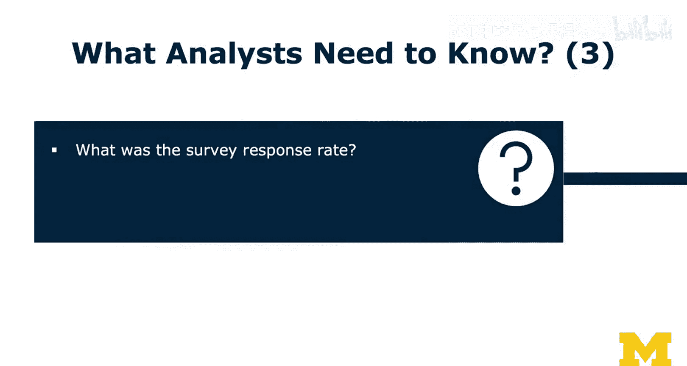
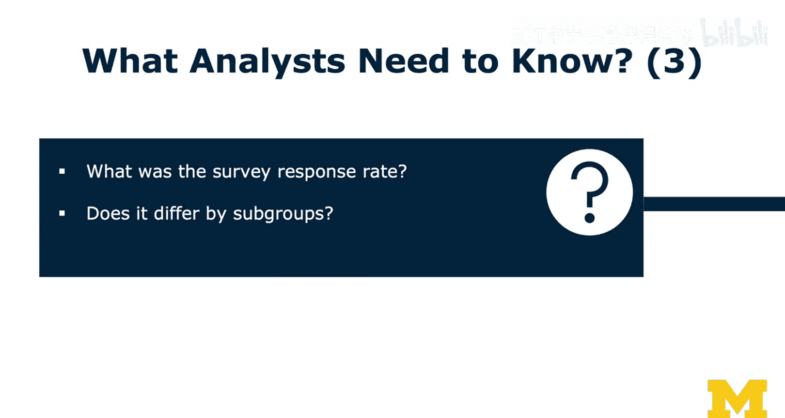
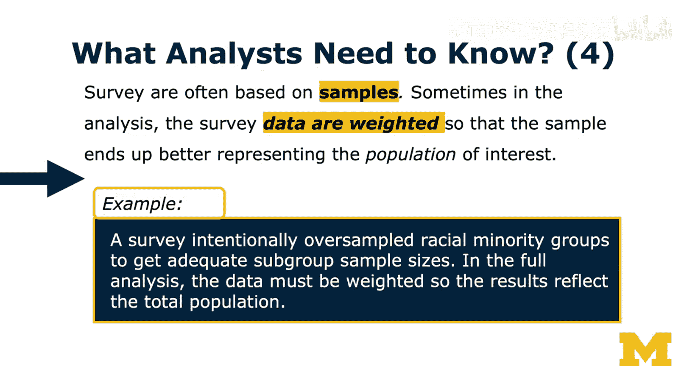

# 密歇根大学《公共部门的R数据分析（基础、数据探索、决策支持、）｜Data Analytics in the Public Sector with R》中英字幕 p21 20_分析师必备：调查实施要点.zh_en -BV1YZ421J7Fx_p21-

Now， and we're going to get even more technical in this next part of our discussion。

 survey analysts need to know what was the response rate for the survey。

Of all the people， or it could be other units that are being surveyed， besides individual people。

 it could be schools， businesses， churches， other religious organizations， etc ce。

Of all the units that were invited to participate in the survey。

How many actually completed the survey or the interview？The response rate is。

Simply the percent of the survey interviews started。Not necessarily completed， but started。

 divided by the total number who were reached and eligible and invited to participate in the survey。

 response rates are percent。Now calculating a response rate is actually a bit more technical than I've just implied and that most surveys have multiple response rates。

 but for our purposes， you as the data analyst really should know the general overall response rate。

 and also does the response rate differ by various subgroups， by say gender， by age。

 by geographic region， by educational status？

Response rates help us understand if the data really are representative of the larger population or if there might be some biases in the results。

And also。Take a deep breath with me right now for something even a bit more technical。

An analyst needs to know if there is the need for using survey weights。

In the data now the survey weights are something that the survey methodologists will have created and as the analyst。

 you need to know if the data set you're using has survey weights， the different kinds of weights。

 and whether or not you should be using those when analyzing the data。

 let's dig into this a little bit more。So surveys are almost always based on samples。

Or a selection of a number of cases from a larger population。

And oftentimes in the analysis of the data。The survey data need to be weighted This is a mathematical process done by the statistical software package you're using。

And the waiting puts different。Basically counts or weights is the word on sample respondents in ways so that the results of your analysis end up better representing the full population of interest。

 let me give you an example。A survey may have intentionally oversampled racial minority or cultural groups to get an adequate sample size for statistical analysis of different subgroups。

In the full analysis， the data must be weighted， so this subgroup that was oversled。

Is not overre in the full results。Again， this needs to be done so that the full sample results are not biased by this overrepresentation of the group。

 and thus they reflect the total population。

I know I'm throwing a lot of terms and technical details at you。

 but it's really important for analysts to understand the basic survey design。

 the approach that was used to collect the data they are analyzing。

What the response rate was and whether or not survey weights need to be applied in analyses。

The numbers and the data that come from surveys， they do come from someplace。

 they didn't magically fall into the data that's sitting in front of you。

 and so you do really need to know why and how the data were gathered and these other basic details in order to put your analytical work in the right context。

