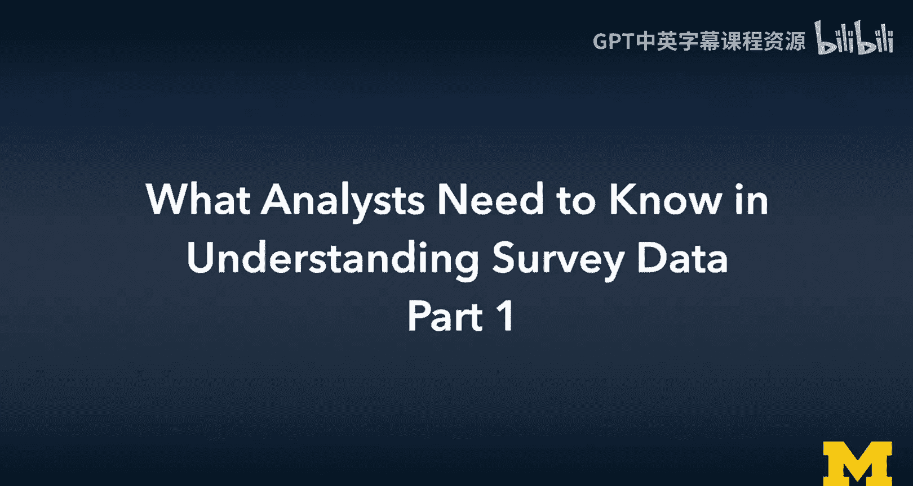
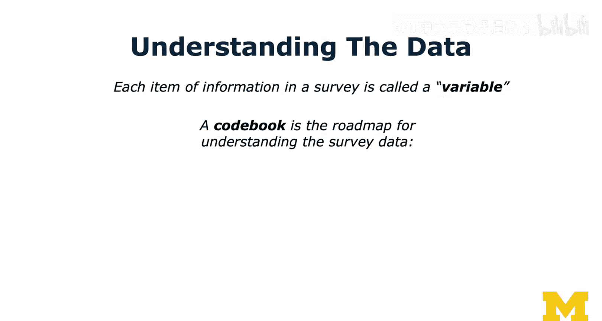
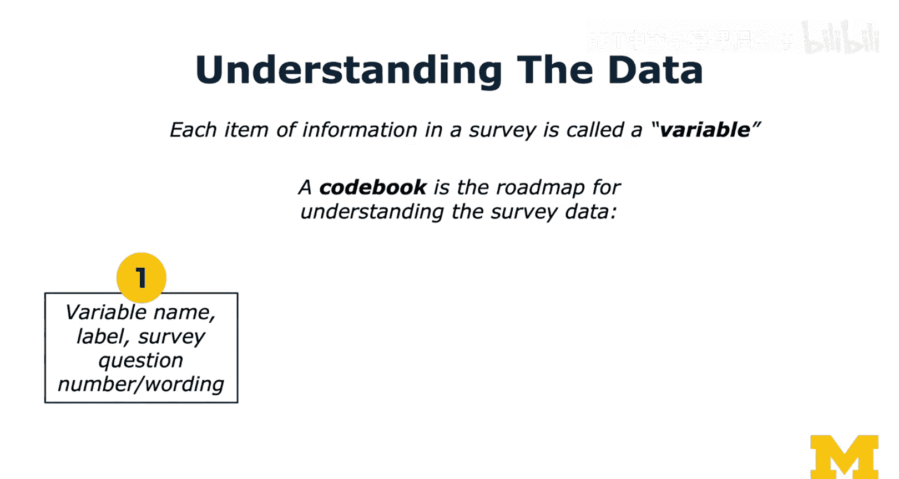
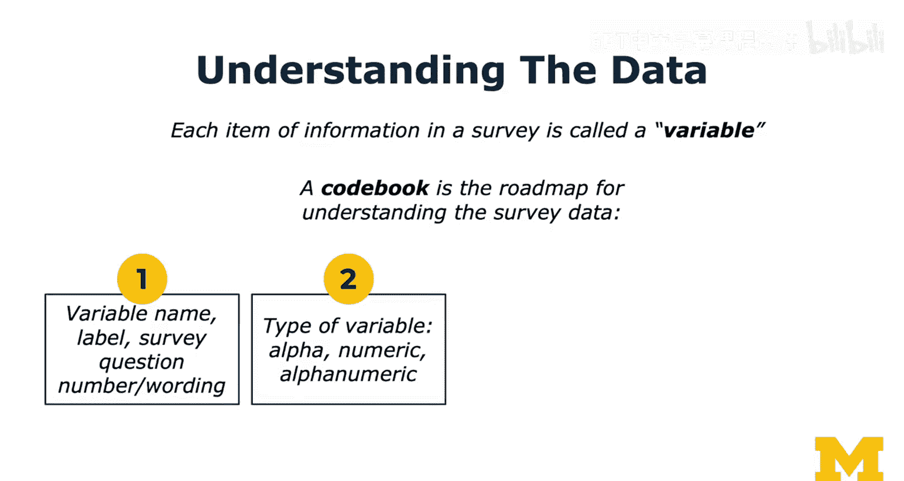
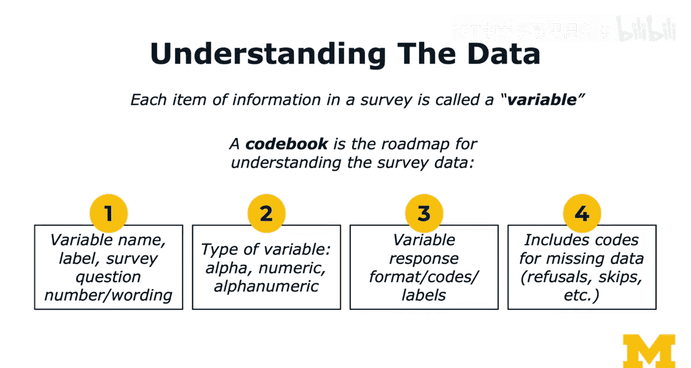
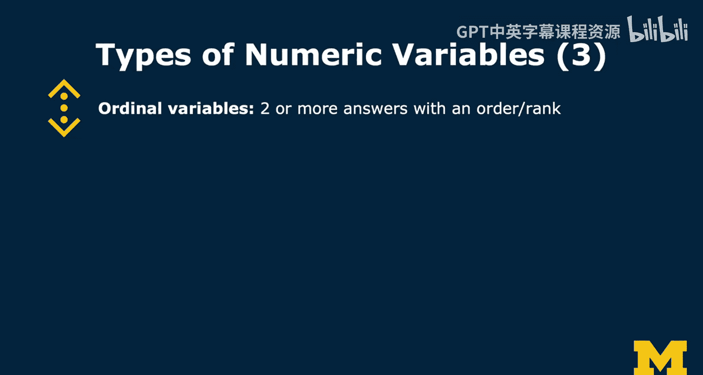
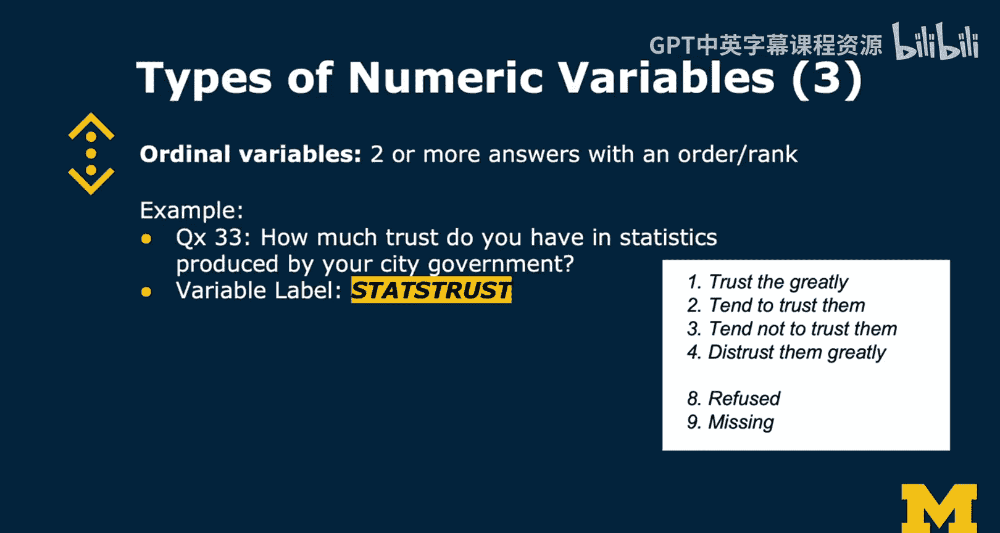

# 密歇根大学《公共部门的R数据分析（基础、数据探索、决策支持、）｜Data Analytics in the Public Sector with R》中英字幕 p22 21_调查数据理解方法论（第一部分）.zh_en -BV1YZ421J7Fx_p22-

Now that we've taken the time to understand the purpose， design， type of survey。

 and sampling approach， we are ready to get into the fun of the analysis of the survey data sitting in front of us。

And now in turn。We need to take a little bit of time to understand what's in the data set。

 what data were actually collected and what formats。

Now each item of information in a survey data set is called a variable。

And every data set comes with a codebook that is essential for understanding all the variables within the survey data。

 you can think about a codebook as a roadmap for understanding and analyzing the survey data that always includes the following things。

Every variable name in the data and there's usually a shorthand name that you're going to use when you do analyses along with this is what's called a variable label。

 which is a longer description of what the variable is actually about The codebook also includes the question number from the survey so you can make sure you are able to connect the variable in the codebook and the data with what was asked in the survey。

And again， the actual wording of that question in the survey。

A codebook also includes for each variable。The type of variable it is and here we're going to think about three main types of variables and of course they all have subsets underneath them。

 but to start three main types of variables。First。When you're looking at a variable。

 is it an alpha variable？Shorthand for alphabetic variable。

 and that means the responses to that variable contain only letters。This could be someone's name。

 this could be some short text in an open ended sort of question。

So the first are their alpha variables second。Is it a numeric variable。

 and that means it contains only numbers？And third， of course， we have alphanumeric variables。

 and that means that the data in front of you for that variable contain both numbers and letters。

Statistical analysis can only be done on numeric variables。

 so oftentimes when survey data are collected and it might include alpha or alpha numeric responses。

 those need to be recoded into numbers before you can do analysis。

For example， a survey might ask people to list things that they like the most about their neighborhood。

This would generate lots of text or alpha responses。

 people could say things likeI like the park in my neighborhood， I like that it's quiet。

 I like the stores in my neighborhood， they could say a lot of different things。

These responses in turn would be qualitatively analyzed and then clustered into groups。

 and each of those groups would receive a corresponding number for the statistical data analysis。

Finally， the codebook contains information on the formats and potential response codes for each variables。

 along with clear labels for each of those numbers。

 I' going to give you examples in a minute so you can see what this looks like。

But one thing to point out is that codebooks also clearly indicate what codes are given for each variable when the data are missing。

Meaning a respondent didn't answer the question because it was skipped。

 they might have quit the survey early or they just missed the question or an actual refusal。

 a respondent indicated that they did not want to answer the question。

 that's very common for certain kinds of questions and surveys， one that comes to mind is income。

 a lot of people don't want to share what their income is。

All right， so let's get back to numeric variables the most common type of variable in a survey。

 as I mentioned， is a numeric variable and the only one you can use for statistical analysis。

Now there are several different kinds， of course， of numeric variables。

 First we have nominal variables a nominal variable is when there are two or more possible answers to a survey question。

 but these answers have no intrinsic order or ranking。

Could be if you're asking someone a question on the survey and the answer is yes or no or true or false。

Two different answers， but there's really no ranking。Another one。

 and here's an example is asking someone their marital status。

Here we can see that this is question number 12 in our survey。

 and the question wording on the survey is what is your current marital status？

This variable in the codebook is called Mar underscore status。

And this is what the analyst would type into any commands or codes for actually doing any analysis using this variable。

Now there are nine possible values， all numbers for this variable。One equals never married。

 two equals cohabitating， three equals married， etc。

You can also see here that code 8 means the respondent refused to answer the question。

Which appeared on the survey form as I prefer not to answer。

And then a code nine in the data means that the data are missing。

 the respondent skip the question or again quit the survey early。

 and in your analysis it's going to be always important to separate out missing data from refusals。

All right， moving on， still in regard to numeric variables， we also have continuous variables。

Or variables in which the respondent will be inputting in a number that represents an actual amount。

Your number of children。 The number of times you visited a public park in the past month。

 monthlyly income。 How many animals do you own。 These are examples of continuous variables。

Another example of a continuous variable is age。Here in an example of what a codebook would look like for this variable。

 we see that survey question number 15 asked， what is your age and that the format of this variable was continuous。

 meaning the survey was designed so that a respondent could actually would actually write in their own age。

Now， age could also be formatted in a survey as an ordinal variable。

Or a numeric variable in which there is some implied ordering or ranking to the responses。

In this case， you can also see in this example that an ordinal formatting of the variable age could provide the respondent with five age groups from which to choose when indicating the range in which their age falls。

 one equals less than 18 years， two equals 19 to 39 years of age etc。

 there are many ways in which to offer age ranges to survey respondents。

 survey designers use a small number like the example I'm showing you， they also however。

 if they want to get more exact ages from people might use fivey age ranges。

 or 10 year ranges and so on。

Think for a minute。 What approach do you think would collect the most accurate data from respondents regarding their age。

 a continuous format in which people just write their age or an ordinal format with different age groups。

Think about that for a minute。Well， I'll tell you that survey research has shown that providing age groupings and small ones will give you the most accurate information。

 It turns out that a lot of people do not like to report their their exact age。

 they worry about being identifying information。And they also worry， thus。

 that their results won't be anonymous， which is often promised in survey research。Also。

 some people don't like to report their actual age because they don't really want to be as old as they really are or they don't want people to know how old they are。

 so in this case people tend to round their age down。

And they usually round it down to a number that ends in a5 or a zero。

So if we want really accurate not proximate information on people's age in a survey。

 you're going to want to use small age groupings as the most accurate way to get information on respondent ages。

Okay， moving along。Here's another example of an ordinal variable from a survey。

 which again is defined as a variable with two or more possible responses with some implied order or ranking。

And here we have an example of an attitude variable or an attitudinal variable。

How much trust do you have in statistics produced by your city government？

Our codebook shows that this is question number 33 from the survey， with the possible answers of one。

 trust them greatly， two， tend to trust them， three， tend not to trust them or for to trust them。

 distrust them greatly。Code 8 is used here to denote a respondent who refused to answer the question and9 is for data you see that there's an implied order。

Measuring the concept of trust in the responses。

