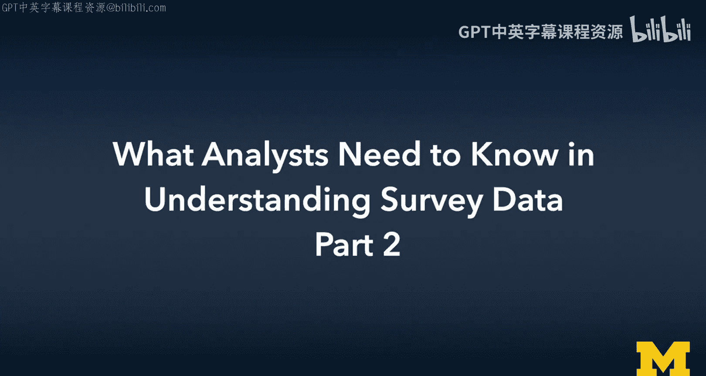
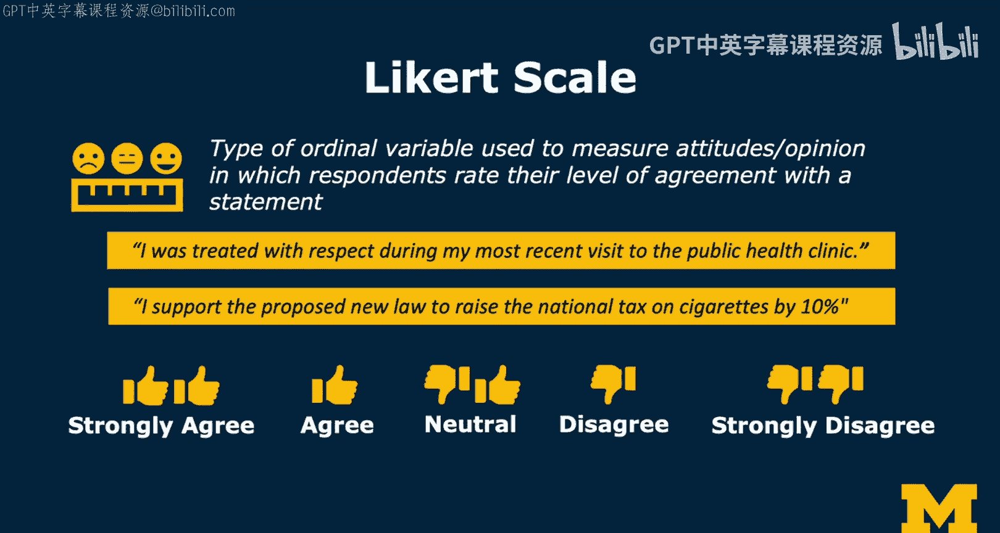

# 密歇根大学《公共部门的R数据分析（基础、数据探索、决策支持、）｜Data Analytics in the Public Sector with R》中英字幕 p23 22_调查数据理解方法论（第二部分）.zh_en -BV1YZ421J7Fx_p23-

A specific type of survey question with an ordinal response scale is that of the liquort scale？

This scale is actually named after a survey research professor at the University of Michigan。

Professor liorard。

A liquor scale is used to measure attitudes and opinions in which respondents are given a statement。

 and then they say how much they agree or disagree with that statement。

 I'm sure you've all filled out surveys with this kind of question in it。

There are usually five response categories。Here's an example。The question is， or the statement is。

 I was treated with respect during my most recent visit to the public health clinic。

And the survey is asking respondents， how much do you agree or disagree with this statement？

Another example of a survey question using a liquor scale would be putting the statement to respondents。

 I support the proposed new law to raise the national tax on cigarettes by 10% cent。

 and then respondents choose between strongly agree， agree， neutral。Or neither agree nor disagree。

Disagree or strongly disagree to answer the question。

There is so much more to understand about different types of variable formats。

And how variables are constructed and used and then how the data are analyzed in surveys。

 and you will see this soon in in more detail as we dive into some codebooks。

