# 密歇根大学《公共部门的R数据分析（基础、数据探索、决策支持、）｜Data Analytics in the Public Sector with R》中英字幕 p24 23_代码本解读实例.zh_en -BV1YZ421J7Fx_p24-

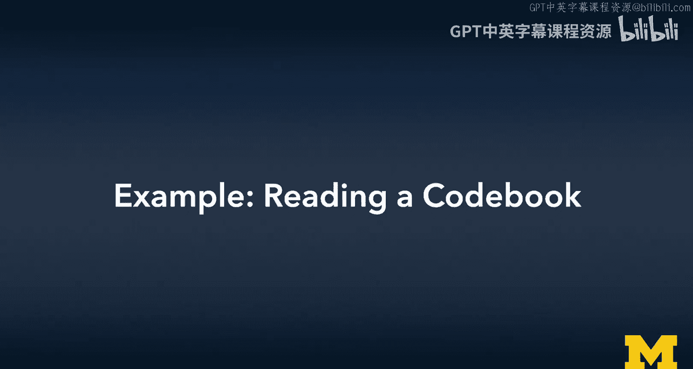

Welcome back。In this session， we're going to continue our discussion of survey data and survey data analytics by talking about codebooks。

As we've discussed before， a survey codebook is really a roadmap for the analyst to understand what the survey questionnaire that was used to collect data looked like and how the data that were collected are stored and will be analyzed all the information needed for the analysts to get in and dig down and come up with survey results。

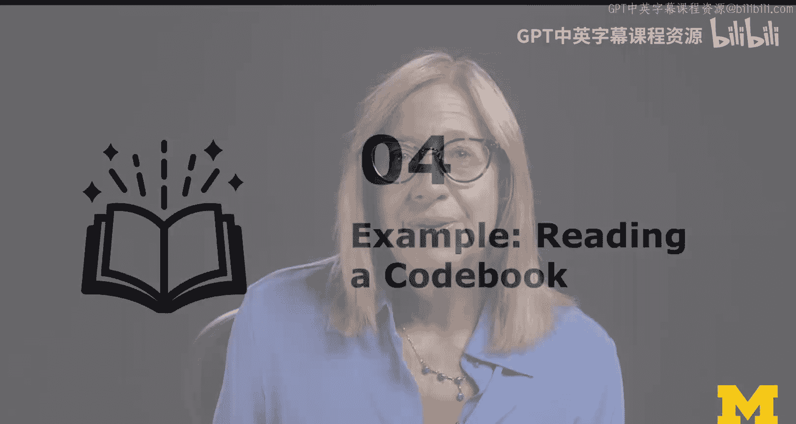

The best way to really understand all this is just to dive right in and go through an example so that's what we're going to do in this session and the example I'm going to use with you is a codebook and this is actually called a codebook report because codebook reports present some of the findings the data from the survey along with the roadmap to understanding the data so in this case we're going to look at the survey codebook report for the national behavioral risk factor Sur system it's a statebased survey in the United States that collects adult data on health related risk behaviors chronic conditions and health use and it's operated by the Centers for Dise control in the United States it started actually way back in 1984 in 15 states and it's now used in all 50 of the United States。

The District of Columbia， three of the US territories。

 but importantly I want to tell you that this survey is also spread to a number of other countries over 20 other countries perhaps including your own are using the behavioral risk factor surveillance system survey approach to collect information on population health and healthcare care so briefly what kind of survey is this we talked about different types of surveys before this is a telephone survey and it's a random digit dial survey it's trying to get a representative random selection of the adult population again in each state。

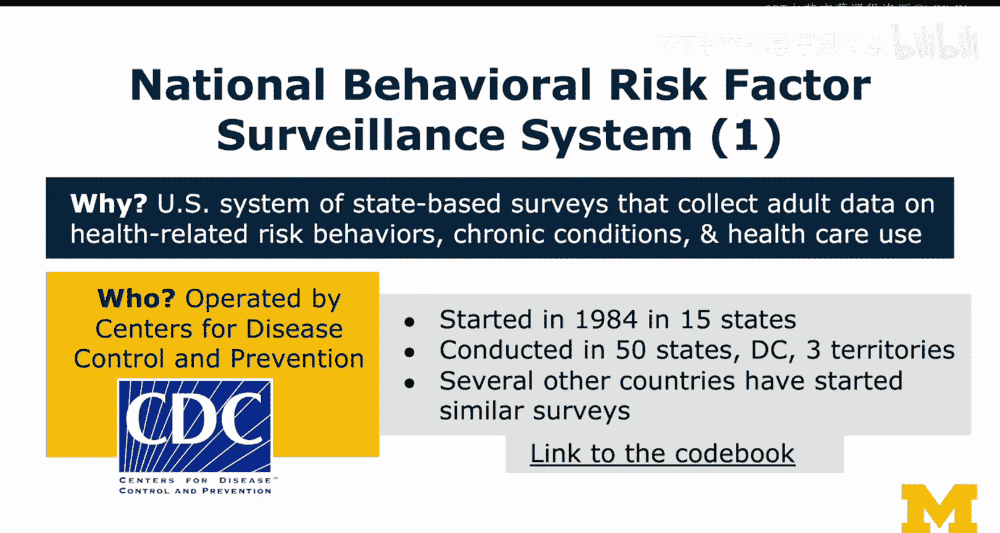

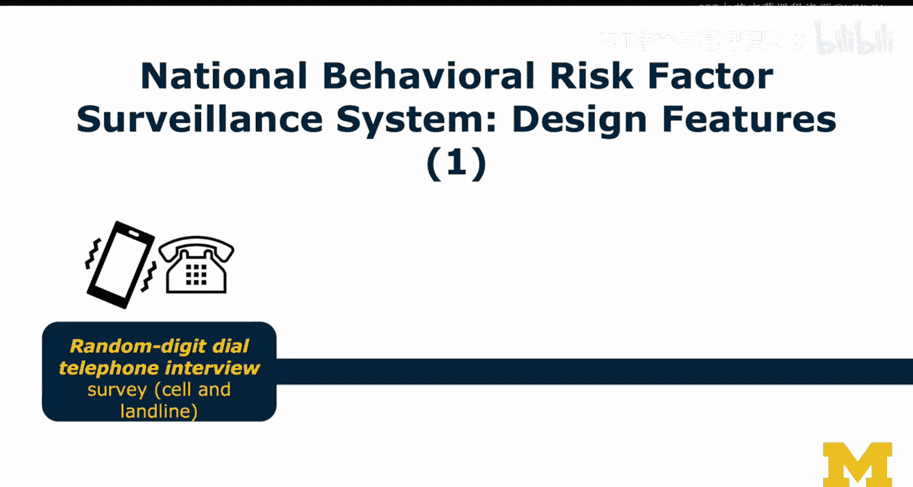

The survey started out as a landline random digit dial telephone survey and now has spread to include cell phones。

 because， of course， that's the only thing many people have。

 It's conducted in the United States in both English and Spanish。

And the data are collected every year and the next year a totally different sample will be used。

 so this is what we call cross sectional data， the same people are not followed over time。

 that would be a longitudinal survey， but this is a cross sectional survey。

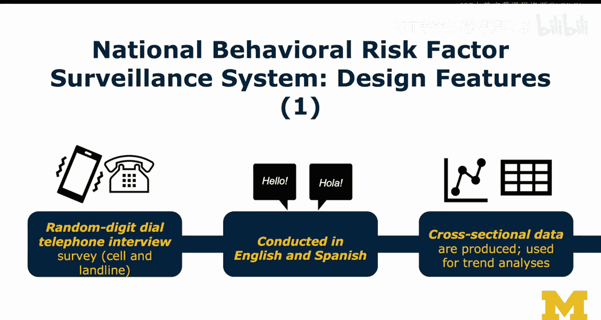

Collecting data at one point in time， those data are produced every year。

 but they are used for trend analysis， so comparing what's going on in cross- sectional populations year to year there's a fixed core set of questions in the behavioral risk factor surveillance survey data that are used year after year after year。

 but every year there's an additional module or two that are added to get information on。

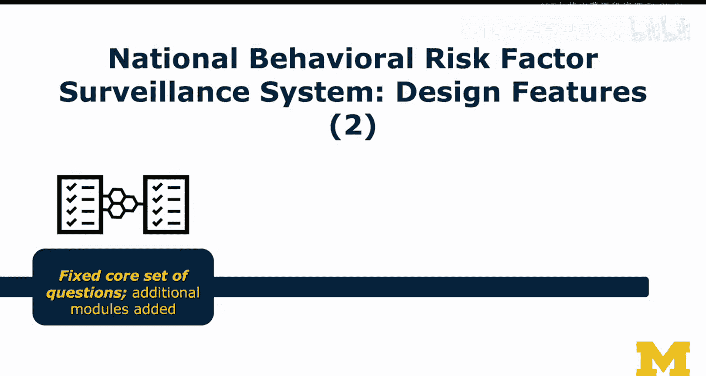

Important emerging dynamic sort of health issues that have come up and of course the last couple years there have been modules on COVID of course and then some other public health issues samples in this survey represent entire states not smaller units some people sometimes you want to pull out the data and look at counties or cities or other small geographic areas you find this problem with a lot of surveys and as a data analyst you have to be aware that you can't take survey data that was collected and the sample was drawn at a higher level of geography and then drill down it wasn't designed to do that the response rate I don't know what you think about this the response rate for this survey is about 50% so half of the people who are asked to participate in the survey and who are eligible to participate in the survey say yes and about you know another half。

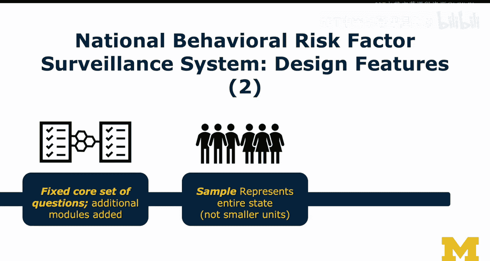

Does no， but that's actually pretty standard for telephone surveys these days Okay， my friends。

 there is a link in the slide deck and also other places where you will find access to the behavioral risk factor survey codebook report for 2020。

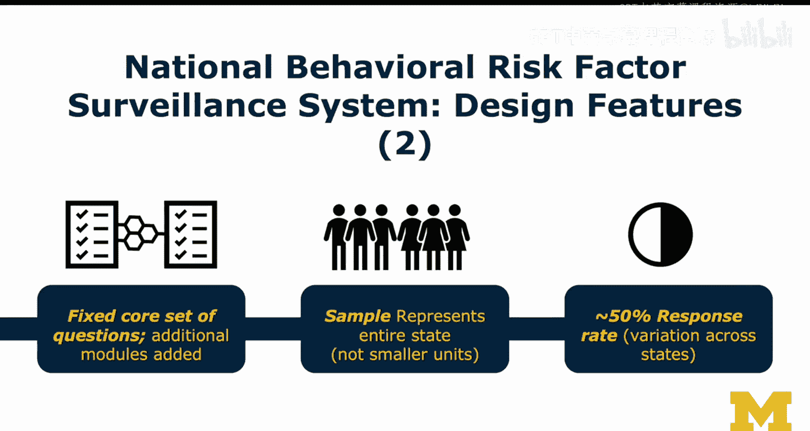

You're going to need to find this because you're actually going to be analyzing some of the data from the survey with Professor Brooks。

Now I don't want to scare you this codebook report is 161 pages long。

 and I'm not going to walk you through all of it today。

 but we're just going to go through a few examples of what you will see when you get into this codebook and the kinds of information that are readily available in survey codebooks so some of the information that's available。

In survey codebooks is information that is not actually in the survey questionnaire。

 but information that's again important to you as an analyst。

 including this variable that I've pulled up called DisP code， DISPCODE。

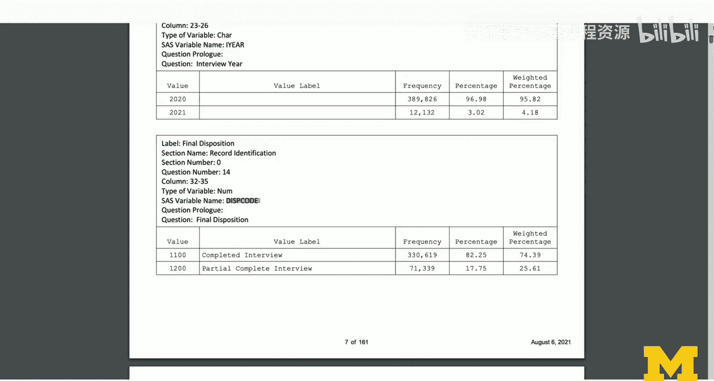

That's the variable name in your data disP code， what is this well our variable label tells us in the codebook that this is representing the final disposition。

 meaning was this interview completed or not completed？So this is in the codebook。

 you'll see what type of variable。Dis code is， we've talked about this before too。

 this is a numeric variable， so the only values you will find in the survey data set for this variable are numeric。

You know， numbers， numeric values， and there are two values we see in our frequency table here in the report from the actual data that people either completed the interview or there was a partial complete to the interview。

 meaning they didn't complete it。And the survey codebook report also shows us that 82。

25% of people completed the interview and 17。75% of the people bailed out of the interview before they got to the end。

 so there's partial complete there。This kind of information is important for the analyst to know what not only the total survey response rate。

 but also how many people actually made it through the entire survey。

All right， let me talk you through another example in the codebook。

 of course in the codebook you'll find all kinds of demographic information on the survey respondents。

 that standard， you'll find information on the gender age。

Income， educational background， etc ceter。I have pulled up the variable called Marital。

 and that reflects survey responds marital status， and in the codebook here's all the information that you will find out about this one particular variable in this large data set。

So it's representing marital status， it's part of the demographics section and the codebook tells you that that's actually core section number eight in the survey data it's question number five。

 it's in column 167 again there's lots and all the necessary information that the analyst needs to know to find the data。

For this variable in the data set， this is also a numeric variable， the only values。

Available in the data for this are numbers there's no alphabetic characters or other kinds of characters and then also in the codebook you see what the actual question that the respondents received was now remember that this is an interview survey so we have an interviewer who's asking respondents the questions and so in this case we learned that this is presented to respondents by the interviewer saying are you。

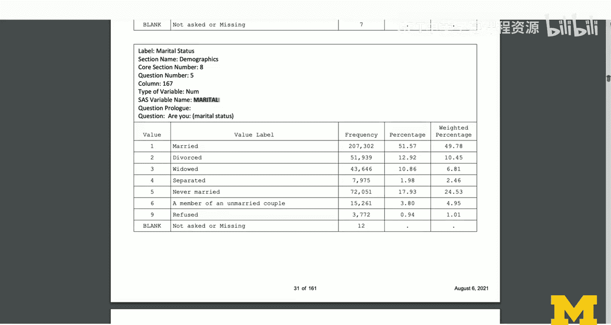

Married， divorced， widowed， separated or never never married or a member of an unmarried couple and those。

Potential responses get a value of one， two， three， four， five or six。

 so if someone says they're divorced， they get a two， if they're separated， it's a four。

 a member of an unmarried couple a six。You will also then see in the codebook report what the distribution of responses was。

 so you'll see that 51。57% of respondents。In the year 2020 to the survey were married， 12。

92% were divorced， et cea。 Now another thing you will see in the code book is that there is the value of9 and that。

Is。For people who refuse to answer the question。It's human nature。

 you shouldn't get surprised about it every survey question in a survey there are some people who just don't want to answer it for whatever reason and。

Survey interviewers just move on。About 3，800 people in who got this survey。

Did not want to answer the question that was a little less than1% and so they refused and those people get a nine Now there are also some people who didn't get asked the question and that's there was only 12 people but they somehow miss that question and those people are not asked or missing we have talked about this before it's really important to be able to separate out refusals they get a special code and then missing data is something different refusals are not the same as missing data。

Let's walk through one more example in the codebook。There's a variable that is。

Pretty much used in every single government survey regarding health。

 and that's a question that's called general health。The variable name here is G EN H LTH。

 This survey data set was originally in Sa， SaS statistical software and so the。

Variable name was Gen Health。It refers to again， this question on general health。

 it's in the section health status。 It's the first question It's question 1 and in column 101 and its numeric variable。

 So all these little tidbits of information are presented to us。In the codebook。

We also again see the wording of the question。The interviewers interviewer says to the respondent。

 would you say that in general， your health is？Excellent， very good， good， fair。Poor。And those。

Answers correspond to one，2，3，4， or5 and those numbers are what ends up in the data set。

Now there's also when you look at the frequency distribution for the answers to this question。

 you see that a number of people said， I don't know。

 I'm not sure they weren't presented that as an option。

 but when they were asked the question they said I don't know。

 not sure 650 people answered in that way， that was。You know， less than half of percent。

 but those are recorded and another 303 people refused to answer the question again， as I said。

 you always have people refusing to answer。Questions for various reasons and so that's reflected as well。

 and then just a small number of people were not asked the question for whatever reason。

 and then that's reflected in the frequency distribution as well。

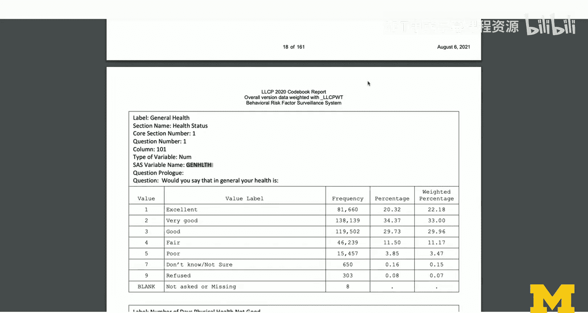

I know that this is not all that exciting， and we're just really digging down in the weeds in a codebook。

 but because you're going to be using this data set。

 we do urge you to spend some time just meandering through the codebook。

 looking at all the different variables， looking at the way different kinds of questions were asked。

 what the responses are looking at skip patterns in the survey。

 you can see that in the codebook as well and just starting to get yourself familiar with the codebook before you。

 yourself jump into analyzing some of the data。

