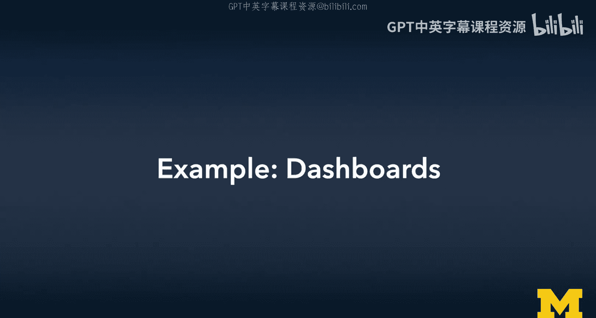
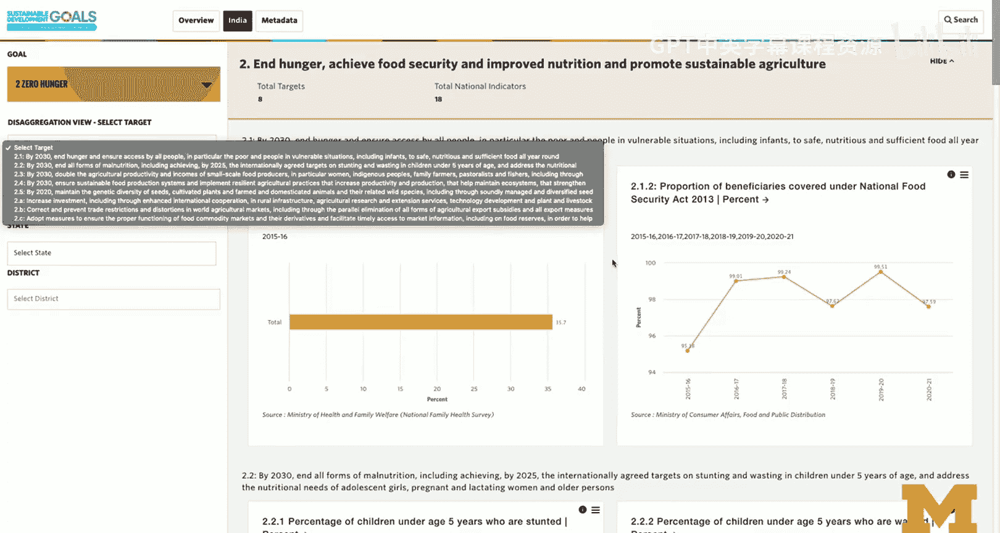
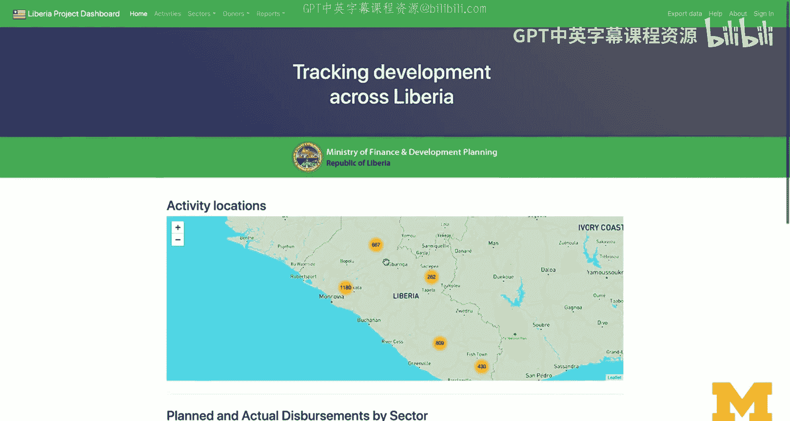
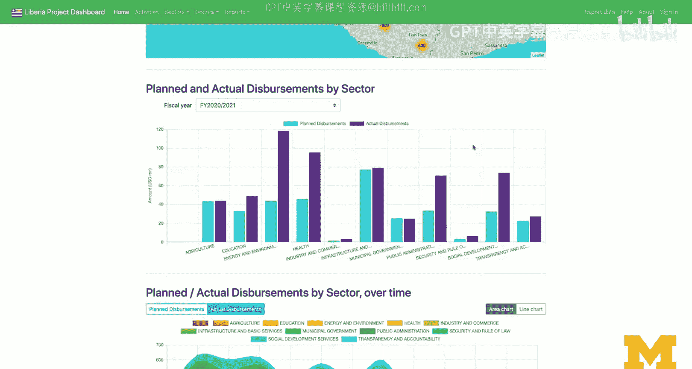
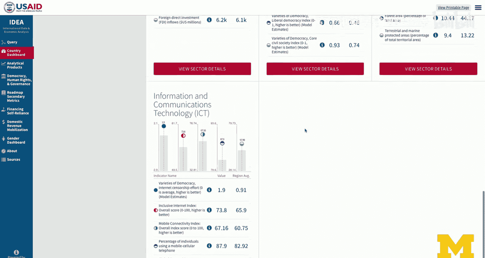
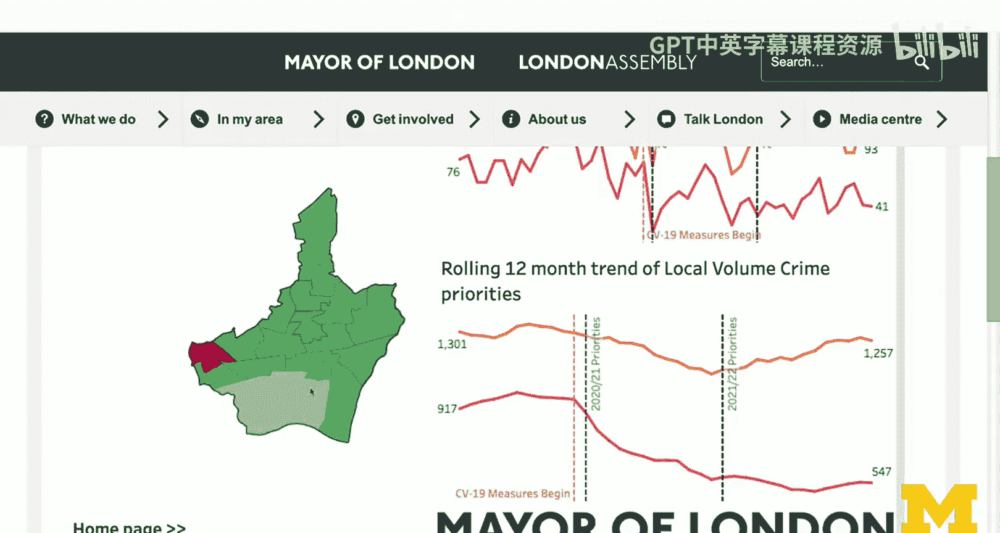
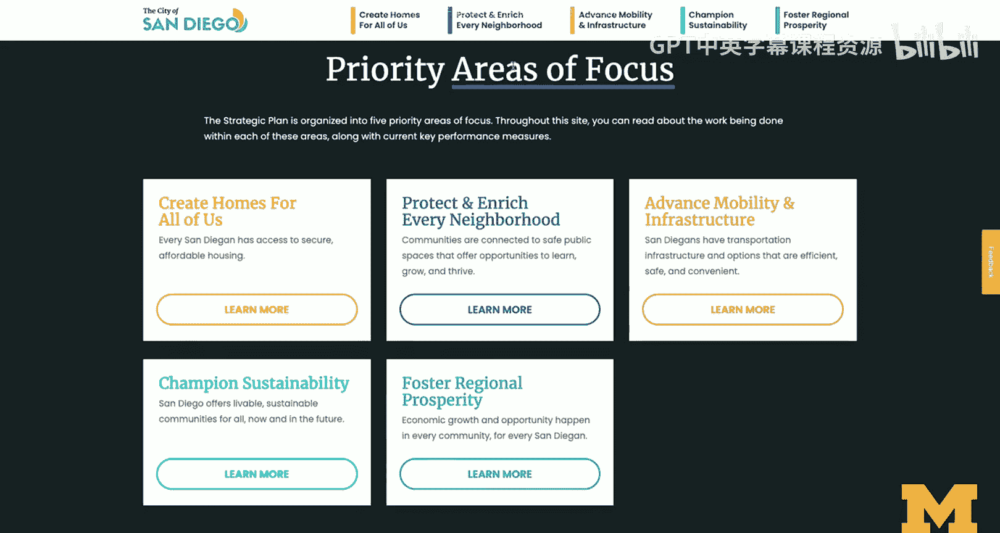

# 密歇根大学《公共部门的R数据分析（基础、数据探索、决策支持、）｜Data Analytics in the Public Sector with R》中英字幕 p25 24_数据看板典型案例.zh_en -BV1YZ421J7Fx_p25-

Hello， in today's session， we're going to be talking about dashboards。

Dashboards have emerged as a really important way in which governments。

Communicate and report data to the members of the public dashboards are being used by local governments。

 regional， provincial， state governments and certainly by national governments again to make sure that they are sharing data and information with the public。

Dashboards are used a lot to also convey and report remember the reporting function to report progress towards stated goals that governments have made I'm going to quickly today walk and talk you through a number of examples of dashboards and I urge you to just scour the Internet and find some really good examples of your own let us start out with an example from India the National India government has many。

 many examples of dashboards here's just one and this is an example of a dashboard where the Ministry of statistics and program implementation has a dashboard where they're showing progress towards the many。

 many goals that are part of India's sustainable development goals。

Again， there's a lot going on in this dashboard， you can click on any of these one through 17 goals。

 sustainable development goals， and when you click on them。Once。

They come up and here's one on ensuresure healthy lives and promote well-being for all ages。

 and then you can go further and you can see that for this particular goal。

 there are 13 total targets and then for these targets you can see graphs and data visualization for progress。

Towards these goals， the targets underneath each of these goals。

So sustainable Development goal number two is zero hunger if on the dashboard you clicked on that。

You'd see that that goal is end hunger， achieve food security and improve nutrition and promote sustainable agriculture let's go further down into the depths of the dashboard and we'll see that for this dashboard there are eight total targets。

They're listed and include things like target number one by 2030 and hunger and ensure access by all people。

 and in particular the poor and people in vulnerable situations to save nutritious and sufficient food all year round so that's just one of eight target goals and then on the dashboard you can see progress in data visualizations towards each of those eight target goals。

So it's a very interactive dashboard， you can spend time working your way around it and provides a lot of information in a very efficient manner。

Another example of a dashboard is one that has been recently released by the government of Liberia。

 the Ministry of Finance and Development planning in this particular dashboard。

What they are really just showing is how much money have they spent in different sectors。

 planned and actual disbursements， meaning again， how much government revenue has been spent by sector and on this dashboard you see you would see a chart that showed planned versus actual disbursements across a number of sectors。

 agriculture， education， energy and environment， public administration。

Social development， etc， so here is an example of a government trying to show via a dashboard how much they plan to spend。

With tax revenue versus what they actually spent by sector。

Next up。Wanted to mention to you that the USAaiID organization。

Has dashboards actually for almost every country in the world in your linked document。

 we have links for both Indonesia and Argentina。But again， any any country of interest to you。

 you can find a similar dashboard through the USAaiID website。

 let's take a quick tour through Argentina and。

Again if you've seen one dashboard， you've seen one， they all look really， really different。

 some are super busy and complicated and hard to maneuver through。

 others are more streamlined and straightforward， the USAID websites have a lot of information on them。

 but for every country and I'm walking through the one for Argentina right now。

 you will see statistics， related to hunger and food security， and this includes statistics。

 very detailed statistics regarding serial yield。Global Food Security Index gross production index number。

 employment and agriculture。Et cetera， et cea， I don't really know what all these statistics mean。

 you'll become experts in your own domain areas of public administration。

But the point here is that you have a very quick snapshot on these dashboards of some pretty important country level statistics。

You'll also on the USAID website， see statistics related to the economy。Domestic revenue。

 mobilization， education， gender equity issues， health， of course， trade and investment， democracy。

 human rights and government， environment and global climate change。

 as well as information and communications technology many dashboards are interactive。

 meaning that you can。

Let the dashboard know levels of detail of information you want and interact with it to get drilled down data for different geographic units。

 for example， or for different subpopulations。

One example of this is for the city of London， they have a crime dashboard that's very interactive and you can get a lot of information on it。

 borrow and ward level volumes and trends in crime， so there's a link that you can。Go to。

and get some basic stats and some fairly simple but important data visualizations。

 and then there's a map of London and you can go to a specific borough or ward and click on that and then it'll pull up more very detailed statistics for that smaller geographic area of the city of London。

So again， this dashboard is showing crime statistics for the whole city。

 but of course these statistics vary differently in different areas of the city and if you're interested in that you can find out and drill down and actually spend a lot of time。

Finding different levels of information。

And the last example I'm sharing with you today is for the city of San Diego in the United States and this is a dashboard that is explicitly communicating with the constituents of the city。

 fairly large city in the state of California about their strategic plan。

 the city has put out that we have a city strategic plan。

 it includes many areas of focus when you enter the dashboard you can find more information about it says follow our journey and so there you can learn more about what actually the strategic planning process was for the city。

 how the citizens were involved and established priorities and then for the。

actctual strategic plan， the areas of focus， then you can see what those are and learn more about what the goals are and the metrics for measuring progress towards the goal and then also where do things stand right now the priority areas of focus for the city are create homes for all of us so there's housing security goals。

Protect and enrich every neighborhood so there's neighborhood level goals。

 advanced mobility and infrastructure， so many goals related to transportation。

Champion sustainability goals， many goals related to environment。

 environmental protection and climate change。And then finally。

 foster regional prosperity or economic goals。

Then I urge you to just spend some time on these dashboards or find other ones on your own。

 take a look at them and think about first of all the data that is needed to go into creating the dashboards and then think about what you see as really great examples of data visualization and data presentation in the dashboards and also ones that you think don't really meet the mark and are hard to maneuver and really are not doing a good job of communicating。

