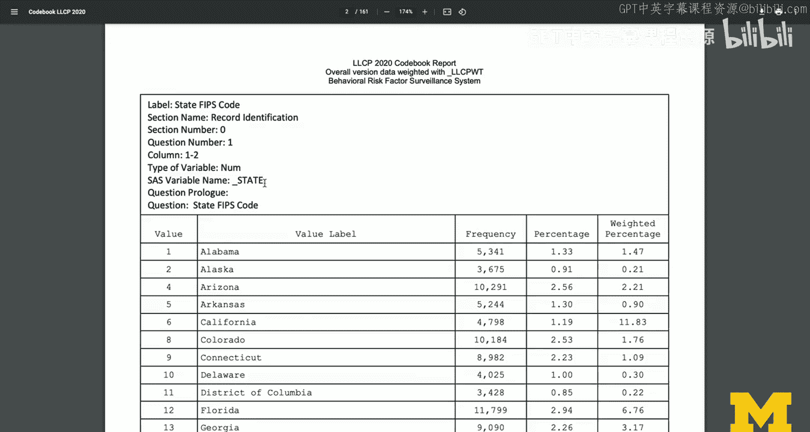
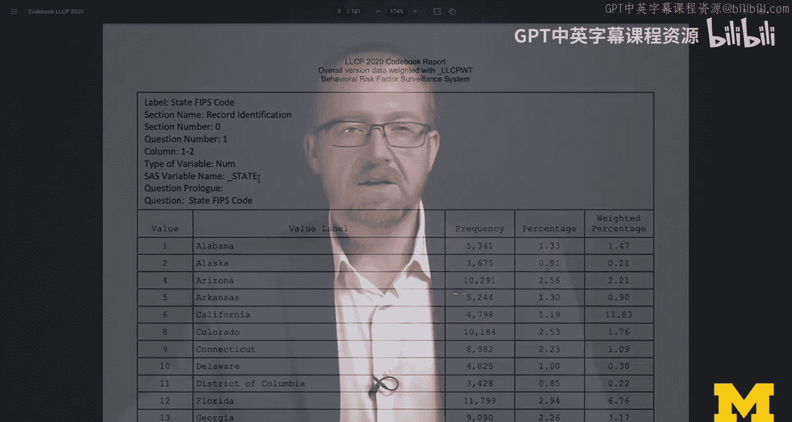
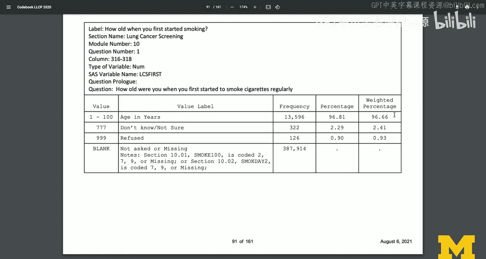

# 密歇根大学《公共部门的R数据分析（基础、数据探索、决策支持、）｜Data Analytics in the Public Sector with R》中英字幕 p26 25_行为风险因素监测系统代码本解析.zh_en -BV1YZ421J7Fx_p26-

Before diving into the codebook for the data， it's worth reading the overview document provided by the CDC and the behavioral risk factor surveillance system。

 It talks about the parameters of the data collection， for instance。

 that in this iteration of the BRFS， they use a mixture of landline and cell phone sampling to contact potential respondents and that different states can add individual questions which they might find interesting or opt in to certain questions posed by the CDC。

An important topic of survey design， which we're not going to spend much time on in this course is how you weight responses。

In this survey， people with more telephones in their household had a larger chance of being contacted just because of how the survey is run。

 You' start to see some of the challenges of representation here。 People without strong phone access。

 say a homeless person or people who are working and thus unable to answer their phone regularly or the like are much less likely to be represented in this data set than a household where every member has a cell phone。

Some of this population bias is intrinsic to the survey design and needs to be acknowledged when building conclusions on the work。

However， other analytic methods can be used to help deal with some of these responses and you can reweight them based on the propensity at which somebody was to be contacted。

 and this is a fascinating and important consideration for public sector work and the overview document touches on how this is handled by the CDC。

For the moment though， let's take a look at what a codebook actually looks like and we'll be using it throughout this week。

 So let's get used to it。 So the codebook is made up of these different variables。

 This is the very first one。 it's called the state Fps code。

 and this is very common in federal data it just identifies the state and maps。

 the name of the state， for instance， Alabama to a value for instance， one。

 There's a lot of different information here that's useful to you。

 So it tells you that this is part of the record identification。

 this is the very first question that's determined。

 It actually tells you it's an offset in its columns1 and2 and it gives you some information about how big that actually is what the type of the variable is So it's numeric and then the Saas variable name and that's going to be important for us because that's how ours going to look at these variables as they're imported in。

 Let's go take a look at one of the variables that we're going to look at a lot this week。

 So the variable we're going to use a lot in this class。

Actually about lung cancer screening and so we're going to take a look at it。

 It's called the LCCS first。 that's the SAS variable name and we can see that it's a numeric value here and that it's actually stored in the data set in columns 316 to 318。

Now the package we use won't use this， but sometimes you need to know the exact position in the data for a given column。

We see at the top that there's actually a label for it。 But then down below， there's a question。

 And this would have been the question that was posed to the phone respondent directly。

 How old were you when you first started to smoke cigarettes regularly。Inside of this codebook。

 they've got four different categories。 If the value is between one and 100。

 that's going to be the age in years， if it's 7，7，7。

 it's going to be don't know or not sure if it's 999。

 it's going to be refused and if it's blank it's either wasn't asked or missing。

 they don't tell us about values in that column that are outside of those ranges。

We also see the frequency here for each one of those。

 so that actually tells us how much of each variable there is in the data set and then what that is is a percentage and then as I talked about。

 there's actually a weighted percentage for each of these two based on the respondents and their demographic and contact features for instance。

 whether they were in a house with many different phones。

So that's the basics of what a codebook looks like Now you've got access to this codebook it's 161 pages。

 you don't have to read it all， but I think that there's a couple of different codes there that you'll want to look at and follow along with the lectures。

 I think it's a really good example of a codebook there's a lot of codebooks that aren't nearly as well done。

 Some of the codebooks I've been given are postit notes from people who've collected the data。

Now that we've seen this code book， I think we should start to explore and play with this data。

 so let's get the data set， get into R and get working。

