# 密歇根大学《公共部门的R数据分析（基础、数据探索、决策支持、）｜Data Analytics in the Public Sector with R》中英字幕 p27 26_dplyr数据操作：数据探索（tidyverse应用）.zh_en -BV1YZ421J7Fx_p27-

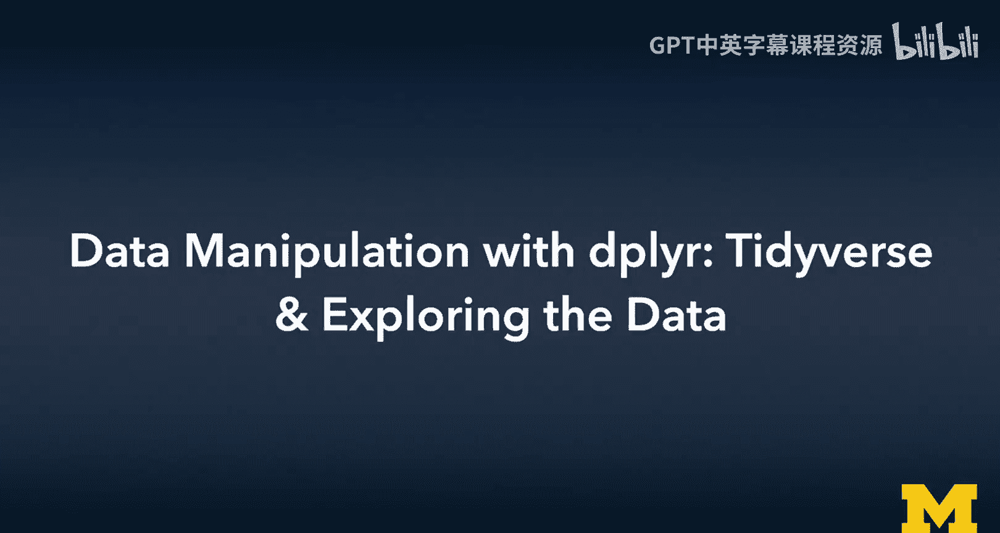

We're going to take this behavioral risk factor surveillance system data from 2020 and do some data manipulation and analysis Now to do this。

 I want to introduce you to the world of the Tidyverse。

 a series of libraries written for R that have become so highly used that many people use nothing but the tidyverse for their analyses。

The tidyverse is a series of eight opinionated R packages。

 which extend the capabilities of basear functionality that you've already seen。

 They're called opinionated because they seek to have you conform your analysis style and data shape to the programming interfaces they provide。

 There's eight packages in the tidyverse。

G plotot2， this is a system for creating graphics within R based on a layered grammar of graphics。

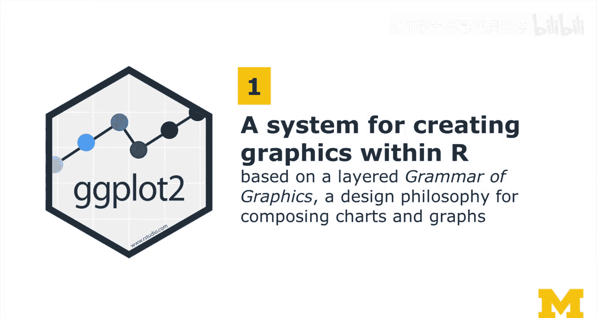

It's a design philosophy for composing charts and graphs。

 And this is one of the most popular libraries for R and the syntax for Gigi plot。

 And usually we drop the two from the name is quite unique。

 We're going to be using Gigi plot significantly throughout this specialization。

 starting in the next course。😊。

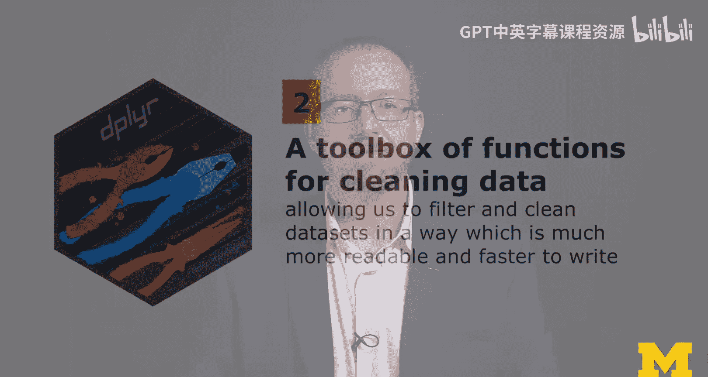

Dlier， a toolbox of functions for cleaning data， allowing us to filter and clean assets in a way that makes it much more readable and faster to write。

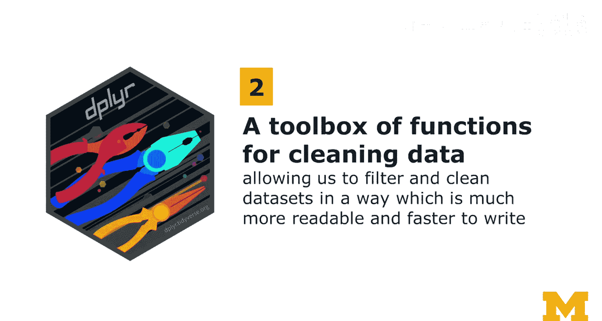

This is the main toolkit we're going to be exploring in the rest of this course today tiDR functions to help you align your data into a consistent form。

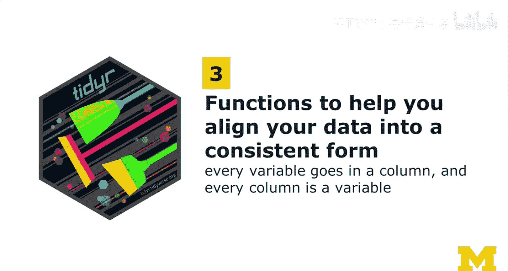

We'll end up using a bunch of these functions throughout the specialization。

 Sometimes I'll call them out as being part of this package， and sometimes I won't。

ReadDar mechanisms to read in tabular data across a variety of different file formats。

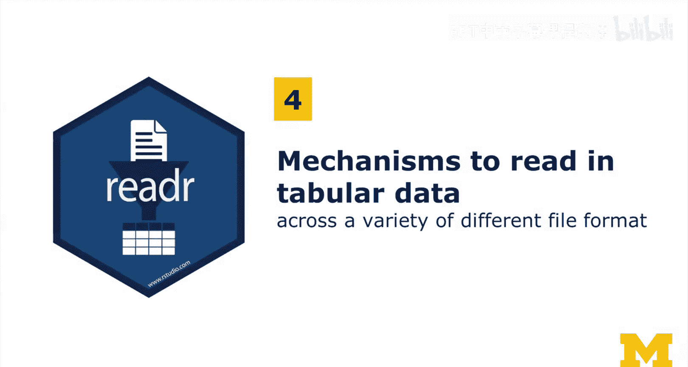

Now， one of the challenges in working with public data is that a lot of the data sets are available only in formats that basear can't handle。

 and readar provides some， though not all functionality for other kinds of data sets。

Por。

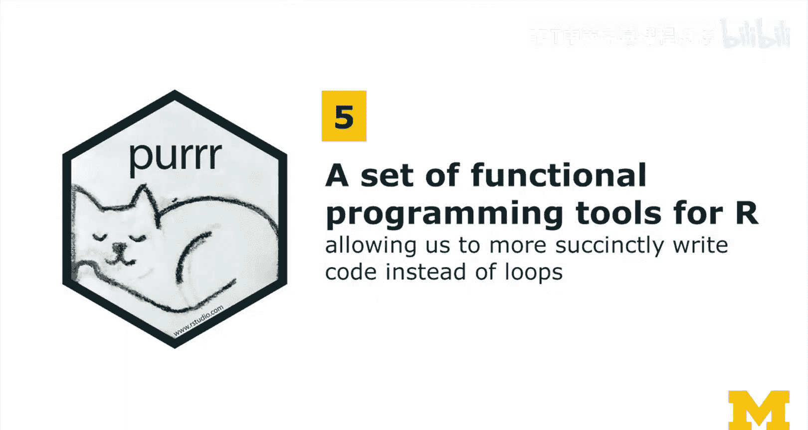

A set of functional programming tools for R。Now， one of the benefits of being a vectorized language is that R can be quite fast and easy to read。

 And PRr helps us improve this by allowing us to write code that's much more succinct and doesn't have as many loops。

 While PRr is very interesting。 We're not actually going to use it much in this specialization。😊。

Tibbble， a replacement for the R data frame structure。

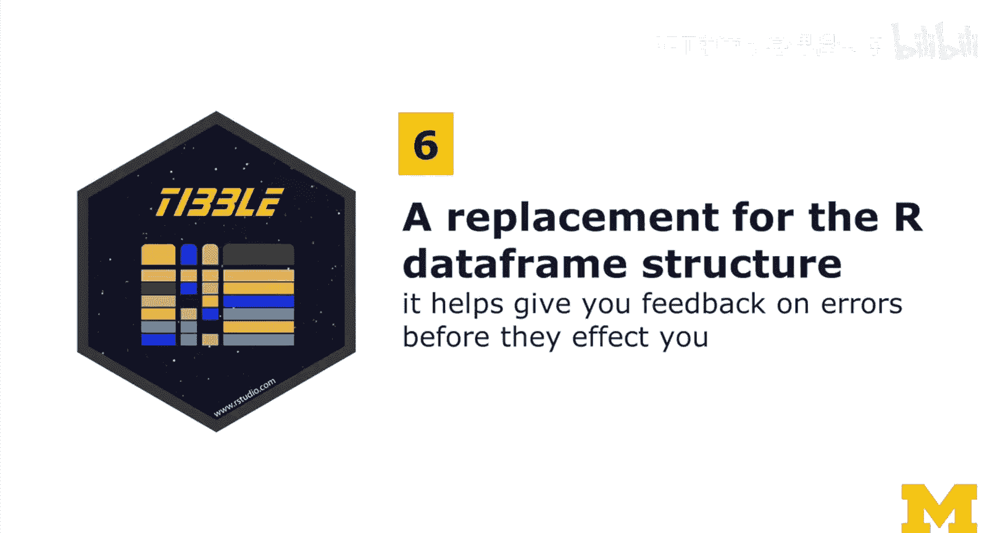

Now， fear not。 Tple builds on top of the data frame。

 so you don't lose the knowledge you've already gained here。 Instead。

 it helps give you feedback on errors before they actually affect you。

 We're going to use Tiple throughout this course and future courses。

 but I'll generally just refer to them as data frames as they're conceptually close enough for our work。

String R functions to manipulate strings。

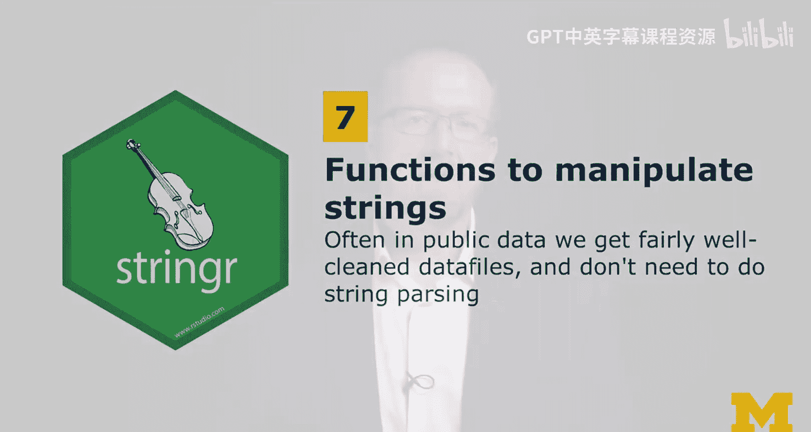

Often in public data we get fairly well cleaned data files and we don't need to do string parsing。

 however， when we deal with data coming from the web or data produced through optical character recognition。

 OCR sometimes called scanning， this library is invaluable。

For cats， a suite of tools for dealing with categorical variables in R。

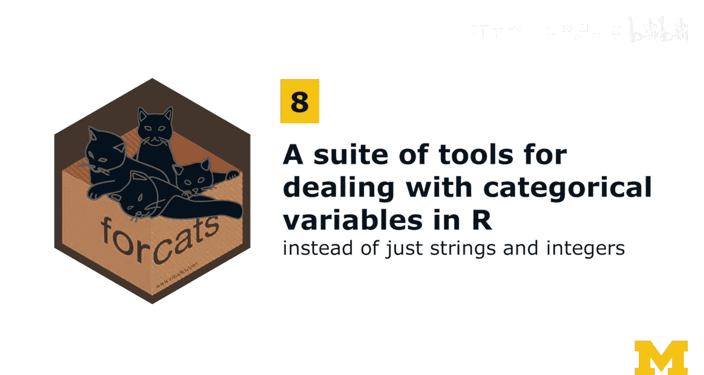

Instead of just strings and integers like we've done so far。

 now we're going to use this a little bit throughout the specialization as we work to better categorize and visualize our data。

For each of these libraries， the authors have provided cheat sheets。

 as well as online documentation to support your use of them。

 And I've linked some of this in the course shell for you。

 Let's load the tidyverse package in our first code chunk。

 You'll notice I've provided a label or name for this code chunk。

 It's customary to label some code chunks for set up and plotting。

 This allows our studio to be smart about not reloading libraries and naming the file outputs。

 You can label a code chunk by adding a comma and a single word on the end of the first line。

We can see we get some nice output here from the package loading and telling a little bit of an error here in red。

 One of the things you'll notice when we import the tidyverse packages is that our reports back the version of each package loaded。

 as well as any conflicts。 Now， conflict exists when two packages are loaded。

 but they have the same functions with the same name。 We could see that on my machine。

 the Dliier package actually conflicts with the stats package。

 and it masks or replaces the functions filter and log with new ones。 This is okay。

 We could still access the functions inside of stats if we want to。

 We just need to tell are that we want to use the one within stats by saying stats putting two colons。

 and then the name of the function filter。 And this is called name spacing。😊。

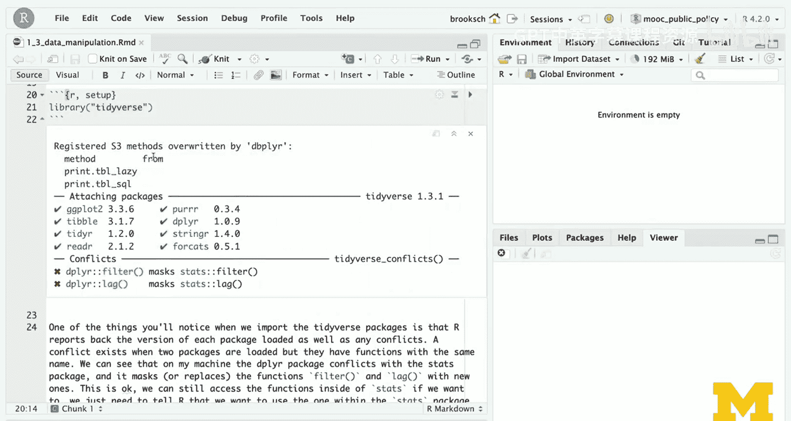

The data for BRFS has been provided in a SAS data file format。 This format is not native to R。

 it's a proprietary binary data format。 SAS data is quite common in public administration and we can use the foreign package to load this into a data frame。

So we'll load the foreign package and this is going to create a new function called read dot export for reading and SAS data。

 and we can just do that with library and then put in quotes foreign and then we're going actually load this into a data frame。

 So all I do is readdot export， I give it the path to my file and I'm going to say fill equals NA and that will say that the data should be read in and any blank items should be listed as NAs。

We can see that this actually takes a while because the data set isn't small and there it goes。

 so we see its appeared up here。I want to demystify how I got to this point， though。

 because honestly， I don't use a lot of Sas data in my own work。 When I was on the website。

 I noticed it was a Saas format， and I had to do a little sleuthing to figure out how to get things going in R。

 But you don't even have to leave our studio for this。

 I just hit the packages tab over here on the files pane。And then when it pulls up。

 it shows me a list of packages and I searched for SAS。

So I saw a few packages and I clicked through to the four and one and I looked around at the functions and I read the docs online and this is all made possible by Crran。

 the central R repository。 Once I decided I wanted to give it a try。

 I just installed the package so you just， let's say I wanted to include this SaS one I could just click here and then I can just click the install button。

And you don't have to do that yourselves。 We've installed the packages here for you。

 but you should be aware of how this works。 If you already work in other data formats。

 take a minute now to explore the R studio package interface and see what's available to you。

 We could see from the environment tab that this data is huge。

 Almost half a million observations over nearly 300 different variables。

 It's always good to look through your code book and get a sense for what the different data means。

 For instance， in this data set， we have a variable called underscore PU。

 And this seems to be a sequence number unique to the data set within our given year。😊。

But if we try to look at， say the first 10 values of that variable， we run into a problem。

 So remember that we can use the dollar sign to pull out a single column and we can use one through 10。

 this slicing notation as I call it to look at the first 10 items and we could see immediately that we're going to have a problem here。

 ours giving us a little bit of an indicator。 So I'm just going to say data dollar sign underscore PSU one through 10 and we'll just run that。

 All right， so it says unexpected input in data dollar sign underscore。

The problem here is that the variables in our codebook and our data file are not all well formatted for R。

 Our variables need to begin with a letter non an underscore。

 And so these values have been automatically renamed for us by the reddot export function to start with the letter capital X。

 All right， So let's look at that data again。 This time we're going to put an x in front of the variable underscore Pu。

 So we'll say data dollar sign x underscore Pu 1 through 10。 and we can execute that。 Okay。

 so we have a bunch of values here。 They're just numbers in scientific format not particularly useful to us。

 the code book tells us that these are sequence numbers。 So let's fine。 We don't really need these。

 In this data set two columns actually represent sequence numbers and we don't need either of them。

 We saw previously that we can get rid of the rows by specifying their numer location in these square brackets and putting a minus sign in front。

 The D per package actually makes this even easier。😊，It provides a function called select。

 which allows you to refer to columns by name， including allowing us to drop columns with a negative sign。

 Let's get rid of these two variables。 So for this。

 we just pass in the data frame we want to work with， followed by the list of column selections。

 So here I'm going to say select。 I'm going to pass in data。

 And then this is one variable that we want to drop。 So I put a negative sign in front of it。

 And then this is another one that we want to drop。 Now let's run that。Now。

 for people with a programming background in pretty much any language。

 this is sort of a weird looking function。 If that's you。

 keep in mind that the object patterns in R often look quite different than other languages。

 and because of that， almost everything is a function which takes a data structure in as its first argument and then returns a modified version of that data structure also common in R is to see an arbitrary list of arguments。

 in this case， are two exclusion criteria， instead of a single argument that has a list of values in it。

In most of our work in this course， we'll be continually calling functions with the first argument being our data。

 and we want to assign this back to some variable。The pattern of data being assigned to a function where the first item is data actually gets really tiring to write。

 so a new operator was added to the R language in 2021 called the pipepe operator and it's actually really。

 really cool。

