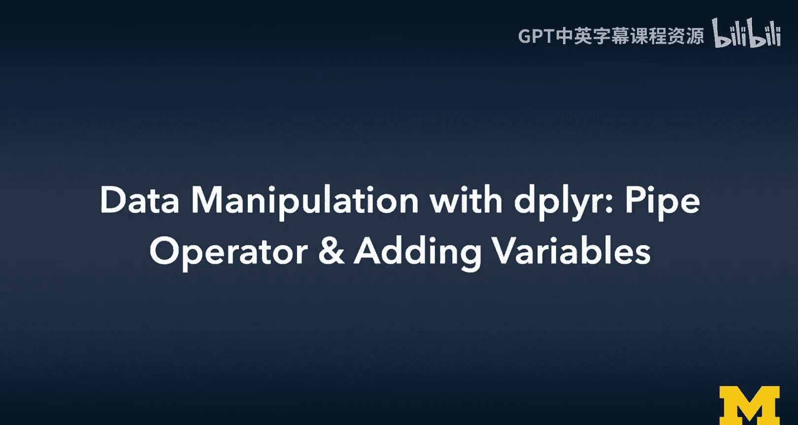

# 密歇根大学《公共部门的R数据分析（基础、数据探索、决策支持、）｜Data Analytics in the Public Sector with R》中英字幕 p28 27_dplyr管道操作：变量添加技术.zh_en -BV1YZ421J7Fx_p28-

The pipe operator was first introduced in the library Madgarter。

 and after many years of use by a huge number of packages it was formally added to the basear language。

 albeit somewhat changed。The operator is denoted by two characters。

 a vertical bar and a greater than sign。 and it takes the variable on the left hand side of the operator and passes it to the function on the right hand side of the operator as the first argument。

 So the code some function， parenthey， data comma X actually becomes data pipe， some function X。 Now。

 this might not seem like a big win until you realize that then you can chain multiple functions together without having to see parentheses within parentheses within parentheses。

😊，To demonstrate the pipe operator， I'm going to introduce you to a new function。

 the filter function from D plier。 The filter function allows us to take a data frame and specify a number of different Boolean masks to apply to it to bring it down to something smaller。

 So the B R F S has a variable， L C S first， which stores the response to the question。

 How old were you when you first started to smoke cigarettes regularly。

 page 91 of the code book indicates that there could be a number between 1 and 100 or a value of 7，7。

7。 if the individual didn't know a value of 9，9，9， if they refused to answer or just blank。

 which we've already converted to N through this re dot export function。 if they were。

 and that happens if they were not asked or if it was missing for another reason。

If we want to quickly calculate the mean age people reported that they started smoking。

 we could apply a few different Boolean masks。So I'm going to take data I'm going to use this new pipe operator。

 What's interesting is that we can actually put a comment right after that and break things up by line。

 So this makes things really easy to read。 I'm going to filter based on our criteria。

 select unlist and then calculate the mean and you can see here I've got the pipe operator at the end of each of these and all r is doing underneath is taking the result of whatever operation is run which is now a data frame and putting it in is the first argument of those functions。

 Let's run this。😊，Okay，43。4。 Now， this has gotten more complex。

 but let's walk through it line by line。 First， we take our data frame called data and we pipe it to filter with filter。

 I've set up three Boolean masks， one of which makes sure the value isn't an NA。

 another which makes sure it isn't a 7，77， and the third that makes sure it isn't a 999。

I pipe the output of filter， which is a data frame to select with select。

 I'm just interested in one column since I'm only going to calculate a mean value。

 So I provide the column name as an unquoted string。 Now。

 selects a bit funny because it actually returns a list instead of a vector。

 Even though everything in that column should be a double value。

 So I need to use a base R function called unlist to convert it back into a vector。

 Then I just pipe this to the mean function。 Despite this all being one expression。

 I can comment individual lines within the pipe。 And that's actually really nice。😊，Now。

 pipes are pretty fundamental to how modern our programming is done and you'll see me use them throughout the series and frankly。

 you're going to see them in nearly every example on the web。

We don't just have to pull variables out of a data frame。

 we can also add some new ones and in the tidy verse the function mutate creates and modifies columns in a data frame。

 for example， in our data dictionary， we have a variable for the number of children in the household called X underscoreed child count。

 It's on page 144。If we want to turn this into a new column。

 we can do so in the data frame using conditionals and the tidyverse has built in functions to help us。

Here's an example of creating a new column， and I'm going to call it child underscore cat。

 which contains values， depending on what is in this child count column。

 So let's start by creating a new column for whether they had children or not。 So I take data。

 I'm going assign it to data。 and then I'm going to pipe it in to mutate。 You'll see here。

 I can actually put these statements on one line。 if I want here it fits。

 So I didn't bother breaking it over multiple lines。

 And then I'm saying child cat is equal to if else， And then I just put in my Boolean masks。

 So I've got a mask for if it's equal to9 or if it's equal to one。 then I want false。

 otherwise I want true。Let's run this。The mutate function takes the name of the column to create and sets it to some value。

 In this case， we're using the if else conditional function from the tidyverse to check whether this child count value is 9。

 which means it was missing or a one， which means no children。 And if so。

 to return false for this new column value。 If that statement does not evaluate to true。

 then they did have children。 So then we want to return true for our new column。Now。

 you've already seen most of this， but you just might not recognize it in this form。

 This is Boolean masking。 that if El's statement's first condition is the mask。

 and the next two items are whether to emit a value of false or true。

 So the result of running the function。 If else， is a new full column of data。

 which mutate and assigns to a name。 In this case， childcat。

We don't have to limit ourselves to just one conditional check or just Boolean values。 For instance。

 what if we wanted to set the value of this new child cat column to a string description for a couple of different thresholds。

 perhaps to match with a different data set。 We can use the case when conditional function to handle this more complicated mutation。

So here we'll just overwrite our previous data value so I'm going to take data and I'm going to assign it to data。

 I'm going to pipe that to mutate and I'm going to take childcat and assign it to case when and so I have three different cases that I want to consider here if the child count is less or equal to two then I want to use the string one child if the child count is less or equal to6 then I want more than one child and if the child count equals9 than I want don't know not sure or missing and these are my strings I got to decide what these are。

After that I'm going to run a second command， which is just the head of data of Chcat to show you that this actually created things Now keep in mind with mutate here。

 it actually checks these case whens in order， so if case if this case of less than or equal to2 succeeds it won't actually go on to the less than or equal to6 so it checks these in order。

All right， so we see top data for head and head prints out just a handful of items when we call it without another argument is just one child。

 one child， one child， and so forth。The beauty of mutate is that we can pass in any name and set it to any vector。

 which is the same length as our data frame。 And now we've got a new column。

 We want to work on a statement outside of mutate， though。

 we need to make sure that we're referencing our variable data since the mutate function is the one that actually makes the variables in the data frame and it actually makes those available to the if else code。

😊，So as a quick example， if we just copy and paste the previous if else statement we tried。

 it's not going to work instead we need to actually reference the data frame so if we're using if else。

 let's say to work on a part of our query outside of mutate。

 we have to pass in the data dollar sign here automatically for us otherwise it's not going to have a reference for that and so this is how all often generate my kinds of different kinds of queries you can also see that here I'm piping it to head and I'm giving head an argument of 10 here and that just says I want to see the1 first 10 rows and so you can play with this a little bit to get some ideas to what your data looks like。

All right， so we have a bunch of falses， then there's a true down here and a false and so forth。

So the mutate function will allow us to change a variable in our data frame。

 and we can do so using an if else function or a case when to match a few different kinds of patterns。

 this all feels pretty natural too， since we just say what column we want changed through an equal sign。

 and then we can use our usual set of Boolean comparisons to make choices。

And while these are two common functions we might use。

 we can actually use any function we want as long as the result is a vector。

 which is the same size as our data frame。But I think we should go back to this case Wen statement and talk about this little till that I snuck in there。

