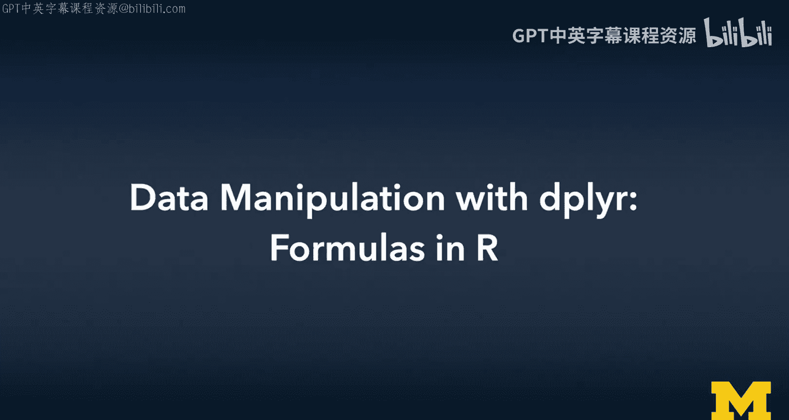
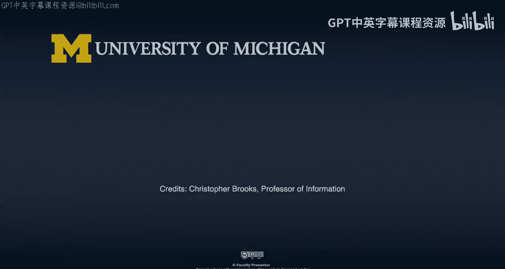
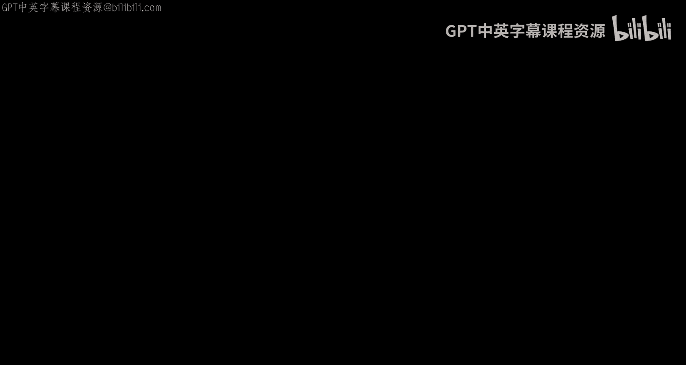

# 密歇根大学《公共部门的R数据分析（基础、数据探索、决策支持、）｜Data Analytics in the Public Sector with R》中英字幕 p29 28_dplyr公式在R中的应用.zh_en -BV1YZ421J7Fx_p29-

You see the Td character is an operator in R， just like plus minus dollar sign and more。 However。

 this operator is expected to denote a formula。 In general。

 the tilde will separate a left hand side from a right hand side， like most other operators。 However。

 the left hand side is optional。 So sometimes you're not going to see it at all。

 The meaning of the operator is completely dependent on the context of its use。

 and this is true of all R operators。 And this can change quite a bit between different functions。

 So in this case， I actually need to look at the documentation for case when。

 to see what it's expecting to do with this formula。

So remember that we can get a little help on almost anything with just a question mark。

 So we put question mark in front of the function or the object that we're interested in。

 And when we execute this in our studio， we see that it's brought up here。

 and I'm just going to bring this up a little bit more。

So we see here that case when we could see which package it's from is from D plier。

 It's a general vectorized if that's how it's being described。

 and we can actually see some information about it。 We could see what arguments it takes。

 So in this case， dynamic dots is the argument that's being called and this is a sequence of two sided formulas。

 and this is the important bit here it says the left hand side determines which values match this case。

 and the right hand side provides the replacement value。

 So if we just scroll back up a little bit to our case when statement。All right， right here。

 We could see that here there's the Tiled operator， right。

 So we've got one child on the right hand side and we've got some masking information on the left hand side。

 And the docs are telling us that the left hand side's got to be something that'll evaluate to a logical vector and the right hand side is this piece that's going to be emitted out。

It's interesting because the documentation will often have lots of examples。

 and so here you can actually just see some of the examples and play with them almost directly。

 so it's very handy to have this built into the environment。

This example is interesting this case very early case when。

 So here the case when has a number of different comparisons。 and then at the end。

 the last formula is just true on the lefthand side。

 And so what this basically means is anything that didn't match these first modulus three modulus things will actually be returned as a character X。

 whatever that is here actually this would not work well because the true and this is what it demonstrating in the docs。

 the true would be true always， And so this as character X will always be returned。

 And so we call that a catch all statement。 and so the catch alls in the case when should come at the end。

It's interesting because here it also tells you that case when， if you don't catch all of the cases。

 for instance， none of these are true， then an AA is going to be used instead， so the documentation。

 the built in documentation is really easy to access just question mark and the name of what you're interested in or have two question marks if you're not quite sure and you want to search through the documentation for it and you can pull it up right within our studio like this As you've seen here。

 operators in are highly context specific and the formula operator is no different。

While much of the work you might do in data analytics will be with more traditional mathematical formulas。

 the formula operator really just allows you to describe a relationship in this case。

 between a boolean mask and an output value。 And then the function that you send that to is going to decide how to handle it。

Okay， we went through a lot in our first look at this BRFSS data。

 We learned that the tidyverse is a big collection of different packages。

 and we spent a fair bit of time learning the fundamentals of one of these D pier。In particular。

 we saw that we can use the filter function to get certain observations rows out of our data frames。

 and that we can use select to get specific variables。

 columns from our data frames and mutate to create new columns in the data frame。

 All of these methods make heavy use of Boolean masking to do this。

We also explored two new language fundamentals。 The first pipes allows us to easily chain multiple operations together。

 Now， in this course， we're using this new pipe symbol。

 which was just added to the base R language and pipes are very common throughout the R ecosystem。

As you browse books and online documentation， you'll see another pipe symbol being used。

 it has a 2% signs and greater than sign in between it， and this is from the MagRtter package。

For most of our discussion in this course， these two are equivalent。

 although underneath they're quite different， and I expect that this new built in pipe operator syntax is going to be prevalent in a few years。

In addition to pipes， we explored the formula operator， this Tt。

 we learn that this operator is highly context specific and that it's made up of three parts。

 a left hand side。 that's optional， the operator and a right hand side。

Our friend here is looking at the doccks in our studio with the question mark。

 which allows us to explore the packages that we're trying to use。

 and then we can actually see how the formula is going to be used by the functions we call。

Now there's a lot more to the tidy verse and we're going to explore it。

 but we've got a little bit more work to do with D per first， so we'll dive into that next。

