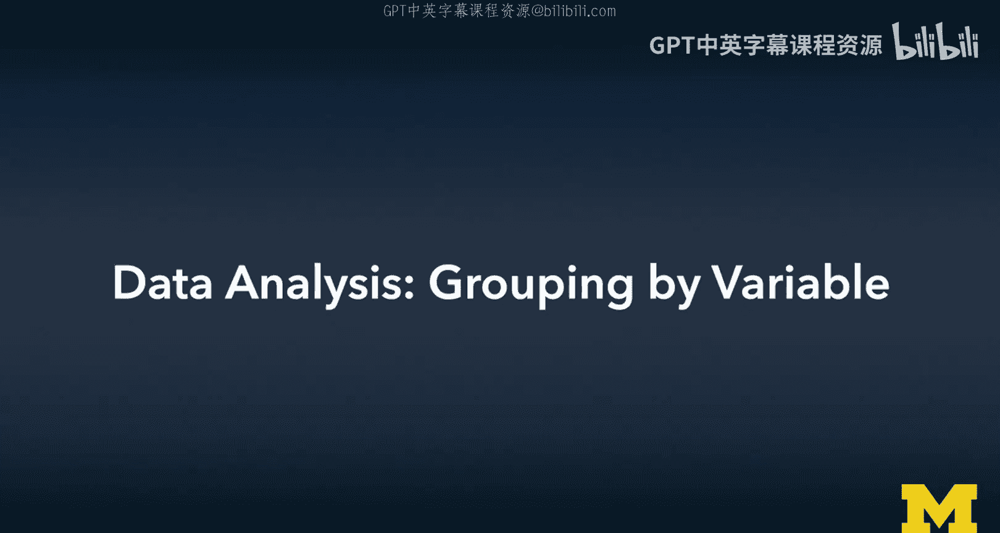
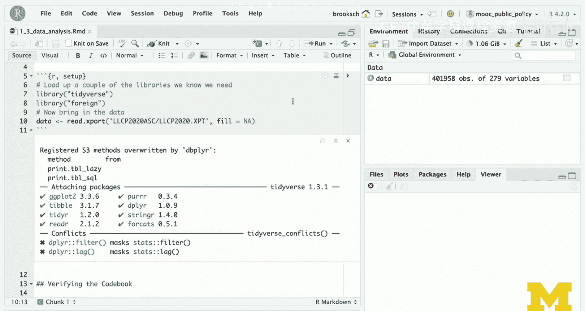
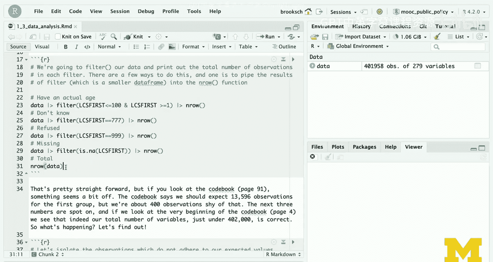
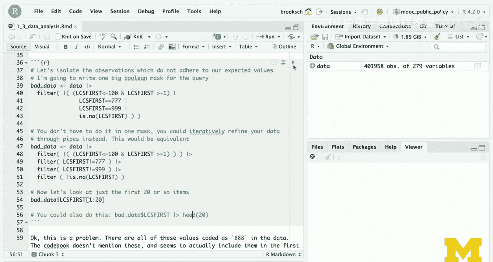
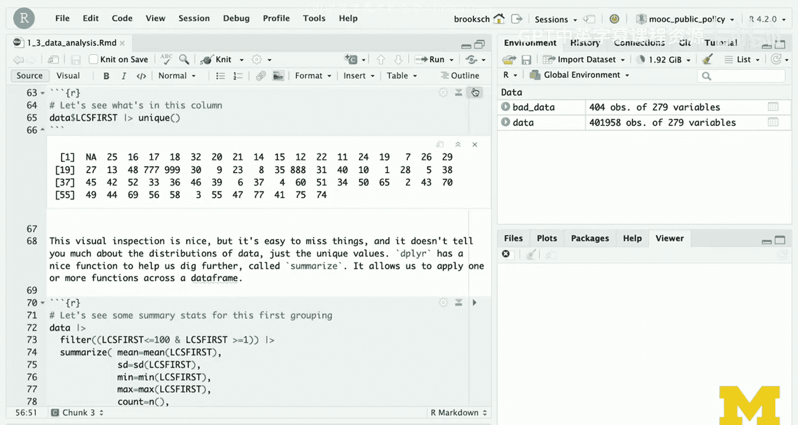
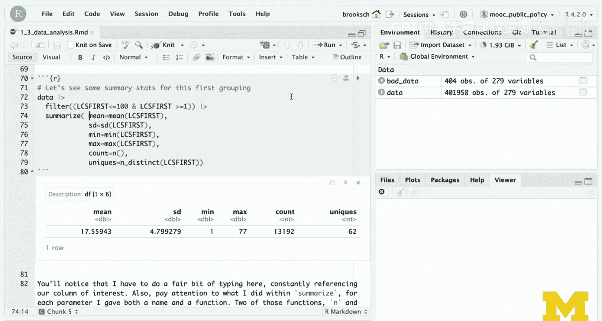
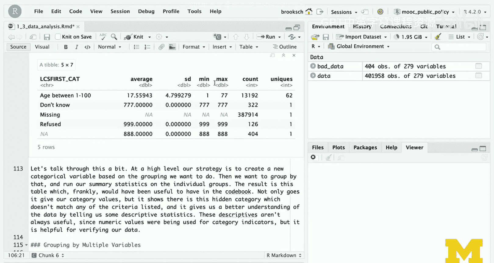

# 密歇根大学《公共部门的R数据分析（基础、数据探索、决策支持、）｜Data Analytics in the Public Sector with R》中英字幕 p30 29_基于变量的分组分析.zh_en -BV1YZ421J7Fx_p30-

We're going to do a bit more work with this behavioral risk factor surveillance system from 2020。

 Now that we have some of these D pier basics。 So let's go ahead and bring in the data that we have to work with。

 reminder that we're using the tidyverse and the foreign packages。

 So we want to load those into the R environment， and then we're going to call this re dot export to bring in our data and it'll take a moment because the data is somewhat large。

For this data set were supported by the published code book。

 We had this variable on lung cancer screening， which asked patients when they first started smoking。

 It was called L C S first。The codebook on page 91 says that there's actually four different kinds of responses we can expect a number between 1 and 100。

 which is the age of the patient， a number of 7，7，7 for don't know or not sure。 a number of 9，9。

9 for refused and a blank if the question wasn't asked or is otherwise missing。

 Let's look at the frequency of these different numbers。

 So we're going to filter our data and print out the total number of observations in each filter。

 And there's a lot of ways to do this。 And one is to pipe the results of filter。

 which is a smaller data frame into the N row function。 that just counts the number of rows。

 So you see I'm going have a filter for the very first criteria which is an age lesson than or equal to 100。

 or it's going to be greater than are equal to one。

 And you see that I said or but I actually end these together。

 That's because I want both of those criteria to fit。 if they have an age of -1。

 I don't want that to appear here。 Or if they have an age of 100 and1 for instance。

I don't want that to appear。We also have don't know that's a 777 or 999 for refused or is NA and remember we use NA to check if something is an NA value and when we read in this data。

 we changed blank values to that NA and then lastly I want to see what the total number of rows are in the data set。

That's pretty straightforward。 But if you look at the code book on page 91。

 something seems a bit off。 The code book says that we should expect 13596 observations for the first group。

 But we're about 400 observations shy of that。 The next three numbers are spot on。

 And if we look at the very beginning of the code book on page 4， we see that indeed。

 our total number of variables just under 402 is correct。 So what's happening。 Well， let's find out。

😊。

So I want to write some code here to isolate the observations which don't adhere to our expected values。

 and I'm going to write this as one big boolean mask for the query。

 So I'm going create a new variable bad data。 I'm going to assign this to data after I pipe it to filter。

 and then I've got our criteria here or 100 to 10 sorry，100 to a1 a 7，7，7 and 9，9。

9 or an NA Now you don't have to do this actually all within one mask。

 So this was how I developed it。 but you can actually do this iteratively as well。

 So this is one of the beauty beauties of pipes。 So this is actually an equivalent statement down here。

 I wanted to show you how they would both look and actually I find this a little bit more readable on each line。

 there's a separate filter and each time it's reducing our data set a little bit based on some criteria and you could of course add comments directly here。

And then after we've done this filtering， I just want to look at the first 20 items or so。

 and so I want to take bad data。 I want to pull out the LCS first and I just look at items1 through 20。

 but actually here's another equivalent statement for that， right。

 we could just take that column that vector and we could pipe it to head and just look at 20 so there's a lot of different ways to do the same thing in R。

Okay， this is a problem。 There's a lot of these values coded as 888 in the data。

 The codebook doesn't mention these， and it seems to actually include these in the first category。

 the age of the patient based on the totals that were provided。 W yet。

 if you look back on the lecture I gave you previously。

 you'll see that I included these values when calculating the main age。

 This is a real problem in data analysis。 you've got to verify that your data is properly cleaned and aligns correctly with your data analysis codebook。

So there's a few techniques I like to employ to data to get a better sense of what it looks like。

 The first is to look at all of the unique values in a data frame。

 This works better for categorical or string values where I'm expecting a set of categories。

 but we can do it with numeric data too。 So let's see what's in this column。

 So I'm just going to take the column LCs first and pipe it to the unique function。

So this gives us a visual inspection， and that's kind of nice， but it's easy to miss things。

 and it doesn't tell you much about the distribution of data， just the unique values。

 DPer has a nice function to help us dig a little further called summarize。

 It allows us to apply one or more functions across a data frame。

So let's see some summary stats for this first grouping。 I'm going to take data。

 I'm going to pipe it to the very first filter command。 So ages between one and 100 inclusive。

 then I'm going to send it to summarize。 and you'll see I've got a lot of different parameters that I'm sending in to summarize。

 of course， because we're piping here， the very first parameter to the summarize function is going to be the data frame。

 The data frame that we've already filtered。You see， I'm going to create a mean。

 a standard deviation， a min， a max， I'm going to create a new one called count and a new one called Uniix。

 Now mean standard deviation min max， these are all base R functions。

 and these other two we'll talk about here。Okay， so we get back this nicely formatted item。

 This is actually a tibble。 It's just like a data frame， but it looks a little nicer actually， too。

 And we can see there's a mean value a standard deviation。

 a miniax account of 13000 values and that there's 62 unique values。

 You'll notice that I had to do a fair bit of typing here。 Con referencing our column of interest。

 Also， pay attention to what I did with summarize for each parameter。

 I give it both a name and a function。 Two of these functions and and distinct are actually Dliier functions to count a total number of and the total number of distinct values in a vector。

 The other four all base are。😊。

The results of summarize itself as a table。 And we can just think of this like a data frame。

 And could see here that the mean age people first started smoking was 17 and/2。

 and the standard deviation is just under 5。 So now we need to just repeat this for each filter clause and will'll have an accurate code book。

 This sounds like a lot of typing。 So as in this case。

 it's common to want to run the same set of analysis code on different groups of data。

 DPer has this function supported by a group by function。 and it takes in a data frame。

 as well as a set of variables or combinations and then returns a new grouped data frame。

 The summarize function is group aware， and it applies to different functions directly to the groups。

 returning a new row for each one。😊，Now the Docs for GroupI suggest that you should first create a categorical variable in your data through mutate before you group。

 otherwise calculations will all be done on the base data， and this becomes a pretty common recipe。

 so I'm just going to introduce you to groupI with this right away。

Alright， let's group our data by our different categories。 So first。

 I'm going create a new variable in the data， and I'm going to call it LCs first underscored cat。

 And then we're actually going to use that for the grouping。

 I just put in here the known categories from the code book and everything else will be a ci in and A value。

 So here I've just taken a case when I've done all of my cases。 I'm going to return a string。

 That's my categorical variable。 And I'm going to have this new LCs first underscore cat column created。

 So that columns going to be made up of these values， these string values。

 instead of these various numbers。 So that's a mutate function。 And so we just pipe data into mutate。

 And there we go。 we've got it。😊，Then I'm going to pipe that and I'm going to pipe it into group by。

 Now group I， we just have to tell it what we want to group by。

 what is the column that we want to group by， and it's going to look for all the unique values in that column and create a group for each one。

And then I want to run our summary statistics on the actual column of interest。 Now。

 pay attention here， I'm grouping by this LCS first cat。 that's our new column。

 but for each of these statistics， I want them actually run on the LCS first column within that group。

Also， reflect summarize just takes any number of different arguments。

 So here I'm giving it one where I said the name is going to be mean。

 and I want it to run the mean function。 You could actually just call this average if you want to。

 That's an arbitrary string that's up to you to decide what you want it to be。Let's execute this。

Okay， so we get a tablebble back and we can see that there's five rows here。

 this is our category LCS first cat so we can see our string values here are nice and that there's this NA and then we can see the averages and the standard deviations within as well as all of our other summary statistics and you can toss whatever statistical function that you want in there。

Now， let's talk through this a bit at a high level。

 our strategy is to create a new categorical variable based on the grouping that we want to do。

 Then we're going to group by that and run our summary statistics on the individual groups。

 The result is this table， which frankly， would actually have been useful to have in the code book。

 Not only does it have our category values， but it shows that there's this hidden category。

 which doesn't match any of the criteria listed， and it gives us a better understanding of the data by telling us some descriptive statistics。

These descriptors aren't always useful， right， so the numeric mean of the value 888 in that one category is not very useful。

 but it can be useful sometimes， and it is for the age。 We see the actual average age of 17。

5 for those where there's an age reported。

