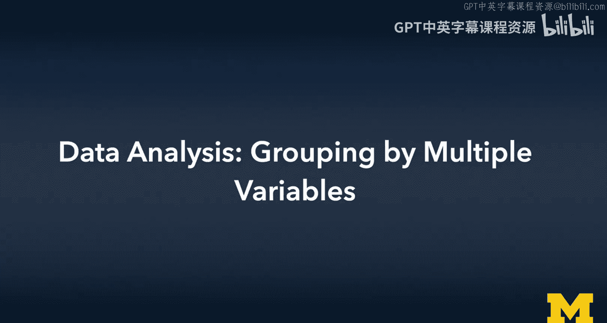
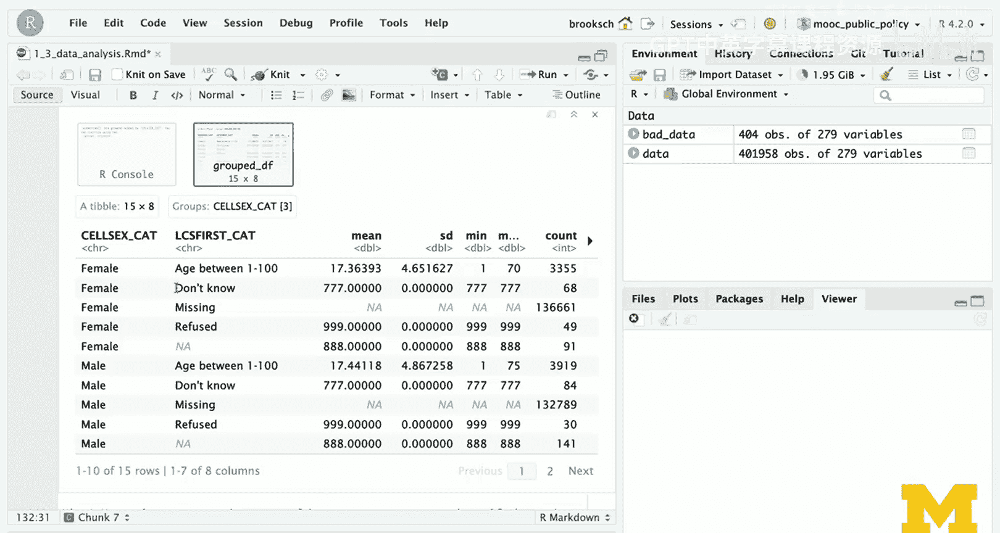
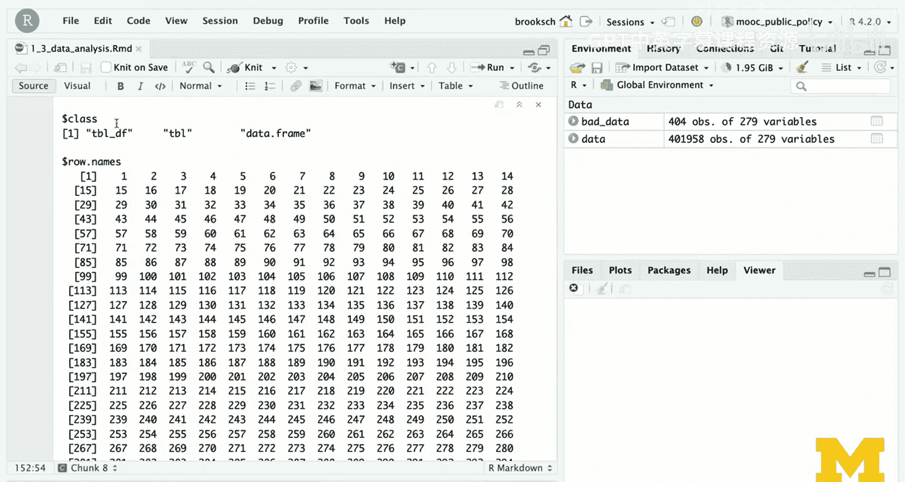

# 密歇根大学《公共部门的R数据分析（基础、数据探索、决策支持、）｜Data Analytics in the Public Sector with R》中英字幕 p31 30_多变量分组分析方法.zh_en -BV1YZ421J7Fx_p31-

We're not limited to grouping by one variable alone。

 And we can tell R to group by combinations of variables。 For instance。

 if we wanted to split out men and women in the previous query。

 we just need to modify the group by to indicate the second categorical column that we're interested in。

 So I'm just going to copy and paste most of this in here。

 And I'll show you kind of the main things that are different。

 So we create our first category just like last time。 But I'm actually going use this other variable。

 It's called cell sex。 it's described on page 15 of the code book。

 And here I'm going to create it right inside of mutate。 So mutate again。

 I can pass it any number of arguments。 So this is the first argument to create our first categorical value。

 and then this line is our second argument to create our second categorical value。

 And here I just want to say if cell sex is one return male， otherwise return female。

 And if it's missing， return missing。 So I actually have an if。😊，Stment that has three options to it。

 if it's a one， it's male， if it's something other than a one， but it's actually there。

 it'll be female， and if it's missing， it'll actually be the missing value。Now。

 when we call group by， I just pass in cellex cat and then LCS first cat。

 and you can flip these two categories， and I'll show you what the results of this look like。

 And then I would encourage you to flip those two parameters and see what that looks like。

 And then we're just going to run our summary statistics just like we did。

 So let's take a look at this。Okay， so we have this table that comes back Now it's important to notice with the table that it'll tell you the total number of rows here at the bottom。

 So it's just showing us 10 rows on a page same with columns actually。

 it shows us that there's one to seven of eight columns so we can move over if we want to to see the other column there or move over back and we can flip pages if we want to so it's nice just be aware that it's happening。

Also with the Tbble， what's kind of interesting is it tells you that data file format or that vector format。

 So these are character vectors， this is a double vector， this is an int vector and so forth。

And then here we can see that it grouped all the females together， all the males together。

 and then inside of that group， it grouped all those who had this age between one to 10。

 all those who didn't know all those who were missing and so forth。

Nice， so now that we've got some data， we could actually use this to answer a question of those who responded。

 either as male or female to the sex prompt and also gave us an age which they started smoking。

 We could see that the mean age and the standard deviations between the sexes look pretty much the same。

 If you flip the page on the Tbble by clicking on that next button。

 You could see that this actually looks pretty similar for those who refuse to answer the male or female sex prompt。

 but have started smoking。This is a great way to get insight into your data and begin your data analysis。

The way GroupI works is that it analyzes your data frame and enriches it with grouping information。

 so functions like summarize which come after the pipe need to be aware of the metadata that group I is going to add to the data frame so that they can function appropriately。

This means a group by isn't as likely to work with functions from packages outside of the tidyverse。

 So you should be aware of this limitation。 This method of putting grouping information in the metadata for a data frame also has some implications for analyses that you might want to do。

 Let's take a look at an example。

So here I'll just group by this cell sex again， a one for male two for female and NA otherwise。

 and I'm going to assign that group I result to data and then we're going to summarize directly on this so then I can just take data。

 pipe it into filter to get one of my groups and then summarize and take this mean value here。Now。

 in this case， I've actually changed the data frame metadata through grouping。

 and this is useful if I'm going to do many different analyses of the same grouping。

 but in order to get my ungroup data frame back， I need to ungroup。😊。

We can see that the metadata is in there with the attributes function。

 which you should remember from week2， so here I'll just attributes data and we'll just run this function。

So we could see after executing that that we have this class attribute。

 we're not going to talk much about that， but what it really just says is that we have a data frame。

 it's also a Tbble and it's also a Tbble DF。

Interestingly， in Tibbles we can have rows that have names here it's just a number from one to n that gives it a unique name we're not going to use that here。

 but if we go down， we also see dollar sign names。 Now we did talk about this early on。

 these are all of our different columns and when you expand your data over here。

 we can actually see those there as well。 so that's interesting。In this case。

 I've actually changed the data frame metadata through grouping。

 This is useful if you're going to do many different analyses of the same grouping。

 but in order to get my ungroup data frame back， I need to use the ungroup function。

 So we can wipe out that metadata by ungrouping。 And so here I'm just going to take data I'm going to assign it back to data piped into ungroup and it'll just wipe out what the groups were。

You'll want to be careful when grouping data if you aren't just piping your analysis and instead are assigning the results back。

 as we did in our first example In this lecture， we looked at how to group our data for analysis。

 This general template is that we want to decide on our grouping。

 identify one or more variables in the data set for these groups。

 create the variables if we need to and then use a function like summarize to apply statistical functions to generate a report。

 We also have seen some new powerful features of R。

 including the pipe operator and functions from within the tidyverse。

 which are going to work together to make cleaning data fast and readable。

It's useful to reflect on our exploration and our issues with the code book。

 Having a code book is actually kind of a luxury， And you'll find lots of data comes with much less clarity than in this dataset set。

 Indeed， it might be your job to help bring data into a clean form and generate a code book like this for others。

😊。

