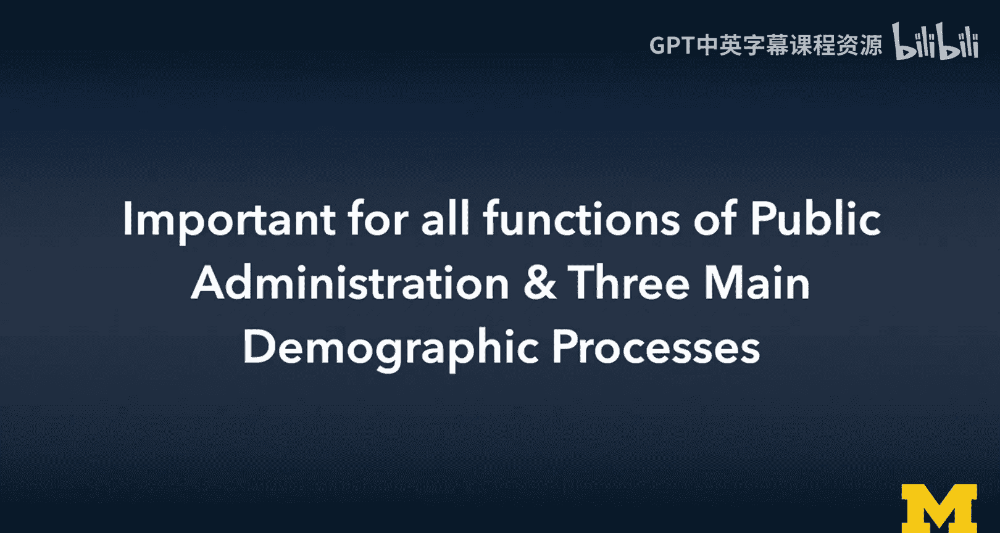
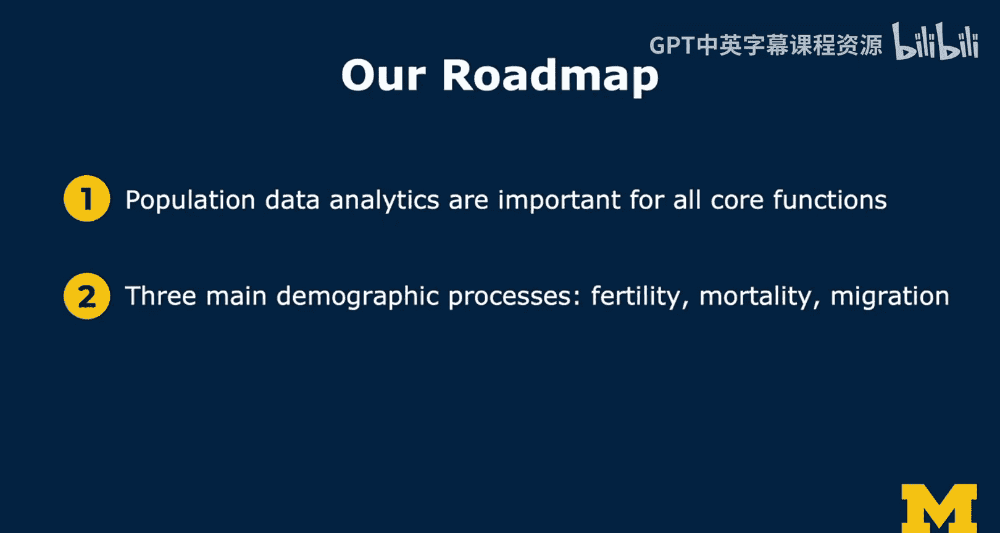
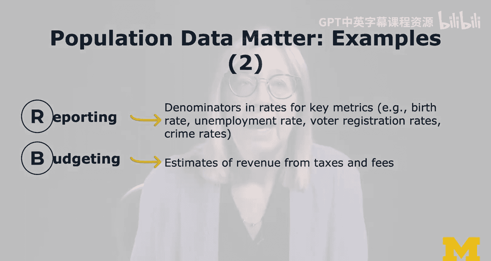
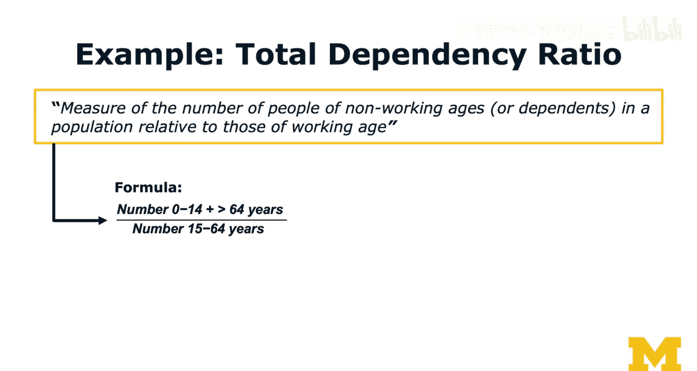
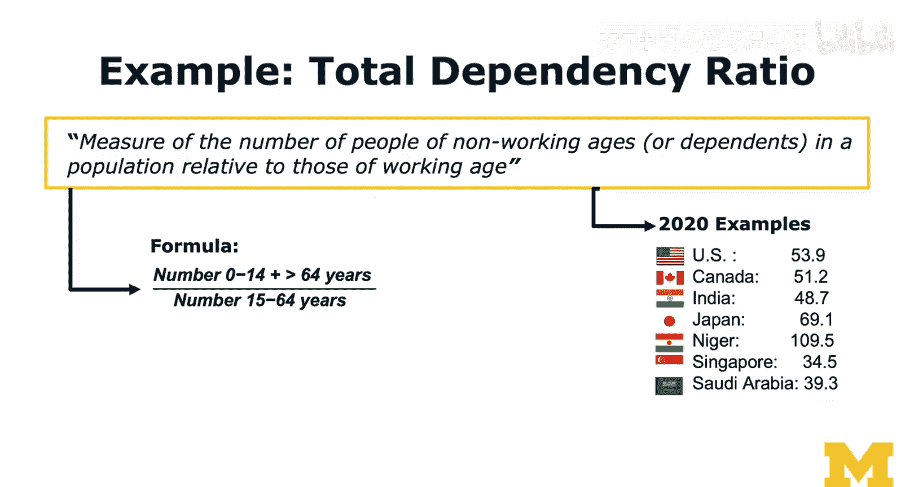
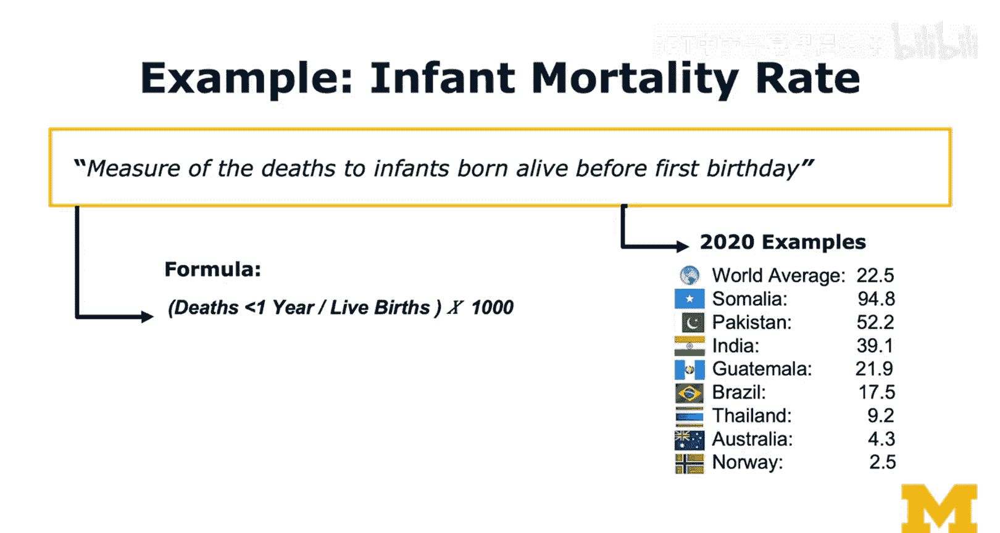
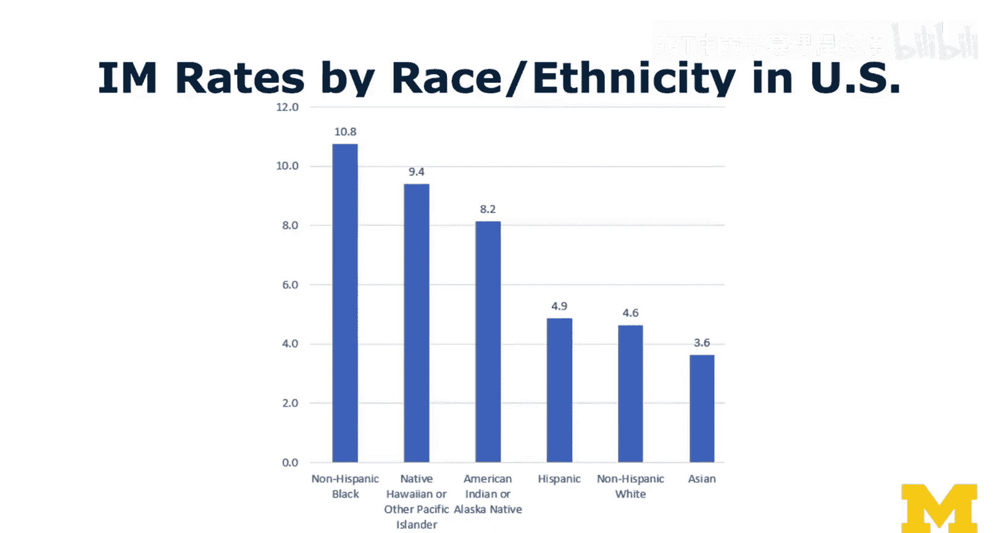
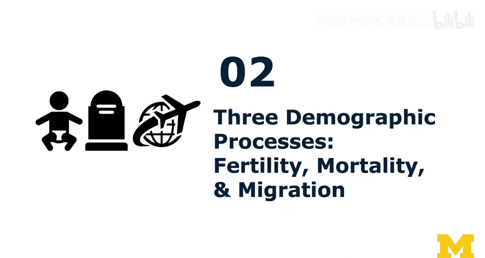
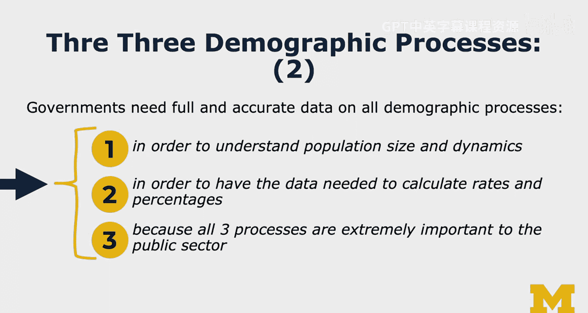

# 密歇根大学《公共部门的R数据分析（基础、数据探索、决策支持、）｜Data Analytics in the Public Sector with R》中英字幕 p33 32_人口数据分析重要性：三大人口过程解析.zh_en -BV1YZ421J7Fx_p33-

Welcome back and welcome to a subject that is very important to me as a social demographer。

Population Data analytics。In this part of the course。

 we will be talking about how population data analytics are important for all the core functions。

The important of data analysis regarding the three main demographic processes in a population。

 which are fertility， mortality and migration。

And also some key sources of population data。First。

 population data are an extremely important type of data for public administration and all of the seven core functions。

Which， as I hope you recall， are clockwise in our model graphic， planning， organizing， staffing。

Direct de， coordinating， reporting and budgeting。Key questions about a population that are important for all these core functions include things like how many people are in the jurisdiction right now？

How many will be in the short term and long term future。

 what does the population look like going forward？What are the demographic characteristics of the population？

What's the age distribution of the population， where exactly do people live？

How many people are eligible for different kinds of public services and programs。

 Let's quickly review some examples。For the planning function。

Education systems plan for future school enrollments based on age distributions and projections。

For the staffing function， population statistics help with understanding workforce dynamics。

 including turnover due to retirements。For the reporting function。

 population data are used in the denominators of many social and economic indicators that are rates or percentages。

 this includes things like birth rates， death rates， unemployment rates， voter registration rates。

 crime rates again any kind of rate that is important。

 it's going to have a numerator but also a denominator。

 and that denominator is typically informed by population data and analytics。

For the government budgeting function， population data are essential in projecting revenue for the government from taxes and fees。

 Now， a great example of a population statistic that is really important for the government across all of its functions is something called the total dependency ratio。

 This is a rough， yet very useful estimate of the ratio of the number of people in a population that are not working and thus dependent upon the work。

 income and tax and pension contributions of the working population。

The formula is pretty simple， it's a number of people of non working ages or dependents。

Defined in this formula as those under age 15 and over age 64。

 that number divided by the number of people of working age defined as 15 to 64 years。

This ratio is interpreted as the number of dependents in a population for every one person who is working。

So here you can see the total dependency ratios for a number of countries。

Higher rates are of concern to a government because it means that more people。

Are dependent on one person working。Again， you would interpret this as meaning that there are a smaller number of people providing the income supports and also the necessary contributions to social insurance。

 social pension systems， etc ce， health insurance systems， and so forth for the population。

So let's look at a couple of countries with high dependency ratios。

 you can see that both Japan and Nigeria have relatively high dependency ratios。

Now while both of those are high， they're high for really different reasons。

 Japan's dependency ratio is high because it has an older population。

It has a low birth rate and a birth rate that's been declining and a long life expectancy。

Nigia's dependency ratio is high because it has a much higher population due to a very high birth rate and then higher mortality rates so people don't live to as long of ages as they do in Japan。

You can't really tell just from looking at a total dependency ratio what's going on in a country and what's causing it。

 but it's a useful metric nonetheless， and used very often to make comparisons across countries。

Now let's consider another population statistic that is used worldwide as a key indicator of population health。

And that is the infant mortality rate。 Infant mortality is a measure of deaths among infants that were born alive before their first birthday。

The formula is the number of deaths before year one。

 divided by the number of live births multiplied by 1000。You can interpret。

An infant mortality rate is being the number of infant deaths per 1，000 live births。

 it's not a percentage。Here's some examples of the infant mortality rate in various countries for you to see。

You can see that the world average for the year 2020 was estimated to be 22。5。

 that means for every 1，000 live births on the planet。Sadly， 22。

Roughly 22 of those infants died before their first birthday。

You can see that some countries have much higher rates。Of infant mortality。

 why other countries have much lower rates， less than five deaths per 1000 life births。

Now， national infant mortality rates mask significant and concerning differences in the rates among subgroups in the population。

 and so governments are generally interested in their overall infant mortality rate。

 but they're really more interested in what are the rates in different groupings and different subpopulations by geography or by soci demographicographic characteristics。

For example， in the United States there is great concern about the infant mortality rate differences and inequities by race and ethnicity this has been a problem in the United States for over 100 years as long as these kinds of statistics have been collected and monitored。

As you can see in this graph， the infant mortality rate among Asian mothers is 3。6。

 but it's almost three times as high， 10。8 among non-hispanic black mothers。

 while it is true that the infant death rate in the US has declined significantly for all races and ethnicities over the past many decades。

 the disparity between these racial and ethnic groups has actually gotten wider。

This type of statistic again， for specific years， for subgroups and for trends over time is extremely important for governments as it is a very strong indicator of the overall health of both women and infants。

Now that we've established that population level data are very important for all the core functions of public administration。

 let's now turn to unpacking the key demographic processes that determine population dynamics。

 or how populations grow， shrink and change over time。

Demographers like me focus on three primary demographic processes。Fertility or birth。

Which is how people enter populations。Mortality or death。

Which is how people can leave populations and migration。

 which is how people both enter and leave populations and then move around within them。So fertility。

 mortality and migration。Governments need full and accurate information on all of these demographic processes in order to understand population size and dynamics。

In order to have the necessary data needed to calculate rates and percentages and other important things。

Like labor participation， unemployment rates， birth and death rates， life expectancy， and on and on。

 and also because all of these processes are important to the public sector in and of themselves。

