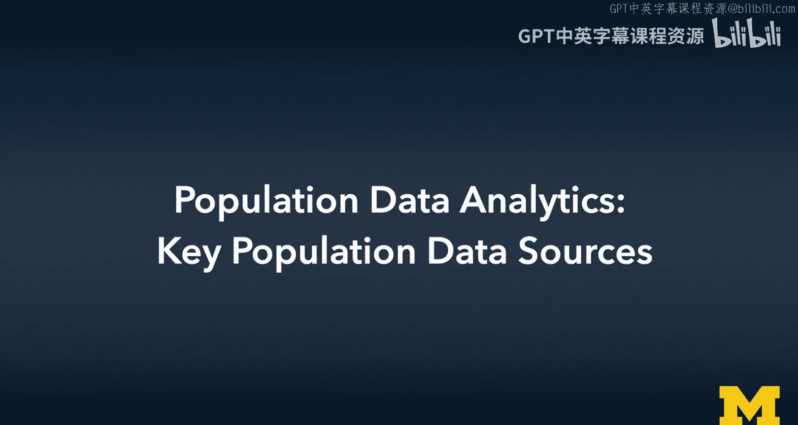
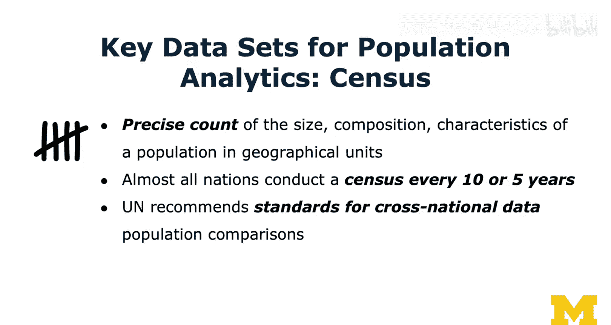
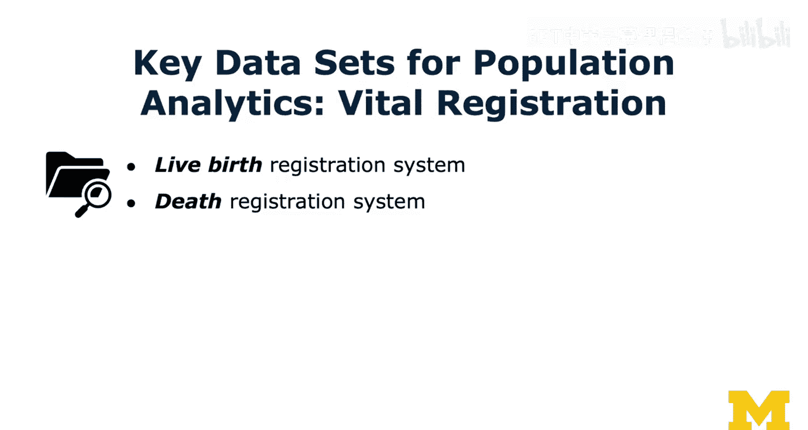
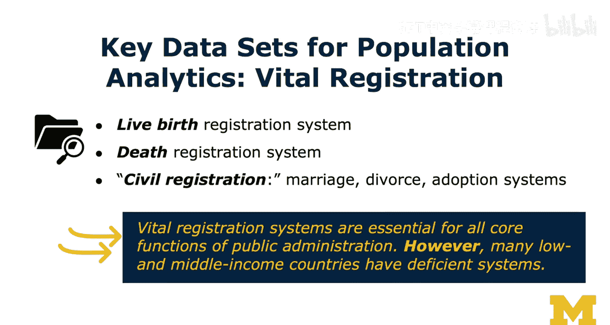
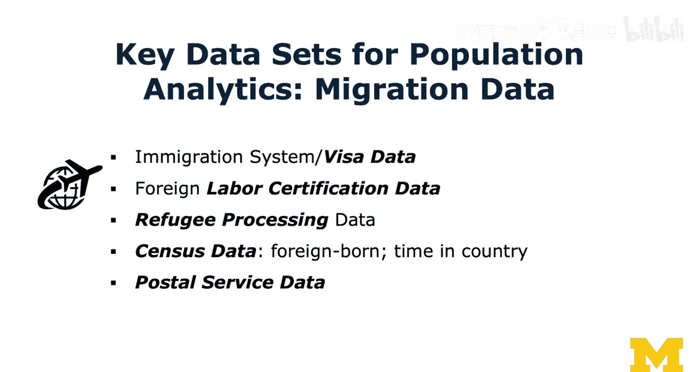
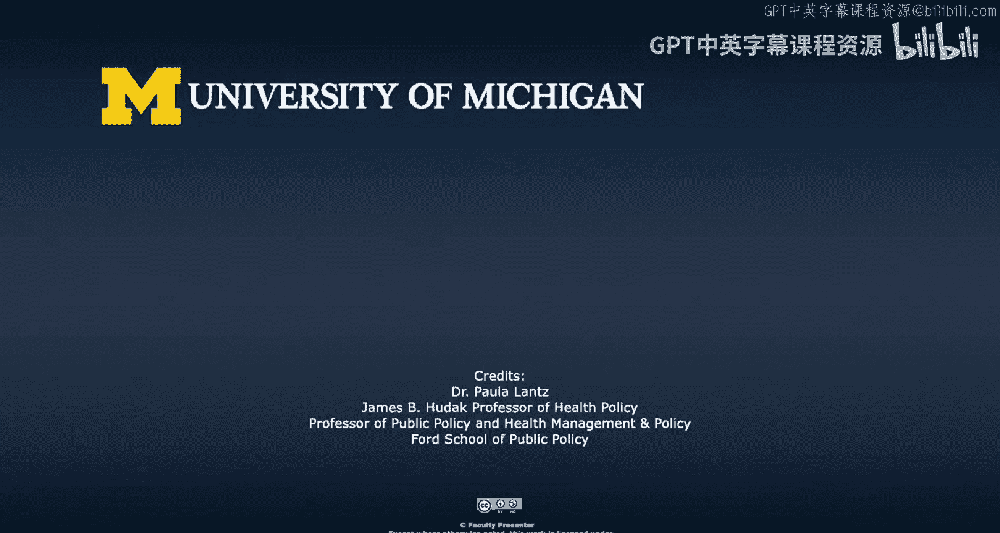

# 密歇根大学《公共部门的R数据分析（基础、数据探索、决策支持、）｜Data Analytics in the Public Sector with R》中英字幕 p34 33_核心人口数据来源解析.zh_en -BV1YZ421J7Fx_p34-

We've been talking about how the public sector needs robust data on key demographic processes such as fertility。

 mortality and migration， and also for population numbers and indicators。

So where does the government get all this important population data？

Well， first of all， an important source of population data is the census。

A census is a precise and full count of the size， composition and characteristics of a population in both large and small geographical units。

Almost all nations conduct a population census every 10 years。

Some conduct them actually every five years。This includes Canada， Japan， Ireland。

 New Zealand and Australia are the countries I think right now that conduct a census every five years。

 But again， most conduct one。Every 10 years。The United Nations recommends a number of standard procedures for population censuses which helps with crossn comparisons。

 so if you want to find out more about the methods of the census in your country and how it compares across countries you can get a lot of good information from the United Nations Now another key source of information for population data analytics is vital registration data most countries have what's referred to as vital registration systems and this means systems by which births and deaths are registered using standardized forms are collecting information and these are often referred to as birth and death certificates these certificates are completed。

On the ground where births and deaths happen and then in turn are submitted to the government for record keeping and also for inputting into large data systems。

Some countries also have civil registration systems that keep track of things like marriages。

 divorces， and adoptions。Vital registration systems and the data they produce are essential for all the core functions of public administration。

However， it's really important to note that these systems are extremely expensive to design and launch in the first place and expensive to maintain over time。

It is the fact that many low and middle income countries have systems with serious deficiencies and coverage and the quality of data。

And then we have migration。 How does a government get information on all the ways in which people move around and in and out of populations。

 It is really difficult for governments to keep track of migration。

 Some data systems that do help the public sector with this important task include。

Immigration data systems and this includes systems with all the visa application and awarding and length of time data。

 some countries have foreign labor certificate data， there's refugee processing data。

 also the census can give us information about migration。

 there are questions in most countries census approach that collects information on whether or not individuals are foreign born。

 their time in the country， and these are used for lots of different ways。

 including to get a handle on migration flows within a country also Postal service data。Specifically。

 address change data does help the government better understand migration within a country。

