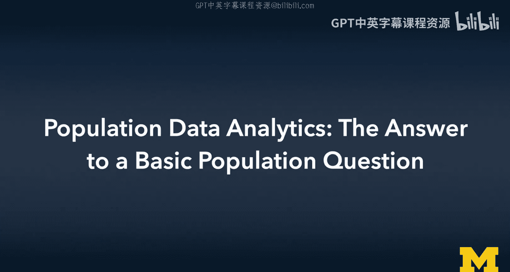
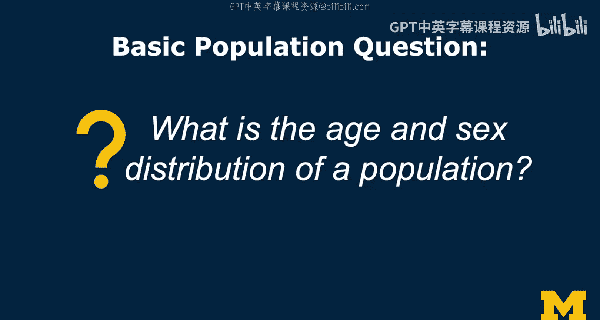
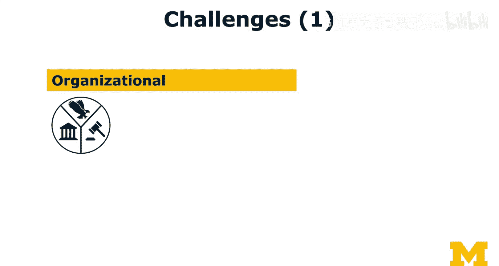
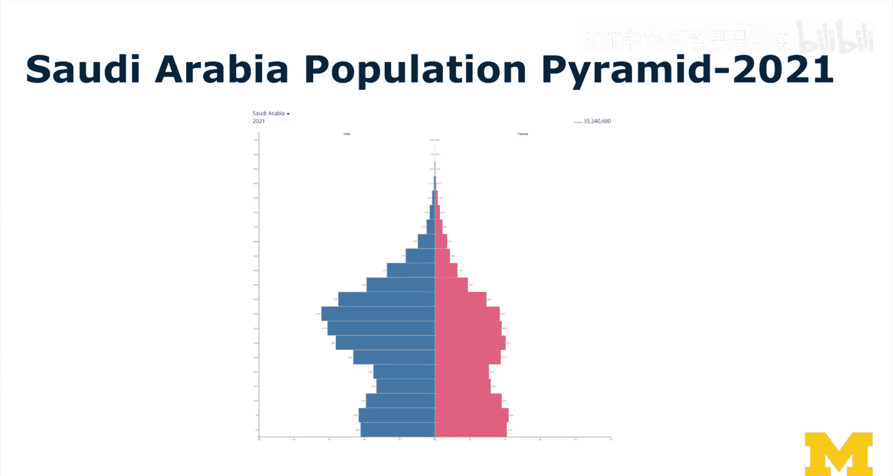
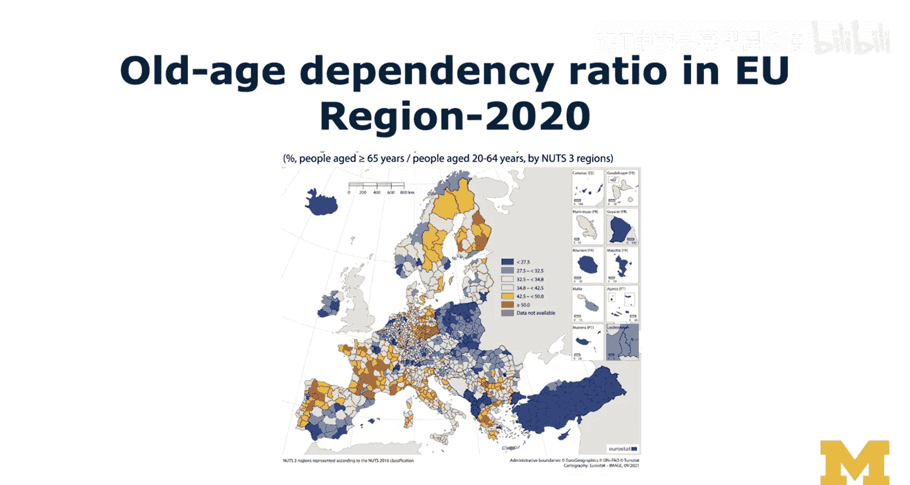
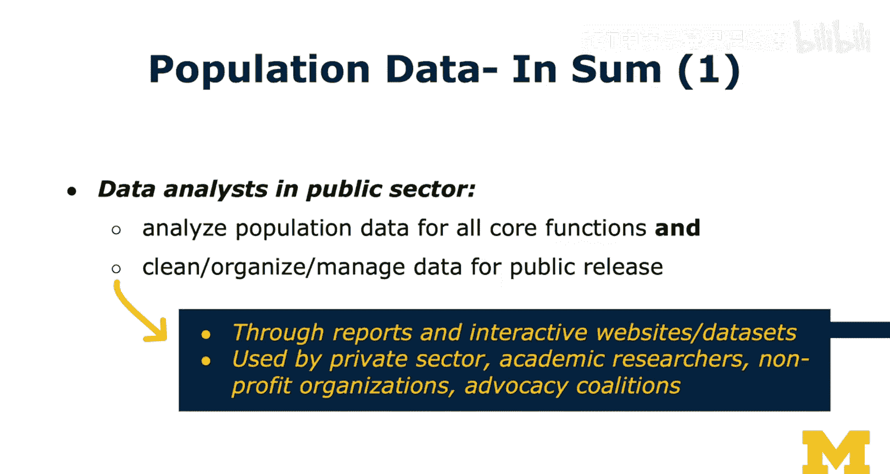
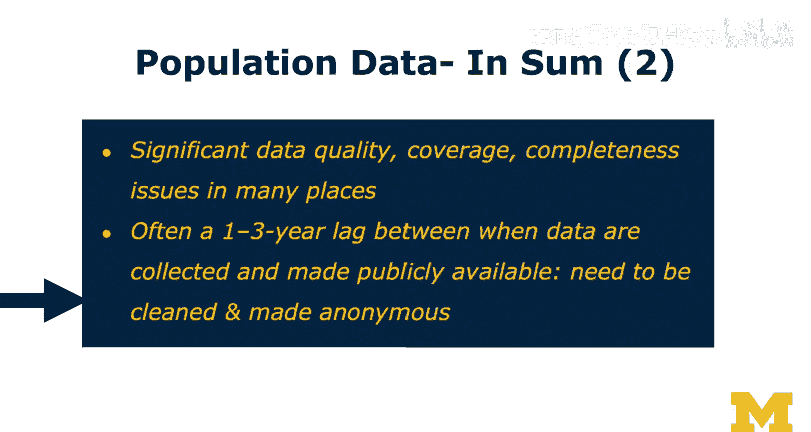
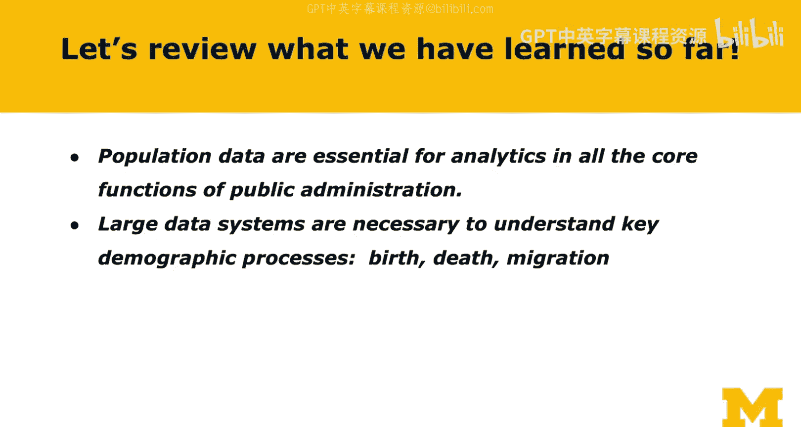

# 密歇根大学《公共部门的R数据分析（基础、数据探索、决策支持、）｜Data Analytics in the Public Sector with R》中英字幕 p35 34_基础人口问题分析方法.zh_en -BV1YZ421J7Fx_p35-

Okay， here's a basic yet important question for you to consider。

Because it's an important question for all governments。

How would you find out the age and sex distribution of a population This is a very important question and it's often answered and then visualized with what is called a population pyramid。

A population pyramid really simply shows you the number of people in a population divided by sex。

 males versus females in small age groups。 Here you can see the population pyramid of the world for 2021。

Which shows that there are many more children and young adults alive on the planet right now than older people。

The world population generally is relatively young。 this shape。

With a wide base at the bottom of the pyramid will stay that way as long as birth and death rates stay the same within age groups。

 However， if birth rates go down， the base of that pyramid will become smaller。

 The shape of population pyramids changes over time for almost every country。

Population dynamics are called dynamics because things don't stay the same。 Here。

 you can see how Japan's population pyramid has changed dramatically since the 1960s。

 It's gone from a pyramid shape。

To a quite different shape in 2010， which is showing a declining birth rate and also an aging population with some baby boom cohorts as well。

 you will also see a population forecast for Japan out to the year 2060。

 which shows quite another different shape。And this is what is referred to as an inverted pyramid。

This shape represents the outcome of declining birth rates over time。

 accompanied by low or declining death rates， More people at the older ages and fewer people at the bottom of the pyramid and inverted pyramid。

 Here's another example of a population pyramid。 This one for Saudi Arabia for the year 2021。

What do you see that's interesting about the shape of this pyramid？I'm hoping you see two things。

 the first one being the obvious difference between males and females。

With a relatively larger male population between the ages of 20 to 65， so what's happening here？

If you thought that this must be from the immigration of men。

 from other countries into Saudi Arabia for work， you would be correct。So again。

 we can see in this population pyramid the important effects that migration can have on the age and sex distribution within the population。

The second thing you might notice for Saudi Arabia is that there have been a couple of baby booms or places in the pyramid with a larger number of people in some age cohorts than the cohorts are groups before and after them。

 so when the bars stick out a little bit more than the groups before and after them。

 that's a baby boom。Governments need to really understand baby booms and when they happen because they matter as the population ages for the planning of government social service programs。

 social insurance programs， retirement benefits that are going to be paid out， etc。

 one less graphic for you， here's a visualization of the old age dependency ratios of the countries。

 and within them their major regions in the European Union or EU。

This is a slightly different statistic than total dependency ratio， which we talked about before。

 as this considers only older age dependence on working age people。

You can see that places with lower older age dependency ratios are in blue colors。

 and the places with a higher dependency ratio are in orange and red。

I don't expect you to digest and understand everything going on in this map。

 but the important point is that combining population data with mapping。

Is also a powerful tool for understanding population dynamics。

 Just a few more comments about population data that are important for you to remember。

First， data analysts in the public sector analyze population data for all the core functions。

That help the government itself， but also data analysts are going to be cleaning and organizing and managing this data for public release and reports and through interactive websites and databases because the public。

In broad strokes， everyone in every sector is interested in the population data that the government produces。

 These reports are used by the private sector， academic researchers， nonprofit organizations。

 advocacy coalitions and on and on。

Also there is often a one to threey lag between when data are collected and then made publicly available。

 again data need to be cleaned， need to make sure they're stripped of any identifying information from things like birth records and death records and census information。

 etc， and also it takes time to do this and do it in a way that the data are going to be understandable and clearly communicated and presented for efficient use by other stakeholders。

And then finally， there really are indeed many data quality coverage and completeness issues in the kinds of population data we've been talking about in every country。

 but also obviously particularly this is a problem for lower resourced countries。

Let's just quickly review what we've covered in this section on population data analytics。

 Pulation data are essential for analytics and all the core functions of public administration。

 and this type of data is almost part of the most important part of computing rates and percentages for important public measures and indicators。

 La， complex data systems are necessary for the public sector to understand the key demographic processes that are important for understanding population dynamics birth。

Death and migration。Data systems are essential。And this includes vital registration data。

 census data， migration data from multiple data systems。

We'll be jumping into some more examples of the importance of population data analytics and how to do some data analytics very soon。

