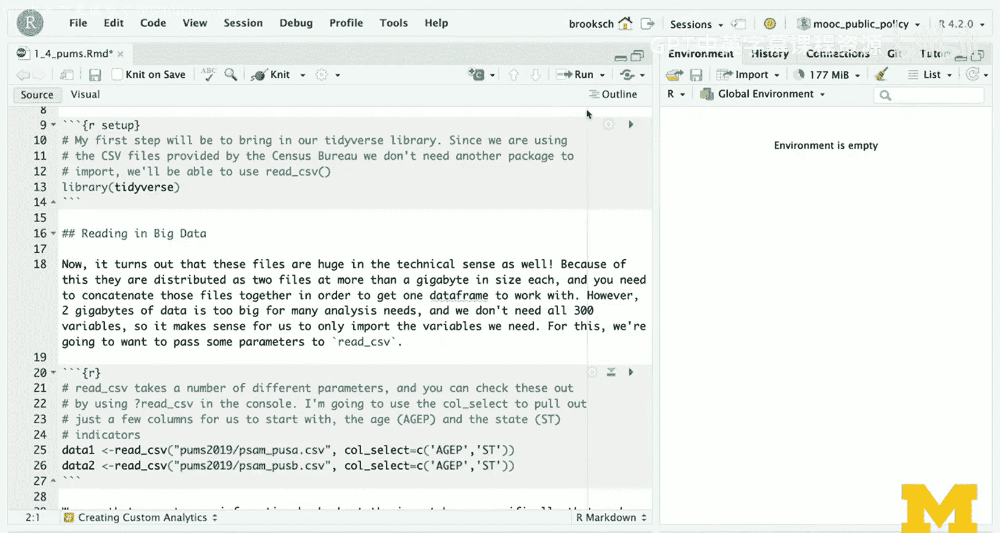
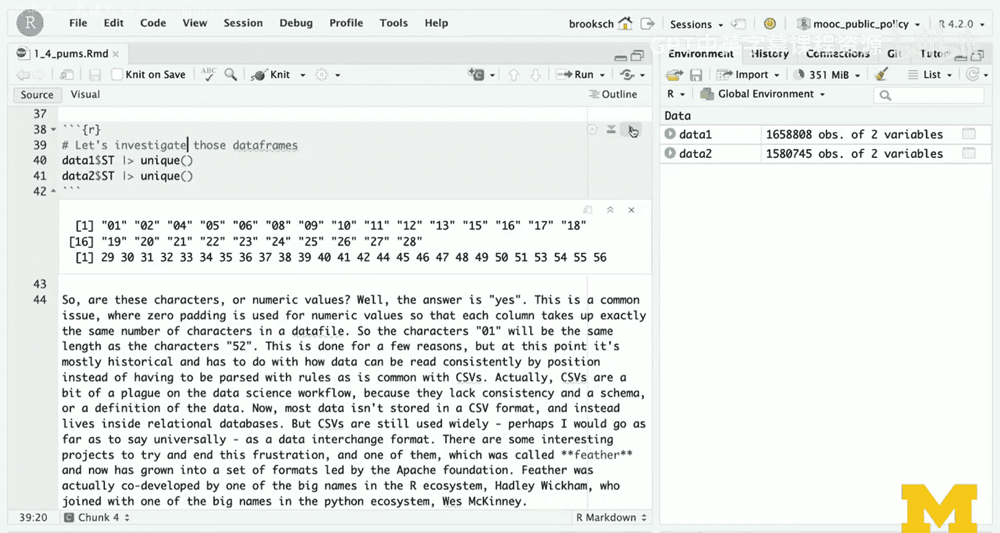
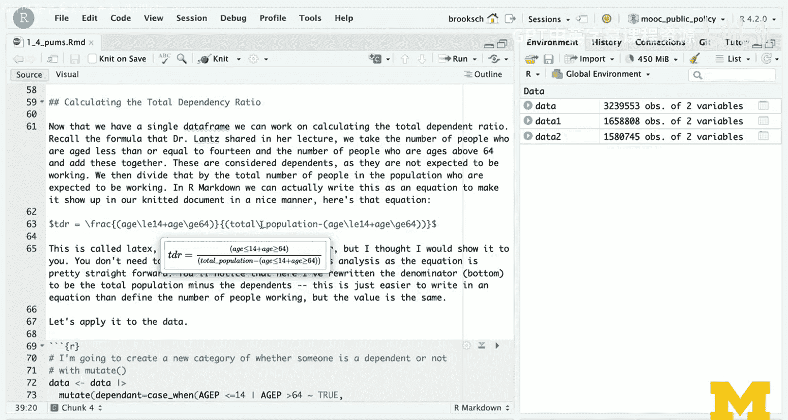
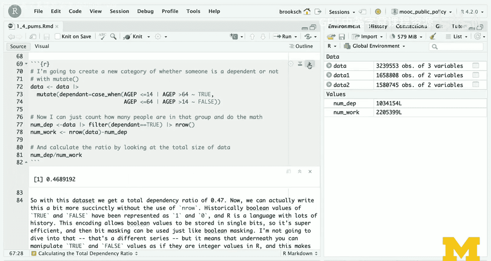
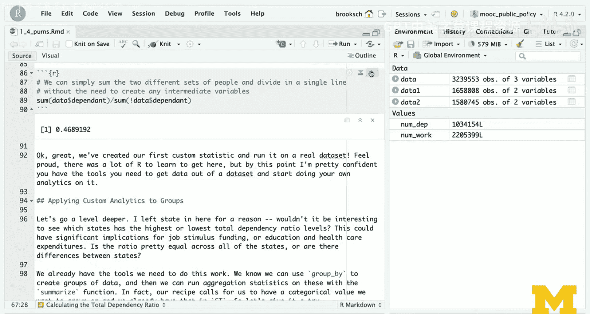

# 密歇根大学《公共部门的R数据分析（基础、数据探索、决策支持、）｜Data Analytics in the Public Sector with R》中英字幕 p36 35_定制化分析模型构建.zh_en -BV1YZ421J7Fx_p36-

In this week's lectures， you learned about a few different common population metrics。

 which are used by social scientists and public data analysts to inform public policy。

 And we're going to build on that and see how we can apply these to raw data。 For this lecture。

 I'm going to use the 2019 American Community Survey， Public use Microdata sample or Ps。

 This is a cross sectional Survey of American households and communities that's provided in raw Midata format。

It represents a one in five year samples of over 3 million American households。

1% of the total population across demographic， economic。

 social and housing dimensions to collect good population data between these 10 year censuses。

What the US Census Bureau has done is take this ACS household survey data and made it available for public use and analysis。

 is really as close to raw data as you can get in public data sets。

 and this is the kind of data that researchers like Dr。 Lance use in their policy research work。Now。

 PUMS is huge， not just in the technical sense， but it absolutely is covering nearly 300 variables。

 but also in the complexity of the process of how the data is captured， recorded and weighted。

 and the breadth of social context is included in the variables that are measured。

The PUMS data is used to support over 300 federal indicators within the government and informs nearly $700 billion of public spending each year。

I'm not going to be able to do PMS justice here in this one lecture。

 but the US Census Bureau has an amazing set of open resources to help data analysts both within the federal government and around the world。

These resources include examples， tutorials and recorded webinars and presentations。

 and I highly suggest checking them out， I put a link into the Census Academy website in the course shell。

My goal in this lecture is to show you how we can create some custom analytics like the total dependency ratio or TDR using this kind of census data。

 Of course， I think along the way I'm going to have to show you a few more things about R and the tidyverse。

 so let's dig in。

So my first step will be to bring in the Tyverse library。

 since we're using the CSV files provided by the Census Bureau。

 we don't need another package to import， we'll be able to use the Read CSV function from within Tdiverse。

Now it turns out that these files are huge in the technical sense as well， because of this。

 they're actually distributed two files at more than a gigabyte in size each。

 and you need to concatenate these files together in order to get one data frame to work with。

However， two gigs of data is a little too big for most of our analysis needs and we don't need all 300 variables。

 so it makes sense for us to only import the variables we need for this。

 we're going to pass some arguments to the read CSV function。

So read CSV takes a number of different parameters and you can check these out by using the question mark read CSV in the console I'm going to use this call select parameter to pull out just a few columns for us to start with the age。

 this is AGEP and the state ST indicators and I found these in the codebook。

Now this will take a minute to run， even though we're only pulling out those two columns because the full files actually need to be read by Read CSV in order to generate these data frames。

We see that we get some information back about the import here。

 specifically that we've got about one and a half million rows in each data frame and that there are two columns。

 Now we need to concatenate these two data frames together。

 We can use the Dliier bind rows function to do this。

So I'm just going to take a new variable data and assign it to bind rows and pass in our two data frames。

Oh， error， okay， let's part a bit。It sounds like the main issue is that the column ST。

 our state variable can't be combined because it's of this character type in the first data frame and a double type in the second data frame。

 actually， if we scroll back up。We can see that being。Told to us here on Read CSV。

 It actually reports back that there's one variable here called S T character and the other one is AGP double。

 But here， it's actually said both of these are doubles。

 So we're going to have to investigate this a little bit。Allright。

 let's investigate these data frames， I'm going to do it just by piping this column to the unique function to take a look at what those columns actually are。

Okay， so are these characters or numeric values。 Well， the answer is yes。

 and this is a common issue where zero padding is used for numeric values so that each column takes up exactly the same number of characters in a data file。

 So the characters01 will be the same length as the characters 52。 This is done for a few reasons。

 but at this point， it's mostly historical and has to do with how data can be read consistently by position instead of having to be parsed with rules as is common with CSVs。

Actually， CSVs are a bit of a plague on the data science wordflow because they lack consistency and a schema Now most data is actually not stored in CSV format instead lives inside of a relational database。

 but CSVs are still widely and I might even go as far as say universally used as a data interchange format。

There's some interesting projects to try and end this frustration one of them that I know of is actually called featherather and it grew out of a set of formats and now is led by the Apache Foundation Feer was actually co-developed by two of the big names in the data science tooling ecosystem from our Hadley Wickham and from Python West McKinney。

Allright， that's a bit of a digression。 We still live inside of a CSV world。

 So we've got to deal with this issue， whether it's to represent our data as numerics or strings。

 we've got to make a choice。 Now， I'm going to choose strings because the code book says that they should be strings。

 Given that， how do we actually do it。 the easiest way for us to do this is to go back to the read CSV documentation。

 If you do that， you can see that there's a parameter in there called call types that we can set。

 so that when read CSV is actually pulling in the characters， it sets the types as we want it to be。

So let's try importing again。 We're going to set both columns to C for character vectors。

 There's actually a number of different types you can use and a number of different ways you can provide those to R。

And then we bound these rows together and we created data。

 and you can see in the upper right hand corner in our environment pane that indeed we have this giant data frame that's got 3 million observations in it of two variables。

So you can see why it's useful to have some of the grounding and data types that we talked about in the very first few lectures of the course。

 We can actually get pretty far in R without having to know the inner workings of the language。

 but sometimes it's important for us to understand those workings so that we can debug problems that we run into。

Now that we have a single data frame， we can work on calculating the total dependent ratio。

 We call the formula that Doctor Lance shared in her lecture。

 We take the number of people who are age less than or equal to 14 and the number of people who are ages above 64。

 and we add these together。 These are considered dependent， as they're expected to not be working。

Then we divide that by the total number of people in the population who are expected to be working in our markdown。

 We can actually write this as an equation to make it show up in our knitted document in a nice manner。

 Here's an example of that。 And if you hover your mouse over this。

 you should see the equation actually pop up there as well。 It looks nice。 right， TDR is equal to。

 and I've got this nice diisor in there and so forth。

So this is called lateek。 and it's another topic altogether。 But I thought I would show it to you。

 You don't need to know lateek or much math for this analysis is the equation's pretty straightforward。

 You'll notice here that I've rewritten the denominator the bottom to be the total population minus the dependence。

 This is just easier to write in an equation than to define the number of people working。

 but the value is actually the same。 All right， let's apply this to our data。

So I'm going to create a new category of whether somebody is a dependent or not with the mutate function and so here I'm just going to pipe data into mutate。

 I'm going to create this new column called dependent and I'm going to use a case when and so AGP less than or equal to 14 or greater than 64。

 I'll set it to true AGP less than or equal to 64 or and greater than 14 I'm going to set it to false。

Now we can just count how many people are in that group and do the math。

 so I'll create a couple of variables here， N De I'll make is the number of dependents and I'm just going to use filter and pipe it to and row to count the number of rows and for N work。

 I'm just going to calculate the number of rows total in our data set and subtract the dependence。

Allright， so now we can just create the ratio with numb depth over numb work。

So with this data set， we get a total dependency ratio of 0。47。Now。

 we can actually write this a bit more succinctly without the use of N row。 His。

 Boolean values true and false have been represented as ones and zeros。

 and are as a language with lots of deep history。 This encoding allows Boolean values to be stored in single bits。

 So it's super efficient。 And then we can use bit masking。

 And that just use that just like boolean masking。 Now， I'm not going to dive into that。

 that's a completely different series。 But it means that underneath。

 you can manipulate true and false values as if they're integer values in R。

 And this makes counting them very， very easy。 We can simply sum the two different sets of people and divide in a single line without the need to create any intermediate variables。

 It's really nice。 We just take data， pullll out the column of dependent。

 we're going do it in both and negate it here and just do sums and all the trues count as one and the falses count as zeros。

😊。

Okay， great。 we've created our first custom statistic and run it on a real data set。

 Feel proud theres a lot of R we had to learn to get here。

 but at this point I'm pretty confident that you have the tools you need to get data out of a data and start doing your own analytics on it。

😊。

