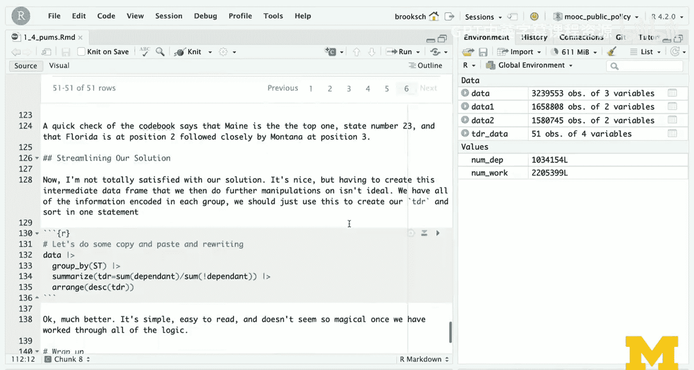
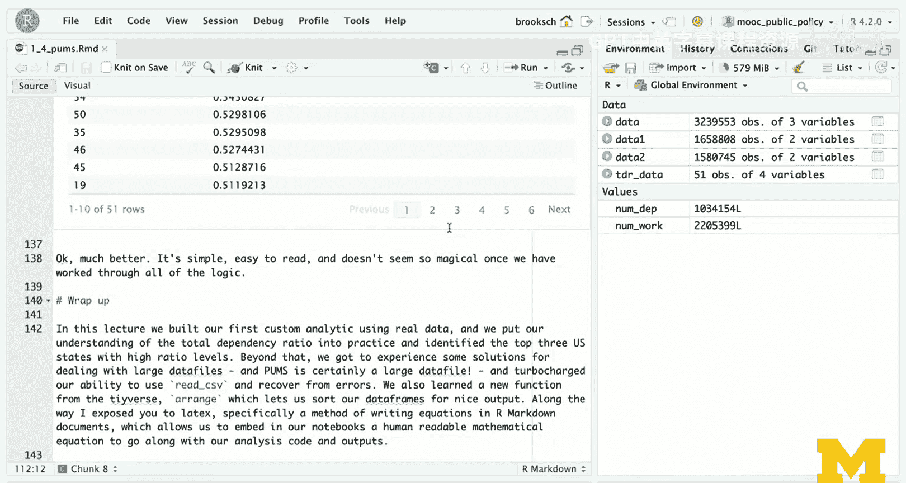

# 密歇根大学《公共部门的R数据分析（基础、数据探索、决策支持、）｜Data Analytics in the Public Sector with R》中英字幕 p37 36_分组应用定制化分析.zh_en -BV1YZ421J7Fx_p37-

Now， let's go a level deeper。 I left state in there for a reason。

 Wouldn't it be interesting to see which states had the highest or lowest total dependency ratios。

 This could have significant implications for job stimulus funding or education in health care expenditures。

 Is the ratio pretty equal across all of the states or are there differences between states。

We already have some of the tools that we need to do this work。

 We know that we can use group by to create groups of data and that we can run aggregate statistics on these with the summarize function。

 In fact， our recipe calls for us to have a categorical value we want to group on。

 And we already have that in S。 It's the state ident。 So let's give this a try。

So I'm going to pipe in our data into group I with ST。

 and then I'm going to create two new variables， one for the top of the equation， the numerator。

 our dependence， and one for the bottom the denominator are working eligible individuals。

And I'll put these both within summarize。 And then we're gonna create a new column in this TDR data with our ratio。

 And so I'll do that here， just taking mutate and saying TDR is equal to the dependence over the number who have been working。

 And then we'll print that out。Awesome， we've just calculated the TDR for each state Now we could sort this data using the arrange function and just indicate which variables we want to sort by In this case。

 I actually want to see TDR in descending order and find out which state has the fewest working aged people in it as a ratio。

So I'm just going to pipe our data into a group by with state and sort it with a range。Okay。

 a quick look at the codebook says that Maine is actually the top state， so state number 23 here。

 and we can see the number of dependents and the number of people working that were included in this sample。

 this is Maine， so 0。56， which means they have fewer people working versus dependence than for instance。

 whatever state 12 is and 30 is and so forth。The second state here is actually Florida and the third state here is Montana。

 So I think it's really interesting to see that there's kind of a golf a little bit here between。

 now， Florida and Montana are pretty close means pulls away and then we can actually flip through and we can see oh wow。

 there's some that actually are very low So there's one state here with 0。28。

 So lots of people working very few children and old people there。 maybe pause right now。

 what state do you think this is， I think we'll talk about it in a little bit。

Now， I'm not totally satisfied with our solution。 It's nice。

 but having to create this intermediate data frame that we then do further manipulations on。

 it's not really ideal。 We have all of the information encoded in each group。

 We should just be able to use this to create our TDR and sort in one statement。😊。

So let's do a little copy and paste rewriting here so I'm going to take our data。

 I'm going to pipe it into our group by state and then I'm going pipe that into summarize and then we're going to create our TDR right in there and then I'm going to arrange it here。

 let's give that a run。Okay， much better， it's simple， easy to read。

 and doesn't seem so magical once we've worked through all the logic。

In this lecture， we built our first custom alytic using real data and we put our understanding of the total dependency ratio into practice and identified the top three US states with high ratio levels。

Beyond that， we got to experience some solutions for dealing with large data files and PUMS is certainly a large data file。

 and we sort of turbocharged our ability to use read CSV and recover from errors。

We also learned a new function from the tidyverse arrange。

 which lets us sort our data frames for nice output。Along the way I exposed you to latex。

 specifically a method for writing equations in our markdown documents。

 which allows us to embed in our notebooks， a human readable mathematical equation to go along with our analysis。

 code， and outputs。

