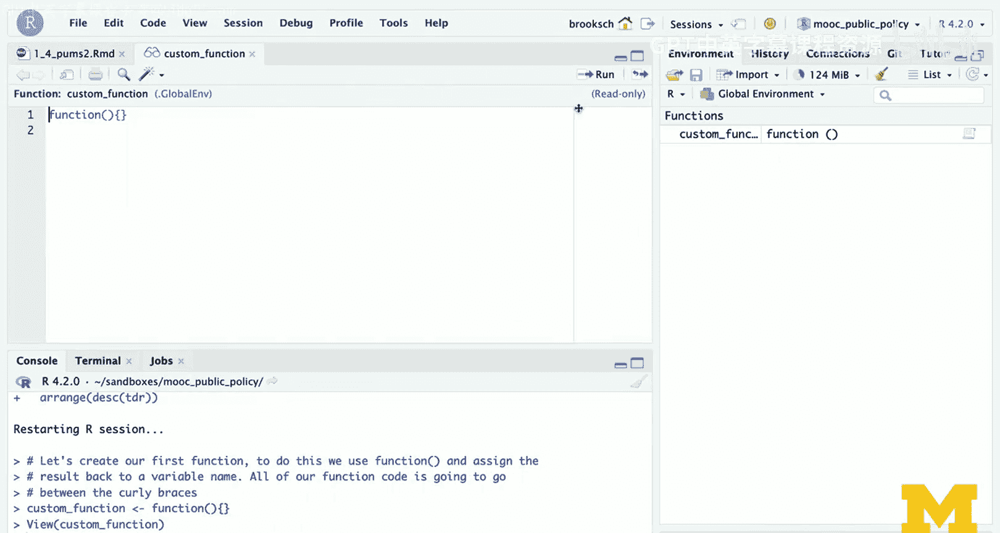
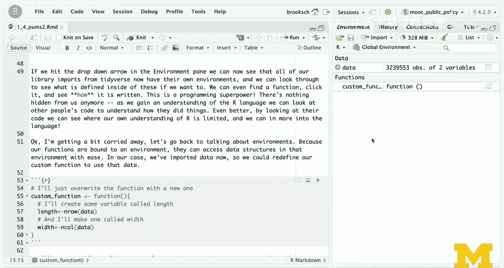
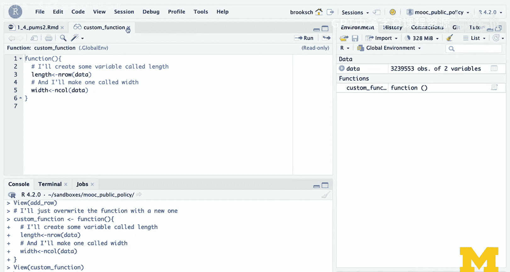
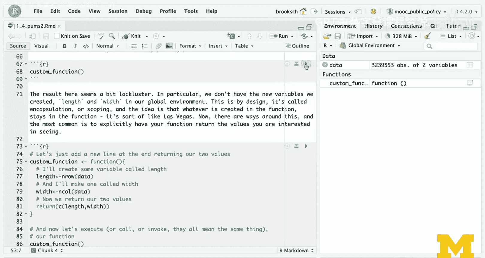
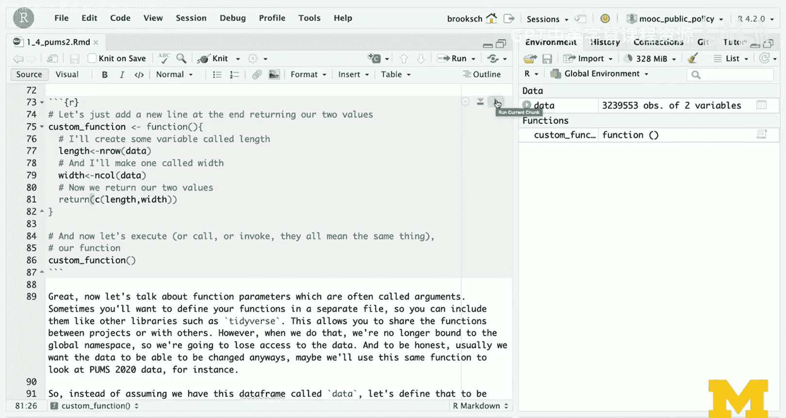
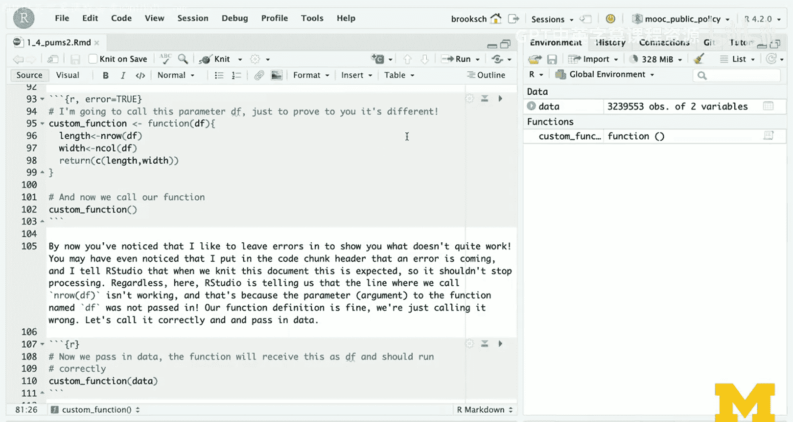
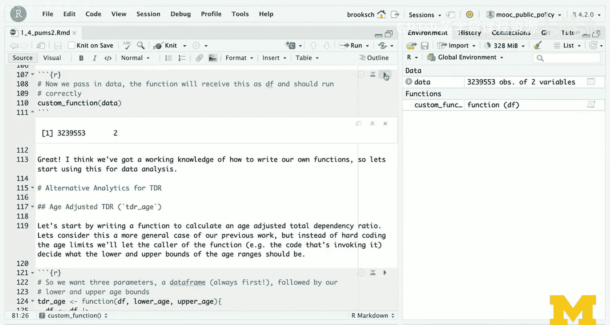
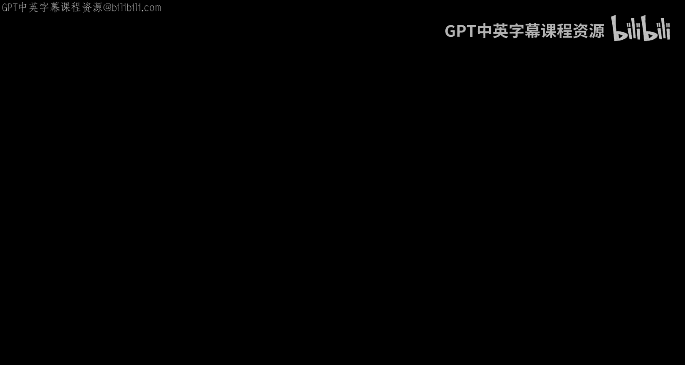

# 密歇根大学《公共部门的R数据分析（基础、数据探索、决策支持、）｜Data Analytics in the Public Sector with R》中英字幕 p38 37_函数编写技术.zh_en -BV1YZ421J7Fx_p38-

We've used a lot of different functions over the past few weeks。

 and now that we're starting to write some of our own analytics。

 I think it's time to start writing our own functions。

I think the PUMS data is actually a great one for demonstration here。

 so there's a lot of alternative definitions for dependency ratio。

 each tune to a particular question or theme of investigation。

Fylen Kainsky from the US Census Bureau actually posed a number of different interesting approaches to calculating a dependency ratio to reflect some of the underlying social differences we might expect to see in modern life。

For instance， is it appropriate to consider people a 15 through 17 in the US to be workers and not dependents or the norm is that they're actually still attending secondary school。

 or does the inclusion of college students in the ratio as employment eligible create a false sense of capacity in a community such as a college town like Ann Arbor where I'm at？

And the structural elements of why someone isn't working are different when they're younger versus say。

 retired， so should we create two different metrics to capture these differences？

I like to imagine that after reviewing the literature and thinking about what they wanted to accomplish。

 they SAT down with someone like yourself and asked for help in doing this kind of analysis。

 And I think we're capable of it。 We have all the tools for this in our tool box。

 But there's a few more things we can learn about our to do a nice， clean job of this。

 So let's tackle this problem and learn how to write custom functions in our。😊。

A function in R is created using the function call， unlike many other languages。

 we don't name the function when we define it， and instead we bind the function to a variable。

 that variable then becomes the name of the function。

Alright， let's create our first function to do this。

 We're just going to use the function function and assign the result back to a variable。

 All our function code is going to live between the curly braces。

 So this function with empty parentheses is actually going to create our function。

 And the body of our function。 The actual code of it。 it's actually going to be blank。

 And we're going to bind this to a variable called custom function。 Let's run this。😊，Okay。

 so the function we've created doesn't do anything yet， but you'll notice up here。

 the moment we ran it， the function showed up in the environment pane in a new space and if we click on this function here。

 it's actually going to pop up the details of the function。

 I mean it's pretty boring right now but this will be useful。

At a high level， there's three things to consider with functions in R Funs have parameters and a return value。

 We call these formals。 Functions have some analysis code in them。 We call this the body。

 and functions execute within a context， and we call this the environment。

Now we've seen lots of examples of the first one， for instance。

 the function sum takes in a list or a data frame and returns a number and the function filter takes in a data frame and any number of boolean mask and returns another data frame We've also seen that where we're going to write this body of our code in between these curly braces。

But this last item， the environment a function operates in。

 this is a bit less clear Up until this point， our environment has always been this pain in the upper right hand corner of our studio。

 which lists our data， values and functions。 So what do we mean by an environment。

 And why is this important。Well， when you define a function like we did。

 it's bound to an environment that you defined it in。

 That means that the function can access all of the data。

 values and other functions in that environment。 We can inspect the environment bound to a function to find out its name using the environment function。

😊，So in our， we're just going to take our name function， custom function。

 and call environmentviron on it and run this。Allright。

 here we can see this function is bound to the R global M。

 which is the environment that we've been creating data frames in for the past several weeks。

 we could actually snoop through different environments in the environment pan using the drop down field。

So if we just come over here， you can actually see there's a number of different environments that already exist。

 So stats， graphics， us， these are all just pulled in by base。 And if we go to these。

 we can actually see， oh wow， there's like values in here。

 We're going to see that there's functions that are defined in here。

 there might be data defined in here。 Yeah， there's some functions defined in here and so forth。

 All right， let's go back to our global environment。All right。

 let's see what happens when we bring in the PMS data into the global environment。

So first thing I want to do is bring in our tidy friends from the tidy verse。

 and then I want to import our data and I'm going to do it by calling read CSV with bind rows so that we don't have to actually have these extra variables kicking around。

 So I'm just going to call read CSV directly in line there。 Let's execute this。

So if we hit the drop down arrow in the environment pane。

We can see that all of our library inputs from tidyverse are actually here with their own environments。

 and we can actually look through these to see what's defined if we want to。

 We could even find a function inside of here and see how it's actually developed。

 So let's look at the Dlier function or package rather that we've been using。

 So we have all of these values that are defined inside of Dlier。😊，If we scroll down here。

We see that there's a number of functions as well， and maybe there's one that we can look at here。

 maybe add row and if we click on that， we actually get right into the source code of Dlier right into seeing exactly how this was written。

This is a programming superpower。 There's nothing hidden from us anymore as we gain an understanding of the R language。

 we could start to look at other people's code to understand how they did things even better by looking at their code。

 we could see where our own understanding of R maybe is limited。

 And we can start to look around and learn a little bit more about the language。

 So I get a little carried away by this。 It is really exciting to me to be able to just start looking at other people's code and learning from them。

 But let's go back to talking about environments。 because our functions are bound to an environment。

 They can access data structures in that environment with ease。 In our case。

 we've imported data now so we could redefine our custom function to use that data。

 Let's check it out。😊。

So I'm just going to overwrite the function with a new one， so I'll call it custom function。

 I'll bind it to that name still， and I'm going to create a variable called length and set that to the number of rows of data and a variable called width and set that to the number of columns of data and we could just execute this。

So you'll see if you click on the function in the environment pane。

 it'll pop up with the source code and you can actually see our new source code even with the comments in there。

 so it's really quite interesting to see how our studio is working and pulling out this function for us。

Now， the function has only been defined and it hasn't been run yet。

 so our actually hasn't executed the function at all。

 and thus it hasn't actually called N row or N call or tried to access data to execute the function。

 we just have to call it by putting parentheses after our variable name。

So now we can just execute this variable like it was any other function。

The result here seems a bit lacklustre。 In particular。

 we don't have any new variables that we created length and width in our global environment。

 like we might have thought。 This is actually by design。 It's called encapsulation or scoping。

 And the idea is that whatever is created in the function stays in the function。

 It's sort of like Las Vegas。 Now， there's many ways around this。

 And the most common is to explicitly have your function return the values that you're interested in seeing。

😊。

So let's just add a new line at the end returning our two values。

 so I'm going to copy and paste the same function in here and I'm just going to have this return value and I'm going to return two values a length and width and we're going to concatenate them or combine them into a single vector。

 and then I'm going to execute this right away as well or invoke it to execution。

 invoking calling these are all the same thing。

Great， so those numbers look about right， 3。2 million rows and two columns。Now。

 let's talk about function parameters， which are often called arguments。

 Sometimes you'll want to define your functions in a separate file so that you can include them in other libraries。

 like is done with tidyverse。 This allows you to share the functions between projects or with other people。

 However， when we do that， we're no longer bound to the global namespace。

 we're going to lose access to the data。 And to be honest。

 usually we want the data to be able to be changed anyways。 For instance。

 maybe we'll want to use the same function to look at the Ps 2020 data。

Instead of assuming that we have this data frame called data。

 let's define that to be passed as a parameter。

So to do this， I'm just going to call the parameter Df。

 and that's just prove to you actually that it's different。

 You could call it the same thing that it would be called in the global namespace。

 You actually don't know what it is called in the global namespace unless you try to access it。

 and then I'm going to take the length width and our return value and then I'm just going to call this custom function。

 So let's give it a wing。

Okay， by now you've noticed， I like to leave errors in to show you when something doesn't quite work。

 You may have even noticed that I put in the code chunk header that an error is coming。

 And I tell our studio that when we knit this document， this is actually expected。

 So it shouldn't stop processing。 regardless， here。

 our studio is telling us that the line where we call N row Df isn't working。

 And that's because the parameter or the argument to the function named D F wasn't passed in。

 our function definition is fine。 We're just calling it wrong。

 Let's call it correctly and pass in the data。

So now I'll just pass in the data， you'll see I'm not calling this DF right。

 so as I invoke the function I can call it with whatever data frame I want inside of the function it's going to refer to that as DF and use that as DF。

All right， so that's exactly what we're expecting。 I think we've got working knowledge of how to write our own functions。

 so let's start using this for data analysis。

