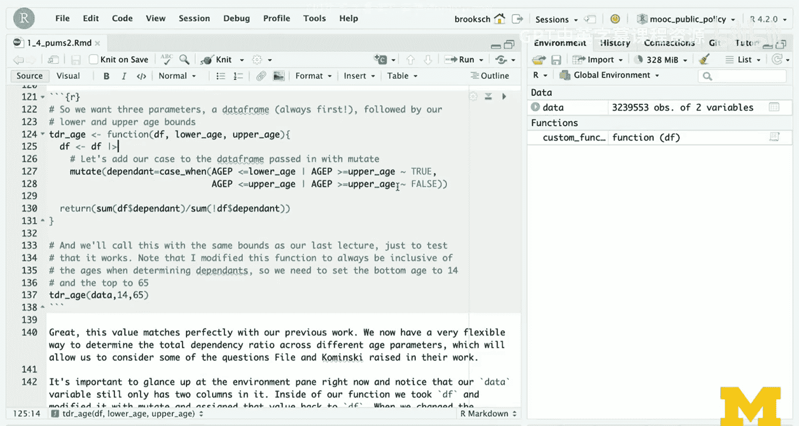
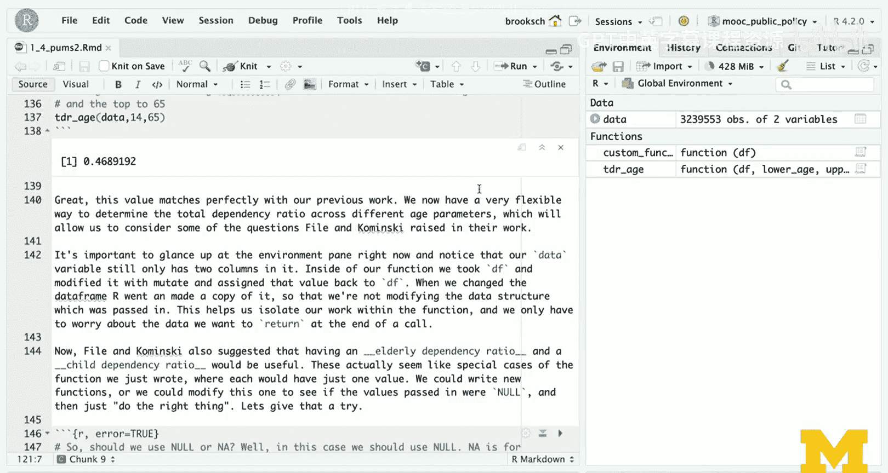
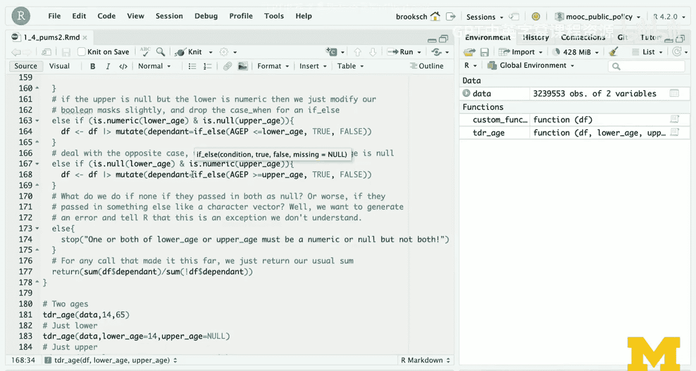
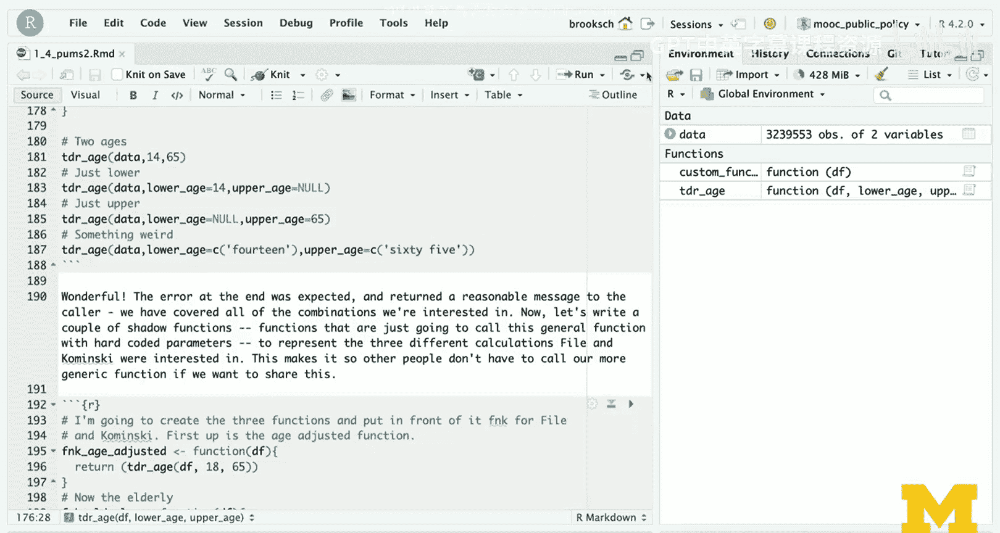
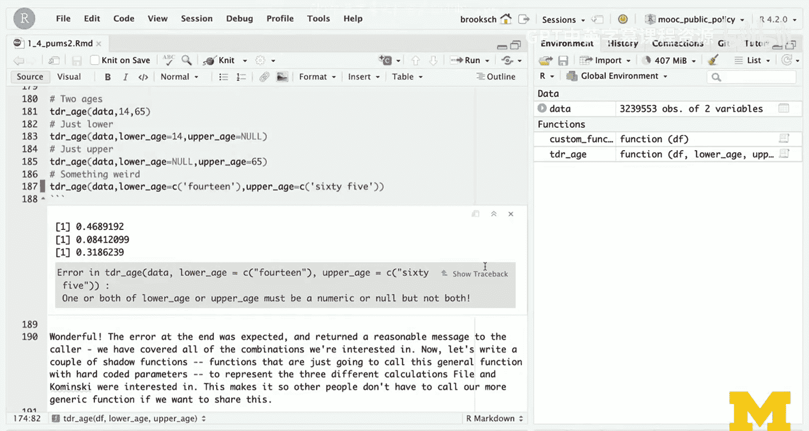
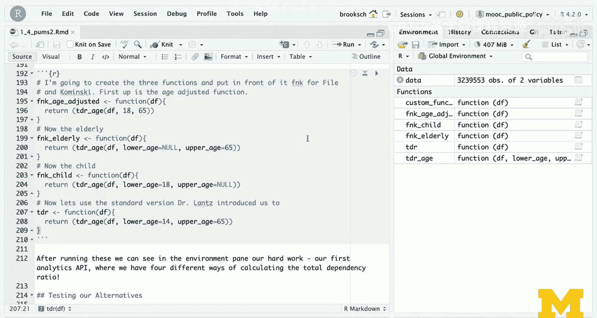
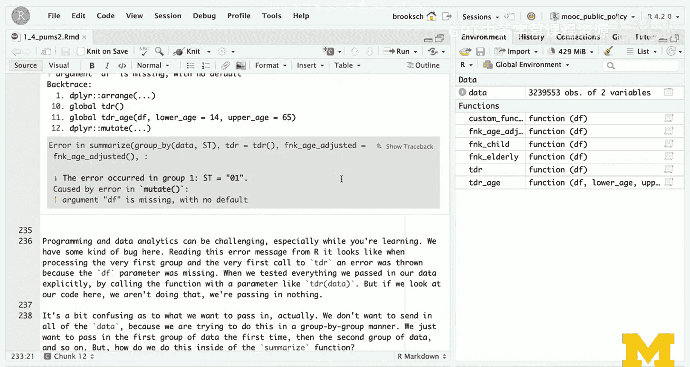
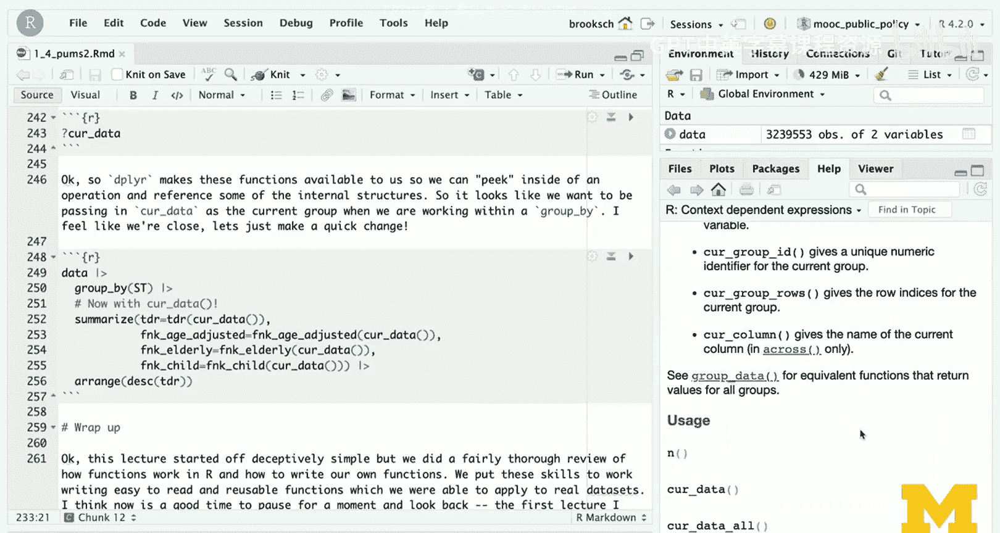
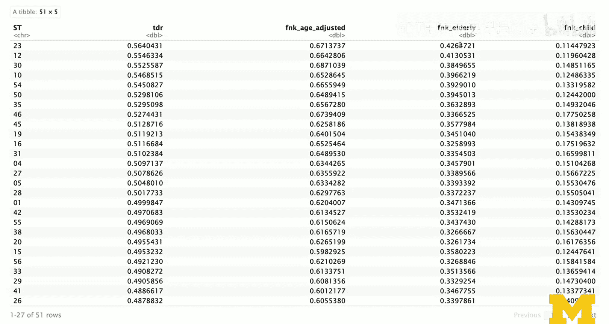
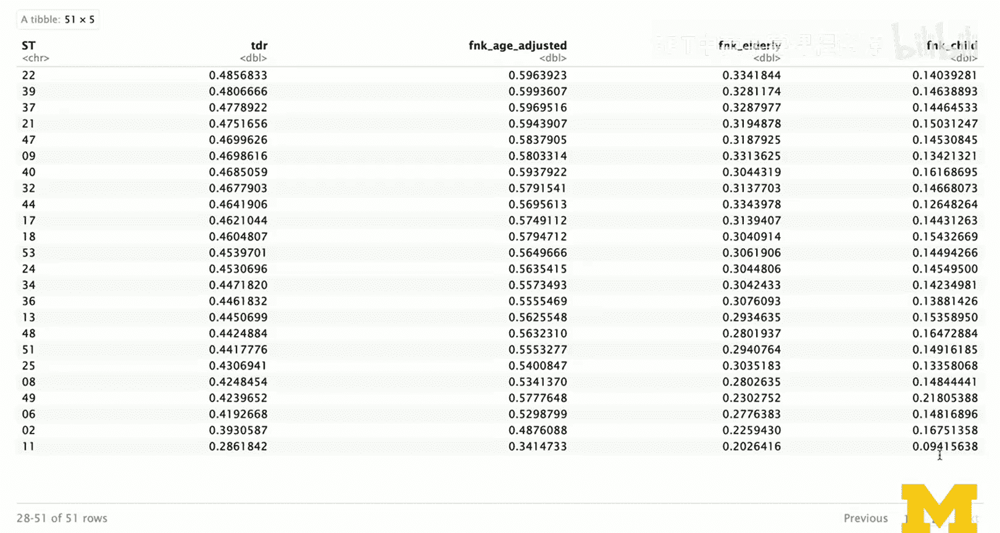

# 密歇根大学《公共部门的R数据分析（基础、数据探索、决策支持、）｜Data Analytics in the Public Sector with R》中英字幕 p39 38_TDR替代分析方法.zh_en -BV1YZ421J7Fx_p39-

Let's start by writing a function to calculate an age adjusted total dependency ratio。

 Let's consider this a little bit more of a general use case from our previous work。

 Instead of hard coding the age limits， we're going to let the color of the function。

 the code does actually invoking it， decide what the lower and the upper bounds of the age ranges should be。

So we want three parameters， a data frame。 We always put that in first because we know how it's used inside of our with piping。

 followed by our upper and lower bounds。 So unlike other languages。

 we don't have to say what types are being passed in here， we just set the names。

 So Df is going to come in a lower age is going to come in and then an upper upper age range。

 And then I'm just going to copy our code from the other day。 So we're going to take our Df。

 we're going to assign it to Df。 and we're going to pipe into it and mutate。

 and we're going to use the exact same code that we use the other day with this case when the true and falses to create our new variable in there。

 And then we're going to do our summary and our division。

And we're going to call this with the bounds of our last lecture and this is great because it's just going to test that it works note that I modify this function to always be inclusive of ages when determining the dependence。

 so we actually need to call it with the parameters of 14 and 65 whereas yesterday we were using 14 and 64。

😊。

Great， this value matches perfectly with our previous work。

 We now have a flexible way to determine the total dependency ratio across different age parameters。

 and this is going to allow us to consider some questions that F and Kainsky raised in their work。

 It's important to glance up at the environment pane right now。

 and notice that our data variable still only has two columns in it。 Instead of our function。

 We took D F and modified it with mutate and assigned it back to a value of D F。😊。

When we changed the data frame， our went and made a copy of it so that we're not modifying the data structure which was passed in。

 this helps us isolate our work within the function and we only have to worry about the things that we actually want to return at the end of the call。

Now， filing Kainsky also suggested that there should be an elderly dependency ratio and a child dependency ratio and that these might be useful for different kinds of analyses these actually seem like special cases of the function we just wrote where each one would have just one value。

We could write new functions or we could modify this one to see if the values passed in were null and then just do the right thing。

 Let's give that a try。

So our first design decision here is should we use null or NA for these values？ Well， in this case。

 we should use null。 NA is for missing data， but this isn't missing data。

 It's intentionally not put there as a signal for our function to consider。

 So I'm going define the function TDR age the same way。

 we've got at least four cases that we want to consider。

 the first is that both values are a number in which case we just want to do whatever we've already written。

 And so I'm going to use this is numeric to do that。

 And so you'll see here if is numeric lower age and is numeric upper age then and I've got a nice little code block here to just do exactly what we did before。

 and all we're doing inside of these conditional statements is modifying Df。

 We're going to do something smart with Df towards the end。

 but here we're just changing that data frame。Now， if the upper is null， but the lower is numeric。

 then we just want to modify our Boolean mask slightly and drop the case when and using if else。

 So remember that when we're using an if else， we don't need that whole formula stuff。

 So here I'm just going to say age P is less than or equal to lower age， then it's a true。 Otherwise。

 it's a false。 And you can see in my if statement here， I'm checking that lower age is numeric。

 but upper age is nu。 And then I'm going to deal with the exact opposite case here where the upper age exists。

 but the lower age is nu。

What do we want to do if nothing is passed in or if both are passed in as null or worse。

 What do we want to do if they pass in something weird like a character vector。 Well。

 we want to generate an error and tell R that this is an exception。 And we don't understand it。

 And so we could do that with the stop function。 When we call stop。

 R is going to send back one of these trace backs， just like we saw earlier。

 And we put a little informative message in here。 One of both lower age or upper age must be numeric or null。

 but not both。

All right。If we've managed to get past all of those elseLif statements here。

 we know our data frame is set up correctly and so we could just calculate our ratio appropriately。

Now， I'm going to run it with these four different lines。 I'm going to test two ages。

 just the lower bound， just the upper bound。 and then something weird。 I'll just put in some。

 some letters in here in words of numbers。

Now I'm going to try it with four different conditions here。 I'm going to use two ages。

 so I'll use 14 and 65。 This is our nice check and then I'll try just a lower age so I'm going to set the lower age to 14 in the upper age to null and then we'll of course try with upper so I'll set the upper age to 65 and the lower age to null and then I'll put in something weird。

 I'll just put in a couple of character vectors in here。 Let's give this code block a try。

Wonderful， the error at the end was expected and returned a reasonable message to the caller。

 We've covered all of the combinations that we're interested in。 Now。

 let's write a couple of shadow functions。 These are functions that are just going to call this general function with the hard coded parameters。

 They're going to represent the three different calculations that file kinsky we're interested in。

 This makes it so other people don't have to call our more generic function If we want to share this。

😊。

So I got to create three functions and just put in front of it fNK for filing Kaensky first up is the age adjusted function。

 so that one they suggested that it should be an age of 18 to 65 should be the exclusion criteria and then I'm going to put in the elderly one so that was 65 or older and then of course the child one which was 18 as the lower age and then we're going to use this standard version Dr。

 Lance introduced us to in the lectures as our TDR and let's run this and this will process these。

After running these， we could see in the environment paying the results of our hard work。

 our first analytics API， where we have four different ways of calculating the total dependency ratio。

The natural next question for us to ask is what does this look like when we apply it to the individual states data。

 Are we going to see any differences in these ratios between the top three states。

 Maine Florida and Montana。 pause the video for a moment and try and generate a hypothesis as to how each of these metrics might change the ordering of the states。

Well， I've got my hypothesis， so let's give it a try and I think you'll agree that making these functions makes the whole data exploration task so much easier。

The beauty of summarize is that we can use it with many different functions。

 so we can create our data frames in one go。 So I'm just going to pipe our data into group by。

 I'm going to group it by state。 Then we're just going to send this to summarize。

 We don't have to make our functions group aware。 summarizemar is going to do all of that for us Even better summarize is going to bring all the results back to us in a Tbble form。

 So we're going to get a nice pretty printed table。 So I'm going say summarize。

 I'm going to set the TDR to TDR。 And remember， these are the column identifiers。 This is the name。

 So you could set this to whatever you want it to be here。

 I'm just using the exact name of our function because it makes it easy to understand the result。

 And then I'm going to arrange these in descending order by the TDR so that we have the same sort of table as we had before。

 just with the additional columns。😊，Programming and data analytics can be challenging。

 especially when you're learning。 We have some kind of bug here reading this error message from R。

 It looks like processing the very first group and the very first call a TDR an error was thrown because the D F parameter was missing。

 When we tested everything。 we passed in our data explicitly by calling the function with a parameter like TDR sub datata。

 But if we look at our code here， we're not doing that。 We're passing in nothing。

It's a bit confusing as to what we actually want to pass in。

 We don't want to send in all of the data because we're trying to do this in a group by group manner。

 We just want to pass in the first group of data the first time。

 then the second group of data the second time and so on。

 But how do we do this within the summarize function。Well， when this happens， don't get discouraged。

 It's part of the learning process。 The key here is to realize it all comes down to the environment。

 The sum function has its own environment。 It doesn't share our global environment。

 then that's bound to our functions。 In our function。

 it's not aware of summarize or group by environments。 However。

 summarizeise does have a function available to us called cur data。 Let's check it out in the help。

 So here I'm just going to put a question mark Cur data and run this here。

 We'll see it pops up in the help。 And let's take a look at this。

So Dlayer makes a bunch of functions available to us so that we can peek inside of the operation and reference some of the internal structures。

 For instance， there's one here called N， and it's going to give us the current group size。

 You'll see that we can use this。 We don't actually have to know anything about the group or what groups being run。

 In fact， if you go back， you'll see that we've actually use this in the past。

 I just didn't tell you what it was doing here。We see that there's one called cur data that's going to give us the data for the current group。

 another one cur data all is going to give us the data including the grouping variables。

 so information about those grouping variables and so forth and so on。

 There's a couple of examples here as well。

So it looks like we want to be passing in current data as the current group that we're working with in group by I feel like we're close。

 let's just make one quick change to the code。

Okay， so we take our data， we pipe it to the group by。

 and now when we pipe it to summarize we want to pass into each one of our functions， the cur data。

 and this is telling summarize that it should find the data that's suitable for this particular group and pass it into TDR and then it's going to do the same thing for the F&K age adjustment and so forth。

 and then we'll arrange it in descending order by TDR。Alright， we have our Tbble。 Now。

 one of the things we could do with the Tbble is we can actually break it out of our studio into a new window and take a look at it so we can see it in a bit more detail。

 So let's do that by clicking this little icon here。

Allright， here's our tibble in all its glory。 So this is great。

 We see the first three states are the same， of course， because we're sorting by TDR。

 but then we see that this F and K age adjustment makes sense。

 The ratio is higher because we're adding people to the dependence list。

 people who are 151617 and so forth。 we can also break it out to see how much of each one of these groups is the elderly or the child。

 So it's interesting。 we see this top state main actually has also one of the highest values for elderly dependents。

 if not the highest value for elderly dependents。 but that's actually not true for child。

 So when you're thinking about public policy。 And if you see that mainine's got this top TDR。

 what does that mean， it actually seems to be because there's a lot of retirees there。

 not a lot of children there。 And that can mean something important when you're thinking about where you want to redirect money to。

 for instance， from taxation or where the tax base is going to be coming from in a few years。😊。

We see that over here the child dependency ratio is actually much more variable across the states。

 it goes up quite a bit as we come down， whereas the elderly ratio actually is adding mostly to our overall TDR。

If we jump to the last states， the ones that have the smallest amount of TDR and actually tend to have a pretty small age adjusted TDR and elderly or child adjusted TDR I think this one interesting here down here at 11009 very very。

 very small？ These are interesting too， So I'm curious what what states do you think these are at the bottom of this list。

 What would state number 11 and state number two be Think a little bit about the US and think about what might drive these different ratios what places in the US actually have a lot of elderly people or children in which places don't What do you think these values are。

So this last one actually ist a state。 It's the District of Columbia， DC。

 And so we can see that there's a lot of working people in this area live in this area。

 The next one actually02 is Alaska and you can imagine actually that not a lot of people move up to Alaska to retire some of course。

 but not nearly as many who are moving up there for resources work， for instance。

 So you can see how this TDR and the different adjustments to the TDR might help us understand our data a little better and might help us describe this data to people like Fiinenkainsky werere interested in。

Okay， this lecture started off deceptively simple， but we did a fairly thorough review of how functions work in R and how to write our own functions。

 We put these skills to work， writing easy to read reusable functions。

 which werere able to apply to a real data set。 I think now is a good time to pause for a moment and look back。

 The first lecture I gave you about R started with variable assignment and slowly started to build up from there。

 Now， you have the ability to wheelield D pr to take these Rossysv files to turn them into knowledge by selecting。

 filtering， mutating and grouping all of the data to build custom functions of your own in a highly readable manner。

😊，So what else is there， Where are we going to go from here， Well。

 remember that the tidy verse had eight packages in it。 We've really only talked about one of them。

 Our next big stop will be in the following course。

 and we're going to go to the wonderful work of information visualization。

 I'm looking forward to seeing you there and diving into Gigi plot。😊。

