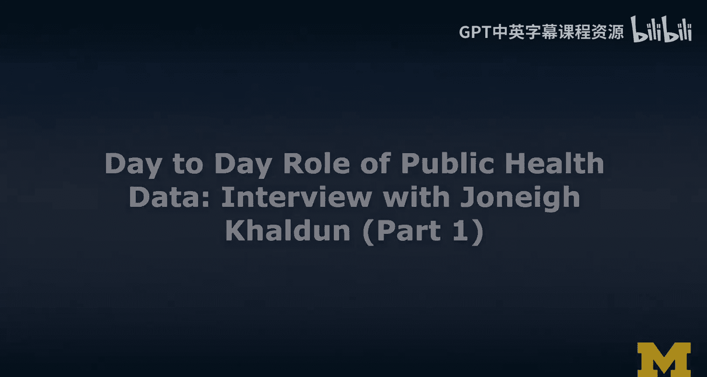
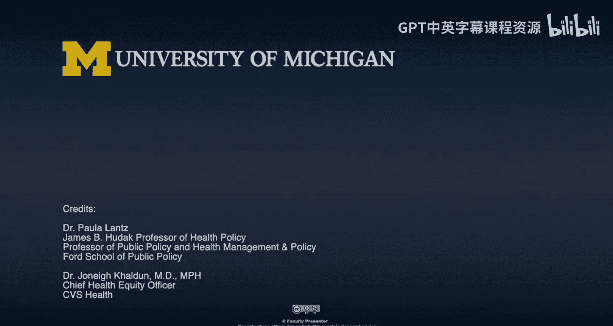

# 密歇根大学《公共部门的R数据分析（基础、数据探索、决策支持、）｜Data Analytics in the Public Sector with R》中英字幕 p40 39_公共卫生数据日常应用：Joneigh Khaldun访谈.zh_en -BV1YZ421J7Fx_p40-

Welcome， I'm Professor Paula Lance， and today I'm delighted to be having a conversation with Dr。

 Jeannay Kdun。Actually is one of my idols in public health and public service。

So grateful you're here with us today。

Dr。 Kaldun is a practicing emergency physician and she is also currently the vice president and chief health equity officer for CVS Health。

Dr。 Kaldun has had a number of different important roles in public health administration and leadership and to get us started Dr。

 Kdun and again thank you so much for being with us today can you please tell us about some of the cool positions you've had absolutely is this just an honor to be here today and I've known you for many years including early on in my career it's just lovely to be back here with you so yes i've been honored to have several roles in administration particularly in the government sector so I was actually the chief medical officer in the Baltimore City health department so we had seven clinics of freestanding labs I was able to oversee that work there I also have served as the medical director and the director of the Detroittro health department so building out programs there in a lot of restructuring and responding to hepatitis a crisis one after another and then more recently before my current role I was the chief medical executive for the state of migan but also the。

Deputy director for health in the michi Department of Health and human Services so public health Medicaidicaid behavioral health and our state mental health hospitals were under my umbrella these are big jobs i'm sure everybody realizes that can you summarize some of the major administrative responsibilities that you had when you work for the city of baltimore in the city of de and the state of michigan absolutely I mean in government public service it's all about the people right it's all about the people and how you're serving people and using your small budget in government it's often a small budget how you're using your dollars and being stewards of those dollars to advance in my rural health for the people of that community baltimore detro or the state of michigan so a lot of my work was on planning a lot of it was about quality looking at data so how are we in our baltimore clinics how are we serving people what are our metrics。

How are we thinking about billing was something else that I worked on in Baltimore and Detroit specifically as far as our infrastructure staffing。

 so a lot of planning assessment， looking at data， quality improvement work that's great and those are all the core functions of public administration that we've been talking about in this specialization and also as you know the learners and this specialization are really interested in what's the role of data and data analytics and the public sector so could you talk a bit about you know the importance of information and data for meeting your very large administrative responsibilities absolutely you know data are so important you don't know kind of how well you're serving or quite frankly if you're serving people at all unless you have data so data are very important when it comes to understanding the people that you're serving different quality metrics so。

How many people are getting access to care， getting the treatment they're supposed to be getting what's the timing of them getting that treatment。

 especially in governmental public health we look at death and death rates a lot and so an example i'll give is for the state of michi actually our opioid works I oversaw our opioid strategy and so we were putting out data on deaths and the trajectory of deaths in the state but one thing i asked the team to do was to go back and say okay we now see that the trajectory this was before 2019 trajectory is trending down for deaths but we looked at it by race and ethnicity we also we actually saw an increase for some populations and so that data is important because then it helps us guide the programs that we implement and think about our geographygraphies and the populations that we're trying to serve right so it's not just having data but really knowing how to analyze it by subpopulations and geography and social care and what is the story what is the question that。

tryrying to have the data answer what's the story that the data are telling you is really really important right so can you talk to us a bit about how you worked with data system designers and analysts in this important work and how did you work with them to make sure you had the right data to begin with but then pulling it together in reports for communication？

Absolutely absolutelyly I'll tell you it it is complicated mean often in the governmental public health sector you often don't have a lot of a large team or full funding quite frankly I would say that governmental public health tends to be underfunded however that team I mean all of my three core roles in governmental public health my data team has been really the backbone of everything that I've done and so I think about timeliness of data making sure the data are clean there's not duplicates as an example so we're counting people in the right way how are the data collected does it match with how we need to report it to other folks so from a state perspective we have to report nationally so are the data being collected upfront in the right way and are we looking at it and package it in such a way that it can be sent to the federal government and also what's really really important is how the data。

Communicated publicly having spreadsheets and tables and Excel files means absolutely nothing to the general public so it's how you share that data visually but it's also how you talk about the data then data really they're really a story they're really about a story and it's a story that's telling us how a particular health issue is playing out but also what tells us what we need to do to advance the health of a community。

That's great and we've been talking in this course a lot about how it isn't just about the data it is about the story but also the analysts need to know what the leaders and the administrators are going to be doing with the data the context absolutely matters I don't know do you have any stories along that line you know I will say always before any speech I give a lot of speeches in my roles particularly in Detroit and certainly in Michigan and any data set there's always limitations to it there's limitations as far as what definitive answers you can say about what the data is telling you there's always there's often omissions there's often just there's just always limitations to a particular data so it's really important that you share that or you understand that when you're looking at telling that story publicly or even designing your programs so I would say with COVID。

Response certainly thinking about what our data said and what it didn't say and that we were still trying to always get additional data that was really。

 really important。There is so much to talk about with coVID。

 so I think we're going to take a little break now and then come back and have a different conversation with Dr。

 Kaldun about COVID data and just the immense issue of building new data systems in a moment of crisis thanks so much。

