# 密歇根大学《公共部门的R数据分析（基础、数据探索、决策支持、）｜Data Analytics in the Public Sector with R》中英字幕 p41 40_Javed Ali访谈（第一部分）：国家安全与政府官僚体系.zh_en -BV1YZ421J7Fx_p41-

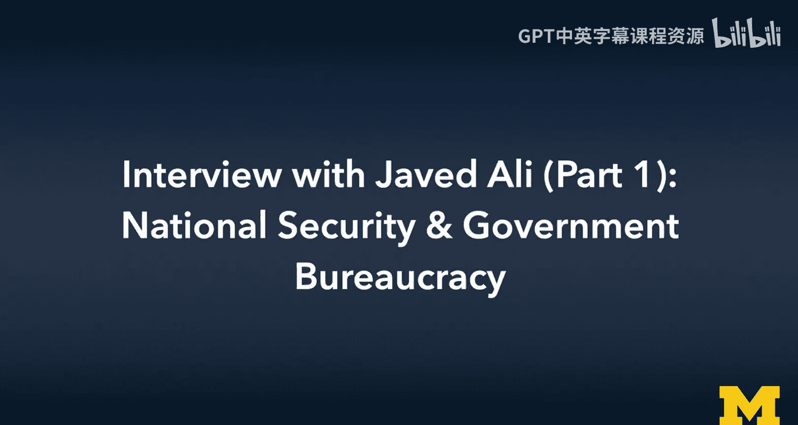

Welcome， I am delighted to be here today with my colleague and friend， Professor Javavid Ali。

Professor Ali is an associate professors of practice at the Ford School of Public Policy at the University of Michigan。

 where he teaches courses on cybersecurity， national security， and counterterrorism。

Professor Aliwi has had a host of really interesting jobs and leadership positions。

 he'll tell us more about that in a moment， but it does include very high level positions in the US Defense Intelligence Agency。

 Department of Homeland Security， and also the Federal Bureau of Investigation。

He has a JD degree from the University of Detroit and again a wealth of experience and knowledge and Java it I'm so grateful that you're giving up some of your precious time to chat with me today about your experience working for the public sector in this important area and especially talking about the role of data and data analytics in this work so Paul great to be with you'm really happy to be here and look forward to our conversation Well to get started。

 please do just take a moment and tell us about all the cool things you've done over the course of your career Well I'll try to be brief and consolidate it but as you mentioned I had a number of different roles in my time in Washington D and I spent 26 years in Washington which is a long stretch of time and of that 26 years。

 16 years in government and you've already described some of those departments and agencies but across all those different positions which even included a year in the White House under the Trump administration。

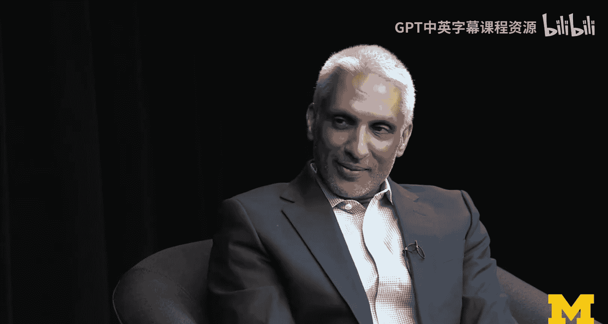

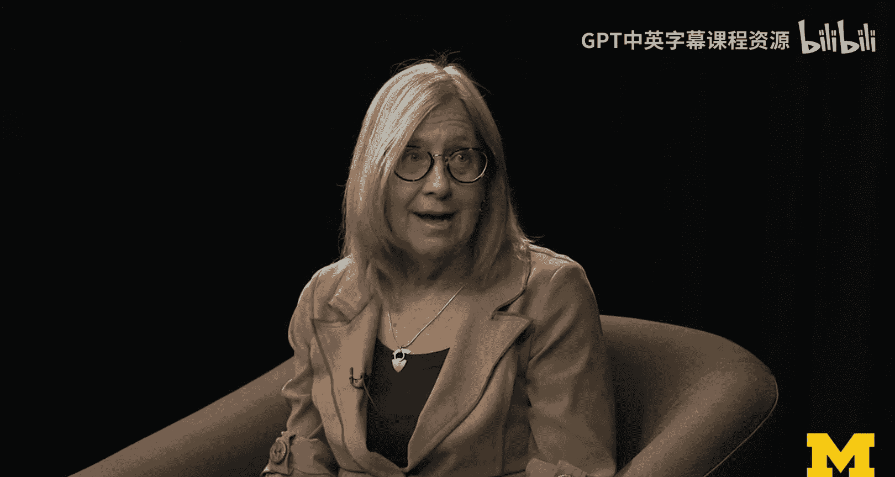

I was for the most part solely focused on counterterrorism。

 but because of that diversity of all these different positions I managed to look at pretty much everything。

 analysis， operations， strategy， policy， resources so unlike most of my colleagues who would generally spend most of their time in government service in a single organization even if they had several different jobs I did the complete opposite I had six different jobs across 16 years of service and increasing levels of seniority responsibility management so it was a really unique career but now I am so thrilled in privilege and honor to be working with you here at my alma mater。

 the University of Michigan and as I jokingly say to my students I would have been voted least likely to ever be a professor so I saw it takes to me some time to get used to being called that but again I'm really glad to be here Great thank you。

Well， so far in our course the learners and I have been talking about public goods and national security is certainly a very important public good but it's also huge so could you just take a moment and unpack this big concept of national security yeah。

 I mean national security is an incredibly vast and complex space and within that broad topic of national security there are different。

Issues and disciplines and they can be regional or functional and I spent my whole career in at least on the government side in one functional issue。

 counterterrorism， but counterterrorism isn't the only national security priority for the United States。

 even though I would argue that post 9/11 after the September 11th attacks here in the US that counterterrorism became the dominant one。

Going back and looking at history， perhaps that was a mistake。

 I mean we were so focused on dealing with terrorist threats both at home and abroad that perhaps we lost our ability to understand this whole range of other national security priorities so fast forward to where we are now in 2022 I would argue that yes counterterrorism is still important as a national security priorities but perhaps there other equally important or more important ones and that involves great power competition great power competition and the Russia Ukraine conflict is just a manifestation of that cybersecurity。

 as you mentioned I'm teaching a course here at Michigan on cybersecur and that crosses all these different disciplines as well climate change has become such a huge issue for national security and the Biden administration is recognized that probably unlike any other administration in the past 20 years obviously public health and we are still in the midst of this COVID pandemic。

I try to be as optimistic as I can I know you have a different perspective but again like this is very much a national security issue as well。

 look at what's happened to the economy too and the impact it's having on how people live their lives every day and that is having an impact on our ability to conduct our affairs in the national security space too so I guess what i'm trying to say is。

There are a lot of different issues under this broad banner of national security and the glory days of my career in counterterrorism being the dominant one。

 those days are gone， I think counterterrorism is now competing with a bunch of other topics。

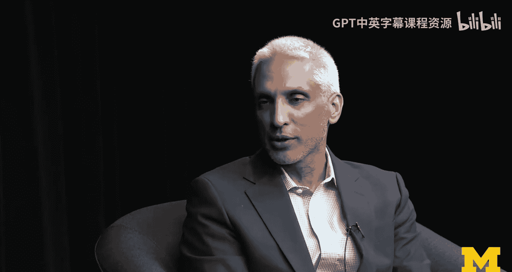

Great and as you know， a lot of the learners that we're speaking with right now are from a number of different countries so in your experience what are some of the similarities but also some of the differences across countries and nations in terms of thinking about and organizing government around all these important national security issues there's there's no model of national security there's no one size fits all approach and at least in my government career I was lucky enough to travel across the world and meet with our foreign partners and understand how were they approaching even it was counterterrorism again is one issue within a broader framework of national security or how are they set up from a national security perspective relative to us and what I found through all that travel and I traveled to almost three dozen countries in that stretch of time so I was on the road a lot is that there's no parallel to the US system because we're so big and we're so。

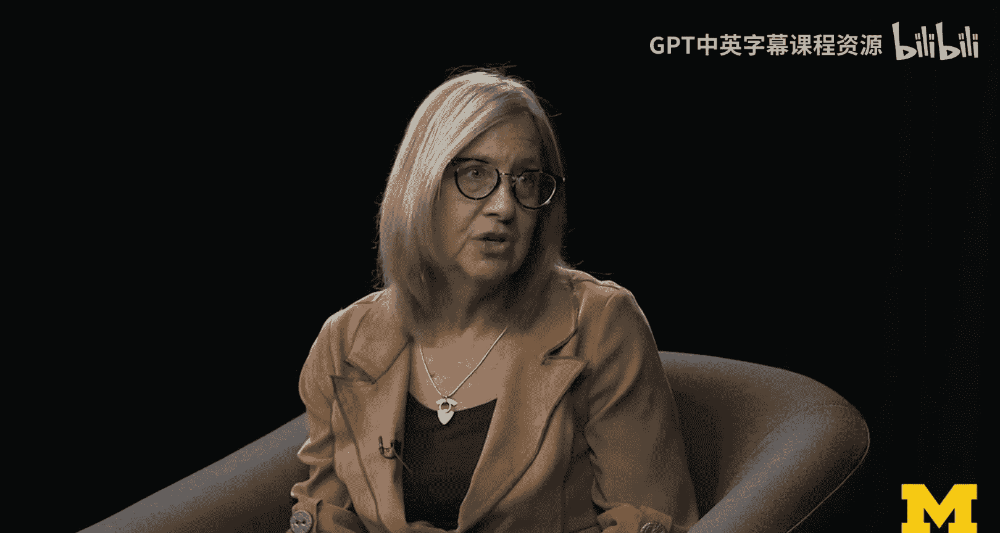

And we've got so many different departments and agencies involved in different aspects of national security。

That in and of itself is a major difference between how the US is organized in other countries。

 but at the same time， some of the common sort of themes are strong approaches in defense。

 intelligence， and then again how those，Different countries view the mission priorities in those two worlds I think you have to look at each country differently I would argue that the countries that seem closest to us maybe not in scale。

 but in terms of focus are。Britain。Australia， Canada and New Zealand and one way the US operates in that national security space on these sort of common priorities。

 something called the Five Eyes relationship and that relationship goes back decades and decades and decades so these five countries to include the US we almost have an identical sort of philosophical approach on national security because of this five Eyes construct but once you separate out from that five Eye's approach then it becomes much more individualized and and tailored so even strong partners to the US like Germany in France。

 we don't operate in national security under that same five Eyes approach so we've been talking in this course about government bureaucracy and I think that is something that cuts across countries right government is a big bureaucracy and there are challenges to public administration and public policy because。

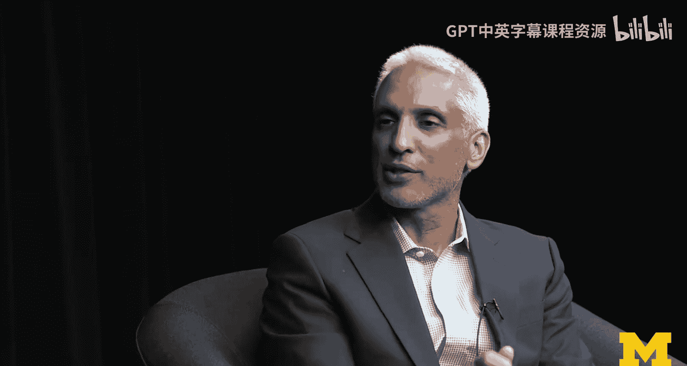

Of，Unwieldiness of most large government bureaucracies。

 can you talk a little bit about in your experience what are some of the things that have been done in the area of national security to try to prevent against siloism and to on the positive side。

 increase collaboration and communication across。All the different parts of the bureaucracy that are ostensibly working on the same issues right and again。

 this is this is an enduring feature of our US national security establishment is this sort of these entrenched bureaucratic sort of priorities and cultures and。

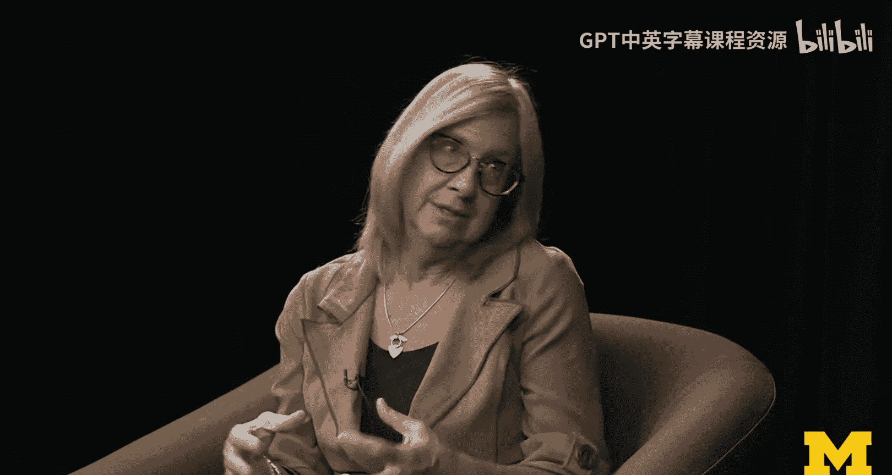

Again， whether it was good or bad， I was witnessed to it because I served in so many different departments and agencies。

 so each one of these six that I served in had its own organizational culture。

 its own sort of language， its own bureaucratic processes and I was up to me to figure out how to navigate through those so even in my own career I had a lot of interesting experience seeing those challenges but one of the things the US has tried really hard to do。

 at least in the counterterror world and that's the world I knew as much or more than anyone else is break down those silos and break through those bureaucratic bears that prevent information sharing and collaboration and integration because what we learned。

Pre night 11， if you're not doing those things， something like 9/11 will happen and I teach a class on this but walking through the the missteps and the missed opportunities and the organizational failures that got us。

To 9，11。 and in the aftermath that of that terrible， terrible attack。

 something dramatic had to change。 We couldn't just operate as status quo。

 So one of the things that had to happen for US counterterrorism was to come up with a new set of paradigm and a new paradigm and a new。

Set of structures and one of the things that happened as a result of that was something called the Office of the Director of National Intelligence in 2004 that was a recommendation by the 9/11 Commission and so that organization once it got up and running was chartered with driving integration collaboration and information sharing through at least the intelligence community on counterterrorism to prevent something like 9/11 from happening and then again my career sort ofode that wave to include serving in two different jobs in this new organization and I'd like to think at least from the US side that made us better in counterterrorism because of all those things we were trying to change after 911 didn't mean we're perfect and didn't mean we weren't going to get attacked again we have been attacked in this country and we've been attacked overseas but at least you don't have to fight the culture and at least you don't have to fight sort of bureaucracy to get you to these end states the adversaries and enemies always get a vote。

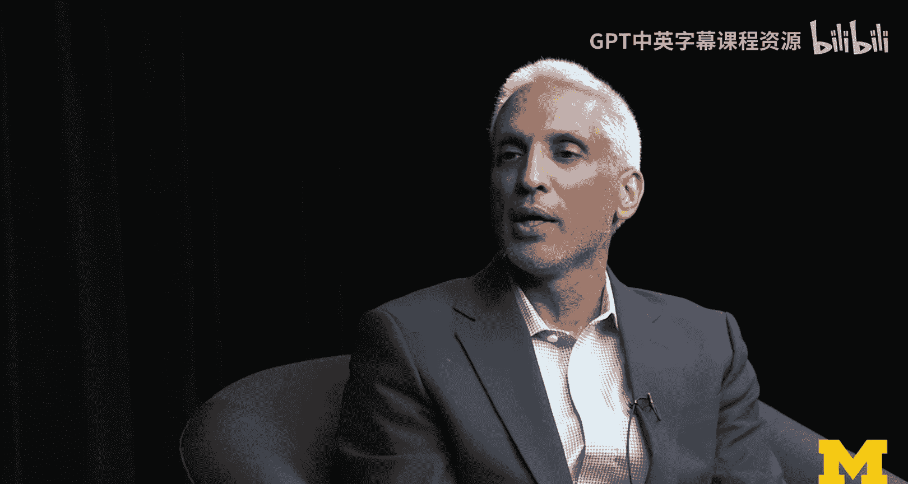

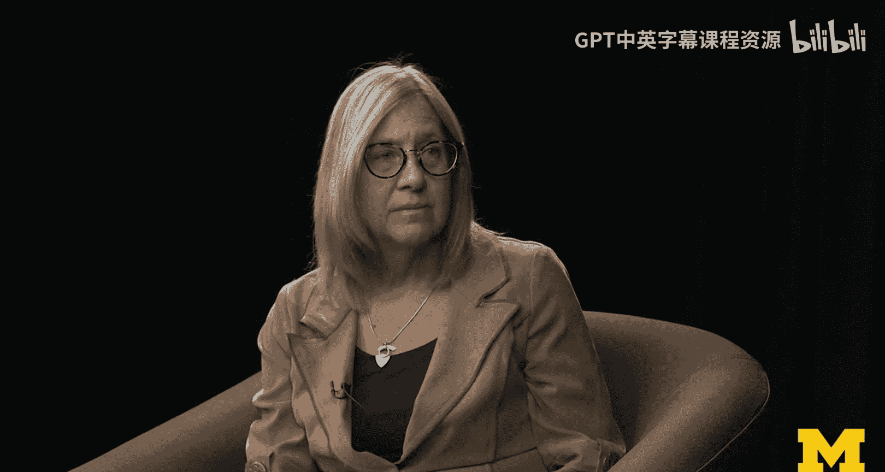

As bureaucracies move slowly to get to some new place。

 they can move faster and that's what we saw in the counterterism well。

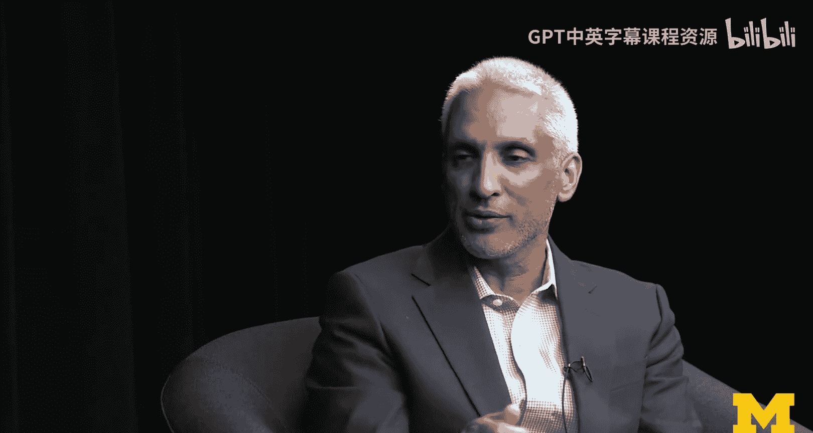

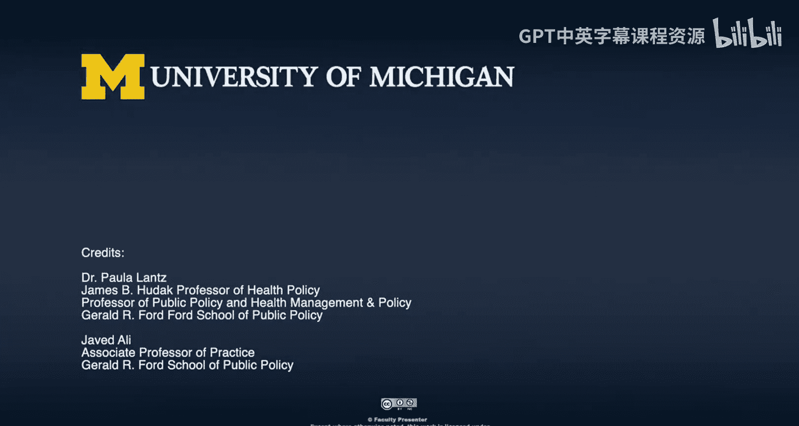