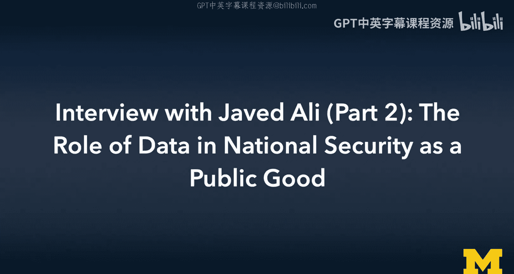
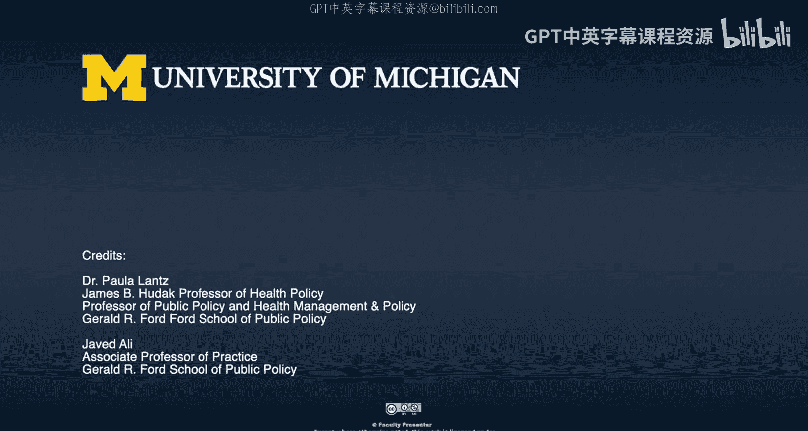

# 密歇根大学《公共部门的R数据分析（基础、数据探索、决策支持、）｜Data Analytics in the Public Sector with R》中英字幕 p42 41_Javed Ali访谈（第二部分）：数据在国家安全中的战略作用.zh_en -BV1YZ421J7Fx_p42-

Well， you've alluded to information and data several times， so let's talk data。Um， what？

Different types of data and there's so many but really you know what are some of the priority types of data and information that are essential when we're thinking about national security including counterterrorism and defense and cybersecurity all of those things what what what matters in terms of data yeah I mean the data issue is so important for national security but you have to sort of look within each。

Functional issue or regional issue to understand what data is most relevant to that because not all data is equal and you could be you start looking at the wrong set of data on a certain topic or issue you may not find the threats that you're actually looking for and again this was something that counterterrorism really had to adjust to after 9/11 and so the aperture for acquiring data got massively bigger after 9/11 and you needed and the growth of social media exactly right both on the classified and the unclassified side and that continues to be one of these challenges just for counterterrorism forget about all the other national security priorities and so when I was in some of these government positions I saw that sort of wave starting to hit us and I thought if we don't we as the intelligence community anyways don't start trying to get ahead of these data challenges we have either on the classified side or the publicly available side and I would argue so。

Me fits in there then we're going to。More threats will happen and we will lose our ability to stop them and so the classified data problem is one problem and traditionally the intelligence community had again another one is cultural you sort of relied on just we're only going understand the world through the lens of whatever classified information we have whether it's technical information imagery from a satellite information that's derived from a human source I mean these are all the different types of classified data that you have to sift through but now we've got this much。

 much bigger pool of publicly available information which a lot of it resides in the social media world and how do you bring those two worlds together infuse these two completely different types of data into a common approach that lets former analysts like myself when I started my career identify threats before attacks happen and that's the ultimate goal to keep the American publica either at home and abroad and prevent。

FromBut I think there's the challenges there's more data now there's less ability to figure out what that data means and then how do you ingest it in a way that's timely。

 it's actionable and makes sense and these are all things that are still ongoing challenges for us right。

Do you have an example of maybe that you can share not classifiedifying data。

 but an example of a routine kind of report you would get in one of your jobs where。

Well， maybe a better example is the social media challenge for for the at least the US and probably other countries on the national security space so again。

 the traditional focus of the intelligence media is to collect the classified intelligence but there's so much of。

National security relevant information in the social media world， and I think one of the challenges。

How much of it is relevant， what can you legally acquire， certainly in the United States。

 we have constitutional protections and what information that's publicly available can police the intelligence？

Community collect and then what do you do with it even if you have it and a good example of how a foreign adversary has managed to exploit this social media domain against the United States was the Russian disinformation campaign in 2016 where they basically using different elements of their government cutouts like the Internet research agency basically led a really strong disinformation and misinformation campaign and the run up to the 2016 elections for President Trump and president presidential candidate Hillary Clinton at the time when these social media drivenve campaigns were happening。

The US government didn't know which of these accounts were linked to Russian proxies or the Internet research agency or not。

 and one of the things we still don't know the answer to is from that social media activity。

 how much of an effect did it have on influencing，Peopleople's perceptions of either Donald Trump or Hillary Clinton to the actual vote。

 but the fact this activity was happening in real time， no one knew it was happening in real time。

 or least the Russian component of it， and then potentially having a significant effect on the elections like that is an incredible case study on how foreign adversary has used social media in plain sight。

Without our ability to understand what was really happening。

 and that'll probably continue to happen in elections going forward。We're in a very uplifting。

Conversation here I'm never the bearer of good news unfortunately that was such an important aspect of the work in the public sector and again as we've been talking about it's such an important public good。

Only。Only the government's going to be taking on this role of trying to understand threats and challenges to national security。

So for people who are thinking about and interested in careers as data analysts and policy analysts。

For governments and in their countries and you know also for you know subdivisions within countries。

 but especially in the area of national security and defense and counterterrorism what are your recommendations I mean my recommendation would be yes you know lean forward into those positions if those opportunities exist。

 you know build the skills you can acquire either on the academic side or on the professional side。

 but at least within the U we need more of those types of people。

 whether they're young sort of midcareer， but because of these challenges that we've talked about on the information and data analytics side。

 this is part of our national security workforce that is still woefully sort of underrepresented and even when I I think it's safe to say it is everywhere but certainly in the national security community and as I was leaving government 2018 to start teaching here。

 that would like these were series，Of positions that some of my former departments and agencies were trying to hire into and even trying to hire a handful of people became。

Veryry difficult either because we couldn't find the people with the right skills and the right experience。

 or we found those people， but they had tremendously better offers from a private sector company where they could triple or quadruple their salary they didn't have to get a government security clearance and get a lie detector test and get drug tests at all I mean these you have to make some lifestyle choices too if at least for the US side if you're going to aim in that world so there's a number of I think barriers to entry that are making this hard and this is another one of these tradeoffs。

 at least on the government side people are going to have to perhaps take more risk on you may not you may not be able to get a candidate who's able to get pass through all these security sort of checks before you get in but they have the hard skills and what's more important making sure that someone has the hard skills first versus some lower level security concerns because if we keep defaulting to someone has to pass all these security checks first。

We're never going to fill these positions with the people that matter， exactly。

 skills absolutely matter。Well， I know we could spend hours more literally talking about all these important issues。

 but thank you so much for sharing a bit of your time with us today to just talk a little bit more about the important role of data and information in。

The incredibly important area of national security， thank you so much absolutely thank you Paul。

