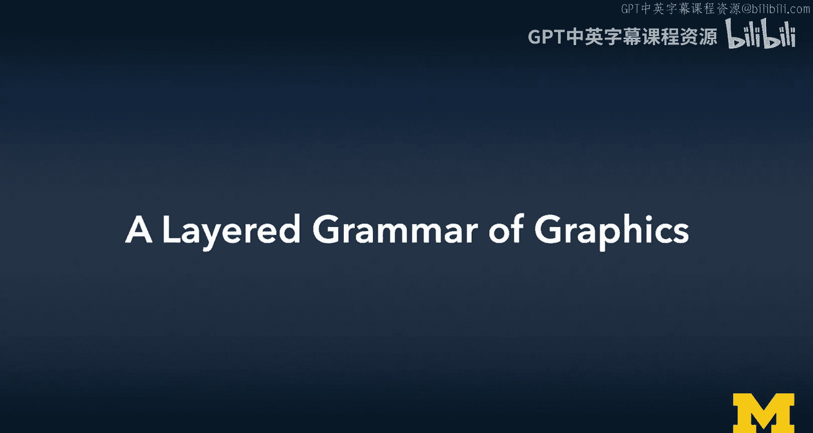
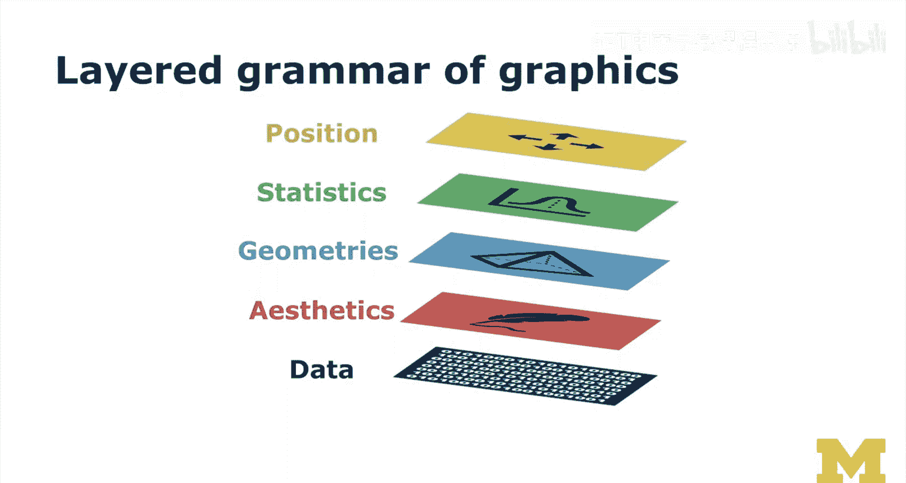
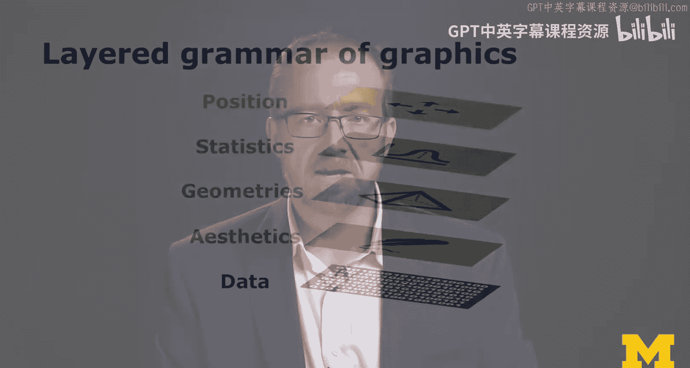
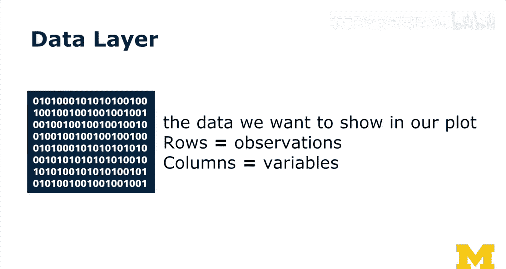
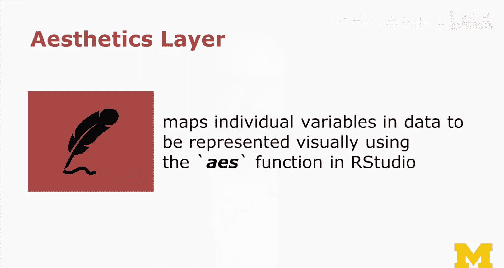
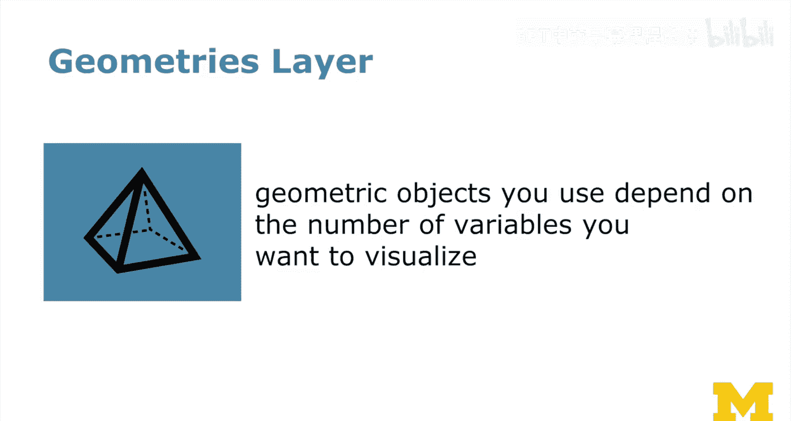
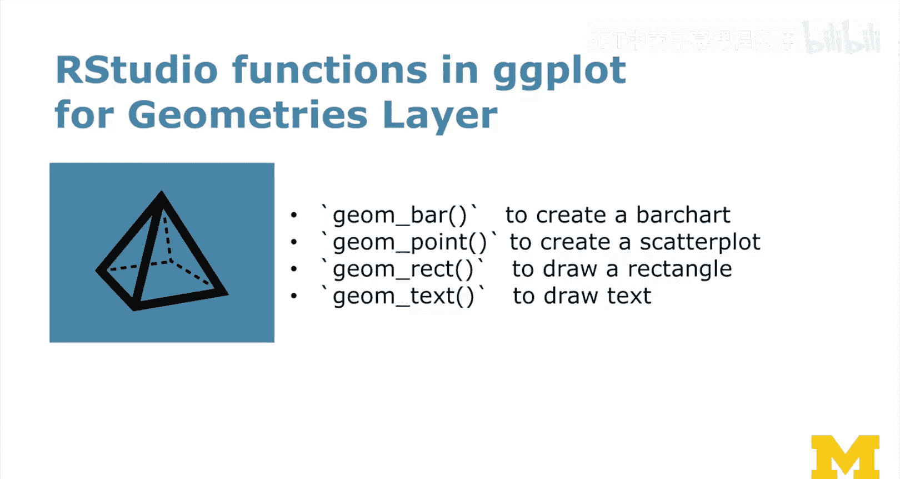
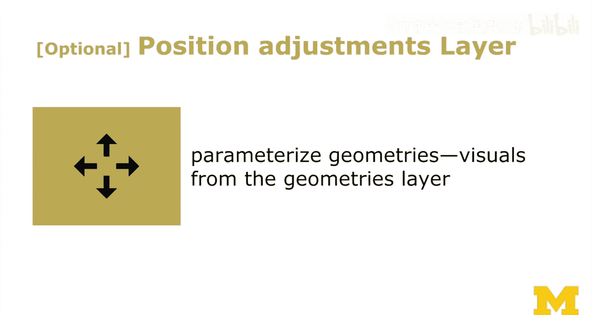
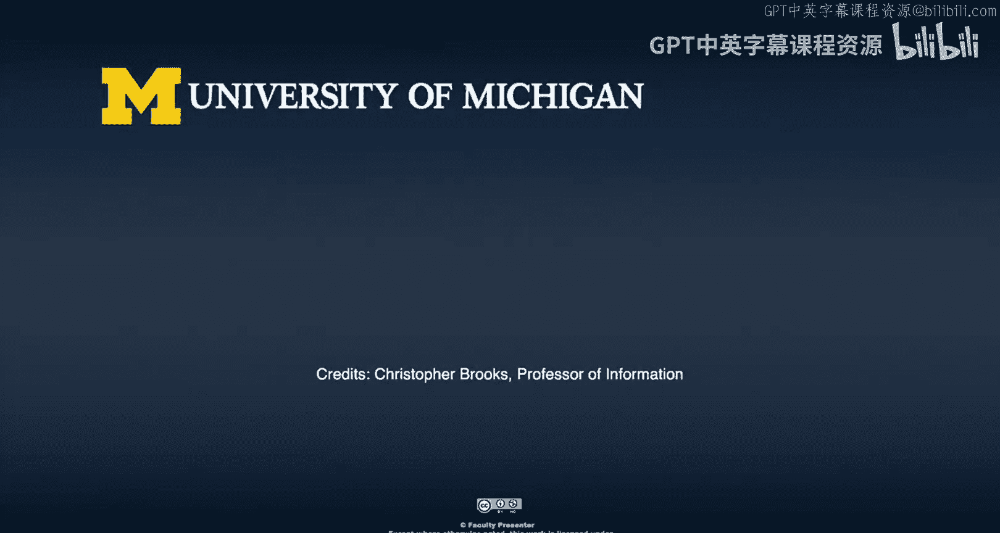

# 密歇根大学《公共部门的R数据分析（基础、数据探索、决策支持、）｜Data Analytics in the Public Sector with R》中英字幕 p45 1_分层图形语法体系.zh_en -BV1YZ421J7Fx_p45-

While there are many different ways to make plots within the R ecosystem。

 the Ggi plot 2 package from the Tidyverse is by far the most popular method created by Hadley Wickham。

 It rests on something called a grammar of graphics。

 a way in which we can structurally define our visualizations through rules that are well understood and repeatable。

Now， Hadley Wickham didn't build this system all by himself， but built on the work of others。

 including Wilson at all， who first defined this as a grammar and the cartographer Jacques Btan。

 whose semiology of graphics from the early 80s is still an excellent inspiration for the topics we're going to be talking about in this course。

 It's actually quite amazing to me at how deep in theory are thinking is about information visuals。

 The roots of this largely come down before the modern computer era。

 when visuals had to be painstakingly created by hand and when printing and reprinting of visuals was an extremely expensive process。

😊，To that end， there's wonderful volumes tackling this issue from the angle of the human visual perception system and the ways in which the eye and the mind can decode information quickly and intuitively。

 We're going to touch on some of this in the last week of this course。

 But I wanted to start off focusing on the mechanics of creating plots in G G plot。

 Let's start with the layered grammar of graphics， as described by Wickham。

 I've included a link to his original paper on this in the course shell。😊。

In addition to this， Wickham has written a great book introducing Gigi Ploot 2 Library。

 aptly named Gigi Ploot 2， and published by Springprinter。As of the time of filming。

 it's currently in its second edition， but the book website has a third edition available and you can access it online for free。

 and there's going to be a link to that in the course after this lecture。

The idea of layers is a bit like old school transparency film。 You can draw one plot。

 Let's say it's a scatter plot with an X and a y axis and a bunch of data points。

 Then you can add another layer on top。 let's say a line plot that shows a trend in the data。

 perhaps even a third layer to call out a special region of the visual to pay attention to something。

In GJ plotot， a layer is responsible for rendering each of the visual elements。

Layers are made up of five parts， and those parts form a grammar or a set of rules by which R will create the visual artifacts。

The first element of a  juji plot layer that we're already pretty familiar with is the data that we want to show in the plot。

 usually is a data frame or a tablebble in the tidy verse。

This data doesn't have to be all of our data， but can be filtered and mutated using some of the tools we've already seen previously。

 keepinging with the opinionated view of the tidyverse， the data should be tidy。

 which means each row should represent an observation， and each column should represent a variable。

The next component of a layer are the aesthetic mappings， and they're defined with the AE S function。

 This maps individual variables in our data to something which will be represented visually。 Now。

 there's a lot of different ways to visualize data。

 The two that will generally start with are the X and the Y dimensions of the data。 And here。

 I think it's important to note that G G plot2 really aims to excel in two dimensional visualizations。

 which are by far the most common。 And so these two aspects of the AES function can be passed in is the first two parameters always。

After this， it depends on the kind of visual that you're looking to make in the different aesthetic mappings that are available。

 for instance， you might take color and bind that to a different column in your data。

The third component of the layer are the geometric objects。

 the kind of geometric objects you use depend on the number of variables you want to visualize and if those variables are discrete or continuous。

Now， we haven't talked explicitly about this， but a continuous variable is usually a number which can range。

 like somebody's age， their weight or maybe their percentage grade on an exam。

 And a discrete variable is one which is categorical and may or may not have an ordering to it。

 For instance， nationality might be an example of a discrete non ordered categorical。

 While one's place in a marathon might be an example of an ordinal categorical。

Sometimes these discrete variables are called factors and we're going to be diving into that in the next lecture。

The geometric objects are all named starting with the letters G EOM， and then an underscore。

 So we have functions such as Geome bar to create a bar chart or a geo underscore point to create a scatter plot。

We also have geometric objects， which are not directly related to the variables。

 but are considered graphics primitives， such as drawing rectangles with geoome rec or text with geoome text。

 These are all shorthand in Gji plot， and there's some important side effects of using them that muddy our initial understanding of how the layered grammar of graphics works。

 So we'll get into those in the second week of this course。The data。

 the mappings to aesthetics and the geometries make up the core elements of the grammar for each layer。

 we do， however， have two optional layer constructs， statistics。

 which provide statistical transformations on the data。

And position adjustments， which parameterize our geometry。

These are useful to know about， but quite often they have their own functions we use。

 and instead we just pass in parameters to the geometry objects or even use the statistics which have been hard coded into the geometry objects。

And this week， we'll mostly focus on the first three aspects of the grammar of graphics。

 but next week we'll add in those last two。That makes up the core of the layered based grammar Now。

 just like we have grammatical rules for sentences in languages like English。

 we also have rules which cover the connections between sentences。

 such as punctuation and rules which cover the connection of many sentences together。

 such as paragraphs and sections。We have these elements as well in our grammar of graphics。

 connecting， framing and spanning the different layers。

 but I think we should get our hands dirty with some simple Gii plot layers first。

 so let's start coding。

