# 密歇根大学《公共部门的R数据分析（基础、数据探索、决策支持、）｜Data Analytics in the Public Sector with R》中英字幕 p46 2_R语言因子变量处理.zh_en -BV1YZ421J7Fx_p46-

I'm pleased today to introduce you to a little friend of mine，7 young Brooks。

 my 20 year old toy poodle。 My wife and I first got savvy when we got married。

 and we've moved throughout Canada and into the US down here to Michigan with him。 In fact。

 we consider him our first born， where our actual firstborn is half savvy's age at just 10。

 I think pets are really important。 and we've seen this in society during the Covid pandemic。

 especially Anim shelters have seen huge demands for people who want pets and need those companions for mental health。

 And while were lots of us were working at home， Pes were a really important part of our life。😊。

Pets are actually a challenge for society on other sides as well。 and so for instance。

 we have to deal with issues like safety and cleanliness and so forth。

 and so pet licensures kind of an interesting piece of civic data that I thought we might start our exploration of G Pot on。

 I thought it'd be interesting to take our first look at Gi plot through some civic data provided by the city of Seattle。

 Washington。 Many civic municipalities are making more and more of their data open to the public。

 sometimes as an effort to engage in crowdsource analyses of the and sometimes as a requirement of legislation such as the Freedom of Information Act。

This isn't unique to the United States at all。 municipalipalities and governments of all sizes around the world are beginning to provide this data to the public。

 creating huge demand for those who understand and can manipulate that data。

 people just like you so I thought for this lecture why don't we just jump into that and start looking at what that license data looks like。

 and see if we can do a little data analysis with it。

First thing I'm going to do is bring in the tidy verse and read in our data here with read CSv。 Okay。

 we've got a lot of things going on in this seven variable data frame。

 And I think we'll be able to talk about number of them。 First。

 note this pattern where I just put the variables data as the last item is my code chunk。

 I like to do this just to render the data because it's easier to explore in the notebook。

 instead of having to go up to the environment pane。 We get some built in support from our studio。

 and we can see how many rows there are in the data types of the columns and we can page through some of that data nicely。

 This isn't always ideal。 if we wanted to knit this together into a P Df。 For instance。

 we're going to get this giant dump of data， which goes on for pages because a P D F isn't that interactive。

 But when working in the notebooks， I find this really beneficial。😊。

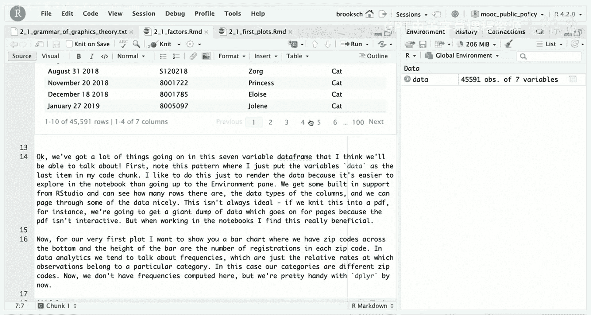

Now， for our very first plot， I want to show you a bar chart where we have zip codes across the bottom and the height of the bars are the number of registrations in each zip code。

In data analytics， we tend to talk about frequencies。

 which are just the relative rates at which observations belong to a particular category。

 In this case， our categories are different zip codes。 Now we don't have frequencies computed here。

 but we're pretty handy with Dli iron't by now。

So this kind of Der work is easy for us now， a little group by， summarize and arrange。Okay。

 so we see we have zip codes there， and then we have the total frequency in this new column that we called total。

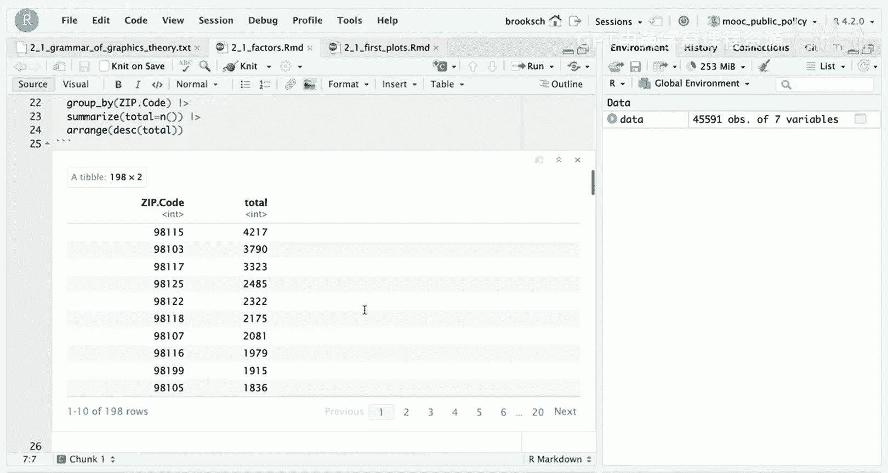

Okay， so we see we've got 198 rows。 So there's 198 zip codes。

 and these are represented as integer values。 Some zip codes have thousands of pet registrations。

 and we see if we jumped about the third page， that will actually have N represented as a zip code too。

 and it's got 181 entries。 Never forget the N values。 They're always lurking in there。 In this case。

 I'm actually going to leave them in in their own category。

 But depending on the analysis that you actually want to do， you might do something else with them。

Now that we have our basic frequency data， we have to address the elephant in the room。

 Zip codes aren't actually integers。 Sure， we can represent them as integers。

 and that's what happened here when we used Read CSV to pull them into the data frame。

But we really want them to be categories。 If we go back to some of our fundamental data types。

 though， we don't have categories。 We've got numeric values， character vectors， and so forth。

Up until now， this hasn't been a problem。 For instance， in the B RFS S data， we looked at。

 we have maybe four or five different categories for someone's response to a phone question on smoking。

 We are able to just represent these categories as numbers when we are filtering and mutating columns。

But that doesn't work with libraries like Ggi Pot， so we need to introduce a new data type in R。

 the factor。In data analytics， we often classify variables into one of two groups。

 either discrete or continuous In statistics lectures。

 this is usually introduced by drawing on graph paper。

 where discrete variables are individual points representing possible values in the data。

 while continuous variables are lines or curves representing the range of values points can have。

I want to refer to discrete variables though as categories instead。

 because that's more common when working with non statisticians。

Categories are sort of like labels on buckets， everything in the bucket is considered to be the same as far as the label is concerned。

So if we're dealing with pet data like this， we might put cats in one category。

 horses in a different category， and maybe dogs like savvy here in yet another category。

 Unlike points being drawn on graph paper， there isn't always an ordering for the buckets。

 The buckets just exist to differentiate our options。However。

 sometimes the context of our work does put an order into these categories。For instance。

 if we wanted to compare our buckets based on the average loyalty of each animal to their owner。

 we would clearly put dogs first， then horses and cats would be somewhere down the line。

In these instances， the categories are considered ordinal categories because they have an order or a ranking to them。

 but it's important to note that they still aren't continuous。

 There might not be any category between dogs and horses。 For instance， and that's okay。

 We still have this ranking of our categories。In R。

 these kinds of variables are called factors and they can be either ordered or not。

 and they turn out to be really important when dealing with Gii plot and the tidyverse。

So let's take a look at our original data again here。

We see that there's this species column here。 That's a perfect example of a factor。

 but at the moment， it's encoded as a character vector。

 If we check the list of unique entries in this vector。

 we see that Seattle has licensed four different species of animals。 Cats， dogs， pigs and goats。

 We can convert this column into a factor using the asz factor function。😊。

So here I'm just going to overwrite our species column with the species column converted into a factor。

All right， and so we can see here that the label for the species has now changed。

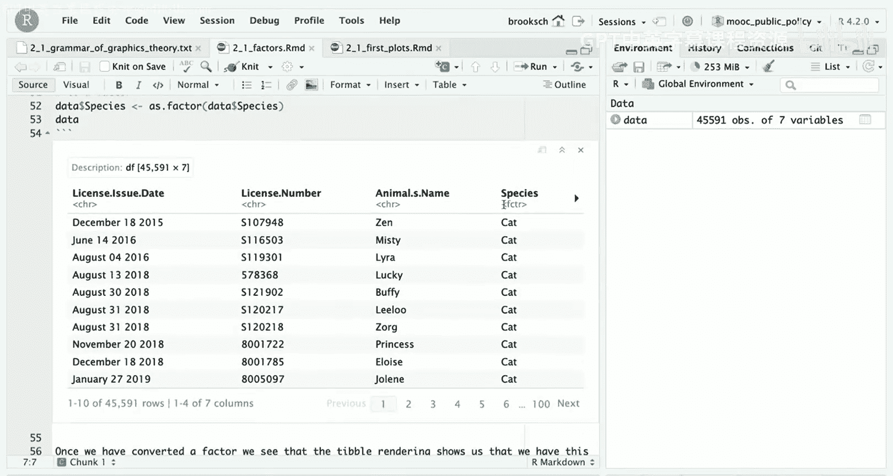

Once we've converted a fact， we see that this tibble rendering shows us that we have this new factor type for a column。

 Now， there's some computer science optimization work happening behind the scenes here。

 And while you don't have to know all of it in detail， it helps to understand some of the basics。

 When we convert a character vector into a factor。 R actually converts it into an integer vector and then creates a mapping between the numbers and the different categories。

 and we call these categories levels in R。 And then it adds it to the vector metadata。

 This is an example of how R handles objects for those of you who might be familiar or have heard of object oriented programming。

 And we can actually see this if we use the attributes function in R。

So here I'm just going to take the attributes of that new column data species。

 we see we have a levels entry here and that we have a class entry which indicates that this is an objective type factor。

The mapping to integer values is largely hidden from us in most of the tools we're going to use。

 We see that in the tibble interface， we can still see the level values。

 And if we look at just the head of the column， we'll be able to see the level values of the first few items。

 as well as a list of all of the levels available in our factor。

 So I'm just going to call head on data subspecies。

 And we see here that the first five items are all cats。 But we actually see that the levels。

 there's a cat level， a dog level， a goat level and a pig。

 So these levels together make up our factor。😊。

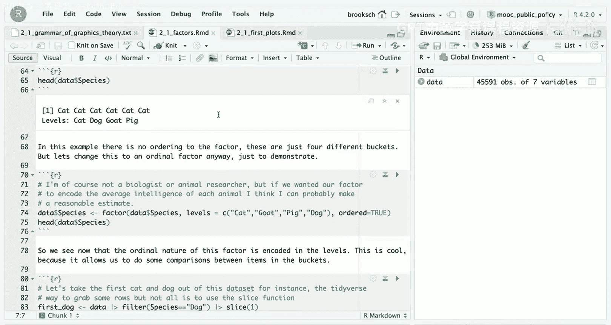

In this example， there's no ordering to the factor。 These are just four different buckets。

 but let's change this to an ordinal factor anyway， just to demonstrate。

I'm of course not a biologist or an animal researcher。

 but if we wanted our factor to encode the average intelligence of each animal。

 I think I could probably make a reasonable estimate。

 so here I'm going to take our data species and I'm going to assign it to the factor and I'm going to pass in data species and then I'll just set the levels of cat。

 goat， pig and dog and I'll say ordered is true and then we'll just print that out。Okay。

 so we see now the ordinal nature of this factor is encoded in the levels。

 this is cool because it allows us to do some comparison between the items in those buckets。

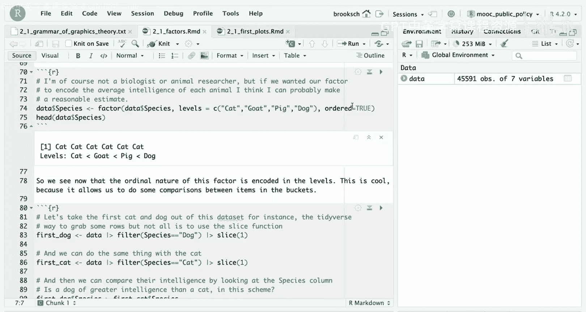

So let's take the first cat and dog out of this dataset set。 for instance。

 the tidy verse has a nice way to do this using slice。

 So I'm going to say first dog is assigned to data。

 I'm going to pipe it into the filter and I say that I just want where the species is equal to dog。

 remember that's just going to reduce our data frame a little bit and then I'm going to pipe that into slice one So I'm going to take the first item out of that。

 and we'll do the exact same thing with cat。 so we'll get the first cat and then we can actually compare their intelligence by looking at the species column and we could just say is the first dog species greater than the first cat species。

Well， it looks like true。So that's neat and it's exactly as we'd expected。

 Now what I've shown you here is the base R factor object。

 but the tidyverse expands the functions we can use and there's a whole package devoted to this to working with factors called four cats。

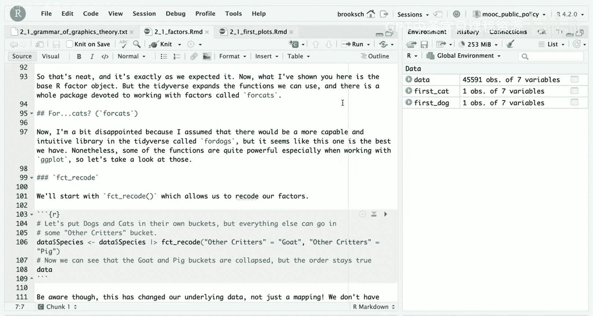

Now， I'm a bit disappointed because I assume there would be a more capable and intuitive library in the tidy verse called four dogs。

 But it seems like this is the best we've got。Nonetheless， some of the functions are quite powerful。

 especially when working with G G P。 So let's take a look。

So we'm going to start with fact recode， which allows us to recode our factors。

So let's put our dogs and cats in their own pockets and everything else we'll just put in this other critters's buckets。

 So here I'm going to take data species， and I'm going to call fact recode。

 I'm going to say other critters is equal to goat and other critters is equal to pig。

 It's going to leave the dogs and cats alone and it's going to reassign goat and pigs into this other critters block。

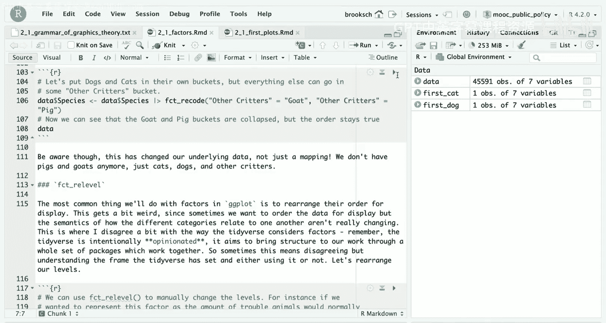

Be aware that this has actually changed our underlying data， not just a mapping。

 We don't have pigs and goats anymore， just cats， dogs and other critters。

 we could have coursed done this with mutate as you learned in the Dlier course and then turned it into a factor。

 so you have some options here。The most common thing we'll do with factors in Gigi plot is to rearrange that order for display。

 This gets a bit weird。 And sometimes we want to order the data for display。

 but the semantics of how the different categories relate to one another aren't really changing。

 And this is where I disagree a little bit with the tidy verse and how it considers factors。

 Remember， the tidy verse is intentionally opinionated。

 It aims to bring structure to our work through a whole set of packages， which work together。

 So sometimes this means disagreeing but understanding the frame that the tidy verse is set and using it or not。

 Let's rearrange our levels。 the tidy verse way。

So we can use the fact relevel to manually change the levels， for instance。

 if we wanted to represent this factors the amount of trouble animals would normally get in。

 we'd probably want dogs to be the very smallest and then the other critters and of course then cats would be the largest troublemakers and so we could just do this by piping in that column to fact relevel and giving it our new level ordering。

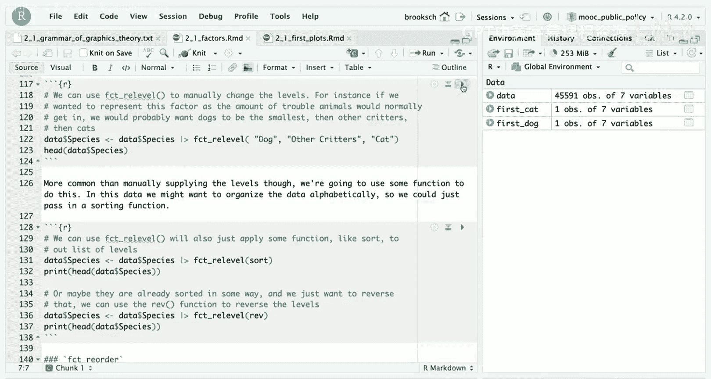

More common than manually supplying the levels， though。

 we're going to use some function to do this In this data。

 we might want to organize the data alphabetically。 So in this case。

 we could just pass in a sorting function。

So here we're going to use the fact rele and just pass in a function like sort。

 And so we can do that here。 Now sorts a base R function。 We could also do fact relel and pass in Re。

 Re is another basear function that just reverses a list。 So after we've sorted it in one direction。

 we can then reverse it。 and you could， of course， merge these together。 In most of my work。

 I actually have some other column of data that I want to use to set the factor ordering。

 For instance， we might want to calculate how many of each pet exists in our data set and order them by frequency。

 We can do this with the fact reorder， which allows us to reorder a factor by another variable。

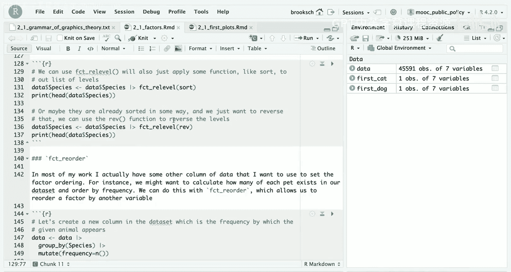

Let's create a new column in the data set， which is the frequency by which a given animal appears。

 So here I'll just group by the species， and I'm going to mutate。

 I'm going to create a new column called frequency， and I'll just assign this to N。 Remember。

 N is a helper function that tidy verse gives us that will count the number of rows。

Now we could change the ordering of the levels using fact reorder factory orderder always uses ascending smallest first order。

 so we would expect other critters to be at the top， so here I'm just saying factory orderder。

 take our species and reorder it based on the frequency column let's execute that。

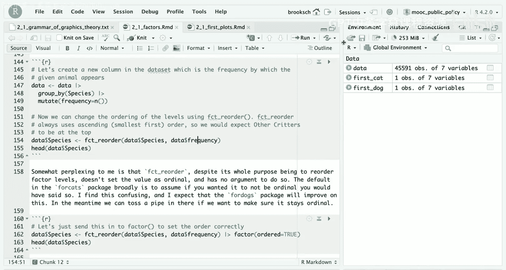

Somewhat perplexing to me， is that fact reorder， despite its whole purpose being to reorder factor levels。

 doesn't actually set the value as ordinal， and it has no argument to do so。

 The default in the forecast cats package broadly is to assume that if you wanted it to not be ordinal。

 you would have said so。 I find this confusing。 And I expect that the four dogs package will improve on this。

 In the meantime， we could toss a pipe in there。 if we want to make sure it stays ordinal。

So here I'm going to do basically the exact same thing and at the end。

 I'm going to convert that series into a factor and indicate that it should be ordered。

It turns out that sorting by frequency is a super common need and having to do all this deep pier work where we group by and create a new column in our data frame is just a pain。

 Forcas actually has a special function to sort by frequency called fact infr。

So we use fact infrequ when we want to sort items by frequency from the largest to the smallest。

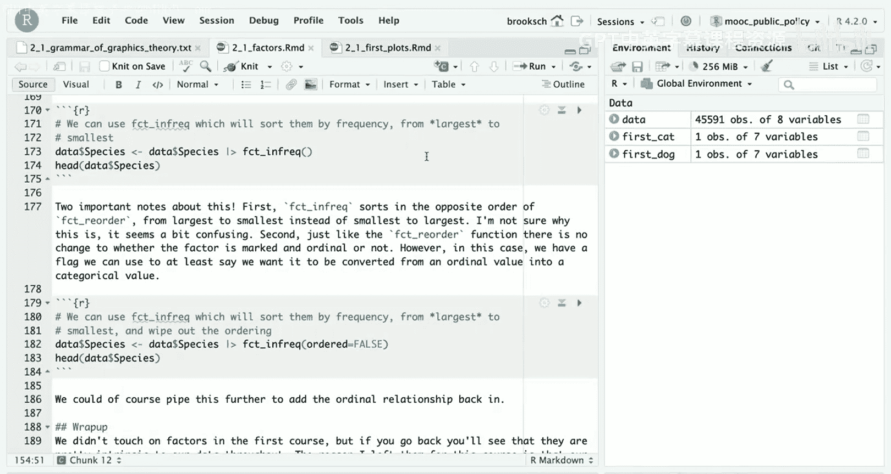

Okay， two important notes about this first， fact infr sorts in the opposite order of fact reorder from the largest to the smallest instead from the smallest to the largest。

I'm not sure why this is， it seems a bit confusing， but second， just like fact reorder function。

 there is no change to whether the factor is marked as ordinal or not。 however， in this case。

 we actually have a flag that we can use to at least say we want it to be converted from an ordinal value into。

 let's say， a categorical value。

Okay， so we can use fact in free here， sort by frequency。

 And then we're going to set ordered equals to false。 And after we execute this。

 we'll see all the less than signs and the levels have gone away。

 indicating it's just a categorical value。 Now， of course。

 we could pipe this further to add an ordinal relationship back in of a different kind or do further manipulation。

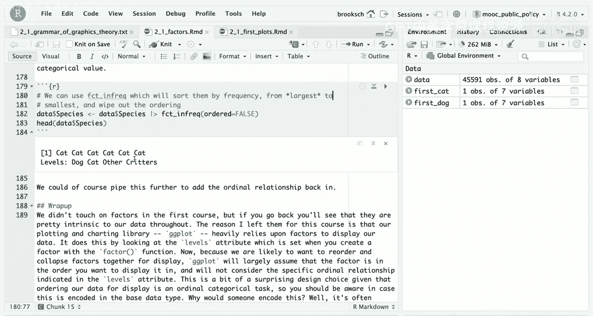

We didn't touch on factors in the first course， but if you go back。

 you'll see that they're pretty intrinsic to our data throughout。

 The reason I left them for this course is that our plotting and charting library。

 G G plot heavily relies on factors to display our data。

 It does this by looking at the levels attribute， which is set when you create the factor with the factor function。

Now， because we're likely to want to reorder and collapse factors together for display。

 Ggi plot's largely going to assume that the factors in the order you want to display it in and isn't going to consider the specific ordinal relationship that you may have indicated。

This is a bit of a surprising design choice， given the ordering our data for display is actually an ordinal categorical task。

 So you should be aware of this in case that data is actually encoded in the base type。 Now。

 why would somebody do this， Well， it's often useful for statistical modeling。

 a topic that we're not going to touch on much here to indicate if your data is actually ordinal。

 Okay， Now that we understand the five layers of the grammar of graphics the way it's implemented in the tidy verse。

 And we understand how factors and categoricals are done in R。

 I think it's time for us to get doing some plotting。

