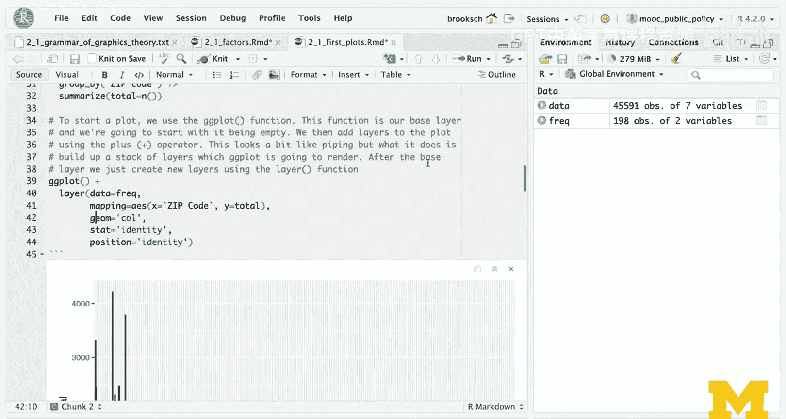
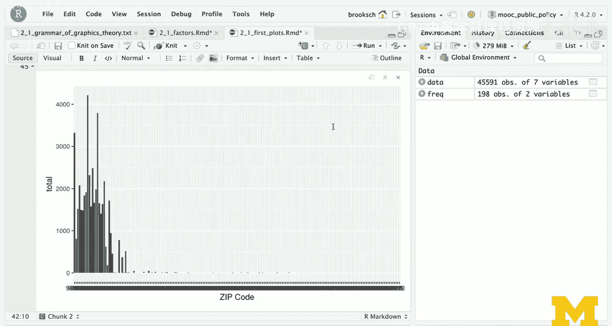
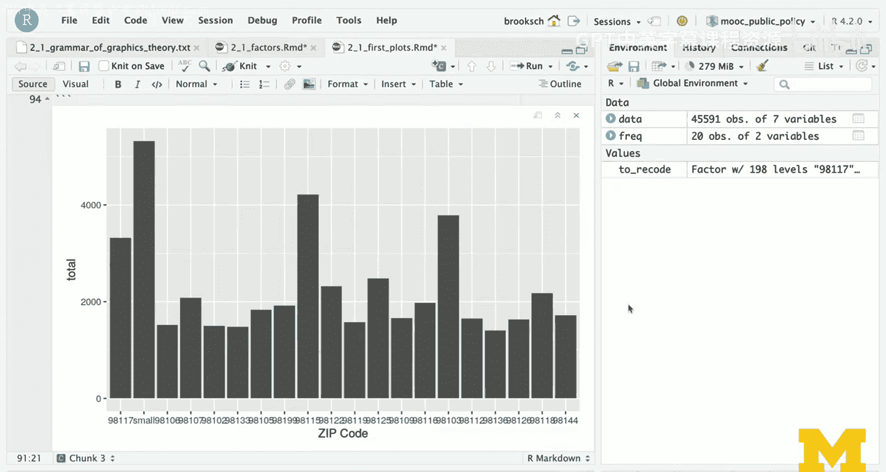

# 密歇根大学《公共部门的R数据分析（基础、数据探索、决策支持、）｜Data Analytics in the Public Sector with R》中英字幕 p47 3_ggplot基础绘图入门.zh_en -BV1YZ421J7Fx_p47-

With our feet grounded both in the theory of the layered gramer of graphics and a bit of hands on practice with forecast cats。

 I think it's time to dive into making some beautiful visuals。

 Let's load the Seattle pet license data and take a look。

 You'll notice that here I'm going to use our newfound knowledge of factors right from the beginning。

😊，First thing I'm going to do is bring in tidyverse Now we're going to read our data in and set our column types as appropriate right in one line while in a previous lecture I use the base R read dot CSv in this lecture。

 I'm going to use the tidyverse read underscore CSV This is a subtle but important difference as this will change some of our column names and automatically create a Tbble for us。

So I did a bit of magic there with this call types parameter。

I showed you previously how you could indicate that a specific column should have a specific type。

 but read underscore CSV actually has this handy ability for you to just list all of the types you want your columns in the order that they're going to be found。

 so the string CCFFF is telling read underscore CSV that I want the first three columns to be character vectors and I want the next four to be factors。

 You can check out the docs for more information on possible values that you can put in here You might also notice that the column names are cleaned up and that they have many spaces in them and don't have periods this will change some of our code going forward and by now you'll know how to scour the docs for a little bit more on the details。

A few lectures ago， I set our target goal for this week to show a bar chart where we have zip codes across the bottom and the height of the bars are the number of registrations in each zip code。

We started to try and clean and summarize our data using DPlier and we know that we've got 198 different zip codes and some of thousands of registrations in them。

So let's create our first one layer visual reflecting on the layered grammar of graphics。

 our data is this 198 observation tablebble， our mappings for aesthetics are the zip codes variable on the X axis and our Y value which is the height of each bar on the chart。

The next element of our grammar， the geometry object is a bit counterintuitive at first。

 we're not actually making a bar chart it turns out。

 but a column chart we'll get to the difference between these in a bit。Finally。

 our statistics and position elements really aren't used here。

 we're going to use whatever statistics are in the data and we're not going to apply any transformations。

Now， R is going to do this by using the word identity to mean that these two items aren't going to change the rendering of the layer in any way。

So the first thing we're going to do is calculate the frequencies for each zip code factor and add that to。

The first thing we're going to do is calculate the frequencies for each zip code factor and add that to our data。

 I'll show you later that we don't actually need this step。

 but I think it's more clear with it right now， So we're going take create a new variable freak and make that equal to our data and we're going pipe that in Now we're going to have our column names in back ticks here because they have spaces in them and this is one of the side effects of switching to read underscore CSv from read dot CSv and I want you to be aware of how to handle variables which have spaces in the name So this column this variable actually has a space in the name and so we have to surround it in these back ticks be careful here these aren't single quotes they're back ticks the tilt button on most keyboards and then we're gonna pipe that into the summarize function and create a new column called total which is the N。

To start a plot， we're going to use the G plot function。 This function is our base layer。

 and we're going to start with it being empty。 then we're going to add layers to the plot using the plus operator。

 This looks a bit like piping， but what it does is actually build up a stack of layers which G plot is going to render After the base layer。

 we just create new layers using this layer function。 And so we'll see we'll pass in our data。

 mapping geos and so forth。 Let's give this a run。

Nice， our first visualization。 The zip code is being mapped to the X axes while the totals of the heights of the bar。

 Look back at that layer function and we can break it down a little bit。

 We know that there's five elements to each layer。 the data。

 which is freak in our cases are aesthetic mappings where we map the X and Y axes and the geometry in this case。

 the geometry is of type CL call for a column plot。 and then the statistics and position arguments。

What we can see at a glance is that there's lots of zip code entries with very few pet registrations。

 and then a few of them have a lot of registrations。

I think we can play around with our zip code factor and do some merging to make this chart a bit more informative For instance。

 why don't we collapse the zip codes which have under1 thousand0 registrations into one factor and then look at what we've got There are many different ways to do this and I'm going to show you one here that might not be the most efficient but it's easy to read and it uses our DPlier skills and of course it's going to introduce you to something new so what I'm going to do is I'm going to create this data set to recode I want to take our frequency I'm going to filter it so I only want those that have less than a thousand registrations in total then I'm going to select out of that the zip code and then I'm going to unlist this。

So be careful here， notice this unlist at the end that actually is going to convert the table that's returned by the select into a vector。

 and this is important because of the comparison I'm going to do in the next step。

 so this data structure here to recode is going to have all of those zip codes that we actually want to collapse。

 just listed as a giant character vector。So now I want to do a mutate and a case when and overwrite with strings。

 so here I'm going to take our frequency， pipe it into mutate， take our zip code， use this case when。

 and then I'm going to say zip code in to recode and remember that we've got here a formula。

 the ted here is actually a formula， so if this case is true if the zip code is in the to recode。

 I want the string small。You then have this catch all true and for everything else that didn't match that first rule。

 I want the zip code return just as a character。Now this in operator I used looks a bit scary。

 but it's not all it does is check if the item on the left hand side exists within the vector on the right hand side。

 and this is called set membership and you'll use it a lot actually in this case I want to search for the zip code column value in the vector which is why I use this unlist function to recode our data。

You'll notice that for the catch all statement I return the value of zip code as a character remember that case when cases must all return the same data type。

 so here I'm making everything into a character vector because I want this new string value called small。

Okay， now if we want， we can turn this column back into a factor。

 so here I'm saying freak sub zipip code and then I'm actually just converting it into a factor。

And then we just want to merge all the factors which are of this new value small to calculate their combined frequency。

 so I'm just going to use D plier here for this， and I actually like to do a lot of this work in DPer even though we could use forecasts for a bunch of it remember that when we're within a group bias so I'm going to take our freak variable I'm going to group it by zip code if I'm want to access just that group in this case I do I can use the cur data function so that allows me to get just that group's data frame or table and then I'm going to create a sum of that and I'm going to use pipe that into summarize and create this new total。

And then we just plot it， the plotting actually here is pretty simple right。

 we're just going to say our data is free， our mapping is this zip code and totals and we want to use our geometry as a column。

 let's take a look。

