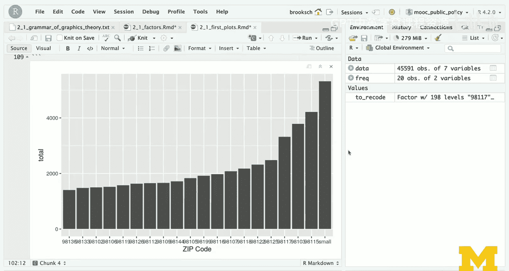
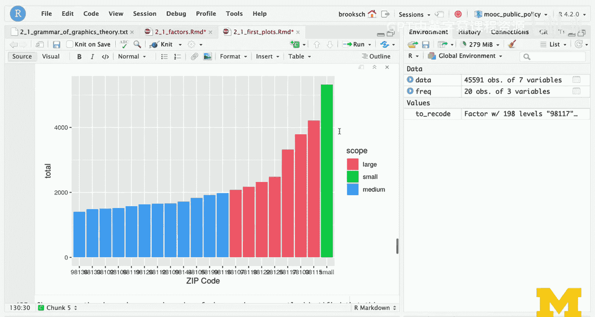
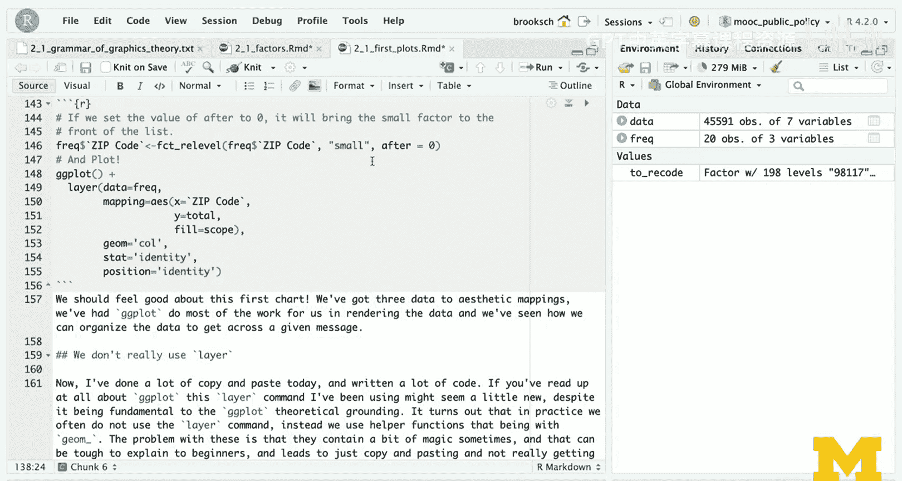
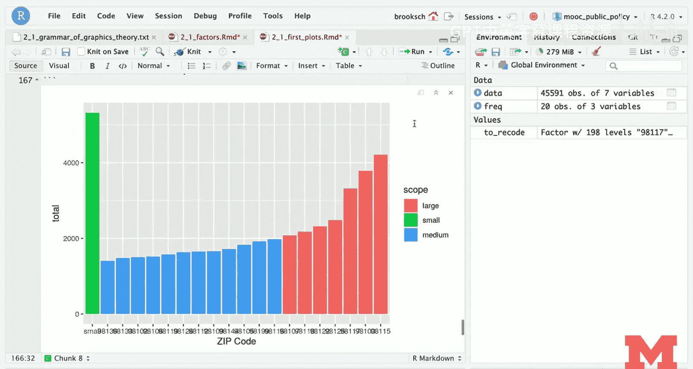

# 密歇根大学《公共部门的R数据分析（基础、数据探索、决策支持、）｜Data Analytics in the Public Sector with R》中英字幕 p48 4_ggplot美学增强实践.zh_en -BV1YZ421J7Fx_p48-

Well， the image is somewhat easier to read， but it's still not ideal。

 let's play with some of the factor reordering we can start by sorting the total number of animals in each level of the factor。

So here I want to reorder by the total so I'm just going to take our zip code in frequency and I just want to reorder it by that column。

 so I actually find myself trying to do this quite a bit where I want to take some column in this case total and I want to change this factor order by that column and then I'll just plot it up again。

Okay， so now we see it's actually sorted in this nice order from smallest to largest。

Let's add another category to this data for instance。

 we might want to identify this catch all small category special， it's not just another zip code。

 we don't want the reader to get confused we might also want to split the other zip codes into maybe let's say two different categories those with greater than 2000 animals in them and those with less than 2000 animals in them we can do this with our data frame with a couple of mutates to create a new column and then we can assign the fill color aesthetic to render that。

So I'm going to create a new column which is either a small medium or large。

 since we've already grouped our smalls into a group， I'll just check that existing zip value。

 then I'll check the total to determine the medium group and at the end I'll set everything else to large。

So this is just mutate with a case when and I think it's useful to see a lot of examples of case when。

 which is why I'm kind of trying to show them in different ways because there's a lot of things going on So I'm going to call this column scope I'm going take our frequency pass it to mutate and set scope equal to the zip code just as a set of characters when it's equal to small this is actually just sort of like the identity if there's something called small in there then emit it as still small。

But then I want to look at the total column， if nothing match that small。

 then I want to see is it less than 2000， if the total is less than 2000。

 then I want it to be medium。And then the very last one I want it to be true always so everybody else I want you to be in this large group。

 then I'm going to pipe this into a select so that I just get the scope O because remember I'm just trying to set that one column and then I'm actually going to unlist it to turn it into a vector so that I can then turn it into a factor so at the end of this we're going to have this scope column actually is a character vector that's been turned into a factor based on this mutate and case when。

And now we're just going to plot it so the only change to the plotting code here is for the mapping aesthetic not only do I have an x and a Y。

 but I'm also using this fill value and I'm setting it to whatever the value is inside of scope so importantly all of these are factors and need to be factors so this fill is not just a character vector it's actually pointing to a column that's a factor and you can find out more about fill in the documentation for the Geome column let's run this。

Okay， so this plot is actually looking really interesting now and we can see that three different dimensions of our data。

 not only do we have a list of all of our zip codes are categoricals along the bottom。

 including this small group that's a collection of zip codes。

 but then we have the height of the bars is the number of animals that are registered inside of each one。

 and then the coloration actually indicates for the reader of this chart immediately at a glance。

 what is a large group， what is a small group and what is a medium group。

So even though our bars are an order of size and we have correctly identified that this one category is just all of those small zips together。

 it might bug you to see it all the way at the right of the graph and I know it bugs me all we have to do is change the factor ordering that is the levels of the zip code factor GP uses these to sort the data along the Xaxxes let's first check what we're actually ordering。

So remember if we want to see the order of a factor， we can do a couple of things。

 we can print out the column and that'll tell us at the very bottom or we can just use the levels function。

 so here I'm just going to use the levels function and look at that column of data。Okay。

 so we see that what it comes back is a bunch of strings。

 and they're all zip codes and then it ends with our zip code called Small here。

So we've seen that there's actually lots of ways we can change the levels with factoryle。

 but there's another handy way to use it， the factory level allows you to take a specific level and place it in the list of levels that it should go in。

 essentially allowing you to move it to an arbitrary position。

So to do this we set the value of after to zero and it's going to bring that small factor to the front of the list so here I'm just going to take this factor relevel of the zip code and then I'm going to take the one factor that I'm interested in small and I'm going to set it after zero which means it's going to put it at the first point in the list and then we just plot it the same way we should feel good about this first chart we've got three different data to aesthetic mappings we've had G plot do almost all the work for us and rendering the data and we've seen how we can organize the data to get across a simple given message。

Now I've done a lot of copy and paste today and written a lot of code if you read up about GG plot and maybe you've seen something about the layer command。

 it might seem a little new and this might not seem like you would get if you were reading some blogs or medium articles or so forth。

 but it's actually quite fundamental to GG plots and it's theoretical grounding。

It turns out that in practice we often don't use the layer command instead we use helper functions that begin with this geo underscore The problem with these is that they contain a little bit of magic sometimes and that can be tough to explain to beginners。

 at least to just copying and pasting and not really getting a sense of how this layered grammar of graphics works。

Each of your layers has five elements， the five we've talked about， data， aesthetics， geometries。

 statistics， and position modifiers。But we don't have to use the layer function to do that rendering and specify all of these all of the time。

 For instance， in this case， we can abbreviate the creation of a column plot by using Jome underscore call。

So by default， geo underscore call is going to set the geometry statistics and positions for us。

 and it's going to use the identity for statistics and positions so we can actually write that whole layered bit just like this where we do GG plot plus geo underscore call。

 and then set the data， the aesthetic mapping， and that's it。We see that we get the exact same chart。

Despite this being much simpler to write， it hides from you some of what is happening underneath。

 it's important to know how this layers function works because there's some geometries that you'll want to use which don't have a helper function。

Okay， we made our first plot today a column plot I showed you how we could sort our factors and how to change how GG plot' is going to render the column list for us and how we can map three different aesthetic values to meaningful translations in the chart。

 the Xaxxes in this case， the y axes and the color for the bars。

Now we didn't talk much about labels either for the axis or for the legend。

 GG plot automatically inferred this from our factor levels。

We also got to learn a little bit more about the inner workings of R first that Read underscore CSV allows us to set the column data types in a fairly straightforward manner right as we load our data。

In practice you might find that you don't load factors right off the bat and that's okay。

 there are other data types out there like dates and times and we're going to be interested in looking at those in future lectures too。

In addition， we talked about the importance of converting our tibbles to vectors when we want to work with them。

 this might not seem intuitive at first and you'll begin to get the hang of it。

 just keep an eye on this environment pan in the upper right to get insight into the data structures that you're using。

Finally， I intentionally showed you this painful syntax using backts for column names that have special characters like spaces in them Frank。

 I never work with data in this format and I cled the column names right away when I load it。

 but I wanted you to be aware of this I'm going to introduce you to a package in a future lecture which helps with this part of the data cleaning。

😊。

