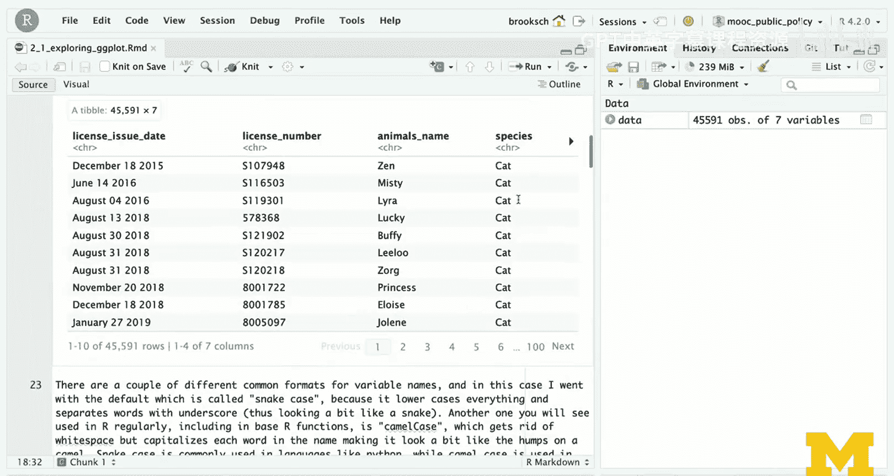
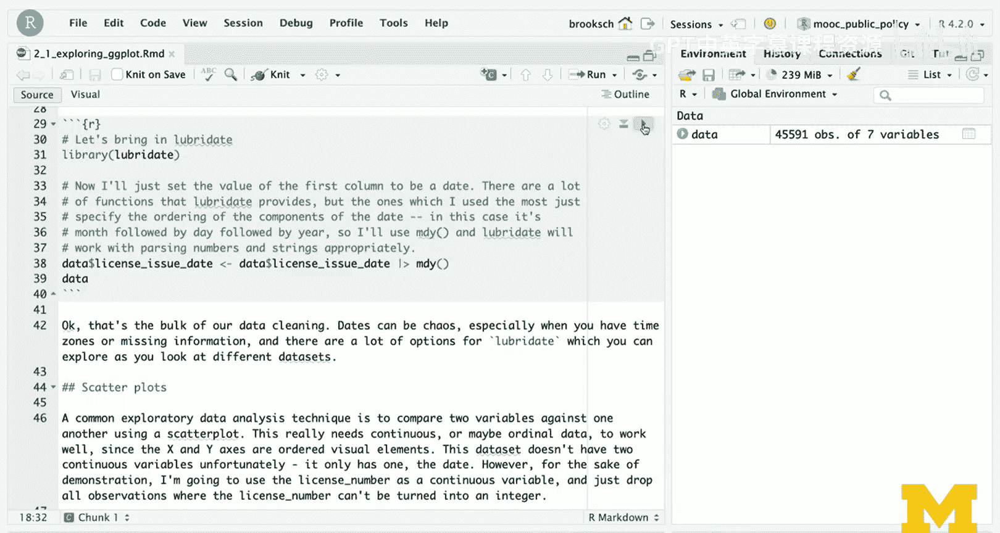
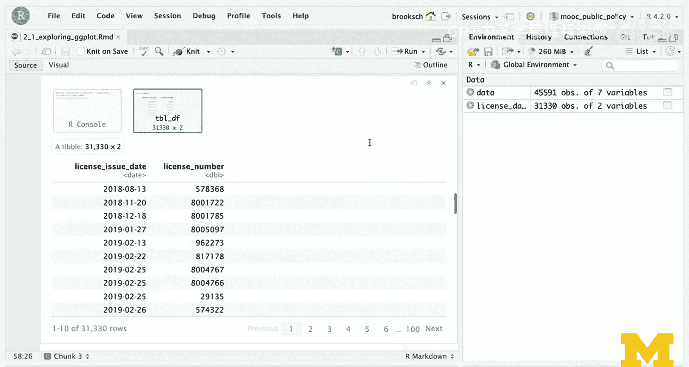
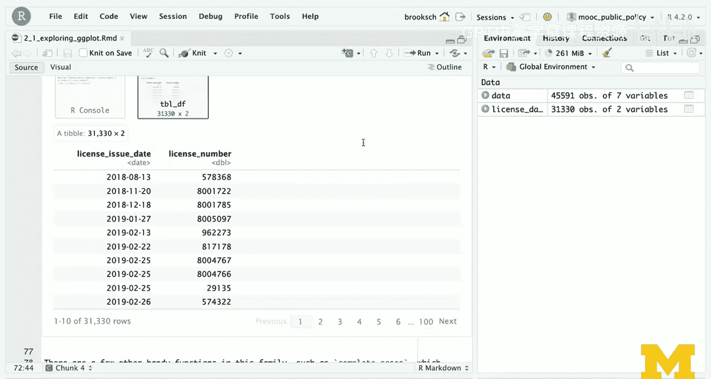
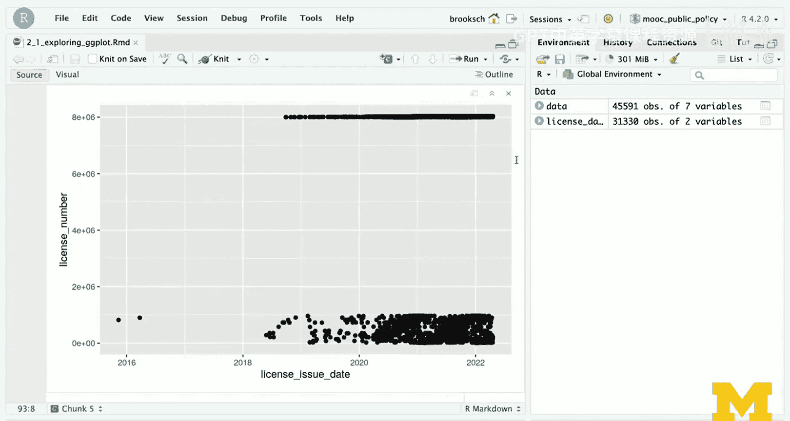

# 密歇根大学《公共部门的R数据分析（基础、数据探索、决策支持、）｜Data Analytics in the Public Sector with R》中英字幕 p49 5_ggplot功能深度探索.zh_en -BV1YZ421J7Fx_p49-

Yeah。

With some experience using G G plot under our belt。

 it's time to do a little exploration of some of the fundamental plots which are available to us。

 I think we can keep using this pet data before we change next week。 so let's load that in。

So first thing I'm going to do is bring in the tidy verse and I also promised you no more back ticks。

 so I'm going to bring in this new package called janitor and it'll help clean things up。

I'm going to bring in the Pats data the first column is actually a set of dates so I'm going to read that in as appropriate remember you can always check out more details about these functions using the question mark and then the function name in the console and I'm going to pipe this to clean names and clean names from janitor it's going to change our column names into a format called snakeake case。

Okay。

Okay， so here's our data。There are a couple of different formats for variable names。

 and in this case I went with the default， which is called Snake case because it lowercases everything and separates words with underscores。

 and so it kind of looks a little bit like a snake。

Another one you're going to see used in R regularly， including in basear functions。

 is called Caml case。 This gets rid of white space， but it capitalizes each word in the name。

 making it look a little bit like humps on a camel。

 Snakecase is commonly used in languages like Python。

 While camel case is used in languages like Java。I want to deal with that date column at the beginning。

 I'll be honest， dates are painful in the programming world。

 There's hundreds of different ways we humans represent dates。

 It's not always clear even to other people what a given date represents。 For instance。

 I had to learn the American style of representing dates as numbers in the form of month， day year。

 while in Canada， where I'm from。 It's written as day， month year。

 It can actually make for some confusion with trying to interpret what the value0701，22 actually is。

In R we can help using the luber date package， I'm going to use it to clean up our date column and you can check out the docs if you want to learn more about the options for this package。

So I'll just bring in the library lubridate。 Now I'll just set the value of the first column to be a date。

 there are lots of functions that Lubridate provides。

 but the ones which I use most just specify the ordering of the components of the date。 In this case。

 it's the month followed by the day followed by the year。

 so I'll use the MY function and lubridate will work with parsing numbers and strings appropriately。

Okay， that's the bulk of our data cleaning dates can be chaos。

 especially when you have time zones or missing information。

 and there are a lot of options for Luber Day， which you can explore as you look at different data sets。

A common exploratory data analysis technique is to compare two variables against one another using a scatter plan。

 This really needs continuous or maybe ordinal data to work well。

 since the x and y values are ordered visual elements。

 This dataset set doesn't actually have two continuous variables。 Unfortunately， it only has one。

 the date。 However， for the sake of demonstration， I'm going to use the license number。

 a continuous variable and just drop all observations with the license number can't be turned into an integer。

 Some of them start with an as。After making this assumption。

 I'm actually testing to see if the licenses are handed out in chronological order， If so。

 I should see a scatter plot of points along a diagonal indicating that his time increases so too does our license number。

So I'm going to make this new tibble of just the two columns that I'm interested in。

 so I'm going to select out the license issue date and the license number。

 Now I want to convert that one column， the license number into a number。

 Anything that can't be converted will be turned into an NA。

 So remember I can use this as numeric to change a string value in this case。

 the license number into numeric values in this case， it would be a double。

Now I'm going to take those observations， the rows。

 which have no Ns in them in either column and I can do this with a filter and some Boolean logic。

 so here I'm going to say filter where the license issue date is not NA and the license number is not NA。

。Great， we now have our clean data frame， and it's roughly 31000 rows long。 Now。

 this issue of dropping N A values is a pretty common one。 And here。

 I had to just look at a couple of columns to formulate a query。

 But what if we had many different columns we wanted to inspect for this。

 Bsar is a handy function called N A dot omit， which does this for us。

 It's not actually all that fancy。 It just takes in our data frame or Tbble and returns a new one where the rows capped are only those which have no N A values in them。

 So we could condense our code here a little bit。😊。

So I'll just overwrite our license data。 I'll use the same select。 I'm going to use the same mutate。

 but instead of the filter at the end， I'm just going to use na do omit。

 and that'll get rid of any rows in our data that don't have that aren't a complete row that have some nas in them because we only have two columns here it's going to be the exact same as before。

 but imagine we didn't have this select， then it would look across all columns in that data frame and omit those that had any nas。

There are a few other handy functions in this family， such as complete dot cases。

 which doesn't actually delete the rows which have an N， but identifies them with a Boolean mask。

 And always be careful when you're removing N values。 You're changing your data set。

 and you need to be able to reflect that back to stakeholders so that they're aware it's not exactly what was collected。

Now let's plot this as a scatter plot in G plot， these are called Ge point graphs。

Okay， now I'm going to plot this。 We've talked about how Gi G plots are actually layers of plots。

 but so far， we've only worked with one layer。 Well， secretly。

 we've actually been working with two layers。 the base layer。

 which is created by the G G plot function that we first call。 and then the chart。

 which we actually render， which we previously used as a geom call。

 The benefit of layers is that the arguments to the base layer are visible to the layers above unless they are intentionally overridden。

 That means we can actually provide some of our five elements。 Remember。

 like the data or the aesthetic mappings to just the base layer。

 and we don't actually have to provide them explicitly to the following layers。😊。

So here I'm going to provide our data， the license data to the GG plot layer。

 and then the GeM point layer will have that， and so we don't have to provide that at all。

 we can just pass in the aesthetic mappings that we want。

Okay， well， I guess we could first conclude that my hypothesis about the relationship between the license number and the license issue date is wrong。

 lots of licenses with small numbers are issued all throughout the data set。

 and then there's this group of licenses with big numbers that are also issued across time。

More importantly， though， this is our first real discussion of some of the interaction between layers in Gigi plot。

 it's pretty common to provide your base layer with your data and sometimes even the X and Y aesthetic mappings and then layer on specific plots that you want to render on top of that。

This would be a great time to do a few experiments yourself。 Actually。

 What happens if you provide the aesthetic mappings to the Gigi plot call and then have an empty geo point call。

 What if you omit the geoome point function altogether。

 Do you think you could recreate this plot that we just made using the layer function I went over previously。

😊，I encourage you to pause this lecture， open up our studio， and check your knowledge。

