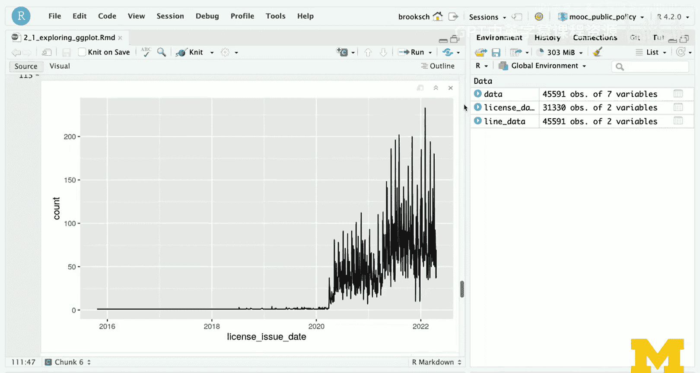
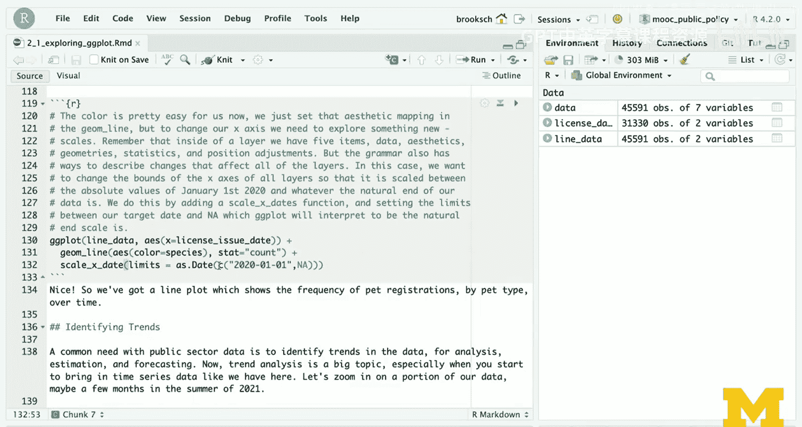
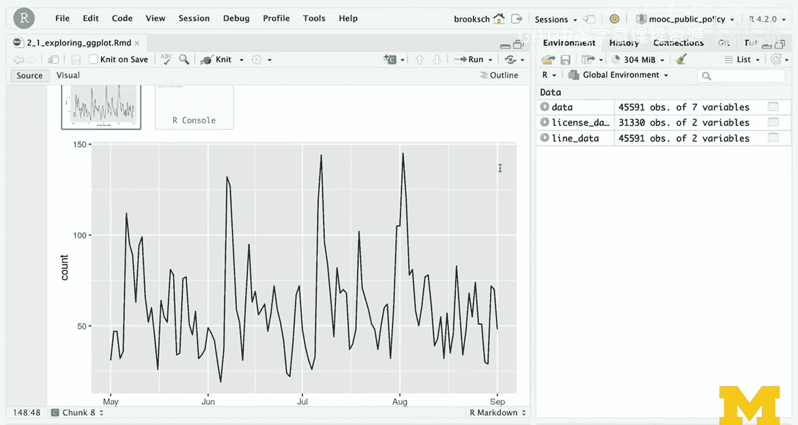

# 密歇根大学《公共部门的R数据分析（基础、数据探索、决策支持、）｜Data Analytics in the Public Sector with R》中英字幕 p50 6_折线图绘制方法.zh_en -BV1YZ421J7Fx_p50-

Another basic plot is the line plot， where individual points in the scatter plot are connected by line segments。

 letting you get a sense of some sort of trend。I think we're going to want to use some better data for this。

 So while I'm going to keep using the pet data， I'm going to reprocess it so that we have dates along the X axis。

 and we have the number of registrations for a given day along the Y axis。

 There are a few ways to do this， because this is frequency data。

 We can go the D per route where we calculate the frequency for each day。

 but you've seen a lot of that already。 So let's instead go the G G plot route where we calculate frequencies on the fly in our visualization。

So the data I'll use here will just be our clean data frame， but with the species in the date。

 so I'm going to take the date and I'll grab the species column。

Now we can start by putting this data into G plot and building layers。

 I'm going to put the data and the aesthetic mapping for the axis in the base layer。

 and then I'm going to calculate the frequency of a given date by setting the statistics argument of geoome line。

 This means that the geoome line layer is going to take the data from the base layer and then apply a statistical transform。

 So in this case， here's my line data that's past in as the first argument of our data。

 and then I've got the X aesthetic mapping here and then for geoome line。

 I actually am not creating any new aesthetic mappings。

 It'll just inherit it from G plots base layer， but I'm going to say that I want the statistical transform to be the count。

You can see that this shows us that there were very few registrations before the year 2020。

 but afterwards we have this interesting spiky frequency of registrations。

You can also see how our statistics functions can be useful here for common stats。

 we don't have to change our data and we can actually allow Ggiplot to apply functions in line which means you can have layers with the same base data。

 but with different transformations。 It also means that you don't have to clutter up your data frame or Tbble with derivative columns。

I left species in here for a reason， though， let's check out how this distribution differs among our four animal categories。

 and at the same time， let's get rid of everything before 2020 the Ggi Pway。

So color is pretty easy for us now we just set that aesthetic mapping in the GO line。

 but to change our X axis， we need to explore something new scales。Remember that inside of a layer。

 we have five elements， data aesthetics， geometry， statistics and position adjustments。

 But the grammar also has ways to describe changes that affect all of the layers。 In this case。

 we want to change the bounds of the x axis of all layers so that it is scaled between the absolute values of January 1。

2020 and whatever the natural end of our data is。 We do this by adding the scale x dates function and setting the limits between our target date and NA and G plot will interpret the NA to be the natural end。

 So here I have the exact same G plot line。 I have our genome line。

 And now I'm just going to add an aesthetic。 when you have an aesthetic pass to the genome line。

 it just adds or overwrites as appropriate。 So here because it's just color it's just adding it。

 So it'll also know that x should be the license data。 If we reset x to be species here。

 it would then overwrite x from the base layer。 and we'll still use our sta of count。 and now I'm。

Use the scale X date Now be aware heres these functions tend to start with scale X underscore or scale Y underscore。

 but then we have the data type here because we scale differently for different data types and in this case we have dates。

I'm going to set the limits and you can think of this on the X axis as the left hand side and the right hand side。

 so I set the minimum to be 20200101 I want it to be January 1st， 2020。

 and then NA just means wherever it would naturally end。

Nice， so we've got a line plot which shows the frequency of pet registrations by pet type over time。

The common need with public sector data is to identify trends in the data for analysis。

 estimation and forecasting。 Now， trend analysis is a big topic。

 especially when you start to bring in time series data like we have here。

 Let's zoom in on a portion of our data。 Maybe a few months in the summer of 2021。

I'm also only going to look at dogs here for obvious reasons。 Also。

 we've already seen how to scale our data to restrict dates。 so we're going to reuse that scale。

 but set the end date to September 1 2021。 So I'm just going to filter species by dog and then I'm going to pipe that directly into G plot and all of the rest of this should be pretty obvious。

 I'm just setting that this end date here so that we get a nice zoomed in view。

You'll notice that I didn't have to change the Y axis at all。

 I'm just letting a GG plot determine what the Y axis should be。

Okay， so we could see a pretty clear trend here。 there's all of these spiky points and some of them seem to be early on in each month。

It could be that people submit registrations early on in the month or that intake formss are only processed at certain times or that there's a relationship between when people get paid at the end of the month。

 for instance， and when they're able to adopt a pet or register a Pat。Now。

 a more thorough discussion of time series analysis would involve something called arima modeling。

 auto regressive integrated moving average。 That's another course or perhaps even another specialization all on its own。

 And I know there are some great courses here on Coursera on the topic。 But instead。

 I just want to note this trend that we're seeing。 And in the next week of the course。

 we're going to discuss trends and data a little bit more。😊，Actually。

 you have all the skills now to at least visualize trends like this in data。

 I think showing a couple of trends with line charts like this would be a great first assignment for this course。

We've gone from nothing to creating useful information visuals in just a week。

 It might have been a bit intense。 So there was a lot of theory to learn but now you've seen how to build column point and line plots in G G plot。

 Moreover， you understand how the layers are constructed and conceived of in this layered grammar of graphics。

 That's pretty significant。 It's going to allow you to explore the documentation relatively quickly to discover different kinds of plots and information visualization techniques。

Along the way， we explored a bit more about the R ecosystem， including two new data types。

 factors and dates， which are common in public policy and social science data。

 We've also found a few new packages to help us out。

 the janitor package and the luber Day packages for our data cleaning and forecastcas for dealing with factors。

 especially in G G plot。At this point， you might feel a bit overwhelmed。

 There was a lot thrown at you in this week， but we're going to reinforce it over and over again throughout the rest of this course。

 and your main takeaway should really be that the grammar of graphics gives us a structured but not magical way of describing our information visuals。

