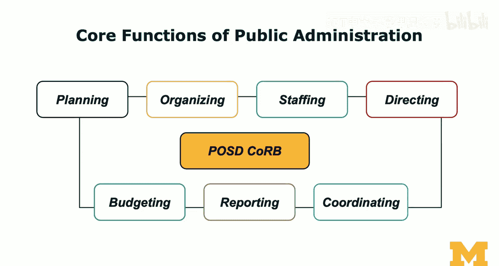
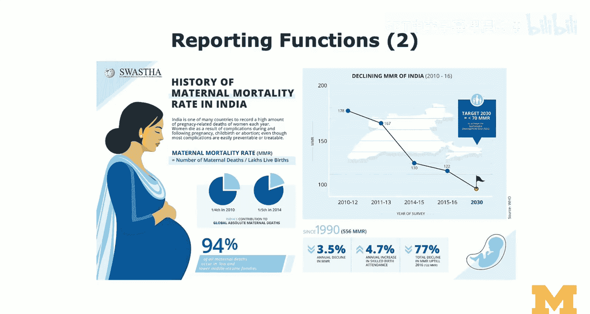
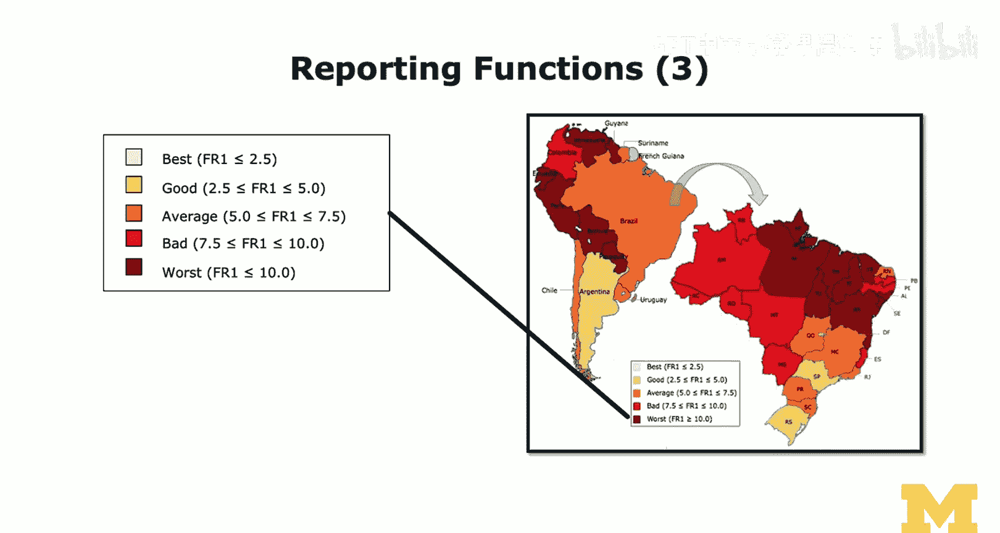
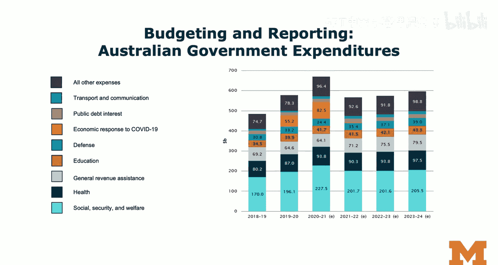
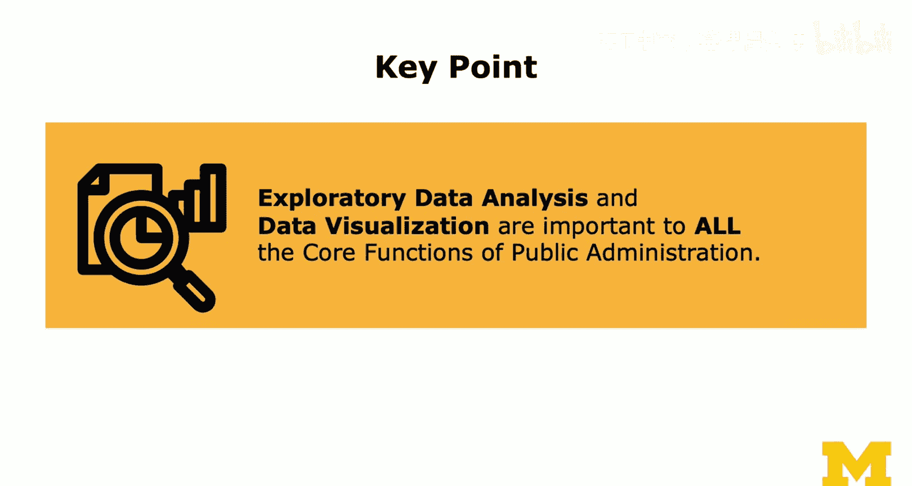

# 密歇根大学《公共部门的R数据分析（基础、数据探索、决策支持、）｜Data Analytics in the Public Sector with R》中英字幕 p51 7_数据可视化在公共管理中的战略价值.zh_en -BV1YZ421J7Fx_p51-

Hi， I'm Professor Paula Lance and I'm really glad to be part of your learning in this course。

As you well know， our studio is really powerful for performing exploratory data analysis and also for creating data visualizations however。

 let's take a brief step back from programming to remind ourselves why this work is so important in the first place data and information are extremely important to all the core functions of public administration as I hope you recall we previously talked about the key functions that the administrative or executive side of government needs to perform including planning。

 organization staffing， directing， coordinating， reporting and of course budgeting these functions are performed both alone and also an important combinations data and information are important to all of these functions and also when communicating about the data both within government and also to the public it's also critically important let's go quickly through a number of simple examples so this becomes even more。

The reporting function of public administration covers a lot of ground this includes every way in which a government is required to share or report information both internally and also with the public。

The reporting function is also essential for understanding trends， progress。

 ongoing issues with a public good， or about an important social problem Take for example。

 the important public issue of education attainment this graph shows longterm trends in high school dropout rates and college enrollment for the US as a nation and also for the black population from 1968 all the way to 2018 The graph is covering a lot of information over a long period of time。

 including data related to trends in racial education equality Another reporting function example is this infographic regarding maternal mortality in India this infographic shares a number of pieces of interesting information including easy to read pie charts and also showing a downward trend in the maternal mortality rate。

 it's a rate however that's still shy of the stated goal for the year 2030 which is also a bit of information。

the infographic so nicely designed infographics can communicate or report a lot of information quite efficiently and effectively this next graphic assists with the reporting and directing functions this map shows different levels of road safety using a fivepoint scale for the entire continent of Southmer by country the graphic however also pulls out Brazil and shows that while for the country as a whole Brazil has average road safety。

 there are actually big difference within the country by region understanding these differences and the large geographic regions with road conditions rated as bad or the worst in the scale should help Brazilian administrators direct resources to where they are needed the most survey data from constituents and citizens including public opinion data are really important to the administrative planning function of government there's a lot going on with this figure which includes。

B chart information for 28 countries， but this is actually an okay way to visually compare survey data In this case。

 public opinion data with a distribution of responses across different populations which in this case is countries our eyes can easily understand the range and distribution of survey responses across the different countries better with this presentation visually then with a table with just a bunch of numbers or percentages Also in regard to planning and staffing functions。

 this figure shows how customers in California who needed their driver's licenses renewed obtained that service within the last fiscal year they obtained it either in person at a field office over the internet or by mail this visualization of the relative use of the different methods for license renewal helps administrators figure out how to best direct resources for user services and their experiences and one final bar chart。

This is an example of the budgeting and reporting function in which the Australian government is communicating the level of public expenditures in different categories for five fiscal years this format allows us to see what the bigger buckets of expenditures are and how they fluctuate over time we also can see in this figure what happened when coVD economic response expenditures hit the budget Also notice how the graph shows the absolute amount of expenditures each year versus just the percentages like a pie chart would display while pie charts are common ways for governments to report expenditures they only show relative percentages or the size of the slices of the pie in each category not the ways in which the overall size of the pie might be increasing or decreasing there's so many more examples I could show you are given you just a few very simple ones the main point here is that both exploratory data analysis and data visualization are important to all。

The core functions of public administration。

