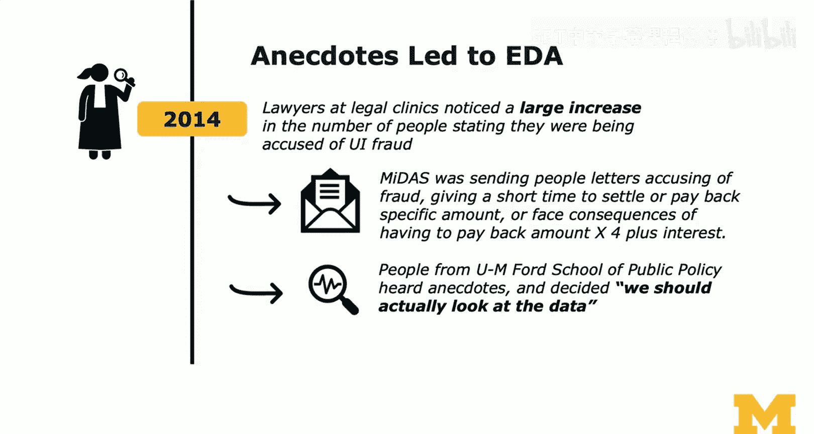
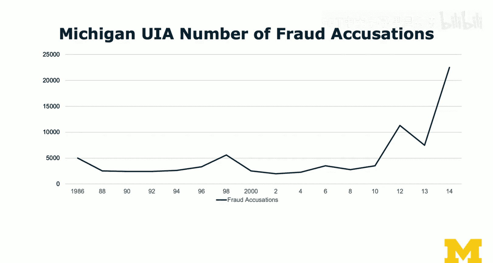
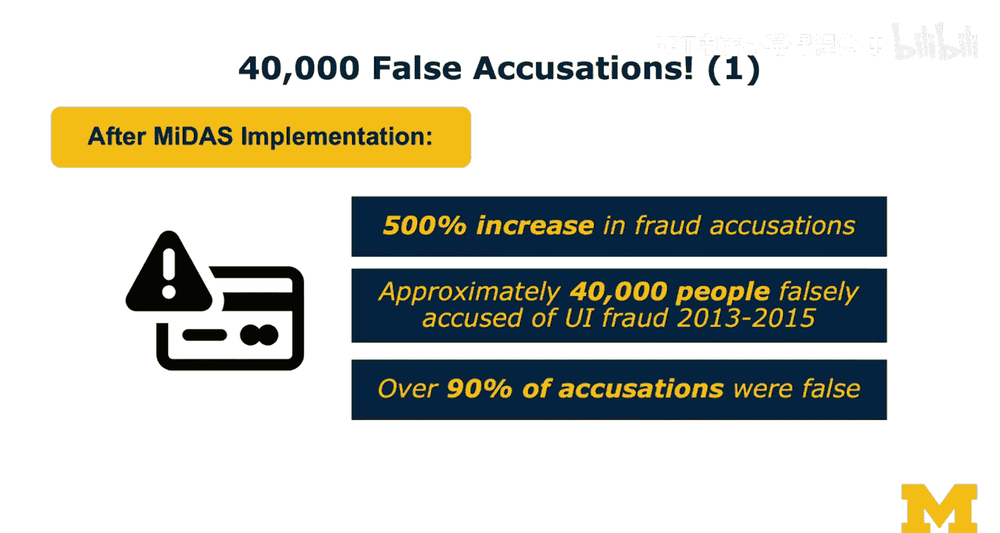
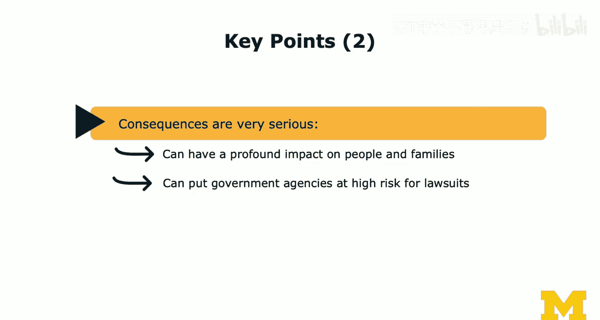

# 密歇根大学《公共部门的R数据分析（基础、数据探索、决策支持、）｜Data Analytics in the Public Sector with R》中英字幕 p52 8_本周补充：异常趋势EDA案例研究.zh_en -BV1YZ421J7Fx_p52-

Hi， I have a quick story to share with you that underscores the importance how even the most simple exploratory data analysis can be helpful to public administrators and those they serve。

This is a story from our own backyard here in the state of Michigan okay the scene is the Michigan unemploymentemp Insurance Agency。

 a state level administrative agency whose main purpose is to provide temporary financial assistance to individuals who become employed through no fault of their own like because of a layoff or downsizing the core principles of public administration are really important to this agency including economy。

 unemployment benefits are paid through taxes that are levied on employers and also efficiency because of the program involves mandatory taxes on employers but also some public resources to administer the program the agency is committed to avoiding fraud。

 waste and abuse as much as possible that's efficiency so back in 2013 the state of Michigan like many other governments implemented a new updated automated government information and administrative system called。

MIS， which stands for the Michiganchi Integrated Data Autoated System The work of the unemploymentemp Insurance Agency collecting taxes from employers。

 assessing eligibility of claimants and then paying claims to those beneficiaries is included in MidTas Now MidTas uses a number of different programs and algorithms for many things including flagging potential cases of fraud in 2014 shortly after the new Midas system went live lawyers at public assistance legal clinics across the state started noticing an increase in the number of people stating that the state had either accused them or found them guilty of unemployment insurance fraud the Midas system was sending out letters many letters to people who were getting unemployment benefits that accused them of fraud Now these letters also gave them a very short period of time to either appeal the accusation or payback the money or they would be。

Assesed a penalty of four times the amount of the fraud or unjustified payments they were being accused of there were lots of anecdotes and lots of concern of course but it actually wasn't until some of my colleagues here at the University of mi heard about this and also decided。

 hey， maybe someone should look at the data and see what is happening here and so they actually did get their hands and working with people from the state on some of the data this very simple chart I don't think you could produce a more simple chart shows the results of a very simple exploratory data analysis the number of unemployment insurance fraud accusations by year over time and look at what happened in 2014 the number skyrocketed just like the anecdotes were suggesting and this just happened to be at the exact same time is a switch over to the new Midas administrative information system the first thing we want to do is think about what are the reasons why this might be the case。

C。Perhaps the number of unemployment cases was skyrocketing at the same time well。

 another simple graph shows that the unemployment rates in the state across the entire state had been steadily declining since 2010 including from 2013 to 2015 which is the same time as the dramatic increase in fraud cases so an increase in unemployment insurance claims is not what's driving the increase in fraud accusations so more extensive exploratory data analysis was conducted and this uncovered that there was a 500% increase in fraud accusations right after the new MITA system went into place this amounted to 40。

000 people in the state being falsely accused of unemployment insurance fraud between 2013 and 2015 and that was 90% of the total number of accusations so clearly I know you're thinking the algorithm is messed up。

The algorithm for identifying fraud。Has some problems。

Now this algorithm is not public so we don't know for sure what exactly went into it and what the problems were。

 but one thing people have been suggesting is that it looks like things in the past were just flags to be looked at in more detail like whether someone quit a job intentionally rather than was laid off were being considered as evidence of fraud rather than a flag needing more investigation in the algorithm I don't know exactly what happened and actually no one at the state is talking about this because there's an ongoing class action lawsuit brought by many of the people who were harmed currently underway it's not resolved yetNonetheless there are some key lessons for us already in this saga first this is a really sobering lesson for government automated administrative data systems algorithms and their protocols need to be designed and tested very carefully second。

data analysis should be used to look for any changes or blips that happen when new systems are tested and then implemented and then this Eda should also be ongoing like weekly byweekly or monthly to identify any problems when new systems go online don't wait for annual data to look for and identify any system glitches or issues third as this case illustrates problems with data systems can have profound effects on people in their families in this case people paid back money often thousands of dollars they did not owe to the state for fear of that compound penalty and also people who deserve benefits were not receiving them these problems not only impact real people and families and create severe hardship they also put governments at high risk for lawsuits so finally once again ongoing exploratory data analysis and its visualization are essential to all administrative functions。

And sloppy design and misuse can have several negative consequences for these functions。

