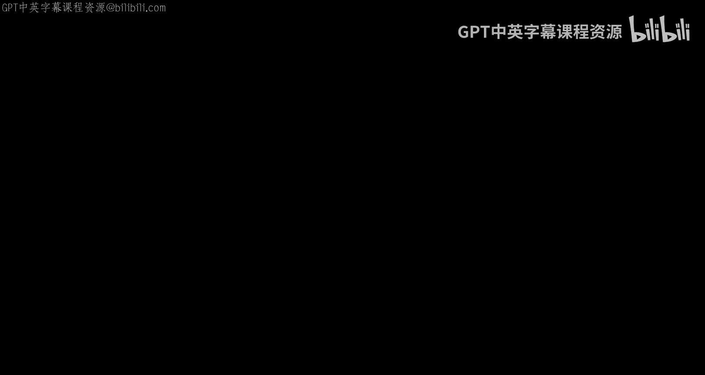
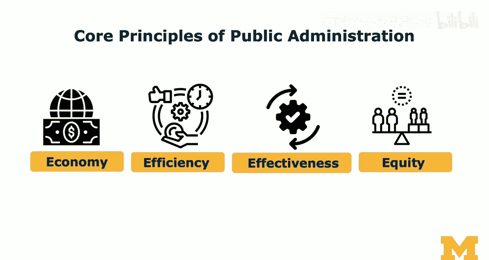
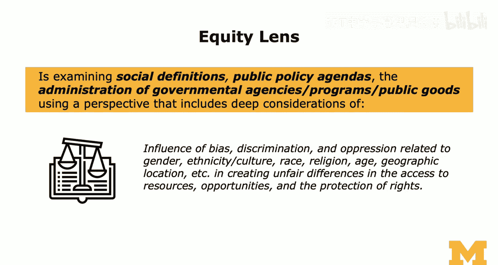
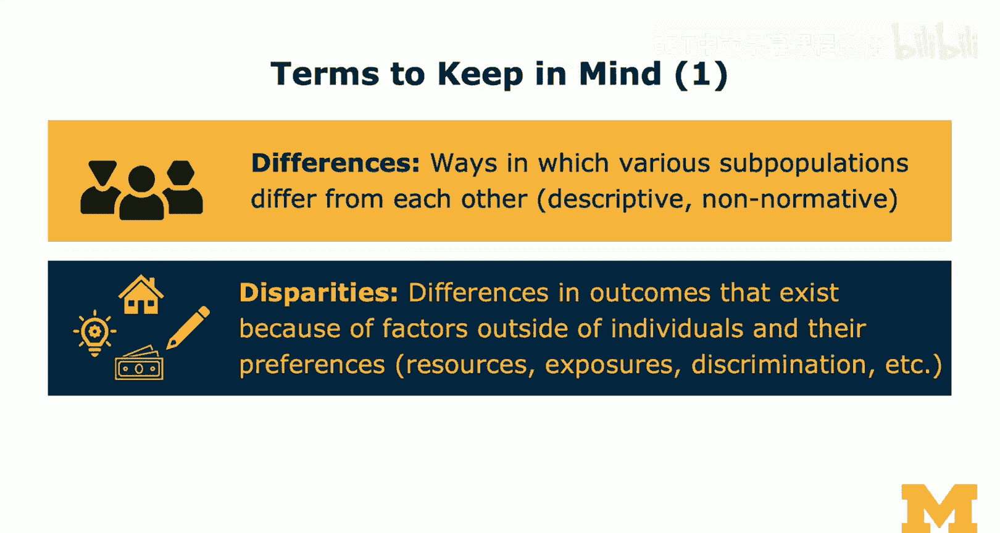
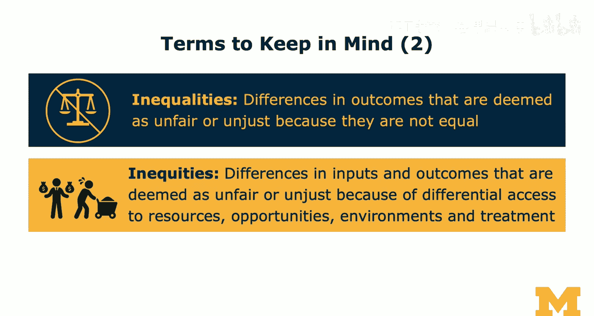
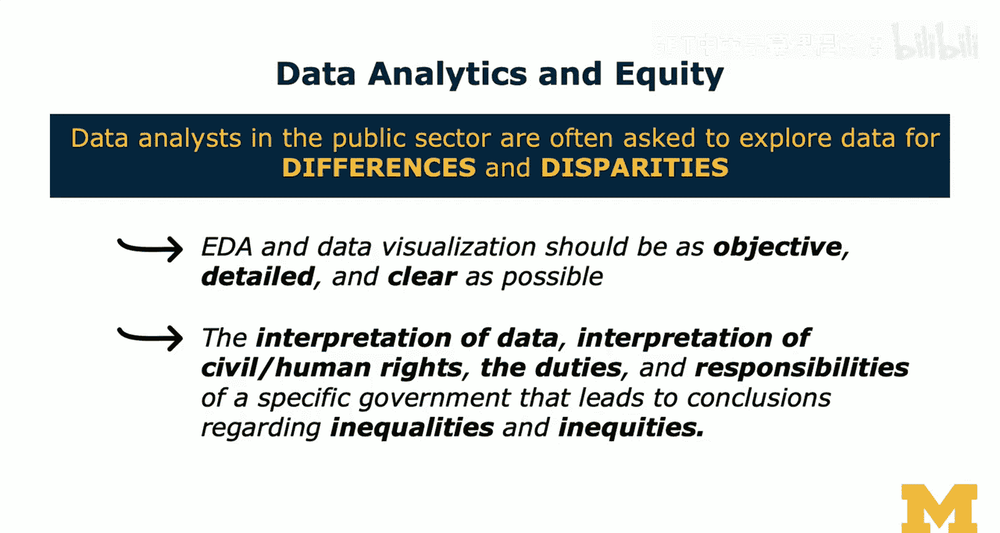
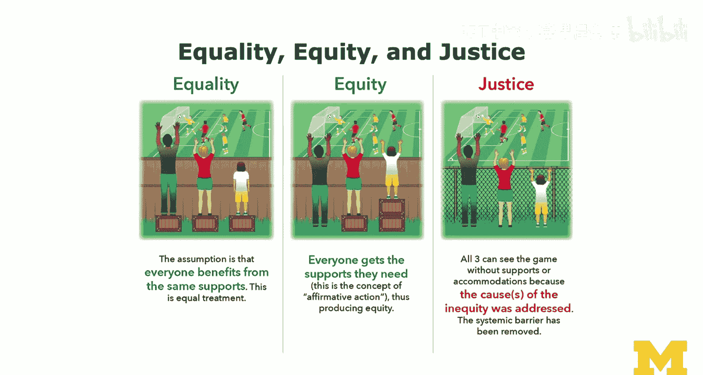

# 密歇根大学《公共部门的R数据分析（基础、数据探索、决策支持、）｜Data Analytics in the Public Sector with R》中英字幕 p53 9_公平性作为公共管理核心原则.zh_en -BV1YZ421J7Fx_p53-

Hi， welcome back。We've been talking about the importance of exploratory data analysis and data visualization for all the core functions of public administration。

In our next two sessions， I want to briefly touch on the importance of both EDA and Data Viz for one of the four core pillars or principles of public administration。

Equity now we have four pillars， economy， efficiency effectiveness and equity， but again。

 in the next couple of sessions we're going to focus in on equity in public administration the pillar of equity includes what is called using an equity lens to look at issues and problems this is defined as follows an equity lens means examining including with data。

 social problem definitions and framings， public policy agendas。

 potential policy solutions and the administration of governmental agencies programs and public goods using a perspective that includes a deep consideration of the influence of bias。

 discrimination and oppression related to gender or sex， ethnicity or culture， race， religion， age。

 geographic area or any other social factors that are involved in creating unfair differences and access to resources。

Opportunities and the protections of rights I know there is a lot in there so you might want to take a moment and just go through and think about that definition a little bit of what an equity lens is Now let's define some terms that are similar and have some overlap and often are used interchangeably but they also do have some distinctions first differences differences are ways in which various subpopulations or groups of people or even communities can differ from each other and these differences are often understood with descriptive data in a non-normative way and this means that the differences are just simply described without any value judgment or value statements made about the differences we just see differences Disparities are differences in which various subpopulations or groups differ from each other but these differences are understood to be driven by things outside of the individuals involved in their own personal preferences。

Disparities are differences that exist because of differences in resources， opportunities。

 discrimination， etc ce， not because of personal preferences or choices Moving on inequalities are differences in outcomes that are deemed as unfair and unjust because they are unequal or not the same inequities are differences in both inputs and outcomes that are deemed as unfair or unjust because of differential access to the resources。

 opportunities， environments and treatment that's required for equality I'm sure this is a little bit confusing so let's think about equality versus equity instead of inequality and inequity equality is when each individual group or community has the same resources。

 opportunities， treatment and outcomes important things that we care about。

public sector are equal or the same E on the other hand， recognizes that individuals。

 groups and communities have different circumstances and in turn allocates or upholds the resources opportunities and experiences given to each that are needed to achieve equal outcomes as dure McKesson。

 a civil rights activist in the United States has explained the difference between equity and equality is that equality is everyone gets the same thing。

And equity is that everyone gets the things they need and deserve data analysts in the public sector are often asked to explore data for both differences and disparities and this type of exploratory data analysis and data visualization is best conducted as objectively detailed and clear as possible。

 the data should reveal the magnitude and direction and even changes over time of differences in disparities。

 Now once the data are explored and presented， then the interpretation occurs and claiming that differences represent inequality or inequity involves values and notions of deservedness and fairness。

 in addition， for differences to be interpreted from a rights perspective。

 one needs to understand the difference between civil rights。

 which are those rights that are upheld by a government's constitution and legal systems versus human rights。

Which are more notions of cross cutting rights given to all humans based on universal codes of morals and ethics。

In philosophy， there's a fundamental notion that rights and duties go together if someone has a right。

 then some other entity has a duty to uphold that right。

And when we're talking about governments and the public sector。

 the only rights that a government has a duty to uphold are civil rights。

 and that is those rights that are codified through formal policy and laws。

So in public sector data analysis， it gets a bit more tricky to move from data that show differences in disparities to claims about inequality and inequity。

But the point here is that most。Not a whole， but most governments are designed to care about equity and data helps them do this。

 it is the data analysis and data visualization that shine bright lights on social equity and inequity issues Let's end with a graphic that tries to illustrate the difference between equality。

 equity and then justice， which includes what governments can do to address inequities。

The first panel of this graphic depicts three people trying to watch a baseball game from behind a fence and shows equality。

 but also the flawed assumption that everyone benefits when provided the same or equal resources or supports or gets equal treatment which in this case is a box of exact same size to stand on to see over the fence this equality and support or treatment does not create equal outcomes as the shortest person on the right still cannot see over the fence to see the game again there's equality and support but an anequ in the outcome the middle panel shows each person getting what they need to see the game the first person gets nothing because they can already see the game the second person gets a box the height needed to facilitate seeing over the fence and the third person gets an even taller box to facilitate their ability to see over the fence and this different or inequality in treatment is what leads to equity。

In the end， however， one more important point， the last panel shows the three people watching the game with the wooden fence gone。

 the barrier that created the different levels of a problem or different obstacles for different people was actively remove now a chain link fence is now in place that still protects the crowd but also allows everyone to see the game and in this analogy this removing the structural barrier is referred to as justice。

 all people can now achieve the goal of seeing the game without additional support or accommodation because the root cause of the inequity was addressed again。

 this is just an analogy to unpack more the concepts of equality equity and then also addressing root causes of inequity。

 removing structural barriers。

Thanks for thinking about this a little bit。

