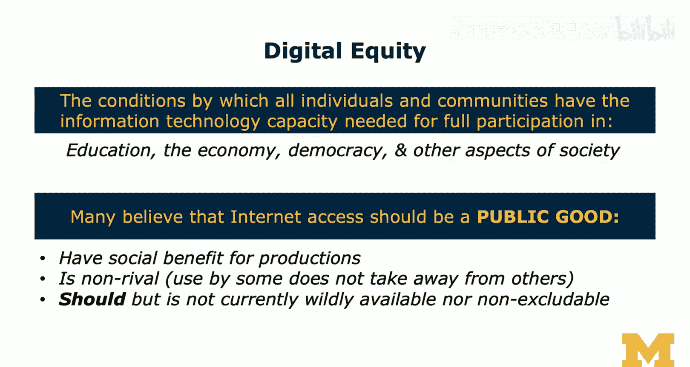
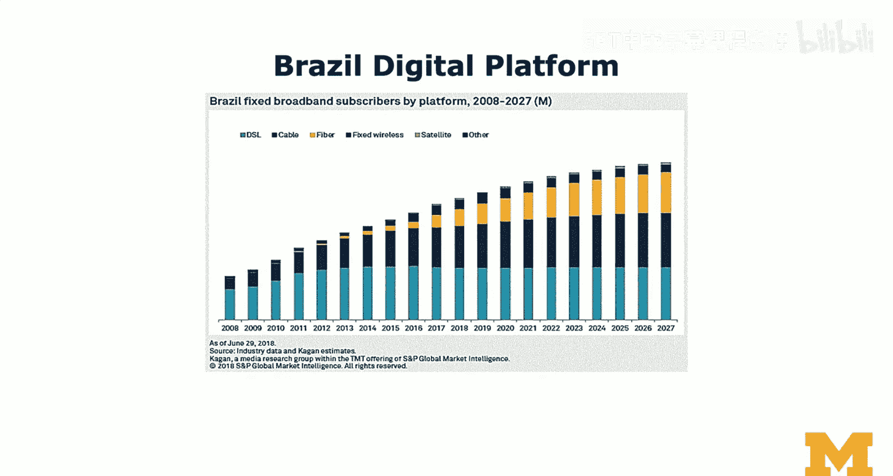
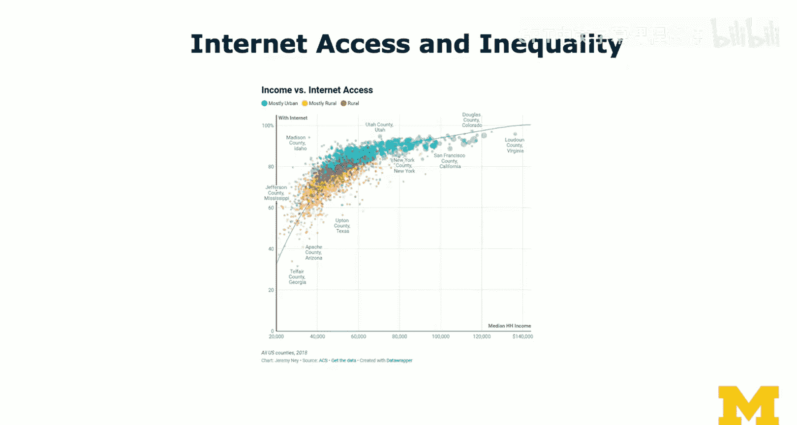
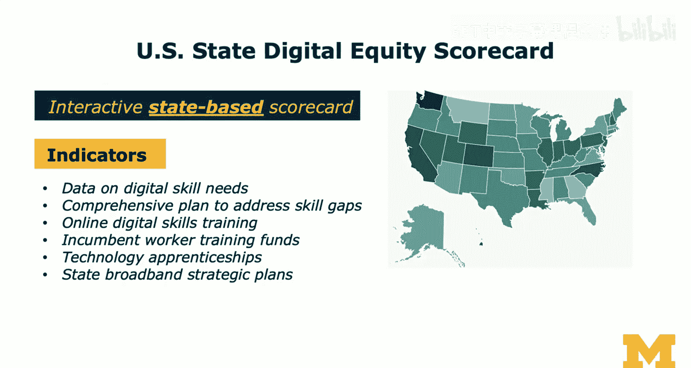
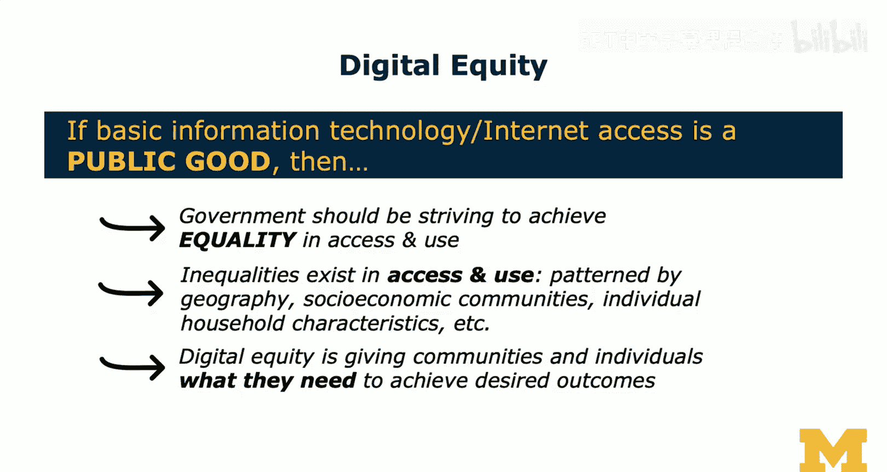

# 密歇根大学《公共部门的R数据分析（基础、数据探索、决策支持、）｜Data Analytics in the Public Sector with R》中英字幕 p54 10_典型案例：数字公平性分析.zh_en -BV1YZ421J7Fx_p54-

Welcome back。We've been discussing the importance of equality and equity for the public sector and the very important role of exploratory data analysis and data visualization in helping to understand differences and disparities that a government might label as inequities and in turn defies interventions to address。

 so let's continue our discussion by focusing on a specific issue that of digital equity。

Digital equity is defined as the conditions by which all individuals and communities have the information。

 technology， and capacity needed for full participation in education。The economy， democracy。

 and all aspects of society Internet access is generally considered to be a public good。

 I'm hoping you recall our definition of public goods from course one a public good is something that has a social benefit for society and populations a public good is also something that's nonrival。

 meaning the use by some does not reduce the supply or take away the use by others also public goods should be widely available to all。

 and non-excluudable， meaning they don't exclude pockets of people or subpopulations。

In the case of digital resources， this is not currently the case。

 and thus it is the main reason that people are focused on doing things that need to be implemented to create digital。

Equity Now elements of digital equity or digital inclusion include the following affordable and consistent broadband internet access。

 access to internet connected devices such as smartphones。

 computers and tablets it also includes access to apps and other resources that enhance work education and all kinds of collaboration and connectedness and finally it includes the notion of support digital inclusion includes tech support。

 user experience support and broad public education data visualization is essential for us to understand levels and trends in digital equity so let's quickly go through some examples This first picture is a map of the percent share of each country's population in the world with access to the internet in the year 2019。

 This map gives you a quick picture of where the most serious issues。

Before the pandemic hit with digital inequity and this includes the entire continent of Africa and parts of Southeast Asia standing out the most this data Viz includes a number of bar charts。

 it was produced by the Pew Foundation and it shows for a selected group of countries。

 three different indicators of digital access， the percent of adults who say they use the internet and have access at home。

 the percent who say they use the internet but do not have access at home and the percent of adults who say they don't use the Internet。

This slide shows another map， this one of India showing the digital divide by displaying the rate of broadband subscribers per 100 people by state colors are used to display than inequities in broadband subscription by state with the greenish states having the lowest rates a similar approach was taken by the city of Chicago which produced a map showing the percent of households in each Chicago neighborhood with internet access here the darker colors mean a lower level of access the map displays the full range in the color legend from dark blue through various shades of blue and green to yellow representing 55% to almost 100% coverage in neighborhoods across the city This graphic for people who are not visually impaired or colorblind easily in starkly shows that there is a digital divide across neighborhoods in Chicago next we have。

By bar chart that shows not only the realized but also the projected growth over time in broadband subscription in Brazil and it also shows the percentage distribution of the type of broadband platforms being used Now you have to read the fine print of this graph to understand that it includes both upto-date data that have already been collected。

 but also includes projections into the future starting in the year 2019。

 There are a couple more graphs that I hope you'll just take a moment to pause and look at one is smartphone and tablet ownership in the use of social media over time in the United States and there's another one I want you to take a look at a scatter graph that shows the correlation between income in internet access in US counties but also highlighting by color the relationship between income and internet access by urbanicity by whether or not people live in urban areas suburban areas。

Rural areas Finally， I want to point your attention to an example of how data regarding digital equity is increasingly being made public so that people can explore the data on their own in the US there's an interactive website that presents a digital equity scorecard for each US state these scorecards include a number of different indicators including data on digital skill needs and the population of the state training issues related to those skill needs and workforce issues also it includes whether or not the state government has made and implemented a strategic plan to address digital inequities this is fun data data interactive data set to play around with encourage you to take some time to do that so in some。

If basic information technology in internet access is a public good。

 then the government should be striving to achieve equality in accessing use。

 everyone should have access and everyone should be able to use the power of the internet data showing that inequalities exist in access and use are vitally important to these efforts and finally digital equity involves giving communities and individuals。

 not all exactly the same thing， but what they need at a moment in time to move towards that goal of equality in the outcomes of this public good。

