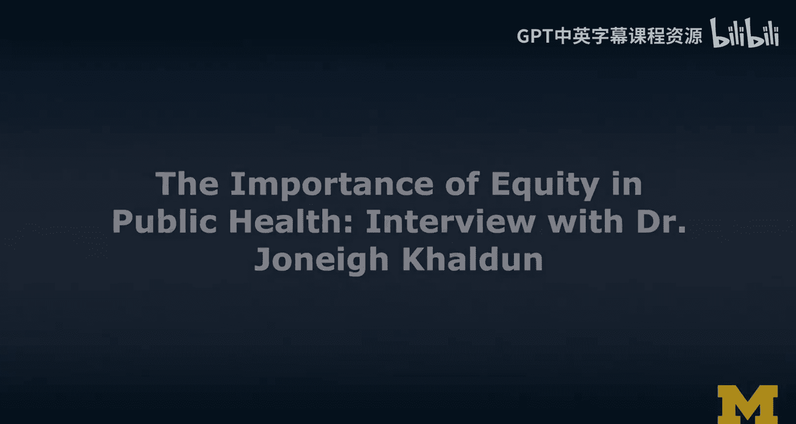
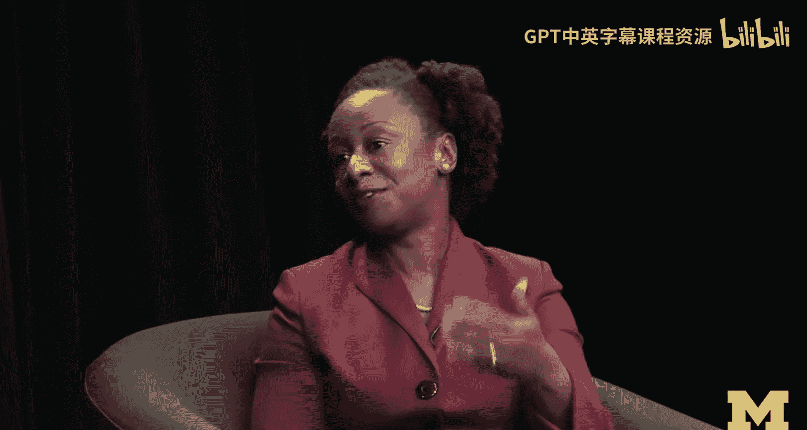
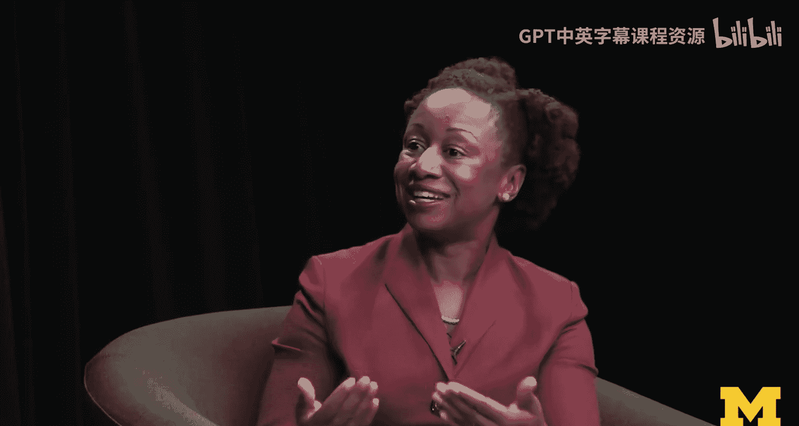
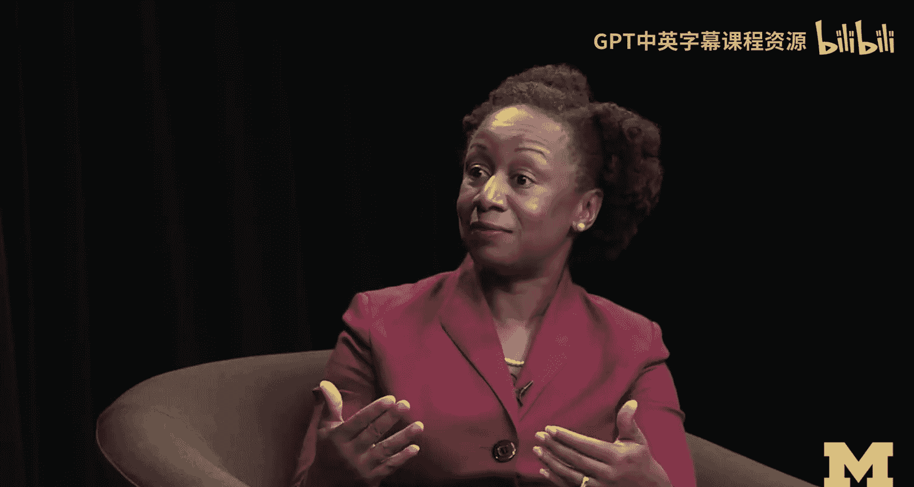
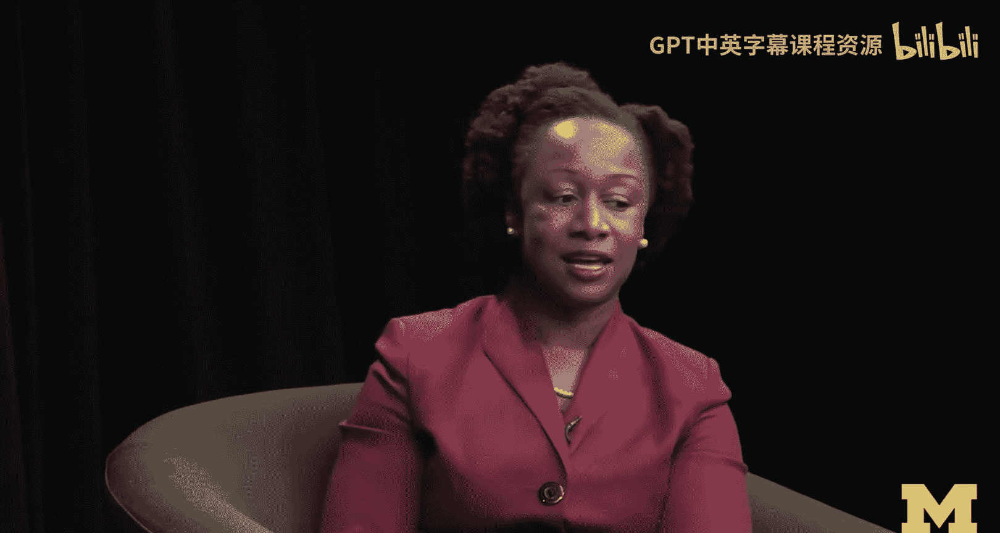
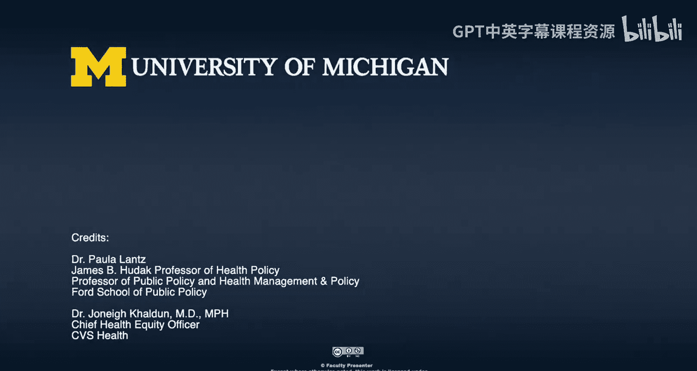

# 密歇根大学《公共部门的R数据分析（基础、数据探索、决策支持、）｜Data Analytics in the Public Sector with R》中英字幕 p55 11_公共卫生公平性重要性：Joneigh Khaldun博士访谈.zh_en -BV1YZ421J7Fx_p55-

Hi I'm Professor Paula Lance and I'm delighted to be having another conversation today with my friend and colleague Dr。

 Jannae Calaldun， who has served in multiple public health administrative leadership roles for the City of Baltimore。

 the City of Detroit and the state of Michigan and right now she' is currently Vi president and chief health E officer for CVS Health welcomecom back thanks for having another conversation with me。

So in this course， we've been talking about the core。Foundational principles of public service。

 efficiency， economy， effectiveness， and equity， and in our conversation today。

 I would love to talk to you about equity because I know is just such a core important principle and fundamental motivator for you and all the work you've done throughout your entire career。

So my first question is， you know and it's a big one but what does equity mean to you in terms of public policy。

 public services and public programs absolutely you know equities is critical to everything that we should be doing in public service as far as I'm concerned so what does equity even mean it's really making sure that everyone has an equal chance to be as healthy as possible。

 has that opportunities but underlying that it recognizes that quite frankly because of different opportunities。

 different resources， how unfortunately as human beings we put people in different buckets and decide who gets more than the other based on who's more important than the other unfortunately that's how we end up with inequities and health disparities so it's really about I like to say it's。

Whoever you love doesn't matter who you love， where you live。

 how you worship you should have an equal opportunity to be healthy and so from a policy perspective it means understanding that not everyone has those resources so how do you think about allocation of resources supporting communities how do you engage communities in a genuine way right and recognizing communities are experts in themselves it's really really important so what do you see as some of the biggest challenges for the public sector in addressing equity？

And inequities in all forms， and we know in the health world where you and I both spend most of our time。

 it's really it' social inequities that are driving health inequities and I think we could say the same for other aspects of government that are you know environmental inequities and educational inequities and food inequities and all those sorts of things。

 but you know what are some of the biggest challenges for the public sector in both identifying and then addressing？

Inequity Ab you I think that I think it goes back to root causes right and I think that it's important that we understand that it's about disparate treatment and disparate access to resources so when you think about how you address inequities and undo them you have to think about how you embed with intentionality。

 health equity into your work， so what do I mean by that it's about your data let's talk about data again。

 I think any quality metric that you're looking at any proposal。

 you should be asking yourself how are historically marginalized communities。

 so racial ethnic minority groups and wherever you are。

 but also those who have different abilities those who are older those who may be living in rural areas right so it's not just about race ethnicity。

 every single thing you do you should be thinking about from a quality perspective of outcomes perspective。

 how are these different communities being impacted。

And how have we brought them into the creation of solutions to address and I think that's challenging to do because that's not how we normally do our work in any sector quite frankly now I work in the private sector I don't think that's the norm so I think that's what's challenging is we're trying to completely change how people do their work and it's not a single program you have to make it embedded in whatever you're doing right can't be just a one off it's got to be it's going to be well it's a pillar it's a core principle so it should be。

Integrated into everything？Can you talk a bit about the powerful role of data in this work？

Absolutely so there's no question whether it was COVID response or otherwise data are often incomplete or lacking so I talked about racial ethnic minority groups those of disabilities we often don't have insights into how those individuals urban versus rural how those individuals are experiencing health and health care and so foundational to any organizations work is understanding so working to standardize and increase how that is being received that actual data and then creating dashboards are really understanding the data from that perspective and again not just data for the sake of having it to say that's cool but actually letting it guide your program and your policy development that's so critical one other point i'd like to make though。

We know that inequities exist we know that health disparities exist no one's ever going to have fully complete data that should not be an excuse for not acting and not doing something to address the inequities and that's a really really important point thank you for that。

Can you talk a bit about some successes you had in communicating to people who control resources？

Or policy decision makers communicating data to them in a way and we talk about how the data never make change by themselves。

 it's not about the data it's about what you do with them and the stories you tell and the。

You know the value that go into decision making but do you have some examples of the power of data but how it was communicated and shared with policymakers and how they responded absolutely you know won't I won't name any individuals but what I will say I'll talk about the kind of core ways I think about communicating data with policymakers and I will say that it's important to understand what the broader goals are right what are the goals。

 what are the constituents thinking about the people who voted you know someone into office but I think it's often about it's also about。

Understanding that most policymakers are not data scientists or scientists at all。

 they're not physicians， so being able to succinctly。

Share the data with a picture a picture is great being able to succinctly talk about what the story is like what the three bullet points。

 pretty much any graph you should be able to boil it down to three phrases。

 three sentences to explain it and then there's got to be an action tied to it so this is what the data shares with me these are the limitationsations of the data this is what it means and I think we could do these one of these two or three things to be able to address what that data is telling us and so I think it's really important to be succinct and to really speak in basic terms not data analytic terms when you're speaking to people who are not data analysts right you've got to know the language of the people you're speaking to。

Any good examples come to mind？

You know， one example is when I was in the city of Detroit and we were talking about addressing infant mortality。

And one of the things that the data that I had were about zip code level data which is really important because the depending on the zip code in the city the infant mortality rate was different and quite frankly the reason for the infant mortality rate was different so I had a great opportunity to kind of share this information with the city's leadership and we talked about the different zip codes but then we talked about the actions so in one particular zip code the issue was actually safe sleep so infants were already you know they were unfortunately die before their first birthday but in another part of the city it was preterm birth right the causes the difference was different and so from that we actually determined where we were going to target certain parts of our strategy based on what the data showed us as far as the issue so it wasn't just infant mortality is an issue it let's be targeted focused and what's underlying the issues in different parts of the city great example。

Do you have any advice for our learners who are interested in going into Danna analytics in the public sector but really do share your core and my core interest in that equity pillar in public service you know I would say wherever you are it's always just important to understand the people。

The people and the core work of the company， the business。

 the department that you're working in because the data is always all about the people and and it's about what do you do with it so don't just go and present a file and a graph always be able to say this is the story this is what this is telling us and this is the action that needs to happen from that and so I think for our data folks out there remembering that that's always about the people and the work is really really important Thank you so much for sharing your very busy life with us and making some time to share your wisdom and experience with us thanks so much Dr。

 Calaldun thanks for having me on。

