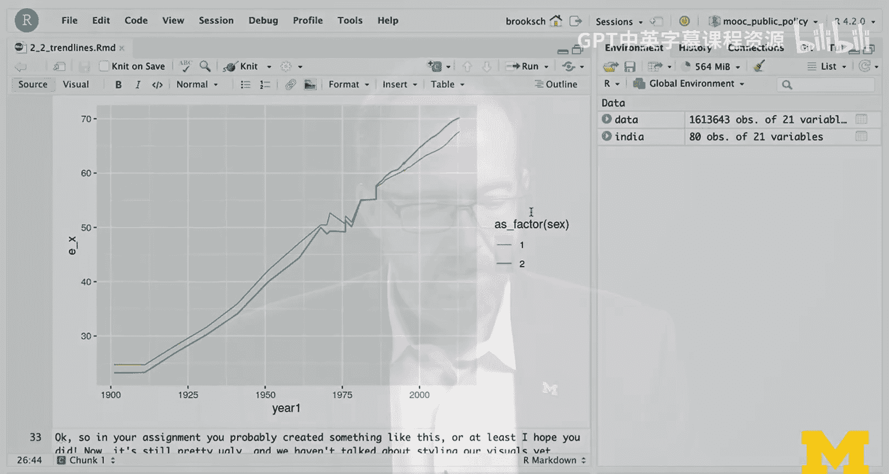
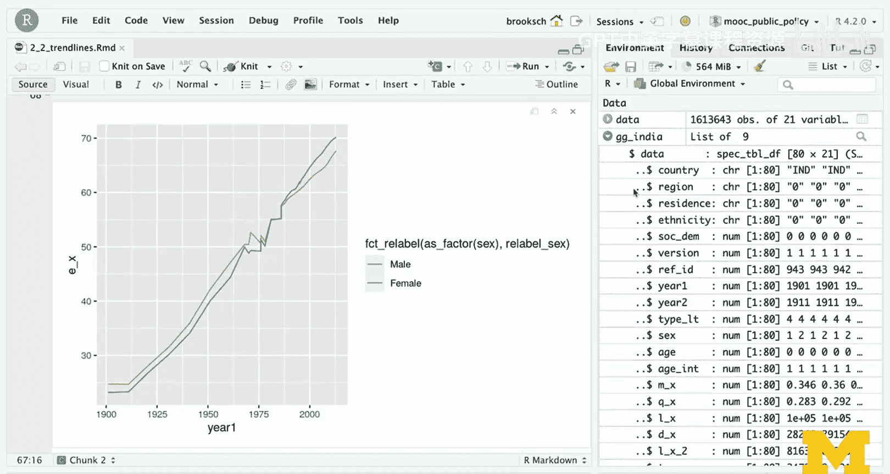
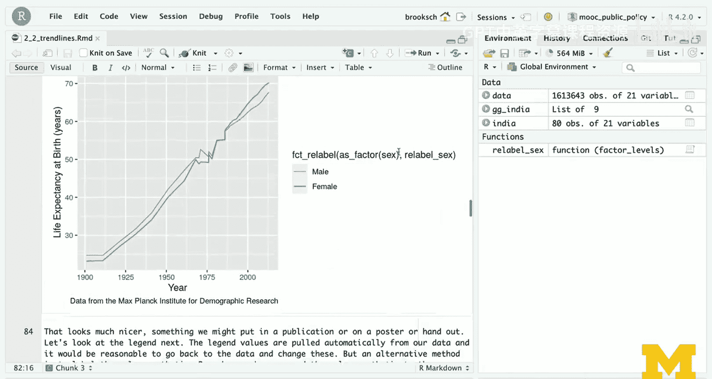
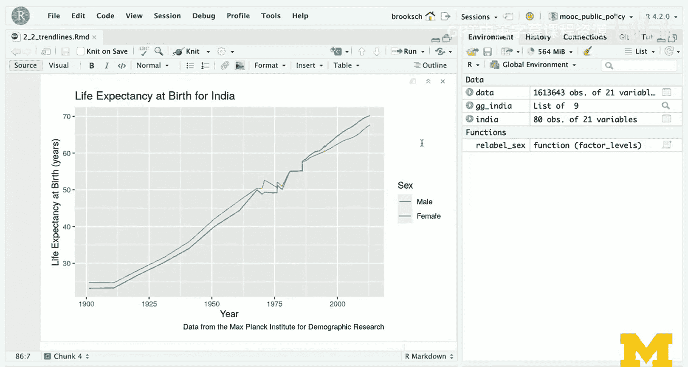

# 密歇根大学《公共部门的R数据分析（基础、数据探索、决策支持、）｜Data Analytics in the Public Sector with R》中英字幕 p56 12_趋势线基础绘制方法.zh_en -BV1YZ421J7Fx_p56-

This week， we're going to focus on expanding our set of exploratory data analysis techniques。

 and I think it's worth revisiting the topic of trends。 Dising。

 calculating and comparing trends is a really common task in the public sector。

 And there's a lot of different methods that can be used。

 It's quite common that we'll want to create graphics to demonstrate a trend over time。

 like we did in the first assignment or from the pet data and use it to compare a few different groups。

A separate but highly related need is to forecast from trends so the policies can be made。

 and this requires building a statistical model of our data and then rendering it into some future time to predict what might happen。

This modeling activity is not trivial， and generally you're going to be working in teams with statisticians if you're going to do a significant amount of forecasting。

Reflect for a moment on the number of different predictions we heard for caseloads in the hospitals during the early days of the Covid pandemic。

 There were various different statistical models， all incorporating different variables and insights from epidemiologists and other experts and decision makers needed to be able to communicate。

 both with these experts and with the general public。

Your role might very well be to aid in that communication。

 either between the statisticians and the decision makers or between the organization and the general public。

Broadly， a statistical model is a set of relationships between different variables in the data。

 which we can express as a mathematical formula。We've seen how R handles formulas and I'm not going to go into the details of the math behind different models in this course。

 but I do want to explore how we can use GG plot and the grammar of graphics to visualize a model on top of our plot data。

You'll hear more in the next course about a few interesting public policy models and how they're being used for forecasting。

 but for right now， let's bring in our data on life expectancy values from last week's assignment and explore them。

True to form I'm going to bring in the tidy verse and janitor and clean my column names。

 so this is a pretty typical pattern for me when I do data analysis and I'm going to filter by the same set of parameters we use for the assignment so that was region of zero ethnicity of zero。

 age of zero， type LT of foreign residents of zero most of these indicate we want for all ethnicities。

 all regions and all residences， age of zero means we're looking for life expectancy as predicted at birth and then I'm going to filter on the country India。

Now we can plot this data using the year one column on the x axis and the expected age。

 which janitor automatically turned into the column E underscore x on the Y axis。

I'll send the data and these aesthetic mappings into the base layer， so Gii plot。

 and then I'll add a line plot that separates out observations for sex。

 and so we can just look at that with the aesthetic mapping of color。Yeah。

Okay， so in your assignment， you probably created something like this。 or at least I hope you did。

 Now， it's still pretty ugly。 and we haven't talked about styling our visuals yet。 First。

 I want to tackle the issue of human readable labels on the plot。

 The name of the ax and the legend are all pulled directly from our datatum。 But， of course。

 we wouldn't show this to a decision maker directly like this。 We've got a few options。

 We can change our data， which might be a reasonable approach， or we can change the labels。

 I think I'm going to do the both of them here。

So I'm going to change our base plot so that our factor values are more human readable。

 One way that we could do this is to create a function which we comply to the factor which will return either male or female if the value is one or two。

 Now， this is actually kind of a long method。 but I wanted to show you it so that you could see it。

 So here I'm going to create some new function。 I'm going to bind that to the name relabel underscore sex。

 That function is going to take in some vector of factor labels。

 First thing I'm going to do is create a new vector。

The expectation is that I'm going to return a new vector that's the same size as these factor levels so that when one is passed in and then two is passed in。

 the return would be male and female。Now， up to this point。

 I haven been shown you the base R syntax for conditional statements and looping。

 So one of the reasons I'm going to do this just to make sure that you see it。

 All we're going to do is iterate through all of the factor levels passed in and return an appropriate string transformation。

 So the way we do this in R is we say four level in factor levels so we're going to walk through everything in the factor levels vector the first time through it'll be a one the second time through it'll be a two and so forth。

 If the level is one， then we're going to append the word male to new levels。

 And if the level is not one， we'll append female， we just happen to know it that way that there's only two values and then we'll return those new levels。

Now， we can pass this function to fact relabel。 I'm also going to assign the plot back to a variable。

 We haven't done this before， but it's a great way to build up a visualization。

 A call to Ggi plot just results in our object which we can render with a call to print。

 So here I'm actually going to make our plot， but I'm going to assign that back to Gigi underscore India。

 So our G plot is， as we would expect， our Gome line here。

 all I'm doing as I'm saying color is assigned to， and then I want to relabel。

 I convert sex into a factor， and then I indicate what the labels should be。

 And then to actually show this plot， we actually have to have a print to Gigi India statement because now we have a variable that is our actual G plot。

😊，Once you execute that， you'll see your plot show up and we get this nice labeling of male and female here。

 but you should also explore up here in your data that we have the Ggi India。

 and this is a list or is telling us of nine items。

 And if you expand that you'll see an amazing amount of stuff in here。

 So first you'll notice that our data is actually totally captured by this object。

 there's a bunch of details of our information。 We can see that there's layers and that there's functions associated with the layers and this is an object that Ggi plot has built up for us。

 so it's really quite interesting to be able to explore this immediately inside of your data environment。

So that was a pretty long chunk of code to do what you can probably do faster with for cats。

 But I wanted to show you how some of the base programming features of our work。

 There are lots of times when you might find it easier just to write your own function to manipulate data and sometimes doing so。

 Even then， you dont will improve your understanding of how R is going to work。 For instance。

 to write this function。 I actually had to go look up the documentation for factory label。 Remember。

 you can just use question mark factory label。 I know I say it a lot。

 but it's really handy to see what parameter would be passed into the function I wanted to write。

Now that we've got this plot， let's clean up our labels。

 the GG plot framework has a few different functions we can use to do this quickly。

 and since we have a plot already in our variable Ggi India。

 we could just add the labels directly to that variable。

So first up， let's deal with the X and Y axis。 We can use the labs for labels function to set up a variety of labels。

 or if we want， we can set the X and Y axis labels with the Xla and Y lab function。

 So I'll show you both here So I'm going to sign back to G India G India plus remember we're not piping here right because this is a G plot object even though the tidyverse has really strong piping capabilities。

 Ggi plot does not I expect this will change in a future G plot。Here when we have labs。

 we just put in the different keywords or names for our different captions。

 so in this case the title which will appear at the top is life expectancy at birthirth for India and the caption will be at the bottom rendered at the bottom of the plot。

 data from the Max Planck Institute for demographicographic Research。

I'm also going to add the X label of year and the Y label of life expectancy at birth in years。

That looks much nicer。 Something we might put in a publication or a poster as a handout。 Now。

 let's look at that legend Next。 The legend values are pulled automatically from our data。

 and it would be reasonable to go back to the data and change these。

 but an alternative method is to label the color aesthetic。 Remember。

 we've mapped the color aesthetic to the variable sex。

 so we could call labs and indicate that the color aesthetic should also be mapped to a label value。

 Now we could have actually done this for our X and Y aesthetics too。

 I just want to show you a diversity of options here。

So very quickly， we can take this Ggi India and we can add labs and we can map color equal sex。

And the result is a pretty final graph， I think， that you could show a decision maker。

