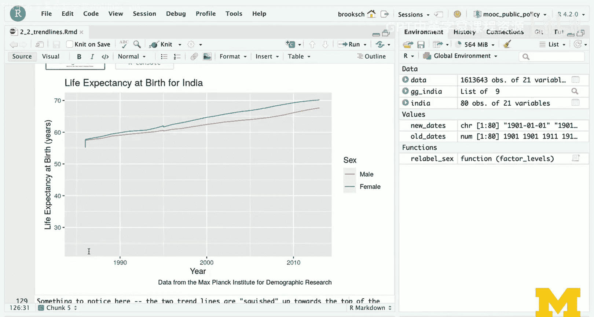
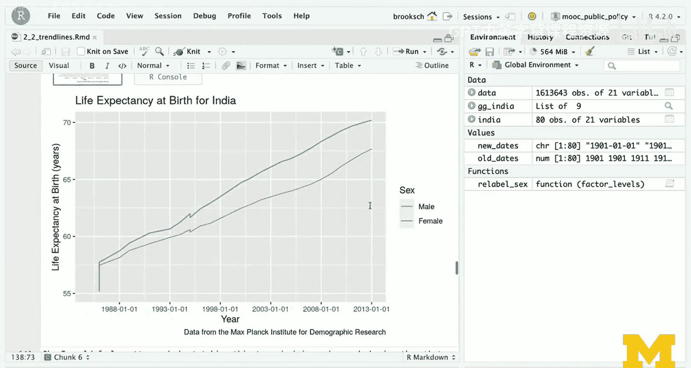
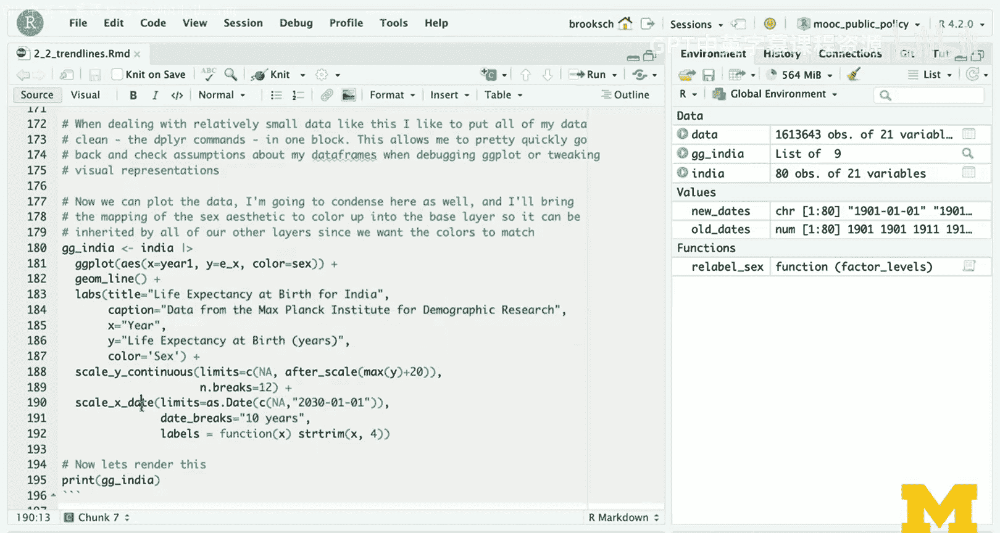
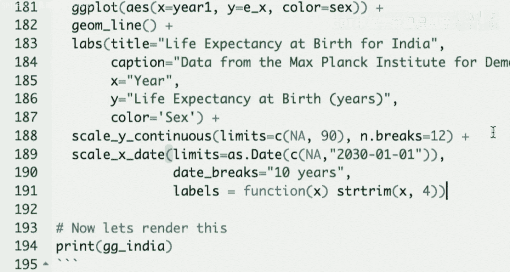

# 密歇根大学《公共部门的R数据分析（基础、数据探索、决策支持、）｜Data Analytics in the Public Sector with R》中英字幕 p57 13_趋势线深度解析与高级应用.zh_en -BV1YZ421J7Fx_p57-

With this graph nicely labeled， we could start to think about what the data means。

 We could see that from 1900 till 1975， men had a higher life expectancy and that the life expectancy for both genders has been largely rising。

 We could see that after 1985 or so， there's a change and that women now have a higher life expectancy at birth。

Let's zoom in on this。 We can do that just by setting the scale for our plot。

 remember that the scale works across all of our layers。

 so if we had more than one layer they would all be scaled identically。

 this is going to be important in a bit。

Right now， our X axis isn't in a date format。 It's an integer。

 We could change it to date or leave it as an integer。 I'm going to do the first of these。

 and this seems like a job for luer date。 So I'm going to bring that in。Now。

 our current value is just the year as a character string。 So 1901 for the year 1901。

 But the representation of a date in R requires us to have at least a month in a day as well。

 I going to manually add in the month in the day of January 1 so that all of our years are aligned at the beginning。

 So this means I actually want to change our date variable in our data by concatenating the string dash0101 to it。

 Then luber date can change this easily。First though， how do we get that data Well。

 our plot object holds the data in a variable called data and our data holds that year in a variable called year one and so we can get the data out just by sayinggggi India。

 Do sign data Do sign year one and so that'll allow us to pull out that year one and if you go up to the environment pan。

 you can actually just explore that and you can actually just see Gigi India has a dollar sign data oh look it's got these other things in it that I can start getting access to and so this is a really handy。

 I really encourage you to use this environment pane to explore the different objects are being created。

This old dates is now a vector of our string values。 So then the next question is。

 how do we concatenate strings， So we can use this function STR underscore C in R。

 which will join all of the inputs together。 If we pass our column of dates as our first item to SRC。

 and then passing in a string vector that we want to add to this。

 StRC is going to recycle that string vector and apply it to every element in the column of data。

 So here I'm going to say STRC call that function。 I'm going to pass in all of our old dates。

 So this is just the year。 So 1901，1902，1903 is a vector。

 And then I'm just passing in a one element vector here。 that's dash0101。😊。

What STRC is going to do is it's going to apply this to the first element of that vector so it's going to concatenate those together。

 then it's going to move on to the second element of old dates and it's going to recycle this because it's a shorter vector。

 We also could have created a vector of all the D or 1 dash ones for every date in here。

 but it's unnecessary and we're going to assign that back to new dates。

Now we can use Lubriate to change that and assign it back to our data。

 so we have it now in year month day format， so I'm going to use the YMD。

 and I'm going to assign that right back into our Gigi India plot。

 our data in that plot and our year one column。If we plot this。

 it's actually not going to look any different， but now we can set those X limits as a date。

 so now we can use scale X underscore date and we'll be using dates throughout for this。

So here's our plot and we've scaled it by date and we've scaled it starting with 1985。

 I believe on the bottom here and going to the end of our data。

Something to notice here， the two trend lines are squished up towards the top of the group。

 We didn't change our Y scale to fix this。 We want to set the y lower limit。 Also， right now。

 we've seen three different years along the bottom axis。

 But it might be more informative to see a few more。 We can tell Gi G plot。

 we want to control this more explicitly。 But when we add in a new scale underscore x date。

 it actually deletes the old one。 So we have to make sure that our limits are set appropriately， too。

 Remember， when you scale one of these axes， it scales it for all of the plots inside of your G G plot。

 all of the different layers。 And so you can only have one scale for a given axes。

 And so if you replace it。 or if you want to change it， you have to replace it。😊。

We'll set the lower value of the y axis to be 55， and then we'll use the date breaks parameter of the scale x date to every five years。

 Remember， our y axis is a continuous value， not a date。 So we're going to use scale y continuous。

 So this can catch you up a little bit in the beginning when you're scaling your axes。

 But for our x axis， we're going to use scale x date。

 We always have to think about what our kind of data type is on the axes。

 So I'm just going to take Ggi India， I'm going to say scale y continuous。

 I'm going to say from 55 up to whatevers natural。 And then I'm going say I want to add the scale x date。

 this is going to overwrite the one that we had there。

 So we have to make sure we set our limits as we want it to be done appropriately。

 And then for date breaks that actually use as an interesting format where you try and give your format in English。

 So in this case， it's five years。 and we can print that。

Okay， I could feel pretty good about taking this to a decision maker and showing them that not only is the life expectancy increasing。

 but there's a growing disparity between the life expectancy for men and women， with women living。

 on average five years longer than men to the age of 70 on average by the year 2013。

 despite that in the late 1980s， Both sexes had a roughly equal life expectancy of 57 or 58 years。

 various social， economic policy and employment issues might then be investigated to try and understand the cases of these differences。

😊，One of the main interests of a policymaker is to forecast。

 I talked a bit about how challenging and technical forecasting is。

 but I want to use this data to show you how you might visualize and forecast if you had a model。

The most common method would be to create a linear model for each of the populations of interest。

 In a linear model， the output of one variable is directly related to another variable。 Now。

 our data here lends itself pretty reasonably to a linear model because the slope of our line seem roughly constant throughout the length of the line。

Once we have a decision on the model， we have to think about how we're going to visualize it。

In the Ggi plot layer grammar of graphics， it seems that this would naturally be a new layer。

 so we could take a model and then plot it as a new Geome line on top of this one。

But Gigi plotot actually is a special geometry in it called Geome smoothoo。

 which will aim to both create a model for us and do the plotting is a lot of options。

 and it can save a lot of time。 It also allows you to specify a model if you have one。

 which is pretty powerful。😊，Let's take a look at how we can use Ge smoothth with this data。

Since I did a lot of building up of the Ggi plot object。

 I want to rewrite some of this here so that you have more of a complete solution of what we've done。

Upfront， I have to make a decision what set of dates do I want to include in my data。

 This is important because the data from across all of those dates will be used to calculate the forecasting lines。

 not just the rendered data。In this case， I'm going to take the data from 192 on。

 and I'm going to set this as a date value in my dataset set。

I'm going to filter by the same set of parameters we used for the assignment。

 and I'm going to look specifically at the data from India again。You'll notice here。

 you'll notice here that I'm going to actually。Change my factors directly in line with fact recode。

 So I showed you how you could write a custom function to do this。

 Of course you don't have to write a custom function to do this。

 You can just create your function and because we only have a or you can just create your factor and because we only have a couple of them。

 we can specify them in line here。I'm also going to do the year month day changing of dates here as a D per mutation。

When dealing with relatively small data like this， I like to put all of my data cleaning the Dlier commands in one block。

This allows me to pretty quickly go back and check my assumptions about my data frames when debugging Ggiplot or tweaking visual representations。

Now we can plot the data。 I'm going to condense here as well and I'll bring the mapping of the sex aesthetic to color up to the base layer so that it can be inherited by all of our other layers since we want the colors to match。

So here I'm actually going to pass in all of my aesthetic mappings into GG plot。

 so I'm going to put the year in as x， the y is our expected life expectancy and then the color is X。

 and then here my call to geoome line， the first layer is actually just an empty call to geoome line。

 I'm saying plot that data and it will inherit everything from above。

I'm going to set all of my labels here in labs， so you'll see here in labs I've got the title。

 the caption and the X and Y and color aesthetics that I'm mapping。

 so I'm not using X labs or Y labs here at all， and then I'm going to set the scale Y continuous and the scale X date。

Okay， now let's render this。So I'm throwing out a few things here。 First。

 I hard coded the y value to be 90 years old because we're going to forecast out a bit。 Now。

 I could use D playerer to access the actual data and save that in a variable， but for brevity。

 I decided to just change our Y limits in this way。Next， I want to change the labels for the Xaxxes。

 since I want to be able to forecast out until 2030， I want to truncate the dates to just the year。

The function I'm going to use to change the labels is actually a base R function called SR trim string trim。

 and it takes two parameters。 the string to trim and how many characters to leave。

 Since I only want the year left for display， I'm trimming to the first four characters to apply this。

 though。 We need to wrap it in a function that only takes one parameter。

 And that's because what scale X date is planning to use is one function where it gives it a date。

 So I defined a new function。 But instead of actually giving it a name and binding it to a name and doing this over multiple lines。

 I did it here just in line。😊。

For the trend line， we're going to use the geo smooth function。

 It's both a geometry aligned as well as a statistical function。

 It will inherit the base layer aesthetics and data。

 and the scales apply to all layers so we don't have to do them again。 Instead。

 we just have to think about what we want to display the geom function for small data like this will build a linear model。

 mappingapping y values to X values across all values。

I want to tell Gemooth to span across the full range of the axes so that it plots out beyond the data we actually have Now here I'm actually going to turn off the standard error。

 it's plotted by default and usually you want that and I'm doing that just for clarity and then changing the line to a dashed line so that we can distinguish it from the line of real data So you see this is deceptively simple。

 but you should really understand if you're going to be predicting using predictive models or linear models what what they're doing in more detail but here I'm saying I want to have a linear model plotted and I want it to be across our full range of data。

 no standard error and I want to change this to dashed Now this is interesting because this method item。

 there's many different ways that method item could be given to you as a predictive model and you'll actually see that in some future lectures I think in the next course where we actually demonstrate kind of a more advanced predictive model that will be given to you by a statistician。

So now we've got two layers both with the same set of aesthetic mappings because they inherit from the base layer that they sit on。

 the first layers are Geome line and the second one is this GeO smooth we also have some scale transformations in here but it doesn't matter what order we place them in because they affect all layers so let's take a look。

So that's a pretty nice basic chart with two groups。

 their actual data lines and a simple forecast for each gender based on a linear model。

 This is pretty easy to interpret， and it gives a sense by the year 2030 Indian women will have a high chance of having a life expectancy of 80 years old while men will be born and have a lower life expectancy at 75 years。

 remember we're looking at life expectancy at age  zero。

 so this would be for people who are born in that year of 2030。On top of it the chart looks good。

 it's readable， and you could relatively quickly build this for other countries in our data set。

I'd like you to reflect on the last two code chunks we wrote。 Aren't they beautiful。

 We have one pipeline， which reads in our data， manipulates it into a format we can use to answer questions and is pretty easy to maintain。

 This then feeds into a G G plot， which is two layers built on top of a base。

 The layer shared the same set of data and aesthetic mapping。

 So the rendering of the line plots is coherent。 and we didn't have to do anything special to make this happen。

 We've augmented those layers with some plot wide scaling functions and labels to turn a basic plot into a forecasting tool。

 Understanding the layered grammar of graphics allows us to write concise， yet clear code。😊。

We're not done talking about population data yet， but I want to set a target for this week。

 Do you think we could build the population pyramids that Doctor Lance discussed in the first course。

 I think we can。 But first， we're going to have to delve in a bit more and see how to plot samples from populations with histograms。

