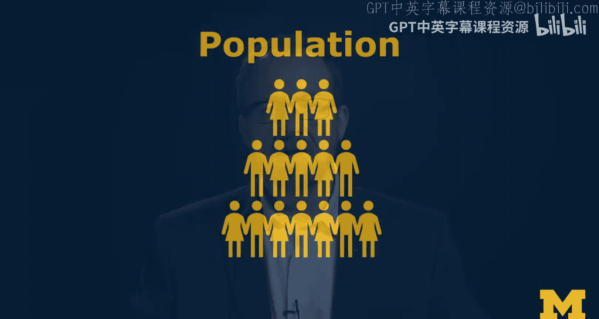
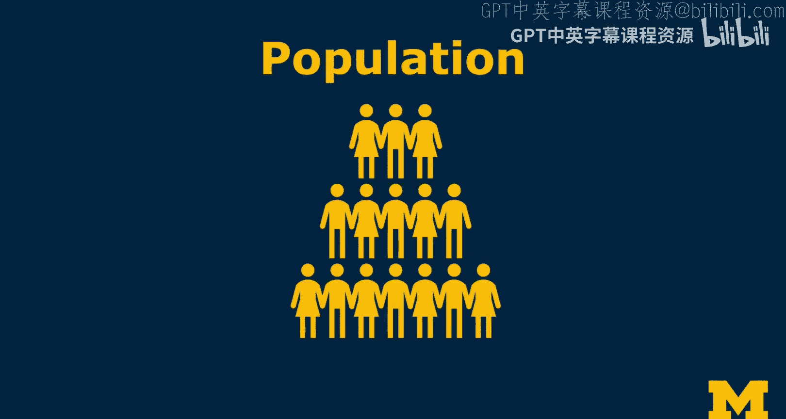
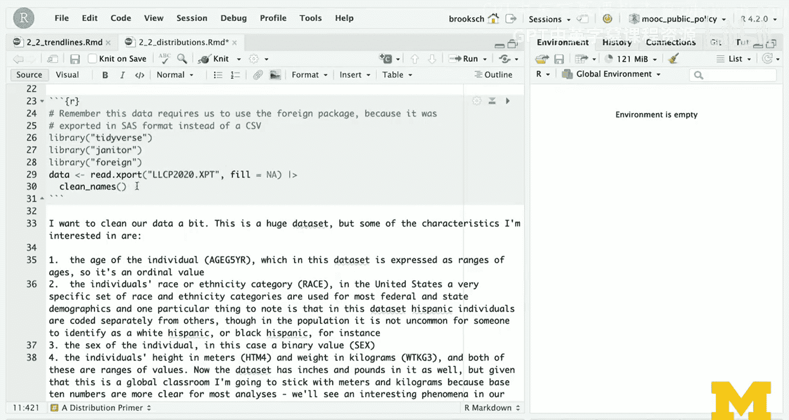
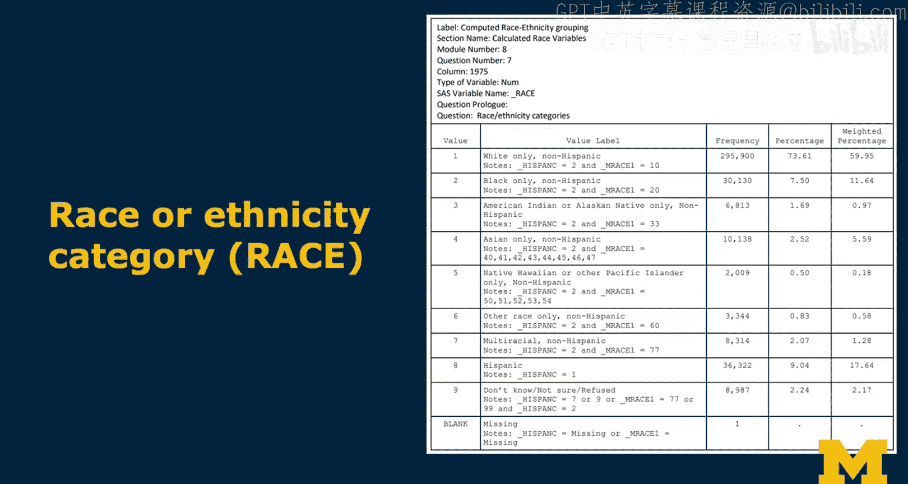
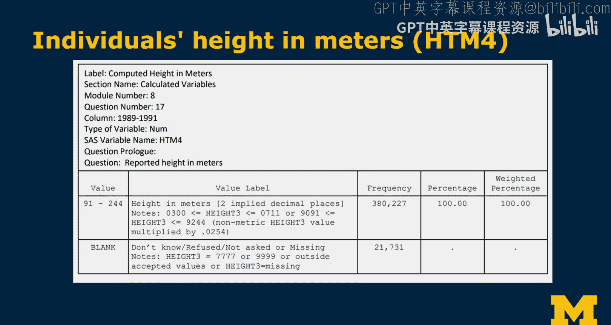
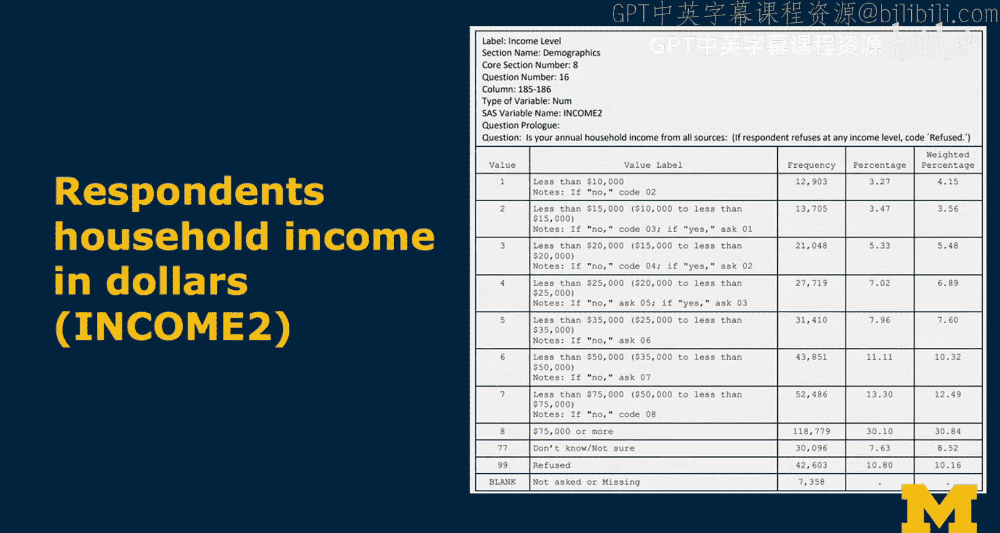
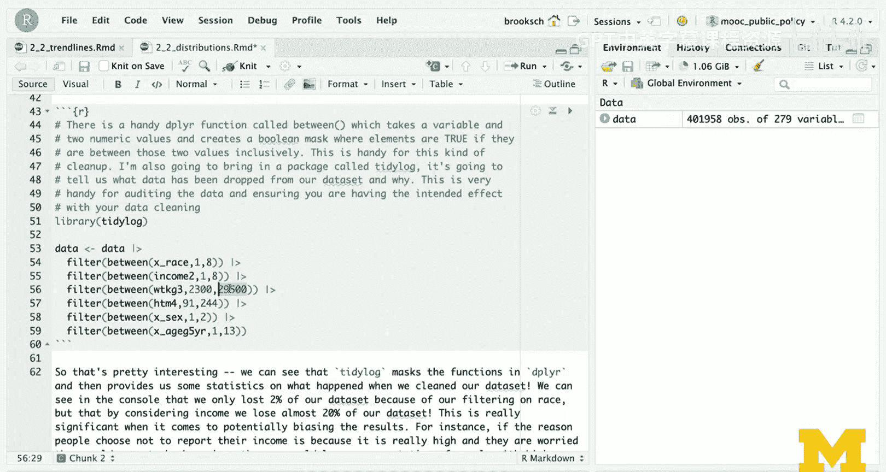

# 密歇根大学《公共部门的R数据分析（基础、数据探索、决策支持、）｜Data Analytics in the Public Sector with R》中英字幕 p58 14_分布分析与直方图入门.zh_en -BV1YZ421J7Fx_p58-

The next topic we should tackle is how to explore and understand distributions of data。

This turns out to have a lot of nuance around it， so I wanted to start with a bit of a primer on what distributions are and how we can use them in the R language。

At a high level， a distribution is just a set of frequency observations。

 So we've actually already seen them with some of the population and pet data that we've looked at。

 Disbutions are very common in public policy。 population age distributions， for instance。

 are used to understand how much of the workforce is likely to continue working。

 while wealth distributions can be useful to understand societal equity issues and the effects of taxation or other initiatives。

There are few central concepts to understanding distributions that I'd like to touch on。

 And if these seem unfamiliar to you， I'd like to encourage you to explore some of the introductory statistics courses here on the Coursera platform。

First up is the notion of a population a population is the set of all possible observations that we're interested in。

In policy， this is often the set of all people， but it can also investigate populations of fish。

 Tre or other diverse groups of things。 In the statistics sense。

 a population doesn't have to be living things。 We could be interested in the population of cars in the world。

 for instance。However， in public policy populations are often people。 For instance。

 the population of US citizens might be just above 300 million individuals。

 The next concept is a sample， and that is the selection of a portion of the population。

 which we're going to analyze。

The sample is often much smaller than the whole population。

 we saw in the last course that the annual census samples 1% of the American population were about 3 and a half million people per year。

The sample is the group that we're going to observe and quantify。

 we will then engage in visual and numerical analysis of the sample with the idea that what we find will be generalized to the whole population we're interested in。

Whether the sample is representative of the population or not is critical and it's a major concern for equity and making good public policy。

There are various techniques to deal with a lack of representation， stratified sampling processes。

 for instance， aim to change how to collect data in order to increase representation while reweighting of variables。

 as is done in the BRfSS data we looked at previously aims to improve representation after the data has been collected。

You'll see some more discussion of this issue， including some of my own research in the last course of this series on ethics and politics of data。

 For the moment， we'll assume that our sampling method is reflective of the population。

 So our sample is just a mini version of our population。Samples are finite。

 sometimes they're finite and big， so we could just consider them to be continuous。

 but often they're finite and small and will become painfully aware of how discet they are。

In statistics， we often want to represent samples using a mathematical function。

 just like we saw in the last lecture， it's possible that this function might be linear。

 but often as a much more complex or nuanced shape to it。

The shape of the function is controlled or described by parameters。

 and we often want to try and analyze our sample data to generate these parameters so that we can estimate the mathematical function。

So why would we bother to estimate this mathematical function？ Well， first。

 there are a lot of different statistical methods that we can use only if we place some limits on the distribution。

 but secondly， we often want to forecast changes that might happen in our population and to do so we need some language to describe how these changes might come about and for that。

 we're going to use statistical modeling， you'll get to hear more in the next course from different statistical modelers on what they've done when we talk about experimental analyses。

The beauty of learning statistics in the modern era is that we can simulate data and functions or even look at real data instead of having to go through the mathematical theorems and proofs。

 and a great place for us to do that is here in R， and in this lecture。

 we're going to do that by looking at some of the behavioral risk factor surveillance system data we used in the previous course。

So let's load that BRFSS data in and get started。

So remember， this data requires us to use the foreign package because it was exported in SAS。

 and so I'm going to use a RE export and then pipe that to janitor to clean those names up。

I want to clean our data up a bit， this is a huge data set。

 but some of the characteristics I'm interested in are the age of the individual or the age five year。

 which in this data is expressed as ranges of ages， so it's an ornal value。

The individual's race or ethnicity， which is the race column。 And in the United States。

 a very specific set of race and ethnicity categories are used for most federal and state demographics。

 And one particular thing to note in this data set is that Hispanic individuals are coded separately from others。

 though in the population， it's not uncommon for someone to identify， for instance， as a white。

 Hispanic or a black， Hispanic。

The sex of the individual， in this case， it's a binary value of sex。

The individual's height in meters， H T M 4 and weight in kilograms， W T， K G3。

 And both of these are ranges of values。 Now， this data set also has inches and pounds in it as well。

 But given that this is a global classroom， I'm going to stick with meters and kilograms because base 10 numbers are more clear for most analyses。

 We'll see an interesting phenomenon in our data from this decision。

And then the respondents household income in dollars or income2。

 and again here we have bands of responses， note that the bands also aren't all the same size in this data set。

I'm going to clean our data by filtering on these column values。

 then convert things as factors as appropriate。

So I want to show you a new handy D per function called between。

 which takes a variable and two numeric values and creates a boolean mask where elements are true if they're between these two values inclusively。

 This is handy for this kind of cleanup。 I'm also going to bring in a package called tidy log。

 It's going to tell us what data has been dropped from our data set and Y。

 This is very handy for auditing the data and ensuring you're having the intended effect with your cleaning。

 So I'm going to bring in tidy log。 And then here I'm going to say I want the x race value。 Remember。

 because it's Sas value and they started their variables with underscore。

 they're going to be imported by read CSsv with an X underscore。😊，Anyway。

 I want to take the race value and I want to ensure that it's between one and8 inclusive。

 that income is between one and8 to inclusive weight and KG these are the min and max values provided in the codebook and so forth。

 so that's pretty interesting we can see that tidyo masks the functions and D plier and then provides us some statistics on what happened when we cleaned up our data set。

We could see in the console that we only lost 2% of our data set of our filtering on race。

 but that by considering income， we lost almost 20% of our data set。

 This is really significant when it comes to potentially biasing the results。For instance。

 if the reason people chose not to report their income is because it's really high and they're worried about that they might be seen as braggars then we would lose representation of people with high incomes。

 It's also quite likely that variables like income are highly correlated with other variables。

 for instance， age since older individuals have a greater chance of having been in the workforce longer。

Being able to report on the effects of these cleaning methods is important in informing good policy。

