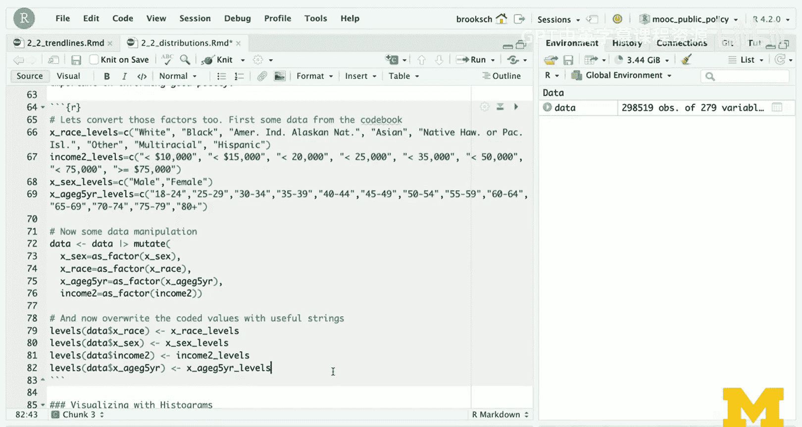
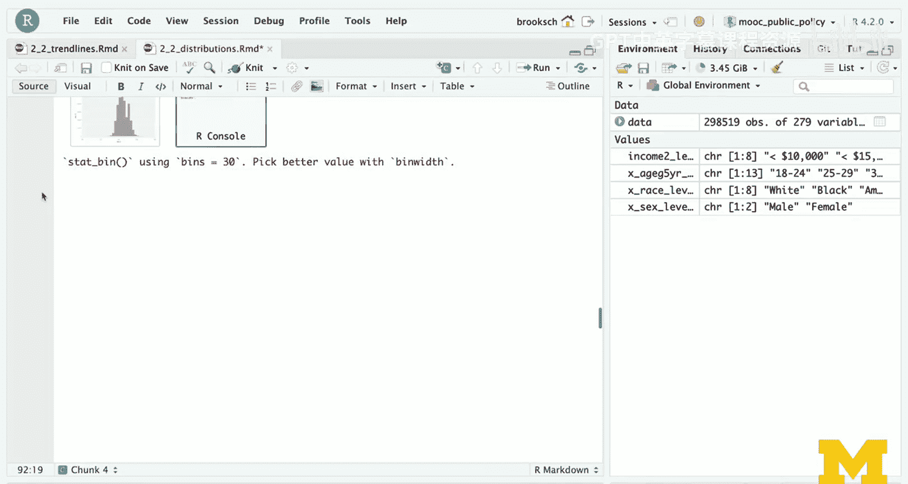
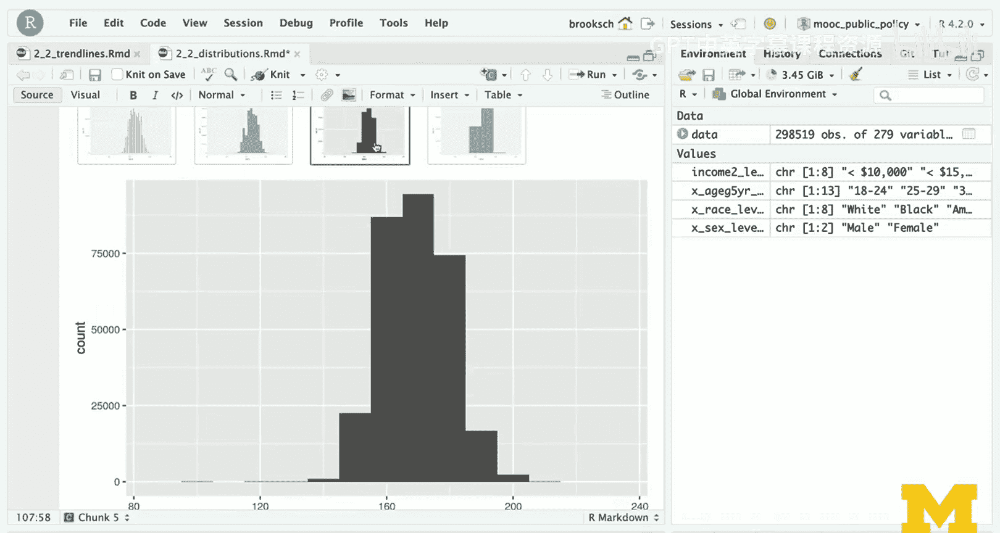
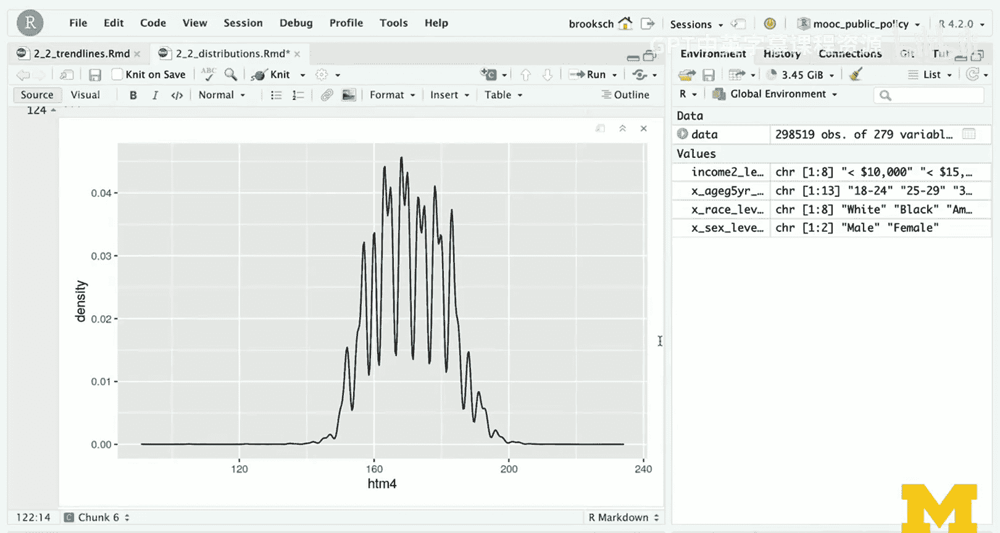
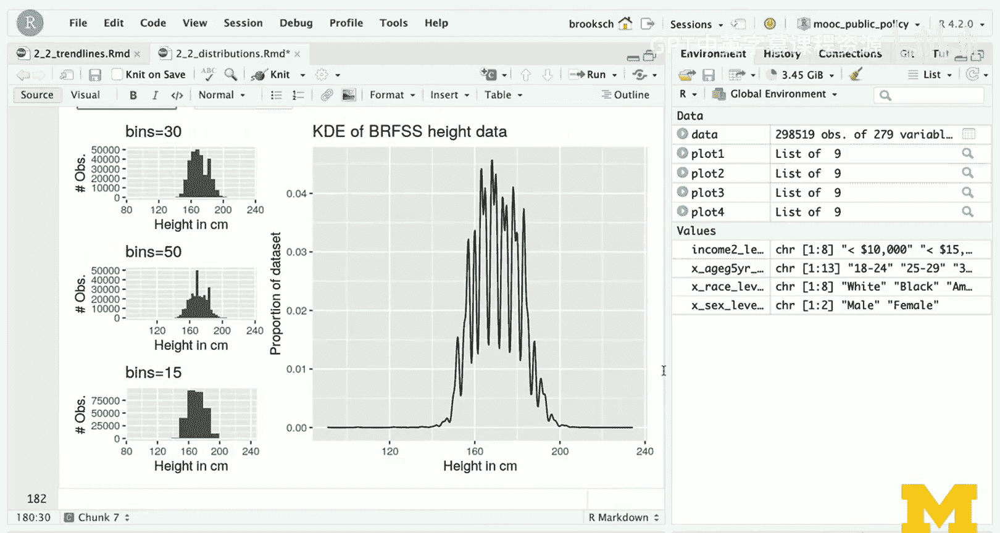

# 密歇根大学《公共部门的R数据分析（基础、数据探索、决策支持、）｜Data Analytics in the Public Sector with R》中英字幕 p59 15_直方图深度解析.zh_en -BV1YZ421J7Fx_p59-

I want to convert these to factors too， so I actually have taken the codebook and I've turned these into race levels。

 income levels， sex levels and the age five year levels and you can see that this is kind of frustrating right I actually had to as a person had to go in and read the codebook I had to rewrite these as strings。

 I made mistakes， those mistakes could give decision makers a wrong idea if they made it through into my analysis and so this is one of the challenges in using data sets like CSV data or SaS data instead of something where the factors are coded actually as string values。

I'm going to change these to factors just with D pliers so I'm going to do it and mutate。

 I'm just going to take our column xX and convert it to a factor， xX。

 and then I'm going to overwrite the levels down here below to change those values。Now。

 as you look at this， think about other ways that you could do this。

 You've already seen some with four cats。 You've seen some with read CSv。

 How else could you create these factors in your data。

 And what are the implications that that might have。 Now that our data is loaded and cleaned。

 I think we could try and visualize a distribution。

 The main technique used for visualizing distributions and samples is a histogram。

 And this maps a continuous value along the X axis with a frequency along the Y axis。

 The visual representation is actually a bar chart。

 The histogram converts the continuous variable into a series of ordinal categories through binning。

 Why do we do it this way。

Well， some continuous variables like weight may be highly varied。 And thus for a given sample。

 we might not be able to see any trend in prevalence。 For instance。

 maybe there's one person in our data with exactly 100。02 kg and another with 100 kgs even。

 and then maybe another one at 100。03。 The histogram if essentially rounds these numbers into buckets and allows us to control these buckets。

 We call them bins with a bit more flexibility。 It gives us a sense of the density of our population and their characteristics。

 Let's take a look。

So we're actually going to take a look at the heightened centimeters here so that's HM4 and it's actually pretty easy GG plot。

 we're only interested in HM4 and we're just going to make a histogram。Okay。

 so here's our first histogram。 In this case， we're looking at the height in centimeters of our sample。

 We see on the console too， underneath G G plot has used a binning function with 30 bins as a value。

 By far， the bulk of people in our data have a height in the range of 150 to 180 centimeters。

 This is roughly between 5 and 6 feet tall。 so it seems reasonable。

There is this little sliver of space around the 180 cm mark where we have a much smaller number of people。

 And this demonstrates one of the biggest challenges of the histogram。

 Your choice of been with changes what the chart looks like and can sometimes mislead。

Sometimes we call this the comb effect because the gaps look like bars。

 that look like the teeth of a comb， let's try a few different bin sizes。

So here I'm going to try four different bin sizes。 and remember these are all in centimeters so one I'm using bin width here。

 so a bin width of one cent is just under half an inch，5 centimeters is about 2 inches。

 10 centimeters is 4 and 30 centimeters is a standard ruler， a 12"ch ruler， so about a foot。

Okay， this is nice。 We see that our studio is going to show us these four plots in sequence。

 The first one shows the combs tooth effect。 There are literally a bunch of values which no one ever reports。

 Actually， if we go into the data and look， we'll see that for a height of 1 and 60 cm。

 there are nearly 20000 observations， but for a height of 1 61 cm， there's only 19。

 So how can this be。 Well， in part， it depends on how respondents answer the question。

 And there's a lot of interesting behavioral psychology at play here。

 If somebody responded that they're 5 ft2， that's 160 cm。 But if they said they're 5 ft3。

 that rounds to 163 cm。 So there's only a few people in the sample who reported their height as 5 foott2 and a third。

 for instance， or who are reporting their height directly in centimetersm。😊。

As we increase the bin size， we see different kinds of patterns。

 and we get a more general sense of what the data looks like。 But when our bins get too big。

 like when we're measuring to the size of a foot in the very last chart。

 we start to lose granularity。 In short， to estimate the distribution of data with a histogram。

 you have to be very aware of the bin size and both experiment and consider it carefully。

A common desire is to try and smooth out the histogram by estimating a function for the data。

 The normal way to do this is to create a kernel density estimate and visualize it as a line。

Unlike a histogram， kernel density estimates are smooth and continuous and can give some insight into data which has relatively small samples。

 G G plot has some built in functions to create a kernel density estimate as a new layer。

 we can access these using the geoome density geometry function。

 And this underneath is actually going to call the stat density mechanism to create the function。

So we can use a nearly identical G G plot just to look at the kernel density。

 So here I'm just going to create a new G G plot， and I'm going to use geoome density on that same data instead of Geome histogram。

 Okay， wow， we can see the spikes here around the reporting numbers。

 You'll notice that the X axis is the same as in the histogram or kilograms。

 but that the y axis is very different。

A density estimate function represents the proportion or amount of data as a ratio in the whole dataset set at any given point along the A axis。

So while a histogram Y axis was the number of observations， people in each bin。

 the density value indicates the ratio as a number between0 and 1 of the data at any given x point。

A density estimation can be thought of as a probability function if you took all of the data underneath the density estimate and summed it up。

 it would equal 1。The inference one can make from the density estimation is with respect to ratios of the population。

 while the inference you can make with a histogram is in exact count of observations。

It's pretty common to plot both the density estimate function and the histogram together。

 But in Gji plot， all layers must have the same scale。 So we have to convert one of these two。

 the histogram and counts of observation or the density plot and ratios between 0 and 1 to the other。

But this isn't straightforward to do as the histogram bar has a width to it。

 while the density function provides point estimates。

 So creating this graphic means we have to write a function to translate from the histogram to the density or the reverse。

 because all the layers must have the same scale。😊。

An alternative is to try and show the two plots side by side Now Ggiplot doesn't do this for us。

 but we can use a library by Klos O Wilki called cowowplot to extend the functionality of GgiPot Kus wrote a book the fundamentals of data visualization where he explains that the cow plotot library in more detail。

This book is interesting because instead of just focusing on the mechanics of information visualization libraries like the Ggiplot1 does。

 he also delves into the topics of the last week of this course。

 which is what makes a clear and informative visual。

So let's use a bit of the cow plot to update this visual and make it a bit more compelling for decision makers too。

So Callo should be installed for you in Coursera so we can just import it with the library function。

Now， the main function we're going to use for the cow plot is called plot grid。

 which allows us to arrange plots into a grid on the screen。 In this example。

 I'm going to use four plots。 I'll plot the histograms on the left hand side using three different bin sizes。

 one on each row， and that it'll put a bigger density plot on the right hand side and have it span across all three rows and take up two thirds of the horizontal space。

 I want to show you a little bit more of a fancy cow plot here。

 because I think the library is pretty straightforward to use。😊。

So here I'm going to create my three histograms， plot 1， plot 2 and plot 3。

 and you can see here I've got really short labels， and all I'm doing is using the default bins。

50 bins， and then 15 bins， and then I'm labeling them appropriately。

And then I'm going to create the fourth plot， and this is our kernel density estimation， and again。

 I've got titles， but it's just the basic genomeome density。Now。

 we can make the plot grid of the three histograms。 So that's this piece in here。

 So here I'm saying I want to create a plot grid of the three plots。

 I just pass all the plots that I want in there。 and then I'm saying I want there to be three rows。

 So it's gonna to plot these on three rows。 And then I'm going to pass that in to another call to plot grid。

 So the first plot will be that group of three。 The second plot will be our plot4， the Kde。

 And here normally it'll just plot them side by side and here I'm saying I want the relative widths I want the plot on the left to be a one and the plot on the right to be a two。

 So the one on on the right hand side is going to be twice as big as the one on the left hand side。

Not bad。 There's a few ways we could improve that， perhaps by having a common Y access label for the histograms or changing some of the text styling。

 But all in all， it gives both a glance at the histograms to give a sense of the density of the population。

 as well as shows the K D E with these spiky pieces。

 indicating that the variable isn't actually as continuous and smooth as the histograms might suggest。

In this lecture， I've introduced you to the notion of histograms and kernel density estimations。

The use of histograms to understand population characteristics is significant。

You might have noticed that we cleaned a bunch of data here， but only looked at the height of people。

 I think a good assignment for this week would be to have you explore making histograms of some of the other characteristics and maybe build a visual a bit more compelling than the simple ones that I've built here。

😊。

