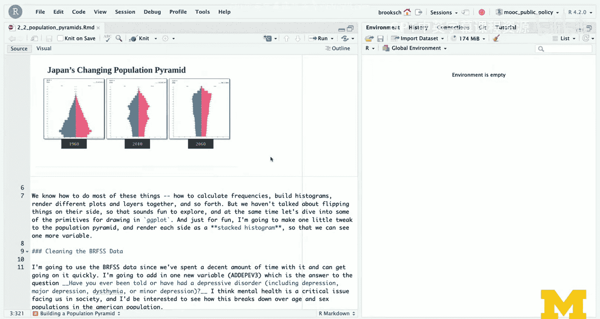
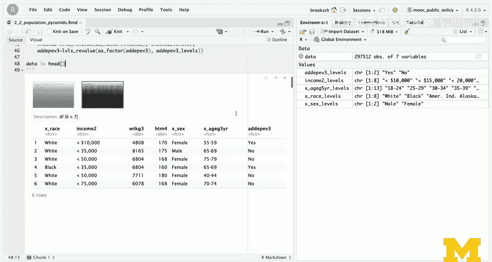
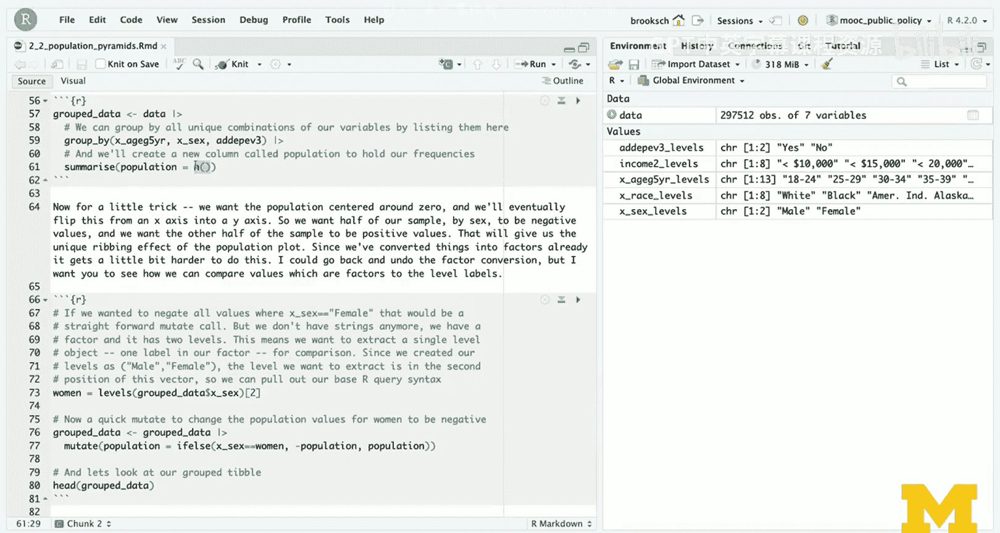
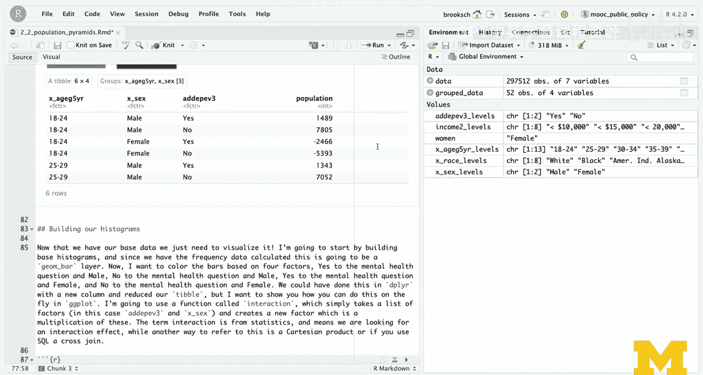
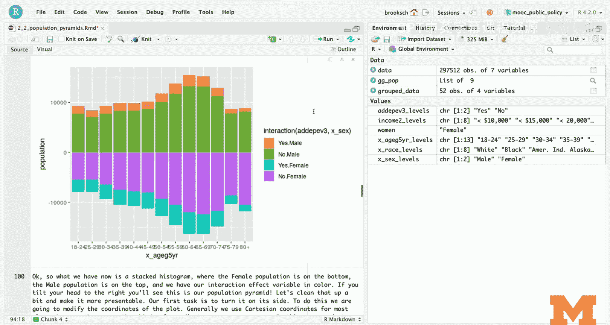
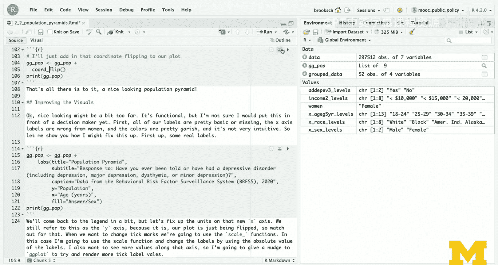

# 密歇根大学《公共部门的R数据分析（基础、数据探索、决策支持、）｜Data Analytics in the Public Sector with R》中英字幕 p60 16_人口金字塔基础构建.zh_en -BV1YZ421J7Fx_p60-

Now that we have a handle on the basic plotting features of Gigi plot。

 and we've talked about the distributions and visualize them as histograms。

 I think we're ready to try and tackle the creation of this population pyramid chart。

 recall for a moment what a population pyramid looks like。

 We can describe it in terms of what we've been talking about this past week。

 It's just two histograms turned on their side so that they share an x axisxes。

 which then becomes the y axises with one group featured on the left and the other on the right。

 In the cases of most population pyramids， this data is split by gender and the x axis is the number of people while the y axis is the age of the people。

😊。

And here's a reminder from the first course of Japan's changing population pyramid over year。

We know how to do most of these things， how to calculate frequencies， build histograms。

 render different plots and layers together and so forth。

 But we haven't talked about flipping things on their side。 So that sounds a little fun to explore。

 And at the same time， let's dive into some of the primitives for drawing in G G plot。 And。

 of course， just for fun， I'm going to make one little tweak to the population pyramid and render each side as a stacked histogram so that we can see one more variable。

😊，I want to use the BRFSS data that we've spent a decent amount of time with and get it going a little quickly here I'm going to add in one new variable which is the answer to the question have you ever been told or had a depressive disorder？

I think mental health is a critical issue facing us in society。

 and I'd be interested to see how this breaks down over age and sex populations in the American population at large。

Okay， so let's bring in our data cleaning from the previous lecture。

 you can see I'm starting to build up this list of packages that are my usual ones。

 so we've got Tidyverse， janitor， foreign and tidy log to see the impacts。

Now here's some human readable labels from the codebook。

 so for each one of these I just went and looked up the variable name and then I took the codebook and I turned it into human readable labels。

 so I've got that for income， for the race and ethnicity for the sex and for the year age of years and this is B by the way。

 and then for our question， this yes or no question to the mental health。

Okay so our data cleaning is going to look pretty familiar。

 I think here we're going to read in our export using our foreign package。

 I'm going to clean the names right away before I do anything that I'm just going pull out the variables that we want。

 So remember you do you could pull up variables or columns in many different ways I'm going to use select here and just pull it out based on the column names and then I like to put a filter on each line so that I could actually annotate in between。

 One of the nice things with the R pipe syntax actually is that I can put comments in between lines and that's not something I could do in a lot of other languages when I want to chain commands together like this so I really like that for the pipe syntax。

 It's too bad we don't yet have that for the Ggi plot syntax。

After I do all of our filtering and I've got the data that I'm actually interested in。

 then I'm going to actually convert our data types and so I'm going to turn things into factors and set their labels as appropriate and then look at the head of this data。

So look back at that code。 Isn't that beautiful。 It's succinct。 It's readable。

 and it's code that's going to be easy to maintain and changes as our analyses might change。 I。

 of course， wanted to throw one more thing at you and introduce this levels revalue function。

 which is actually from the forecastcas package。 It allows us to take a character vector the same length as our labels and just overwrite the level names。

 We did this previously with the levels function， which is base arm。

 But that function is not as easy to pass into the tidyverse pipebased cleaning。

 So to use it here would have required some additional statements。

 So I like to use this levels revalue。 Often， we want to use the Ggi plot histogram to calculate frequencies of interest and plot them directly。

 But since we're customizing this plot， we're going to actually use some geobar charts like we did originally back in weak one of the course。

😊。

In this case， we need to write some data processing ourselves Now the question we want to understand is if by age group and gender group。

 the response to the question on mental health is yes or no。

 so we want to calculate the frequencies for all 20 to 25 year old men who said yes。

 all 20 to 25 year old men who said no， all 20 to 25 year old women who said yes and so forth and so on。

This means we're going to do a D group I on these variables and pipe that to summarize and mutate to create a new variable in our data set。

Now when I change my data， I like to actually call it grouped data so that I know what I'm working on and we're going to group by multiple columns so essentially we're going to say we want all three of these columns to be in our group and then we just use this N。

 remember this is actually brought to us by D per， it's a function that allows us to work on the individual groups to summarize the size of that with population。

Okay， now for a little trick， we want the population centered around zero and will eventually flip this on this x axis on the y axis。

 so we want half of our sample biX to be negative values and we want the other half of the sample to be positive values。

This is going to give us a unique ribbing effect of the population plot。

Since we've converted things into factors already， it gets a little bit harder to do this now I could go back and undo the factor conversion。

 but I want to show you how you can actually compare values which are factors to the level values。

So if we wanted to negate all the values where the sex is equal to this string female。

 that would be a straightforward mut call， but we don't actually have these strings anymore。

 We have a factor and it has two levels。 and if you're comparing a factor and the level is a string and you're trying to compare to a string it just doesn't work because a string isn't a factor。

 So this means we might want to extract a single level object。

 one label in our factor for a comparison。 Since we created our levels as male and female。

 the level we want to extract as the second position of this vector。 So this one。

And so we can actually pull it out with our base R query syntax。

 so I'm going to create a new variable here， women， you see that I've used the equal sign here。

 actually the equal sign， that's kind of bad coding that's not something that you normally would see normally you would see this arrow。

 actually the equal sign in the arrow work interchangeably and that was added into R because a lot of programmers like myself who come from a different background found it weird to have this arrow and I didn't even notice that until I was lecturing here that I tossed that equal sign in。

Either way， what it does is it binds this name in this case women。

 and so here I'm going to take the levels， I'm going to take our grouped data。

 take our sex variable out of that。Find the levels and then take the second item there and bind it to this word women。

 So now women actually points to something that looks like a string of female。

 but it's actually a factor value。 What's nice about that is that now we can actually mutate。

 So now I can do this population if else， the sex is equal to women， then negate the population。

 So this will negate all of the values in that column or just take the population itself。

 So let's take a look at the head of this data frame。Okay， so we can see here we've got males， yes。

 and then we've got a positive number， and then for female， yes， we've got a negative number。

 so this will be useful for us when we want to actually draw our geoome bars to the left and the right of the zero line。

Now that we have our base data， we just need to visualize it。

 I'm going to start by building base histograms and since we have frequency data calculated this is going to be those geobar layers now I want to color the bars based on four factors。

 yes to the mental health question in male， no to the mental health question in male。

 yes to the mental health question in female and no to the mental health question in female。

We could have done this in DPer with a new column and reduced our Tbble。

 but I want to show you how you could do this on the fly in GG plot。

I'm going to use a function called interactionction。

 which simply takes a list of factors in this case our yes， no question and our gender or sex， male。

 female， and creates a new factor， which is a multiplication of these。

The term interaction is from statistics， and it means we're looking for an interaction effect between variables。

 While another way to refer to this is a Cartesian product， or if you use SQL， it's a cross join。

 These are all the same here。

So I'm going to pass in the aesthetics to our base plot and I'm going to set the fill of the bars to be this new interaction factor while the height will be our population frequency value and ourite ages。

By defaulted GeObar uses the stat value of count， but we already have our values in a data frame。

 so I'm going to override that and set the stat identity。

 this tells GeObar to do no statistical transformation。And remember。

 our genomebar is just going to inherit all of this data。

 all of the aesthetic mappings and the data rather from the base GG plot。Okay。

 so what we have now is a stacked histogram where the female population is on the bottom and the male population is on the top。

 and we have our interaction effect variable in color。 If you tilt your head to the right。

 you'll see this as our population pyramid。 So let's clean it up a bit and make it more presentable。

 Our first task is to turn it on its side To do this。

 We're going to modify the coordinates of the plot。 General。

 we use Cartesian coordinates for most plots。 However。

 there are other kinds of coordinate systems we can use。 In this case。

 we just want to flip the X and Y and Gigi plot has a function to do that called coordinate fl。😊。

Keep in mind that all the coordinates affect all of the layers。

 though right now we just have one layer， so in our layered grammar of graphics each layer has kind of five pieces to it。

 but then we also have aspects or pieces of the grammar that affect across all layers and the coordinates and the change in coordinates is one of those。

So I'm just going to add in that coordinate flipping to our plot。So you see。

 I like to use the variable that I've created over time and then just add chord flip to it。

