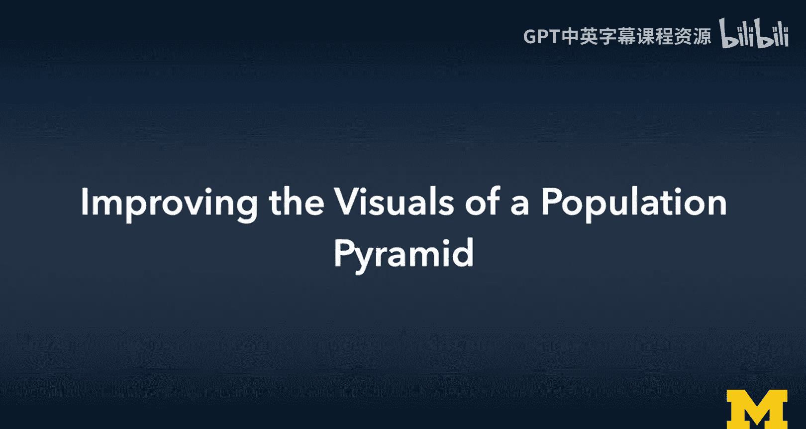
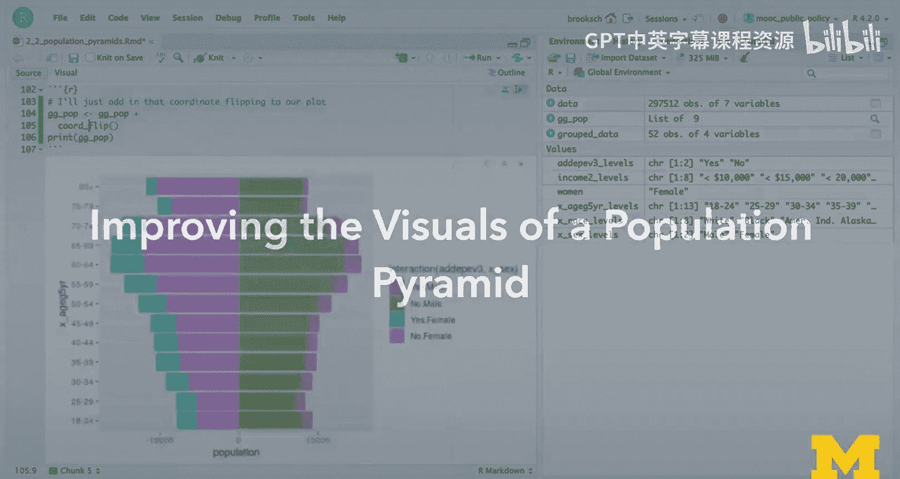
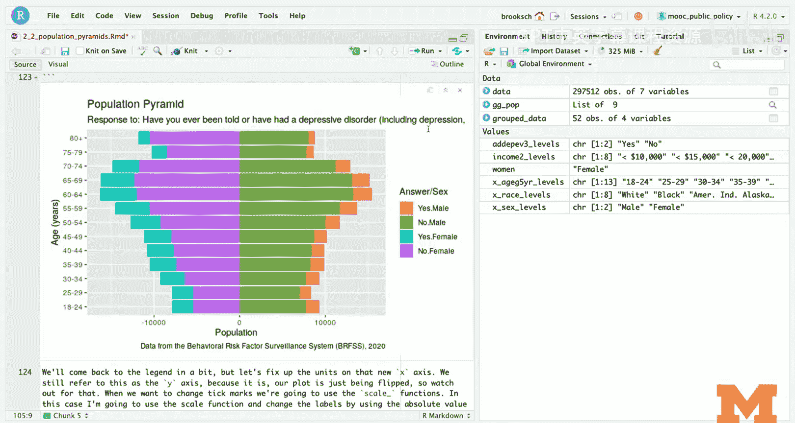
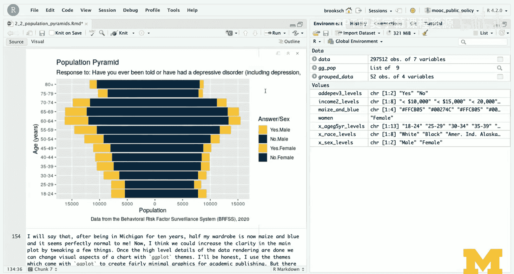
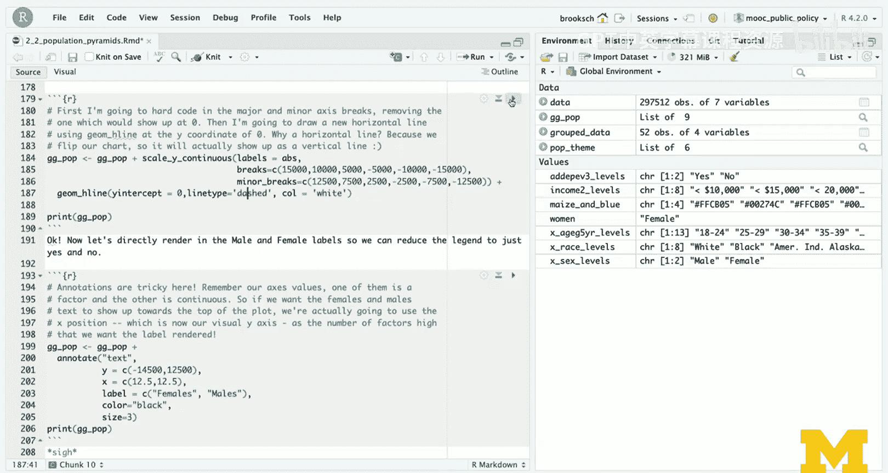
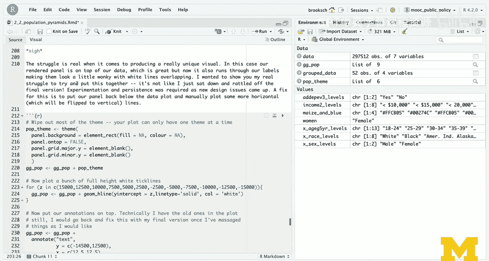
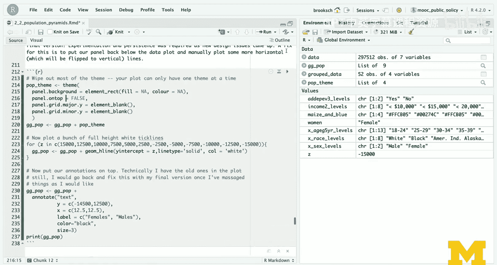
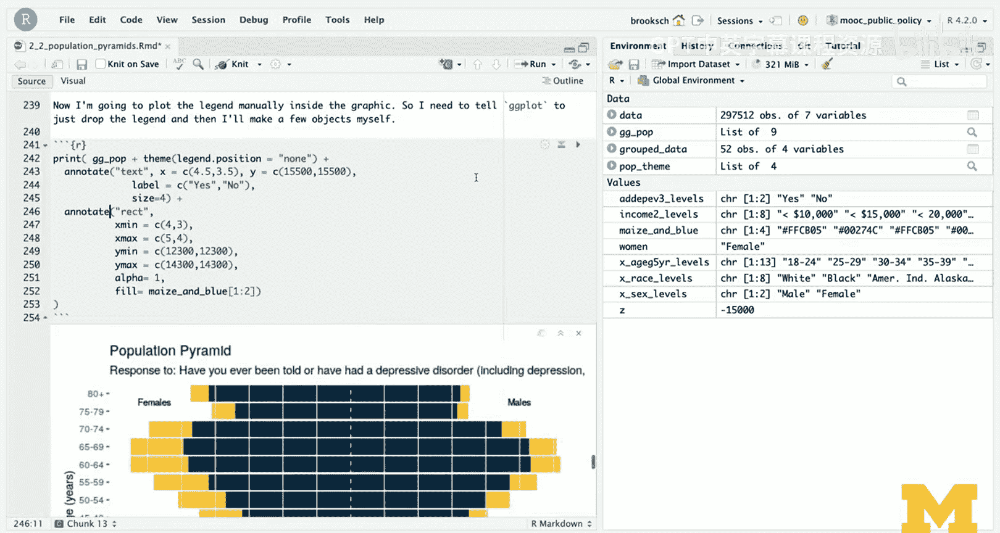
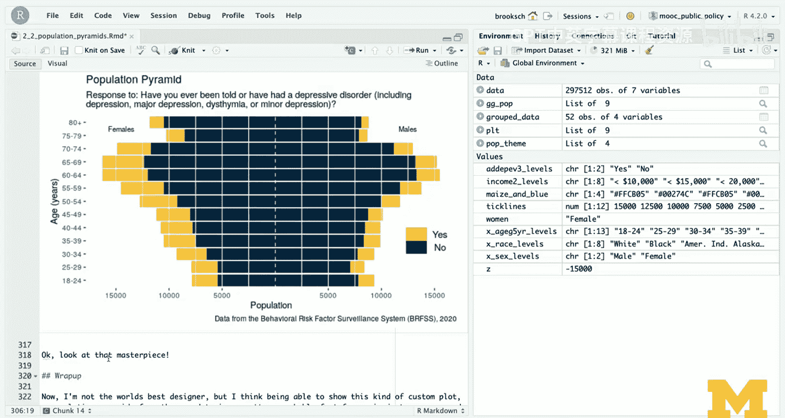

# 密歇根大学《公共部门的R数据分析（基础、数据探索、决策支持、）｜Data Analytics in the Public Sector with R》中英字幕 p61 17_人口金字塔可视化优化.zh_en -BV1YZ421J7Fx_p61-

Okay， well， nice looking might be a bit too far。 It's functional。

 but I'm not sure I would put this in front of a decision maker yet。 First。

 all of our labels are pretty basic or missing。 The access labels are wrong for women。

 and the colors are pretty garish。 I really don't think this is very intuitive。

 So let me show you how I might fix this up。 First up， some real labels。

So we've seen all this before there's nothing really special here， we're going to use labs。

 we're going to add a title， a subtitle， remember the subtitle renders right below the title。

 you'll notice some problems as we render the subtitle that's very long and I'm going to leave that to the end。

And then a caption and a caption is often you put at the very bottom of the plot used to reference the data that you're actually using。

We'll come back to the legend in a bit。 but let's fix up the units on this new X axis。 Now。

 we're still actually going refer to this as the Y axis because it is。

 Our plot is just being flipped。 So watch out for that。 When we want to change tick marks。

 We're going to use the scale functions。 In this case。

 I'm going use the scale function and change the labels by using the absolute value of the labels。

 I also want to see more values along the axis。 So I'm going to give a nudge to Ggi plot to try and render more tick label values。

 The labels assignment in this case， is just taking a function。

 So I take our labels when I do the scale Y continuous and I assign it to A B S。

 which is just the absolute value function。 So it's going to turn all those negative values positive and leave all the positive values alone。

😊，To nudge G plot to improve the scale， I'm going to set the number of major breaks to 10。

 This is actually just a hint to G plot。 It's still going to make something beautiful and balance。

 so if you want to insist on certain breaks， you can pass a vector in that are the actual breaks you want here。

 I like to just say try and give me 10 labels。Now， I'm not a big fan of these colors。

 Theyre certainly distinct， but we can tweak them to make them fit in more with。

 say charts or literature， other things that we might be presenting to stakeholders。 In this case。

 I'm going to use the University of Michigan colors。 Now， when I came to Michigan 10 years ago。

 I have to tell you， I was a little taken aback。 everyone in the town is wearing na blue and yellow and not a subtle。

 faded yellow， but a screaming bright yellow。 What I was quick to be told， though。

 is that it's not actually yellow， but maize， which is another word for corn。

 So I'm going to use the official Michigan colors of maize in blue。

 And I just looked up the color identification codes on the U of M website。

There's a lot of color pickers out there that allow you to find the appropriate hex codes for colors that you might be interested in for a given context。

 Okay， so here's our colors， maize and blue。 So you can see that I've got maize in blue and maize in blue because we have four different things in our legend that we want to actually color。

Now remember we change visual aspects of aesthetics by scaling them。

 so in this case we actually want to scale the fill color。

 this might seem pretty unintuitive when you first do it， I don't really think of this as scaling。

 I think of this as setting the fill color， but it's the norm when we're changing aesthetics and the visuals of them。

Also， remember I've got these four values， but I only want two colors。

 so we'll talk about that in a little bit。

I will say that after being in Michigan for 10 years。

 half my wardrobe is now maze in blue and it seems perfectly normal to me。Now。

 I think we could increase the clarity in the main plot by tweaking a few things once the high- levelve details of the data rendering are done。

 we can change visual aspects of a chart with Ggiplot themes Now I'll be honest I use themes that come with Ggiplot to create fairly minimal graphics for academic publishing。

 but there's a fair bit of customization that you can do and in the last week of this course。

 we're going to talk about some of the things you might want to consider when actually doing that kind of customization。

As you can imagine， the theme function affects all layers in the plot。

So the theme function just maps a number of different features of the plot and you can look at the docs for more details in this case I'm going to wipe out the background color and fill by setting it to NA and then I'm going to set the grid lines to white and remove the grid lines for the Y axis and finally up with the background panel which is actually got to all of our grid lines and so forth on top of our plot and so it's going to actually render in front of our plot but because it's white it's going to look like it just breaks out those color bars。

First， I'm going to hard code in the major and minor axis breaks。

 removing the one which would show up at 0。 and then I'm going to draw a horizontal line using this Geome H line at the Y coordinate of 0。

 Why a horizontal line， because we're flipping our chart。

 So it actually will show up as a vertical line in the end。

 You've always got to kind of watch for that。 and that'll catch it kind of over and over again。

So this is how we can set our breaks instead of that end dot breaks。

 I'm actually hard coding in the values that I want the breaks to be in for the major breaks and for the minor breaks。

And then I'm just going to indicate that I want that line to be a dashed line。

 so it's going to look the same， but it'll be a clear difference at zero。

Now let's directly render in the male and female labels so we can reduce the legend to just yes and no。

So anannotations are tricky here。 remember our axis values。

 One of them is a factor and the other is continuous。

 So if we want the females and males text to show up towards the top of the plot。

 we're actually going to use the x position， which is now our visual y axis as the number of factors high that we want the label rendered。

 So this is actually a little bit tricky。 Our y coordinate here is in the size of our population or our frequency。

 the number of people in each bucket。 Our x coordinate， which ends up being our y coordinate。

 is in a factor offset。 So we have， I think 13 factors。

 here I'm saying I want the labels to show up between the 12th and the 13th factor high。

 I'm going to then indicate the two labels that I want rendered。

 and you can of course change the font and the size in the color and so forth。Okay。

 the struggle is real when it comes to producing a really unique visual。 In this case。

 our rendered panel is on top of our data。 Now， that's great， except you can see here with our。

 our females。😊，And our males。That there's this this weird like change in the font。

 it doesn't really look all that good。 and that's because those white lines are actually being rendered on top of it。

Now， I wanted to show you my real struggle to try and put this together。

 It's not like I just SAT down and rattled off the final version。

 which we often think of when we're watching somebody give a lecture or a demonstration。

 experimentation and persistence is required as new design issues come up。

 A fix for this is to put our panel back below the data plot and manually plot some horizontal lines。

 which are then going to be flipped， of course， to vertical lines。

So I'm going to wipe out most of the theme your plot can only have one theme at a time。

 so whenever you set a theme it's going to wipe out the previous one and here I actually don't care about most of these things。

 the big thing I don't want is I don't want my Y labels or my Y grid lines and then I want to make sure that the panels going to go to the back。

Now I want to plot a bunch of full height white tick lines。

 so I did a little for loop here to plot those at the different locations。

And then now I want to put our annotations on top。 technicalically。

 I have the old ones in the plot still， so I would normally go back and fix this with the final version once I massaged things a little bit。

 So the font might look a little bolded， for instance。

嗯。Now I'm just going to plot the legend manually inside the graphic and this means that we get a little bit more horizontal space and it looks a little cleaner and simpler。

 so I need to tell Ggi plot to just drop the legend and I'll make a few objects myself。

And so these are just two different kinds of annotations so here I'm going to have a text annotation for the yes and the no and you'll notice you could take a look at this remember we've got our weird positions。

 this is I wanted to show up between four and a half and at three and a half the two different factor heights and then these are based on our frequency sizes and then I want to create a couple of rectangles so I want one to be maze and one to be blue and render them on the plot and so you can imagine that this took a little bit of time for me to actually nudge things around and find out where I wanted them on the plot。

We need to manually add in returns for the title as Gigi plot does not wrap。

 I'm going to do this and then show you the whole code in this last chunk。 Okay。

 so this is what my final code looks like。 I've got our amazing blue。 I've created a vector of that。

 I've got our tick line coordinates。 I'm actually going to group our data and build our base plot。

 Then I going to add in those tick lines because I want them to be on top of that base plot。

 And then I want to create the rest of the plot。 And so this is just bringing across all of the labels and so forth。

 I want to call your attention here in the subtitle。 I just manually put in a slash。

 And this is a new line character or a break。 And that'll cause essentially a hard carriage return in that subtitle。

😊。

I scale the fill manual， so I want my maize and blue values in that fill I set the Y continuous values and I do that absolute。

A value function in the labels and set the brakes major in minor， create our center line。

 flip things， and then add in all the annotations。 and usually I put the theme as the very last item。

 Let's take a look at this。

。This plot quickly shows that the sample has more older women in it and that women answer yes to the question of depression more frequently than men do throughout the range of age values。

Importantly， I've shown you a very authentic workflow， how I took this data， how I explored it。

 converted into graphic， which might be useful for a stakeholder。

 and then themed it to match with the context that I might actually present at in。

 I added more visual embellishments than I normally would。

 and this is something we'll discuss a bit in the last week of this course。

 but I wanted to introduce you to themes in R。 At the end of the day。

 the kind of visual you produce will depend on who you're trying to communicate with， a statistician。

 a decision maker or the general public。

