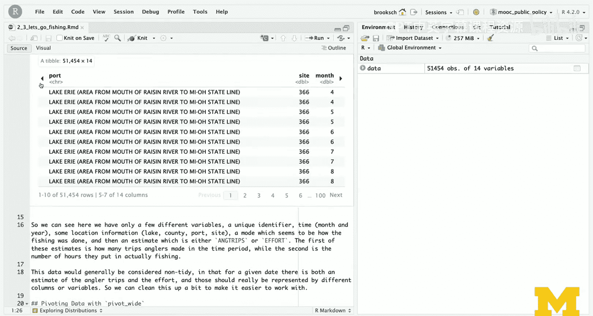
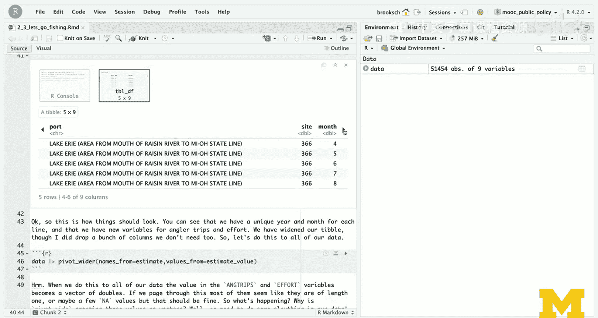
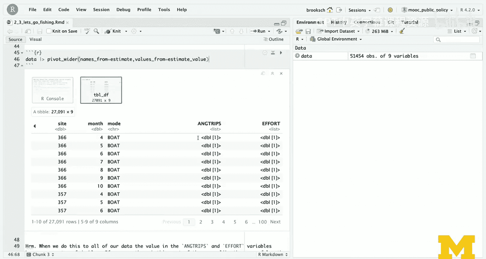
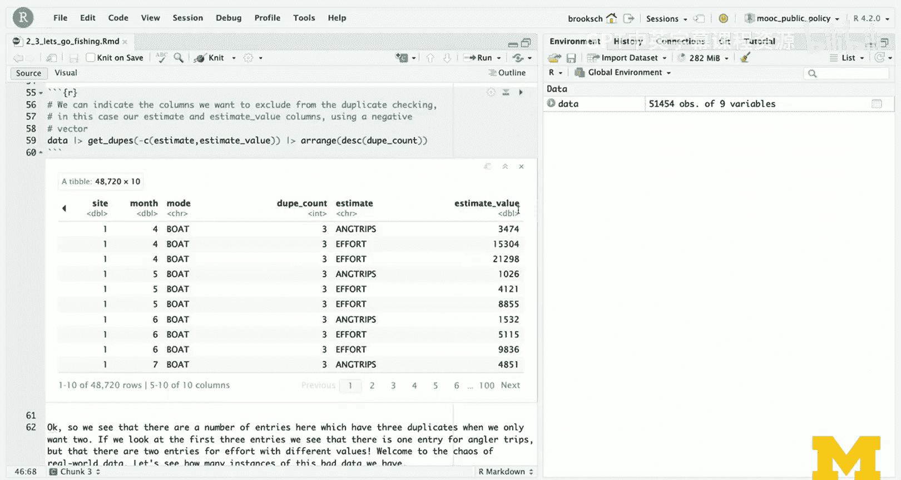
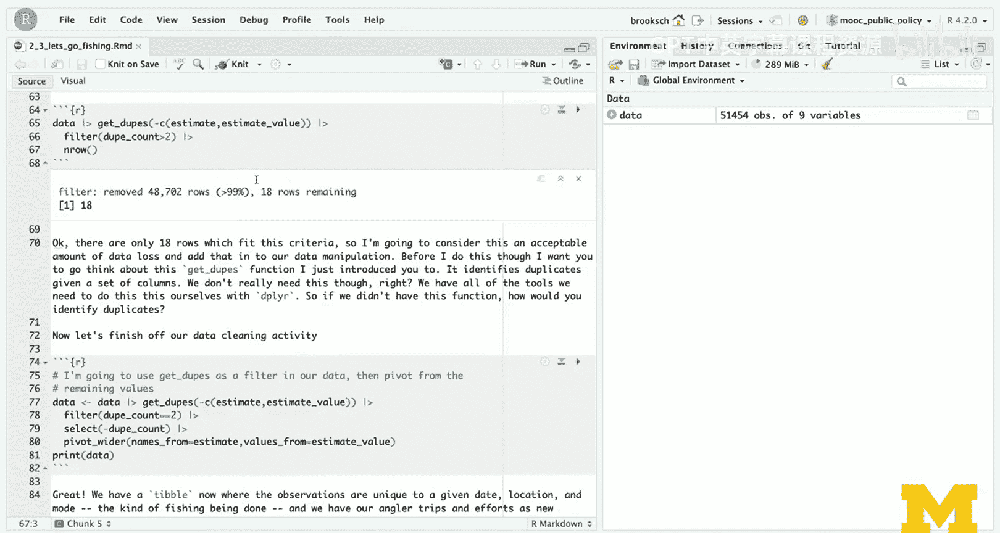
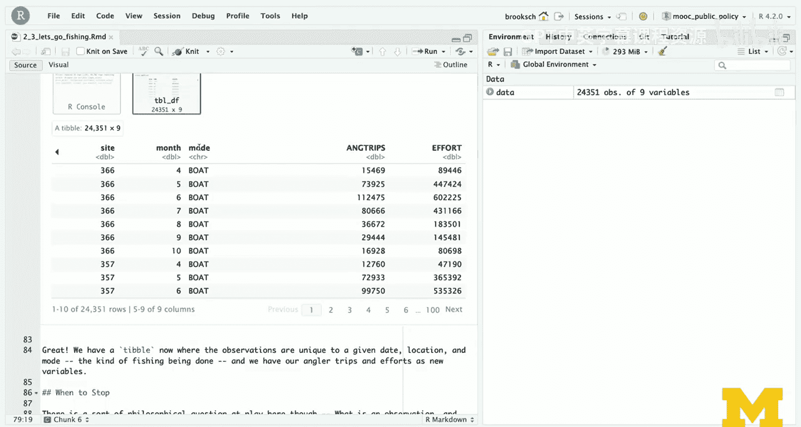
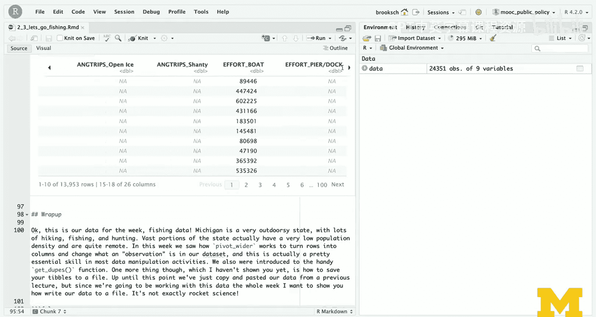
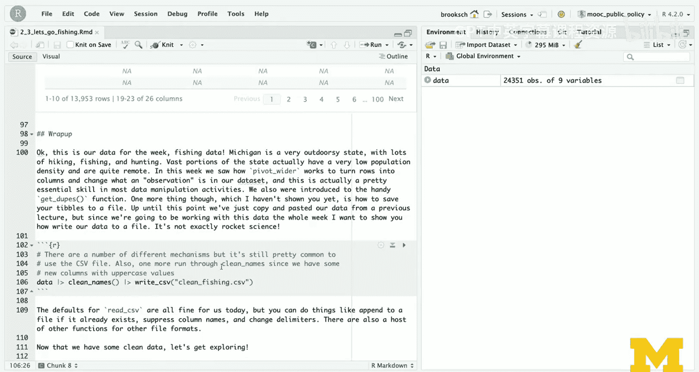

# 密歇根大学《公共部门的R数据分析（基础、数据探索、决策支持、）｜Data Analytics in the Public Sector with R》中英字幕 p62 18_数据探索实战演练.zh_en -BV1YZ421J7Fx_p62-

In this week， I want to introduce you to a few more exploratory data analysis methods for distribution data with a handle on how basic Ggi plots work and an understanding of some of the fundamental types of charts such as line。

 bar， Sc and histograms， I think we could start to look at a few more advanced visual methods for distributions of data。

 While the theme of this week stays with visualization of distributions。

 I'm going to bring in a different data set。 This time from the Department of Natural Re in the state of Michigan。

 This data set looks at the fishing data on the Great Lakes。

 which are the largest freshwater bodies in the world called Creel data。

 This data makes up the effort anglers。 These are people who fish put in and the results of that effort。

 Most of this data is collected manually by the Department of Natural Resource。

 Let's jump in and take a look。

So I'm going to start my usual way， bring in tidy verse， janitor， tidy log。

 I'm going to bring in tidy log regularly now， and we're just going to read in the CSV and pipe it to clean names。

。So we can see here we only have a few different variables， a unique identifier， time。

 month and year， some location information， Lake， County port， site， and a mode。

 this seems to be how the fishing was done and then an estimate which is either a trips or effort the first of these estimates is how many trips anglers made in a time period while the second is the number of hours they actually put in fishing。

Now this data would be considered nontidy in that for a given date there is both an estimate for the Ang trips and for the effort。

 and those should really be represented by different columns or variables。

 so we could clean this up a bit to make it easier to work with。Now。

 there are two different functions which can help us convert rows to columns and vice versa。

 Pi wide and pivot long。 Right now， our data is in long form because we have two rows for each observation。

 one with the anglengr trips and one with the effort。 If we use pivot wide。

 we can convert these single rows into two columns。

 one which holds the estimate of the number of trips and the other which holds the estimate of effort。

So let's take a look at how to do that First we're going to drop this unique identifier if we left it in there。

 it would cause problems because pivot would say， well these rows aren't actually the same。

 what should I be doing with this and actually we don't really need a unique identifier in here。Now。

 when I bring in the data， I'm actually going to do that by doing a negative selection。

 I find that a nice handy way to get rid of it instead of saying all of the columns that I want to keep。

 but then I'm actually going to drop a bunch of columns that we're not going to need for the analysis either。

Now we want to pivot wider。 We want to add columns。

 We want the column name to come from the estimate variable and the value to come from the estimate value。

 So every time you're pivoting wider like this， you need two things。

 the name of what your new column is going to be and what its values actually should be。

 We're going tell tidier which values these are with the names from the values from columns respectively。

 So I'm going to say names from the estimate and values from the estimate value。

 and let's just take a look at what this would do the first 10 or so entries。Okay。

 so you can see that we pivoted this out and as we move across here we'll see that we actually now have an Ang trips value and an effort value。

 so for this first entry here we've got the month of four we've got the site information。

 we've got the year of 1989 and the next row is going to be a different date。

 it's got a different month to it。

So this is how things should look。 You can see that we've got this unique year and month for each line。

 and then we have new variables， frangler trips and effort。 we have widened our timmal。

 though I did drop a bunch of columns we don't need to。

 so it's not necessarily doesn't look so much wider。 So let's now do this to all of our data。

 So I'm just going to run this function across all of our data。

Okay， now let's take a look at our results。

This doesn't look quite， quite right。When we do this to all of our data。

 the value in the angtris and effort variables becomes a vector of doubles。 Now。

 if we page through most of this， they seem like they're of length 1， or maybe a few N values。

 but that should be fine。 So what's happening。 Why is pivotvo wide creating these values as vectors。

 Well， we need to do some sleuthing in our data。 Usually when this happens。

 it means that there are more than two rows that match somewhere。

 So pivotvo wider isn't quite sure what to do， and it just decides to put vectors in those variables for us。

 Pivo wider never wants to lose data because of something it did implicitly。

 If we told it the column should pivot out and those columns are not unique and have multiple entries for the rest of our data。

 Pivo wider is just going to put vectors inside the variables for us。

 Remember that a single variable， a single column has to be of the same data type。

 So if it finds one place where it's going to put a vector of doubles。

 Everything is going to become a vector of doubles。

 Even if they only have a single double value in it。

A handy function that we haven't looked at yet and actually comes from the janitor package is called get duops。

 Now， this package allows you to specify which columns you're interested in and tells you how many matching values are in those。

 Let's use it and try and find out what our issue is here。

 By default get dus is going to return a new column in our data called doop count。

 So let's sort by that。

So we can indicate the columns we want to exclude from the duplicate checking and in this case it's just our estimate and estimate values we expect those not to be duplicated because those are the things we're trying to pivot out and then I'm going to change it descending by the du count so we'll see anything that's got a high du count number。

Let's take a look at this。Yeah， so we've got some higher du count numbers。

Okay， so we see that there's actually a number of entries which have three duplicates when we only want to have two duplicates。

 right， one for the A trips and one for the effortffer。If we look at the first three entries。

 we see that there's actually one entry for Angr trips and that there are two entries for effort with different values。

 so welcome to the chaos of real world data。Let's see how many instances are like this of this kind of bad data that we have。

So I'm going to run get dupes again， and I'm just going to filter where doop count is greater than two。

 and then I'm just going to pipe that to N row， which is going to count for each one of those how many there are。

Okay， so we can see that actually that removes most of our data and there's only 18 rows which fit this criteria。

So I'm going to consider this kind of an acceptable amount of data loss and put that into our data manipulation pipeline。

Before I do this， though， I want you to think about this get dupes function。

 I just introduced to you。 It identifies duplicates given a set of columns。

 We don't really need this， though， right， We have all of the tools we need to do this ourselves with D playerer。

 So if we didn't have this function。 how would you identify duplicates。

Now let's finish off our data cleaning activity。 I'm going to use get duops as a filter and our data then pivot from the remaining values。

 So I'm going to call get doops， and then I'm going to filter where the doop count is two So just the things that I want。

 then I'm going to drop the column doop count because we don't need it anymore and then pivot and let's see if that fixes our problem。

And let's page over in our data a little bit here。 Okay， yeah。

 we see now that our a trips and our effort are actually the numbers that we're interested in。

 And just notice， though， that we have some now non cleanan names in there， right。

 some capitalized words， whereas previously when we run things through clean names。

 everything comes back in snake case。

We have a tibble now where the observations are unique to a given data， location， and mode。

 the kind of phish that's being done， and we have our angler trips and efforts as new variables。

Now there's sort of a philosophical question at play here though。

 what is an observation really and when should we stop a pivoting？For this data。

 I've gotten in mind that an observation is a date， a location in a mode。

 but somebody else might say， hey， it's just a date in a location and that mode should be combined with the columns of angler trips and effort Now this all depends on the question and what visualization you're interested in doing。

Still， some might argue that if you only have a couple of locations and you're looking to compare between them。

 then every location has a measurement in a given month and year。

 so maybe you just make sense to have month and years the columns。

Now I don't think there's a clear answer to what a tidy data frame is in this context。

 it's really your inquiry that's going to drive what is tidy for you。

Here's an example of how we could pivot this even wider and create new columns for each mode and angler trips and effort pair you'll notice that a lot of this is empty and for good reason。

 some methods of fishing like ice fishing aren't actually something you can do in the summer on some of the great lakes so I'm not going to save this but I'm just going to use it to demonstrate so we pivot out and we're going to use the names from the mode and the values from a trips in effort so we're going to do this Cartesian join again or Cartesian product between modes and a trips in effort。

So here's an example of what that would look like for A tripps boat， we have a number。

 but there's also an entry for the A tripps Peer dock， A trips open ice， A tripps shantti。

 which is a shack on the ice and so forth， and you can see that as we move across we'll also have those for effort as well。

Okay， so this wraps up our data for the week fishingish data Michigan is a very outdoorsy state with lots of hiking。

 fishing and hunting， vast proportions of the state actually have a very low population density and are quite remote。

In this week， we saw how pivot wider works to turn rows into columns and change what an observation is in our data set。

 and this is actually a pretty essential skill in most data manipulation activities。

We also introduced you to this handy get doops function。 One more thing though。

 which I haven't shown you yet， is how to save your Tbbles to a file up until until this point。

 we just copy and pasteed our data from previous lecture。

 but since we're going to be working with this data the whole week。

 I want to show you how we can write this data to a file。 It's not exactly rocket science。

So there's a number of different mechanisms， but it's still pretty common to use the CSV file。

 so I'm going to run this through clean names to get rid of some of those new variables and then I just call right CSV and I'm going to call it cleanfishishing dot CSV。

The defaults for Read CSV are all fine for us today。

 but you could do things like aend to a file if it already exists， suppress column names。

 change delimiters， There's also a host of other functions for other file formats。

Now that we've got some clean data， let's go exploring。

