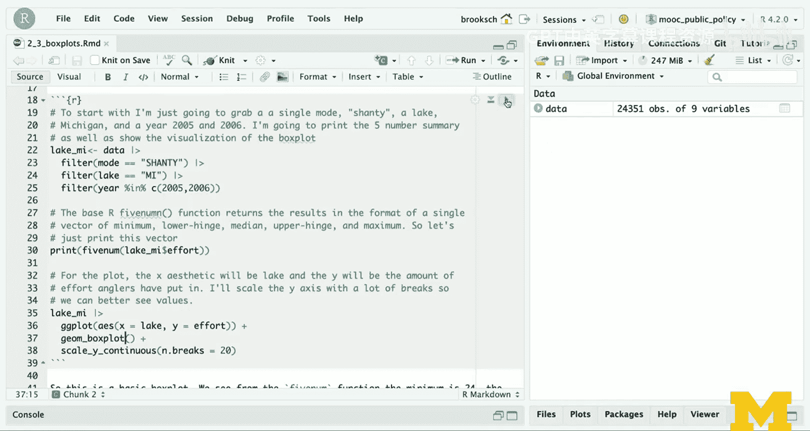
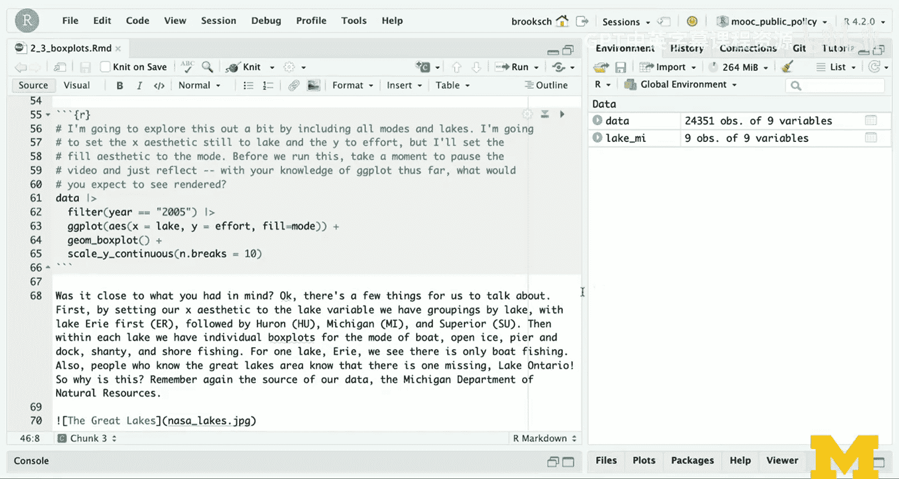

# 密歇根大学《公共部门的R数据分析（基础、数据探索、决策支持、）｜Data Analytics in the Public Sector with R》中英字幕 p63 19_箱线图绘制与应用.zh_en -BV1YZ421J7Fx_p63-

With our data formatted， let's talk about one of the classical summary statistic and exploratory data analysis techniques。

 The box plot。 The goal of the box plot is to summarize the distribution of your data through a visualization of what's called the five number summary。

 The extremes， often the minimum and maximum values。 The center。

 this is usually the median of your data。 and the first and third quartiles of your data。

 The quartiles of your data break it into four roughly similar sized buckets。

 So the first and the third quartile markers， they're sometimes called hinges show you the middle 50% of your data。

 through the box plot。 we can get a sense of the weighting of our data in a fairly compact visual representation。

So I'm going to bring in our phishing data like last time。To start with。

 I'm going to grab a single mode， the shanty， a lake。 I'll use Lake Michigan。

 in a year 2005 and 2006。 I'm going to print the five number summary as well as show the visualization of the box plot。

 So that's all I'm just going to filter our data here。Now。

 the base R5 nu function returns the results in a format of a single vector of minimum， lower hinge。

 median， upper hinge and maximum。 so I'm just going to print out that vector。

 so you'll see this is my base R syntax to call5 nuum and pull that variable out of this lake mesh。

For the plot， the X aestheticthe is going to be the lake。

 and the Y will be the amount of effort anglers have put in。

 So I'm going to scale the y access with a lot of breaks so we can better see the values。

 So for a box plot， we're just going to use genome box plot here。s pretty straightforward。

So this is a basic box plug。 We see from the five nu function。 The minimum is 24。

 The bottom quartile or hinge is about 1200。 The median about 1300 and the upper quartile at 42000 and the maximum just under 60000。

But what can we infer from this， which might help somebody from the Department of Natural Resources who actually sets policy？

Well， it means that at one location in one year on this lake in a given month。

 only 24 hours of effort was put in fishing from as shanty， but that actually 50% of the time。

 the range ofarrow hours is actually quite large between 13000 to nearly 60000。

Each one of these segments， the lines， which are sometimes called whiskers and the boxes。

 have roughly 25% of our observations in them。 So the box blood is giving us a sense of the distribution of observations and the weight of our data points。

But we always have to remember the nature of our data。

 so let's take a look at what's actually in our data。

So we see that this data is actually pretty sparse and importantly only observations in a month when a shantti was used were described。

 if we had pivot wide R mode， then we would have a table with a lot of NA values in it。Now。

 you can't fish from an ice hotut when there isn't enough ice on the lake。

 So the summer months actually have a number of ar trips and efforts and shanties of 0。 Thus。

 our conclusion for this box plot is actually limited only to the months where shanties were in use。

 That's okay if it matches up with your question。We also see that in one year，2005。

 only one county had shanty fishing。 Why， I don't know。

 But the small number of trips for the other county might give some suggestion。

 and this might be important for your stakeholders。As you might have guessed。

 we don't have to look at a single box plot at a time。

 instead we can increase the number of variables by changing our filtering and setting more aesthetic mappings。

So I'm going to explore this out a bit by including all modes and lakes。

 I'm going to set the ex aesthetic still to lake in the wide effort。

 but I'll set the fill aestheticthe to mode。 Before we run this。

 take a moment to pause the video and just reflect with your knowledge of Ggi plot thus far。

 what would you expect to see rendered。😊。

Was it close to what you had' in mind， O， there's a few things for us to talk about。 First。

 by setting our exsthetic to the lake variable， we have groupings by lake with Lake Erie， E。 R。

 first， followed by Huron， Michigan and Superior S U at the end。Then within each lake。

 we have individual box plots for the modeat of the boat， open ice， pier and dock。

 shanty and shore fishing。For one lake Erie， we see that there's only boat fishing。 Also。

 people who know the Great Lakes area know there's actually one missing Lake Ontario。 So why is this。

 Remember， again， the source of your data， the Michigan Department of Natural Resources。

