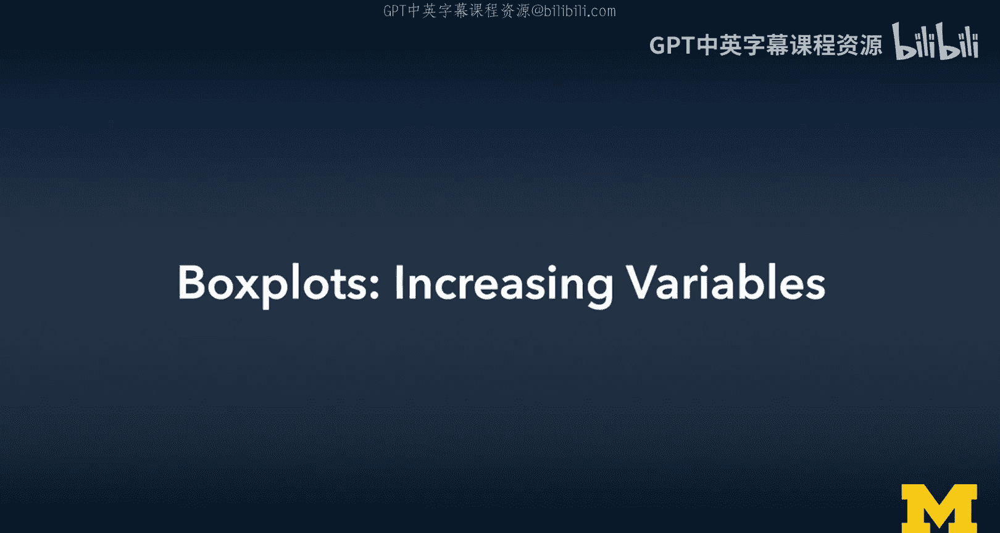
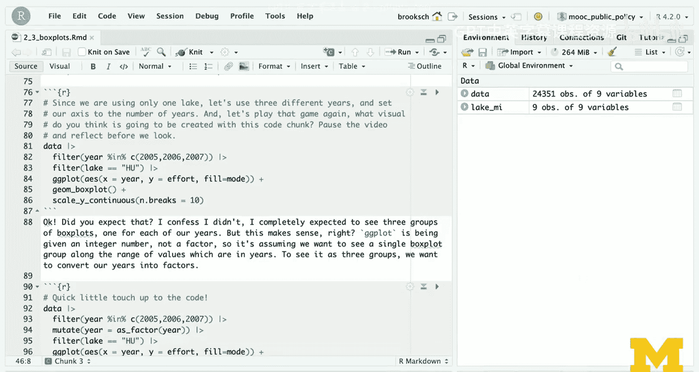
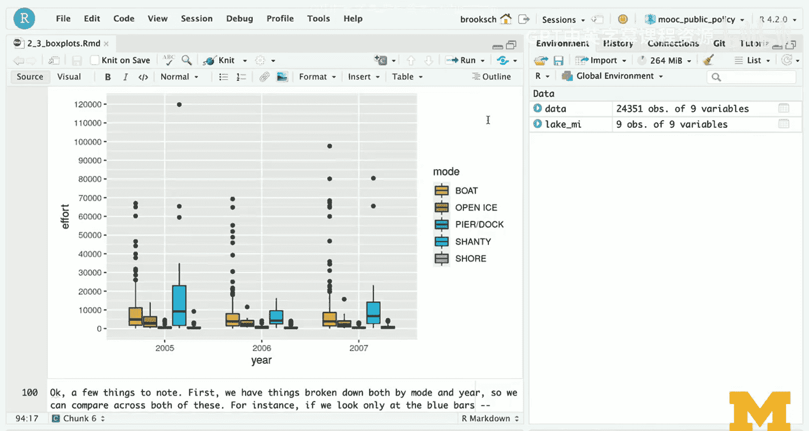
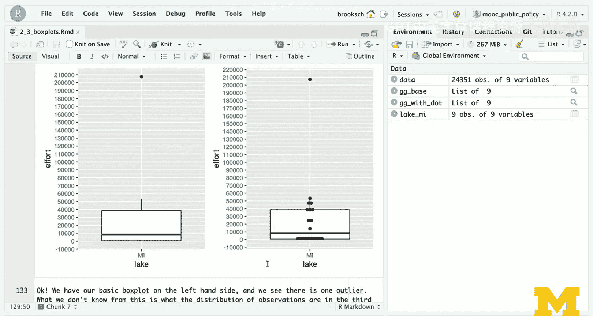

# 密歇根大学《公共部门的R数据分析（基础、数据探索、决策支持、）｜Data Analytics in the Public Sector with R》中英字幕 p64 20_多变量箱线图拓展.zh_en -BV1YZ421J7Fx_p64-

Okay， so here's a quick geography lesson now I didn't grow up in the Great Lakes area。

 I moved here so my apologies if I'm off slightly， but this is what the state of Michigan is here and so we sometimes call it the mitten because it looks a little bit like a mitten with the hand。

 but importantly there's this area up here called the UP or the upper peninsula which is quite beautiful and the border actually comes all the way up here and around and so you can see actually this area。

 the UP and then this area which is the southern part of Michigan that all makes up the state of Michigan。

Each one of these lakes is in our data set except for Lake Ontario。

 so Lake Ontario here actually doesn't exist because this is the border with Canada。

 so this is Canada up here and you can see because it looks like kind of here it's a big frozen wasteland。

The border for Michigan then cuts through these lakes and cuts through these lakes。 So all of our。

 our observations are from the counties that kind of come along the side of the state as it。

Faceces these different lakes。Now there's a couple of interesting things that you can note here so first Lake Erie down here。

 ER， so that's why it's really tiny in our data set because actually we just have a few observations down here。

 this is Lake Michigan here and then this is like superior here and that means that this is like Huon。

Wisconsin is over here and there's a tiny bit of Minnesota up up in here。

 but I do want to draw your attention to this feature here and you can also see it up here a little bit more in Canada this photo is a NASA photo and was taken in the winter and so you can see all of the ice on these giant lakes。

 but even along these borders here， people will have shanties out on the lake or they'll be they'll just go out and drill a big hole maybe it's about a foot wide and drop lines in and do ice fishing there so our data really comes from this region and that's why if you're looking at Great Lakes data。

 you know we've only got the Michigan observation so we don't have anything from Lake Ontario and we're not going to actually get any of the fishing activity from this side of the border with Wisconsin。

So we can see that the state of Michigan doesn't border on Lake Ontario。

 which is why there's no data for it and that the border chairs with Lake Erie is actually really small。

 So only a few counties would actually have reporting data。 The upper part of Michigan。

 the upper peninsula actually is a significant border with Lake Superior。

 So the number of observations there might seem small。

 but the counties in this area of the state are very low in population as it's quite remote。

But there's a few other things happening in our visualization。 so let's focus on Lake Huurron。

 which shares a border with the province of Ontario and Canada。

Since we're only using one lake， let's use three different ears and set our access to the number of years。

 And let's play that game again。 What visual do you think is going to be created with this code chunk。

 Pause the video and reflect before we look。

Okay， did you expect that， I have to confess， I didn't。

 I completely expected to see three groups of box plots， one for each of our years。

 But this actually makes sense， right， G G plot is being given an integer number， not a factor。

 So it's assuming that we want to see a single box plot group along a range of variables。

 which are the years to see it as three groups。 We want to convert our years into factors。

So just a quick touch up of the code here， and I'm going to wrap this in an as factor。Okay。

 a few things to note。 First， we have things broken down by both mode and years。

 so we can compare across both of these。 For instance， if we look only at the blue bars， shanties。

 we see there's a fair bit of difference between 2005 and 2006 and 7。 While for boat fishing。

 there doesn't seem to be much of a difference at all。 We can also compare between bars。

 and we see that in 2005， the median of the number of hours anglers spent in shanties per month is almost the top of the third quartile of the number of hours angler spent fishing from a boat。

 And all of these are much larger than shore and dock fishing。

 We also see another visual aspect of the box plot， the outliers。 Now。

 how outliers are detected really depends。 And there's various mechanisms to determine and whether an observation is an outlier or not。

 if we look at the documentation for the Gigi plot box plot。

 It states that outliers are all data points， which are either greater than or less than the distance between the hinge。

 So that's the bottom or top of the box。

The first and third quartile and one and a half times the inter quartile range or the IQR。

The inter quartile range is the distance between the two hinges。

 which captures at 50% of our data in the middle。 So the whiskers on G plot box plots don't actually go to the minimum and maximum values。

 They go to this difference between the hinge and one and a half times the IQR。

 The intention with this approach is to not give an overly large sense of weight to just a few data points。

So data beyond the end of the whiskers， these are called outlier points。

 and by default we plot these individually。Sometimes when there's a very small amount of data。

 the box plot can give you a false sense of how important each of the different values are In our very first box plot example。

 this was certainly true。 We had a visual of a five number summary when there was only9 observations of data。

One technique to try and balance this is to merge box plots with dot plots。

 A dot plot is exactly like it sounds。 It represents each each observation with a single dot。

 It's kind of like a scatter plot， but the X axis is the same for each observation since one is for one of the same group。

 In our case， this was the lake。 So let's take a look at how we might add a dot plot here。😊。

So I'm going to include a bit more data here to demonstrate the dot plot effect the dot plot is just going to be another layer in our visual so I'm actually going to show you the two visuals side by side with the cow plot。

 so I'll bring in the cow plot we're going to look at shanties from Michigan across these years and you'll see here this is just my box plot。

Now the Ge dot plot has a couple of different parameters， the most important is this bin axes。

The genome do plot is essentially bidding your data by observations and then stacking it to demonstrate it。

 so here we want to show those bins along the y axisxes。

So I've set the binaxes for our GM dot plot to Y， and then I've stacked it on the center so they'll just show up centered and then we can change various aesthetic mappings like dot size。

 I just add this Geome layer to the GG with dot and then I'm going to plot it in our plot grid。Okay。

 we have our basic box plot on the left hand side， and we see there is one outlier。

 What we don't know from this is what is the distribution of observations in that third quartile between the mean and the start of the top whisker。

 We just know that this has roughly 25% of our data because it's a quartile。

 but that's it from the dot plot on the right， though。

 we can see clearly that actually three of these points are right at the top of the quartile。

 While the other three are in the mass of it。 We also see that there's a lot of points。

 These are rows in our data。 Remember， observations right at the bottom of the first quartile。

 All0 are very close to 0。 In fact， there's so many points here in one space at the bottom two quartiles。

 The whisker and the box share a border with 0。😊。

Laying on a dot plot on top of the box plot can be a powerful way to get more insight into the distribution of your data。

Box plots are a great way to get some insight into this distribution of data。

 and I think they work decently for small amounts of data。

 But I confess I've largely replaced them in my workflows with vilin plots。

 And we're going to look at those next。 boxox plots were in their prime when the five number summary was a fast way to calculate some summary statistics。

 But modern computational power means it's pretty easy to apply new methods which show us a bit more nuance。

😊，Regardless， the use of the dot plot layered on top of your box plot is really quite beneficial when you're dealing with small data。

 Sometimes a graphic lies through omission by showing the viewer distributions and leading them to conclusions which are shaky because of the lack of data available。

 And I think it's worth thinking about that with this phish example。

 How do you think the visualizations would change if zero values for angler trips and estimates for those months where we had no data were actually included。

 Do you think that's a box plot that you could go build。

 I'm convinced that between this lecture in our previous one on pivot wide。

 you should be able to relatively quickly go through that exercise and gain deeper insight into the distributions of fishing activities。

