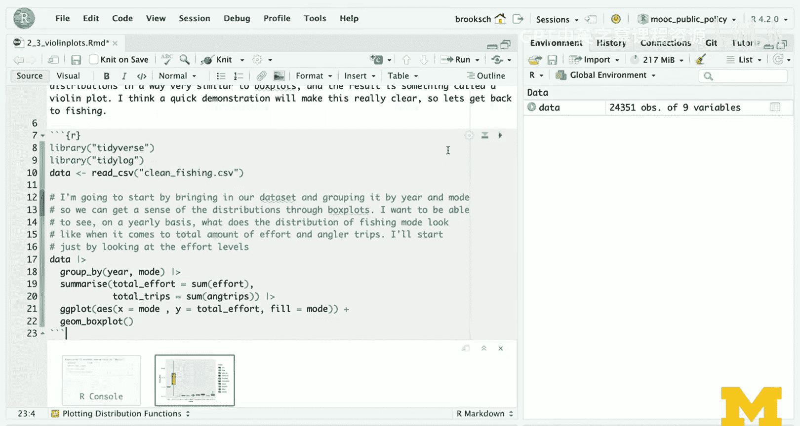
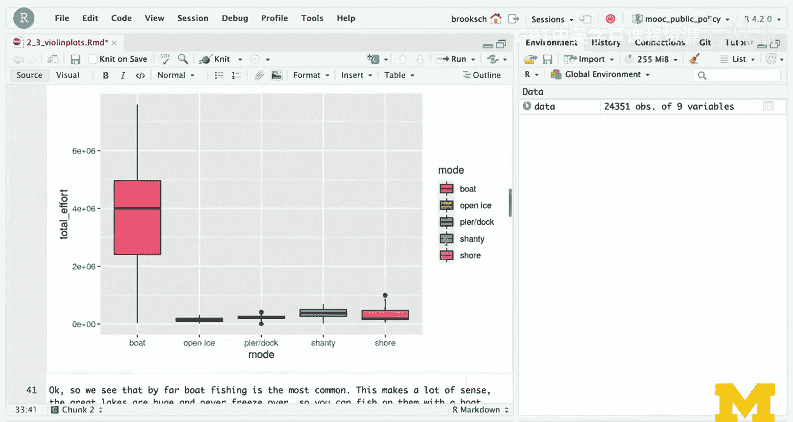
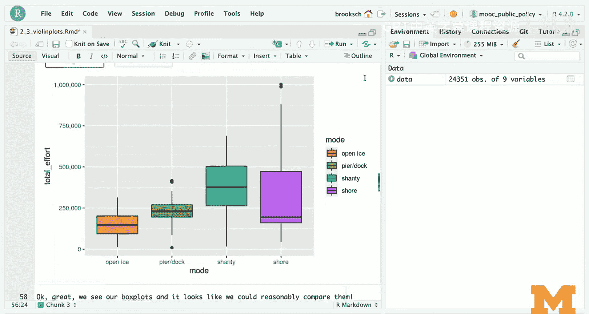
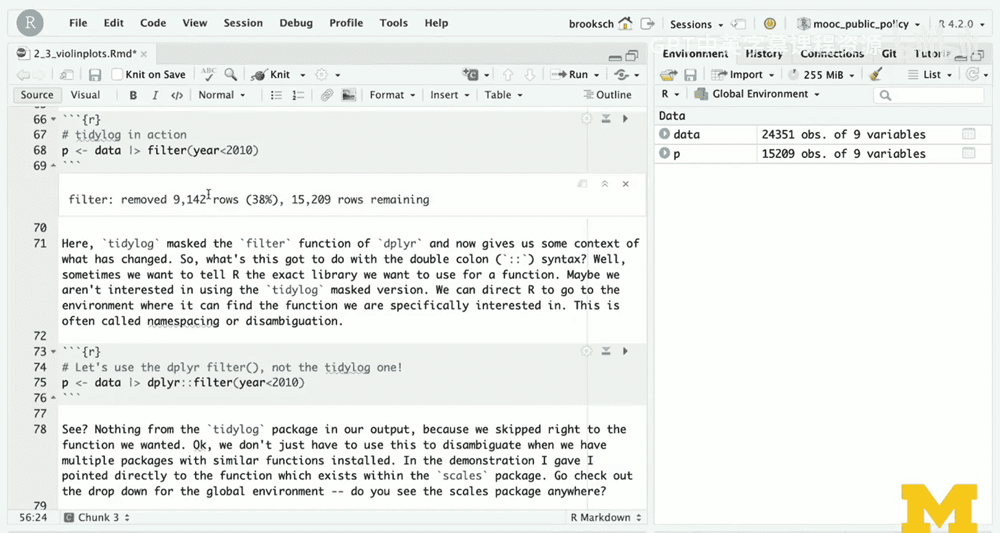
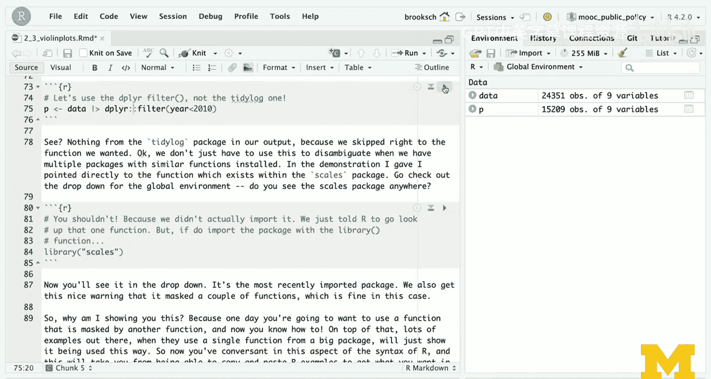
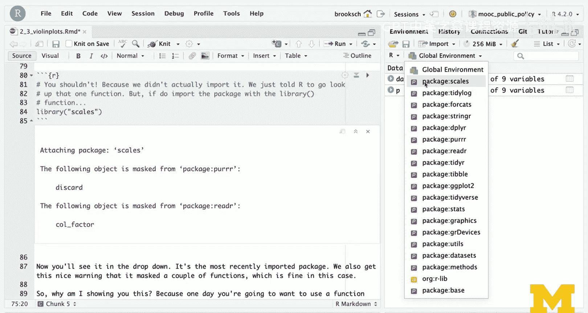
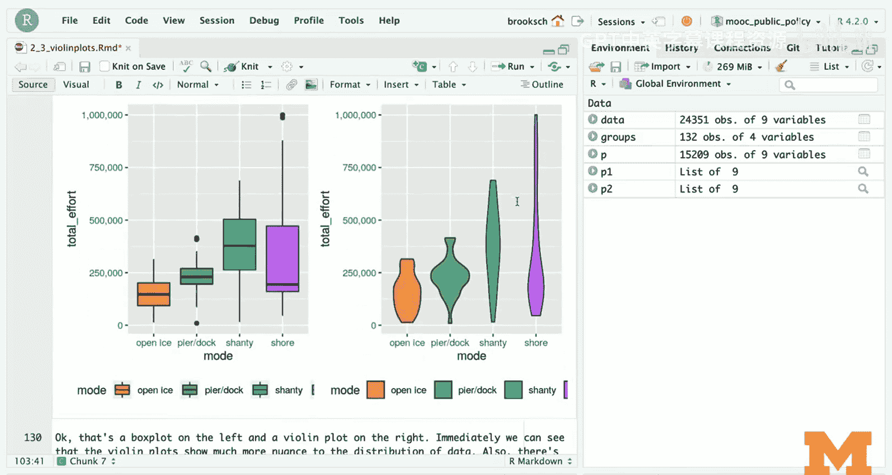
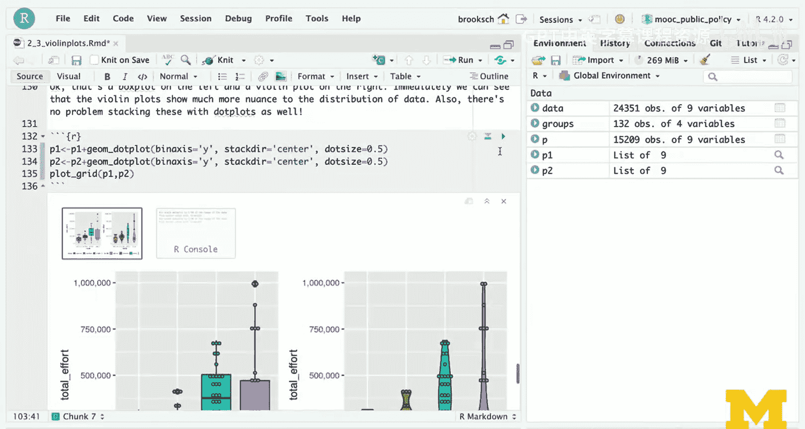

# 密歇根大学《公共部门的R数据分析（基础、数据探索、决策支持、）｜Data Analytics in the Public Sector with R》中英字幕 p65 21_小提琴图绘制技术.zh_en -BV1YZ421J7Fx_p65-

We saw how we can plot some summary statistics of distributions。 but last week。

 we actually saw how we could plot the distributions themselves with histograms and kernel density estimation plots。

 We can apply the same approach to comparing multiple distributions in a way very similar to box plots。

 And the result is something called a violin plot。 I think a quick demonstration will make this really clear。

 So let's get back to fishing。

I'm going to start by bringing in our data and grouping it by year and mode so that we can get a sense of the distributions through box plots。

 I want to be able to see on a yearly basis。 what does the distribution of phishing mode look like when it comes to a total amount of effort and angler trips。

 So I'll start just by looking at the effort levels So I'm just going to take our data I'm going to group it by year and mode run our summarize function and some those two columns across the groups toss it into a Ggi plot and build our G box plot。

嗯。

Okay， something isn't right。 It Looks like a data has some different ways it was coded for a given mode。

 either in all caps or in title case， where each word is capitalized。

 We need to clean this up in our data cleaning。 Now。

 I actually haven't shown you much about cleaning up string values in R。

 So this seems like a perfect opportunity to do that。

 Many of the functions you might want to use or actually included in base R。 For instance。

 there's one called N car， which will count the number of characters in a string。

 Another handy function is string split， which will allow you to split a string based on some value and return parts of it。

 This is handy， when you want to separate out things like a user name from the rest of an email address。

😊，We've already seen STR underscore C， which concatenate string values together and paste is another similar function。

 but it works and allows you to concatenate all sorts of objects together。For this work， though。

 I think we want to have to use either the two lower or two upper。

 which you guessed it converts a string to either lowercase or uppercase。

Okay， we're going to do a quick mutation on the mode and I'm going to change it all to lower。

 and now we can check it out with that basic box plot。

Okay， so we can see that by far， boat fishing is the most common。 Now。

 this actually makes a lot of sense。 The Great Lakes are huge and never freeze over completely。

 so you can fish on them all the time with a boat basically whenever you want to。

 While the rest of the modes， they have limitations。

 and we would expect to see these limitations come up in a given month。

 skewing the number of hours anglers can put in。Let's get rid of boat fishing to make this a little bit more interesting as a demonstration。

 Also， let's change those tick labels on the Y axises at the moment there， in scientific notation。

 this really isn't very friendly for reading。

So first I'm going to filter out B and group and then I'm going to keep effort and trips in here。

 even though we're only looking at the one and now let's plot it。

 we can change the look of the Y tick labels by scaling the axis。

So scale Y continuous here and setting the label's argument。

Okay， great。 We see our box plots， and it looks like we could reasonably compare them。

 But let's unpack the scaling function。 I just dropped in there。 What's up with these double colons。

😊，Well， up until now we've been bringing in libraries using the library function and then we can reference all of the functions in that library。

 Do you remember though how that works， we talked about it early on in the very first course of this specialization。

But now that we've got some basic R skills behind us， let's go back and revisit that。

When we use the library function， it identifies an installed library and runs that associated R code。

 It does so in a new environment。 So the functions related to the library don't clutter up the global environment that we're working on。

 If you hit the drop down for the global environment in the environment tab in the upper right of our studio。

 You'll see there's a number of packages which were run when we imported them into the tidyverse。

 When we go to use a function， let's say Gebox plot。

 Our first looks in our current environment to see if the function exists。 If it doesn't。

 it walks through the stack of environments from our imported libraries to find the function that we're looking for。

😊，So what if R finds two functions with the same name， but in different libraries， Well。

 it doesn't ever。 The minute it finds one。 it just returns that。 That function masks the others。

 And we've already seen that happen when we imported tidy log as a library。

 This library first imports the tidyverse functions。

 then intentionally masks them so it can add some useful rapper statistics。

 about the number of columns and rows， which were modified。 like this。

Take a quick look at tidy log in action。 and we see here， Oh， nice。

 So the filter tells us how many rows were moved。So here。

 tidi log masks the filter function of D plier and now gives us some context of what's changed。 Okay。

 what's this got to do with those double colons。 Well。

 sometimes we want to tell are the exact library。 we want to use for a function。

 Maybe we aren't interested in using the tidy log masked version。

 We can actually direct R to go to the environment where it can find the function that we're specifically interested in。

 This is often called name spacing or disambiguation。

 And so here's an example of how we can do that with the D plier filter。

 instead of calling the one that's been taken over by tidy log and masked。

 We could just say D plier toss in a couple of these colons filter and then run it。

See， nothing from the tidy log package comes in our output because we skipped right to the function we want it。

Okay， we don't just have to use this to disambiguate when we have multiple packages with similar functions installed in the demonstration I gave。

 I pointed directly to the function which exists within the scales package。

Go check out the dropdown from the global environment。 Do you see the scales package anywhere？

You shouldn't， because we actually didn't import it。 we just told R to go look up that one function。

 but if we do import the package with the library function。

Then we can see here the environment shows up in that drop down。

 It's the most recently imported package。 We also get these nice warnings that it's masked a couple of functions。

 which in this case is fine。 So why am I showing you this， Because one day。

 you're going to want to use a function that's masked by another function。

 And now you know how to on top of that， lots of examples out there whether they use a single function from a big package。

 They're just going to show you to do it this way， So now you're conversant in this aspect of the syntax of R。

 And this will take you from being able to copy and paste our examples to get to what you want to at the moment to actually understanding the language and how it works。

 Our studio makes it easier for us to understand， So I wanted to demystify this process for you。😊。

Okay， so what is this package scales that we've just imported Well。

 you can check it out by hitting up the docs as you know。

 but in short it's a helper function that GgiP uses to change labels on aesthetics in meaningful ways for us humans。

In this case， we wanted to add in a comma every three characters。

 and that's what the label underscore comma does for us。 We have various other options。 For instance。

 the label underscore percent for showing percentages or label underscore date for changing how dates show up。

 We could have actually used this in one of our previous lectures where I used the string trim instead。

Actually， that would be a great way for you to put your new knowledge to work。

 why not go back to the lecture on trend lines from week two and change the date appearance by using this new scales package。

With that aside covered， let's get back to the box plot and see if we can compare it to a violin plot。

 The violin plot aims to show us the same thing an understanding of the spread and density of our data。

 But to do so without using this five number summary。

 Let's cow plot this up and see how it looks in comparison。 So first。

 let's group some data and store this in a new Tple called groups。 Now。

 I'm going to make our two plots。

Since I'm going to Cal plotot， I'm going to actually save these as variables， P1 and P2。

 Note that here I don't actually have to say scales。

 colon label comma anymore because we actually imported the scales just above in a couple of code chunks。

I'm also changing the legend position here too for clarity in our comparison。

Indicating where the legend will go at the bottom， and then we're going to cow plot these。

Okay， that's a box plot on the left and a violin plot on the right。

 Imedialy we can see that the violin plots show much more nuanced to the distribution of data。

 and there's no problem stacking these with dot plots as well Let's take a look。

You could see that the dot plot layer unaffected by the box plot or violin plot as they both have the same scaling。

 but you may also notice the violin plot distribution function tends to match the dot plot a little bit more。

 making it unclear whether the dot plot in this case is actually needed。

Violin plots are a powerful visualization technique to understand the distribution of a series of data that you might want to compare。

 While box plots are still used frequently， the violin plot has grown in popularity。

 as It captures this nuance of the data。The use of the dot plot in addition to these two methods is trivial for us to do in Ggi plot。

 thanks to this layered nature of the system and the grammar of graphics。

As your amount of data grows， the dot plot becomes less useful。

 but it's particularly valuable in situations like this。

 where both the box plot and the violin plot obscure whether there's actually any observations at a given level。

 For instance， in this last example， if you go find the total effort of about 375000。

 you'll see that both the box plot and the violin plot imply some density to our distribution here。

 But in actual fact， there were no observations with that number。

 dot plots are a great way to add more concrete understanding when you're dealing with small amounts of data。

