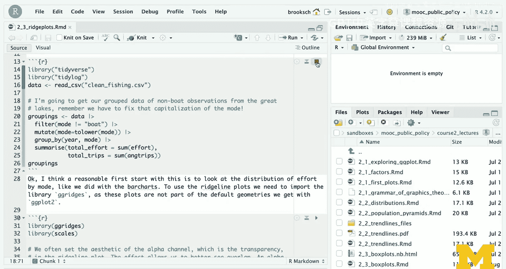
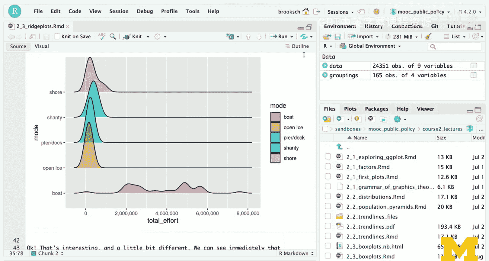
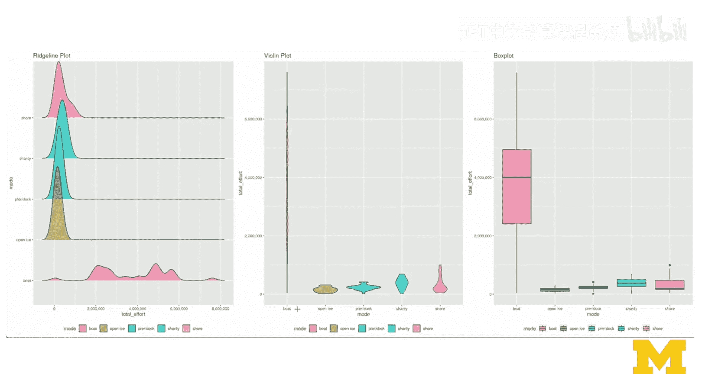

# 密歇根大学《公共部门的R数据分析（基础、数据探索、决策支持、）｜Data Analytics in the Public Sector with R》中英字幕 p66 22_山脊图可视化方法.zh_en -BV1YZ421J7Fx_p66-

The box plot violin plots allows us to compare distributions。

 but a more compact representation exists called the Rige line or Rige plot。

You can imagine a ridge line plot is a bunch of violin plots。

 which are cut in half vertically squished together and then flipped 90 degrees。

 The result is a series of mountain ridges， one for each item that we're comparing。

 and they show overlapping distribution functions。This allows you to quickly get a sense of which distributions differ and by how much。

In fact， this plot type， like many others， isn't really all that new。

 One of the earliest examples of this is from 1805 and can be found in the book an inquiry into the permanent causes of the decline and fall of powerful and wealthy nations by William Playfair。

 This book has a number of painstakingly drawn charts and visuals， including stacked line charts。

 And this image of the wealth of nations versus time。Each nation gets a separate row in the visual。

 and it's fairly easy to compare it at any point in time to other nations。

Now this visual doesn't show overlapping ridges， it's more of an example of a technique called small multiples which we'll talk about next week。

 but it's pretty close to what modern ridge line plots look like。

Let's take a look at how we can tackle this in R。

Okay， so we'll bring in tidy verse and tidy log in our fishing data。

 and I'm going to get our group data of non boat observations from the Great Lakes。

 remember we have to fix that capitalization of the mode。

Okay， I think a reasonable first start with this is to look at the distribution of effort by mode like we did with the box plots。

 Now， to use the ridge line plots， we need to import the library G ridges as these plots are not part of the default geometries we get with G plot too。

 So I'm going to bring in G ridges and scales。 Now we often set the aesthetic of the alpha channel。

 which is transparency in the ridge line plot。 This effect allows us to better see an overlap。

 So an alpha value of 0。5 is 50%。 an alpha value of1 is 100%。

 and you can set this alpha value for all sorts of different visuals。

Okay， that's interesting and a little bit different。

 We can immediately see that everything but the boat distribution looks similar。

Well， the shoreline distribution has this little bump on one tail， but otherwise。

 these distributions all look relatively symmetric around the peak。

 looking for features and distributions to classify them and then apply appropriate statistical texts is a common activity of statisticians and you can see how you might aid in those efforts。

The boating distribution， as we've seen before， is certainly different。

There are some chunks of mass around the 2 million and 5 million mark hours。

 Why don't we cow plot this up and compare the three different techniques that we've just seen。

 Actually， now would be a great time for you to try that yourself。

 I'm going to put my solution below。 But you have all the skills you need to do this yourself。

 If you want to give it a try。 I'm going to start by introducing a few more chunk parameters。

 Remember that the first line of this code chunk that we're telling R marked down that we're using R。

 and then we can pass in various different parameters up until now， I've not put in many parameters。

 but there's a few。 you should be aware of。 Now， chunk options themselves actually come from the knitter package。

 And if you look at the top of the source code window。

 you'll see that there's an option to knit this document into a P D F file， H T L file and so on on。

😊，If you want to explore the functions available， you can check them out on the knitITter website。

I'm going to start by turning off warnings， errors and other informative message from our libraries now generally I don't think this is a good idea。

 but if you're creating a document for others and have already understood the warnings that you've seen。

 then it's okay。I'm also going to set the figure width to a larger number because I want to see these three plots side by side。

 So if you click this little gear icon up here at the top of this code chunk。

 you can actually see that you can configure a number of these yourself and there's a bunch of chunk options。

 but you don't have to do that。 you can just write them up here。

 So I'm setting the figure width to be 12 inches， for instance。

 and the height to be5 the messages to be false and so forth。

Okay， I'm going to bring in the scales and cow plot。

 and then I'm going to make our new ridge line plot。

So I'm going to add labels so that we can see it pretty clearly so I just do a GG plot and then I add this geoome density ridges。

And then I'm going to add some labels and scale the x continuous。

Then I'm going to add the violin plot。 Now remember our x and y axis values are different from the ridge line。

 so on the ridge line we kind of flip those violin plot distributions on their side。

 So here I'm scaling y continuous right so you'll notice that the aesthetics mappings have changed between these two。

And then I'm going to add at the very end of the box plot and then toss it into cow plot。

We can make a few observations about the three methods。 First。

 let's talk about this peach colored bar or the boat information。

 The ridge line plot allows us to see the density function of the data。

 and it's more informative than the box plot because we can see that there's actually very few values around the mean。

 which is about 4 million hours。

The violin plot here is pretty useless because the horizontal space is really quite limited。

As the size of the plots gets smaller， the box plot becomes extremely difficult to read because all of the hard lines exist。

 so other than knowing that the mean is different than say chore or shanty。

 there isn't much else that we can say。The violin plot makes it clear that theres a distribution difference between these two。

 as does the ridge line， but they do it in slightly different ways。

The additional vertical space due the overlapping nature of the rig line plot allows us to more clearly see a distribution shape versus the violin plot。

This week， we finished our tour of how to use Gi G plot to explore distributions。

 You've seen a lot of different and overlapping techniques， histograms for bidding continuous values。

 kernel density estimations for estimating a function based on a histogram。

 the box plot for visualizing the five number summary of variables， the violin plot and dot plots。

 which allow us to look at many variables and see a distribution function。

 as well as individual observation values respectively， and now the ridge line plot。

 which is especially useful for compact visualizations in comparing distributions。😊。

