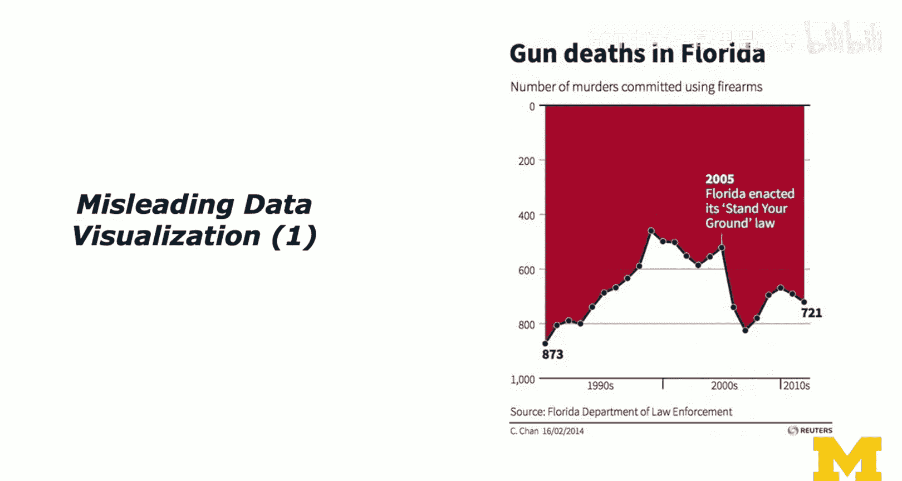
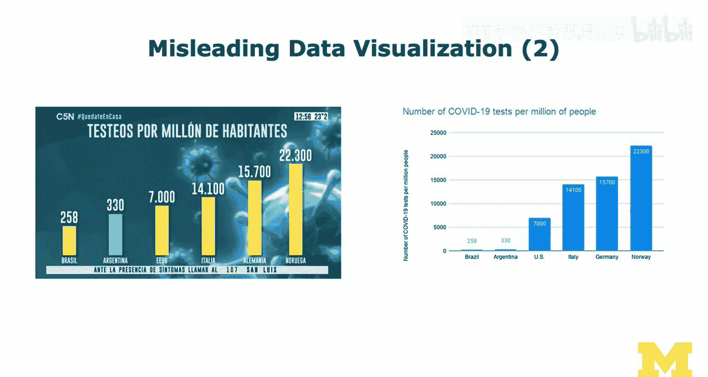
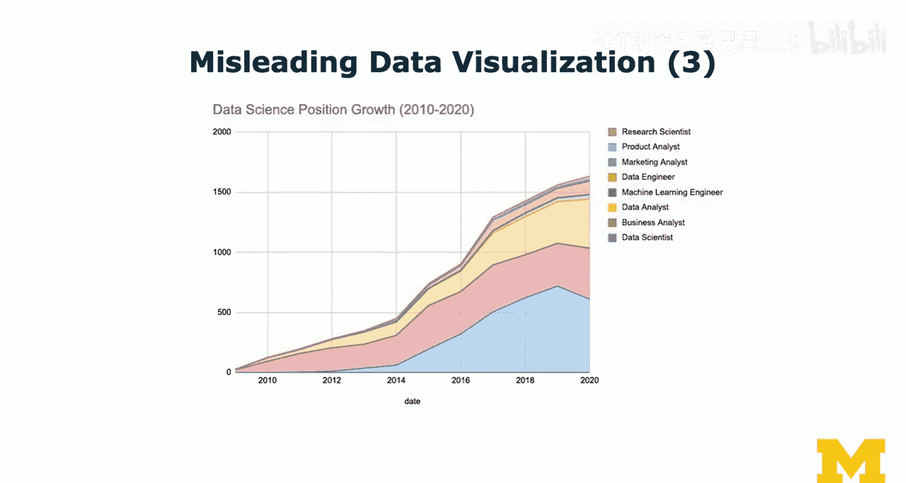
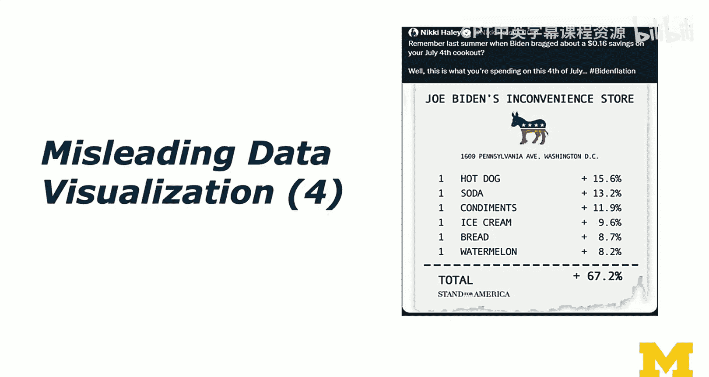

# 密歇根大学《公共部门的R数据分析（基础、数据探索、决策支持、）｜Data Analytics in the Public Sector with R》中英字幕 p67 23_警惕误导性数据可视化.zh_en -BV1YZ421J7Fx_p67-

Welcome back。As you move along in this series of courses regarding data analytics in the public sector。

 we hope that you feel that you're developing new skills and data analysis and visualization。

And also you're deepening your understanding of their important role in the key functions and pillars of the public sector。

 as we keep saying， data are extremely important and powerful and are used in so many important ways。

This also means， however， that data can be misused in powerful ways。

And the unfortunate reality is that there are a lot of pressures in the public sector to use and present data in ways that tell stories and convey information in misleading ways。

Sometimes in a minor， subtle way， but also sometimes in dramatic ways that are intentional。

This could be labeled as half truths， puffy。Sometimes though it can be labeled as lies。

 misinformation， and even propaganda。We will talk more about this in course 4。

 but for now I would like to show you just a few data visualizations that we can say are misleading now we cannot tell from looking at them if they were intentionally designed to mislead or not but we can see the problems in the outcome First。

 we have an infamous graph that is showing changes in the number of murders that involved firearms or guns in the state of Florida over time。

 including both before and after the year 2005 when a new law was enacted in the state called thestand your ground law This law allows Florida citizens to quotestand their ground。

 meaning they could fight back in some kind of altercation。

 including with the use of a firearm with immunity from prosecution if they feel threatened with death or great bodily harm Now there was concern among some groups that this policy was actually going to increase injury and death from firearm。

Rather than deter it if you quickly glance at this graph。

 it actually looks like the number of gun deaths in Florida decreased after 2005 when the new law went into effect。

 the line goes down at that time after increasing after 1990 and then leveling off however。

 if you look at the y axis， you see that the numbers on the y axis go down。

That's weird right The access starts at the bottom at 1000 and the values get smaller as you go up the axis so the interpretation of this graph is actually the opposite of what you see upon first glance the number of gun deaths in Florida did increase after the Stan your ground law went into effect Now where the makers of this graph trying to confuse or mislead us。

It's not clear。One story is that they were not trying to mislead if you notice their choice of red for the background color above the trend line in the graph was perhaps intended to show that more blood was spilling after the policy change than before take a look what do you think so one point to make is that if you were trying to do something creative and that's not typical or standard in a visualization you best workshop and test drafts with your intended audience first whatever the intent of the designers of this graph。

 the public outcry was allowed and most labeled it as intentionally misleading and as a misuse of data visualization in support of a questionable policy this next graph was also judged harshly by the public the one on the left is showing the number of COVd-19 tests per1 million people in the population early in the pandemic in a handful of countries and the graph shows Argentina somewhat。

behind some other countries at a single point in time and that you should know this graph was made by the Argeninian government if you look closely。

 the height of each bar on the graph doesn't have much to do with the actual number of tests there's actually no y access with numbers on this graph so while the graph is showing some level of difference in the testing rates across countries。

 it's not showing the absolute difference in the testing rates when this is done as you see in the graph on the right。

 you notice that Arrggentina was testing at a rate that was much。

 much lower than the comparison countries at that point in time so this comes under the category of a visualization that is trying to downplay the extent of a problem。

This data visualization is saying yes， Argentina is lagging behind other countries but not by that much when in reality the problem was greater this next graph is showing the growth in different types of data science jobs between 2010 and 2020 Now at first glance the graph seems to be suggesting that the number of data science jobs and a number of different subcategories leveled off or decrease towards the end of the time series which again is in 2020 however there are also a number of problems with this graph first this pesky Y access it often has a lot of problems and in this case it's not labeled so what is this graph even showing it turns out that what is being plotted here is the percent job growth rate not the actual number of jobs or job interviews or other indicators that are used in this kind of workforce analysis so it is the rate of job growth in some types of data analysis。

and data science jobs that has slowed not the actual number of jobs Also this graph doesn't tell us where the data come from or how the main indicator of job growth was measured so unfortunately it's really hard to interpret the graph and come away with any conclusions we do know from other information that the data for this graph was actually from some kind of internet survey but this graph is picked up by the media and shared widely with the story that covid had decreased jobs in 2020 and data science and data analytics now you'll be glad to know that better data suggests that while growth rates had indeed slowed a bit in this sector there is still a growing field this is still a growing field worldwide both in the public and private sectors Finally here's something that recently happened in the United States in the summer of 2022 now Nikki Haley is a former governor。

U state and the former US。 ambassador to the United Nations she tweeted this graphic of a receipt from quote Joe Bien's inconvenience store right before the 4 of July this receipt shows the cost and the percent inflation over the past year of a number of products that Americans tend to have at their fourth of July celebration picnics the price of hot dogs according to this receipt increased by 15。

6% since just last summer soda increased by 13。2% ice cream by 9。

6% etc and the receipt suggests that for the 6 items on the receipt， the total inflation was 67。

25% implying that the fourth of July celebration this year costs over 67% more than it did the year before due to inflation and as the tweet says thank you President bidden well of course there's a very basic math error here。

Instead of taking the average amount of inflation for the six products listed on the receipt。

 the inflation percentages were added up。 this of course。

 is such a basic math mistake that it looks intentional how could an educated Upolitician make such a basic and misleading error The instant this went live on social media there was severe backlash calling the graphic intentionally misleading。

 unethical and more when pressed publicly Nikki Haley's PR team through her staff under the bus Their statement was quote this was a staff error that should not have been published。

We realize the calculation error and immediately remove the graphic so one final lesson here is that if you are ever pressured to create a misleading graphic。

 first of all， try not to do it and we'll talk more about how to push back and not produce work that you find misleading our unethical in Co4。

But second， if you do end up producing misleata data visualizations at someone else's order or authority。

 just prepare yourself for having to take the blame at the end of the day if there's public scrutiny or accusations of misrepresentation。

