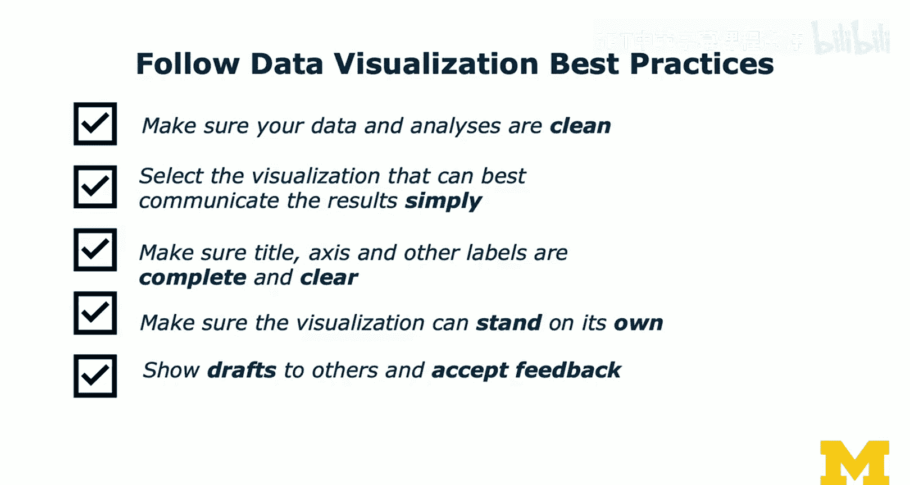
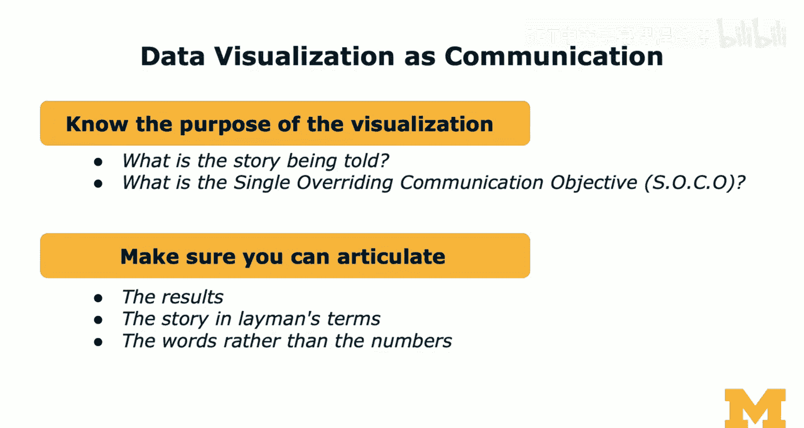
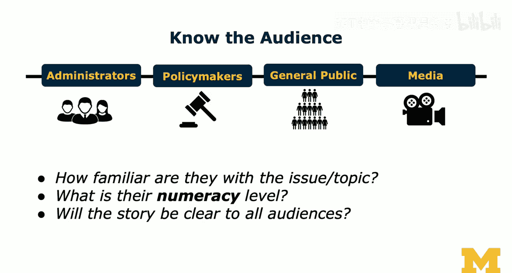
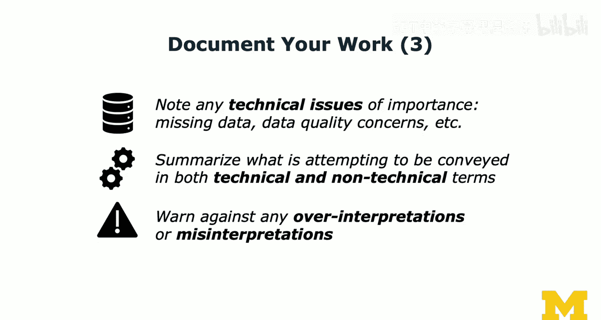

# 密歇根大学《公共部门的R数据分析（基础、数据探索、决策支持、）｜Data Analytics in the Public Sector with R》中英字幕 p68 24_数据分析师沟通准则.zh_en -BV1YZ421J7Fx_p68-

Hey， welcome back。You've been learning a lot about best practices for exploratory data analysis and a number of different types of data visualization within the context of the public sector。

In today's session， I want to share with you some principles for best practices。

 not just in regard to creating data visualizations。But also communicating about your work To start。

 let's review some data Viz best practices First obviously make sure your data are of high quality and clean and that your analysis approach is appropriate for the question being asked of the data Second select the visualization that can best communicate the results in a clear and simple fashion I know it is more fun to create fancy。

 complex data visualizations but honestly less is more is often the best approach especially in the work of the public sector the less complicated the visual is the more impact it is likely to have in a lot of cases Third make sure the title and the access labels and all the other labels on your Viz are clear and understandable and fourth。

 make sure that your visualization can stand on its own people in the attended audience should be able to。

Understand and interpret the graphic or whatever you've created without someone walking them through it and explaining it with additional information Fth to make sure you're accomplishing all your goals with your visualization create drafts and share them with others to get feedback and then importantly listen to that feedback and make adjustments as needed the entire purpose of a data visualization is to communicate something to an audience。

So here are some practices regarding Data Viz as a communication tool and strategy。

First， you do need to know the purpose of the visualization before you make it what's the story that you're going to try to tell and here's a new acronym for you What is the Soco or soCO of the visualization and this stands for the single overriding communication objective you should be able to answer this question about any graphic or visualization you create。

 what's the Soco what's the point what's the communication objective second make sure that you as the designer can articulate the story or the communication objective in lay terms this includes being able to talk about the results of what you're creating in words in addition to numbers Also I know this goes without saying but it really bears underscoring to be a good communicator you have to know your audience。

So you need to know the audience for your data visualization before you create it。

 is it just for administrators is this an internal document or is it something that the media and the general public will be seen either right away or potentially in the future is this something for legislators or lawmakers again who exactly is the audience for what you're being asked to produce and then what's the level of sophistication in that audience in terms of the topic。

 the issue that the visualization is about but also in terms of their numeracy and this means how well does this audience understand numbers and things like percentages。

 rates， ratios， growth trends and so on Finally if there are multiple audiences for one visualization and this is often the case will they all be able to understand the same visualization？

My last bit of advice to you is always document the work behind any data visualization that you are producing Now。

 as I just said， your visualization should be able to stand on its own with varied audiences without additional information or supplementary expplanatory text even so you do need to prepare notes and good documentation for any visualization you create consider if your boss or someone else had to explain or defend the data viz that you produced do they know all the details about what went into creating it can they answer questions your documentation should include things like notes on the data source or sources used and the timeframe covered you should also note any concerns you have about the data quality the coverage of the data。

 even issues related to missing data you should also note important measurement issues how are the variables or items in your visual。

measuredThis includes making notes about how any rates were calculated and a rate always has a numerator and a denominator so what went into the rates that are in your data is Also if youre using a composite measure。

 something like the Ginni index， the social vulnerability index a global measure of government trust etc。

 any kind of composite measurement requires you to make notes about what went into that and how it was ultimately calculated Also in your documentation summarize the main communication objective again your Soco。

 your single overriding communication objective and both technical and lay terms and finally in your notes warn others against any overinterpretations or misinterpretations of the data visualization that are of potential concern to you。

