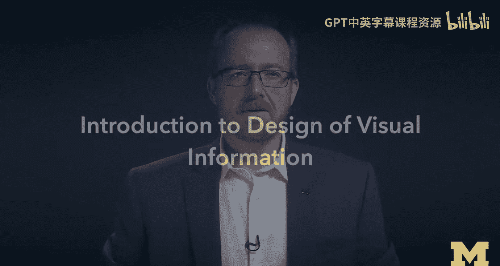

# 密歇根大学《公共部门的R数据分析（基础、数据探索、决策支持、）｜Data Analytics in the Public Sector with R》中英字幕 p69 25_信息可视化设计导论.zh_en -BV1YZ421J7Fx_p69-

This week of the course is a bit different from the previous three in a couple of ways。 First。

 you're going to meet a different Chris Brooks， one who's seven years younger。

 clean shaven and maybe carries a few extra for pounds。 You see， back in 2015。

 I had my first teaching opportunity here at Michigan And I got together with a group of my colleagues and launched a specialization on the course platform called App data science with Python。

 In that five course series， we introduced data manipulation。

 data visualization and machine learning and network analysis techniques using the Python programming language。

 One of my courses in that specialization was a lot like this one and focused on data visualization。

 In that course， I gave a series of lectures on information theory。 and it's still as applicable。

 now， as it was then。 So we brought these lectures into this course as a bonus。😊。

But there's actually a different connection to this course。

 You see one of the most prominent figures in information visualization theory。

 Edward Tuftty actually began his work on the topic back in the mid-70s at Yale。

 where he was a Political Scist。 In fact， one of his first books was titled Data Ana for Polics and Policy。

 which seems eerily similar to the topic of this specialization。Now。

 while that book is focused mostly on causation and regression modeling。

 he does use many of the same techniques we've covered in this course When he moved to Princeton。

 he began to seriously focus on issues related to explanation and exploration of data visually。

 and his most seminal work here， the visual display of quantitative information is still required reading in most human computer interaction degree programs。

Its from this book that I want to introduce you to three visual design patterns， the data ink ratio。

 chart junk， and the live Factor。Now， your role might include a lot of storytelling to display not only truthful and accurate visuals。

 but to convey them to a broad audience。Alberto Cairo， author of the book， The Truthful Art。

 is a journalist and designer， and has more tools for us to consider when designing visuals。

 especially for broad audiences。 His portfolio of projects is broad and compelling。

 He is advised governments and companies on the topic of information visualization designs。

I'm going to spend some time discussing some of the concepts he speaks about in his book and the tools he uses to help organizations think about their visual designs。

I hope you enjoy these lectures and I'm looking forward to showing you more ways to analyze and understand data in the next course。

