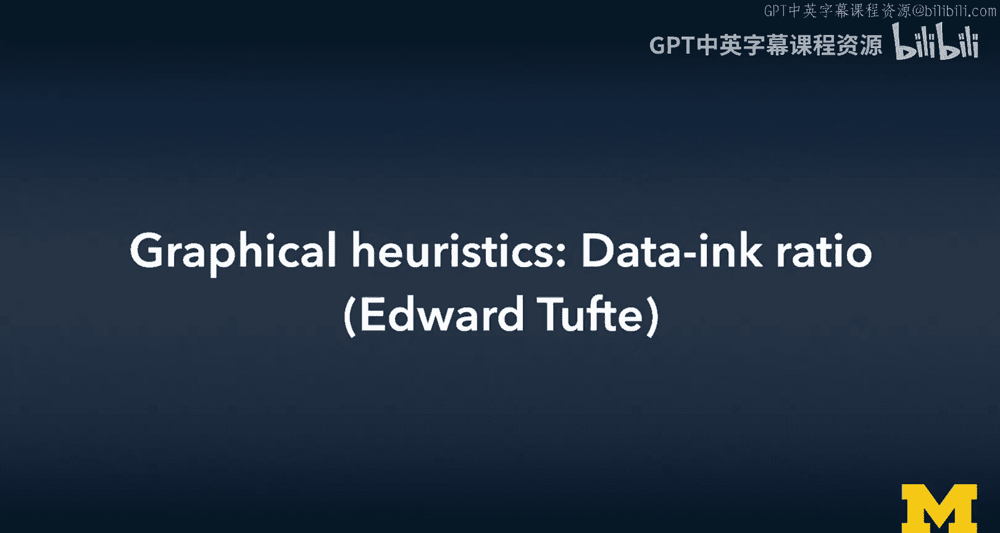
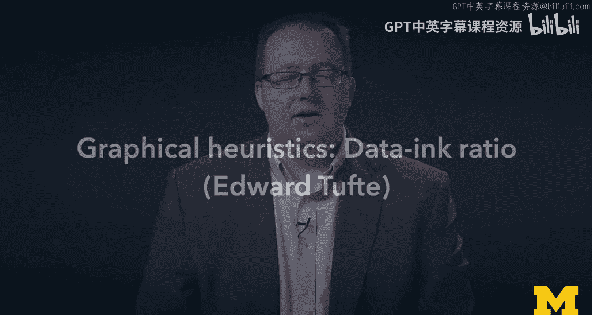
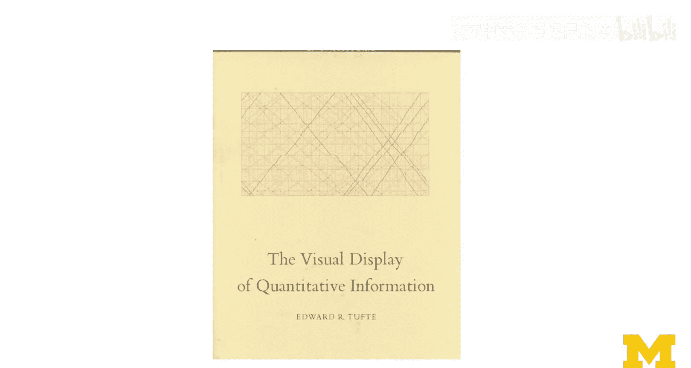
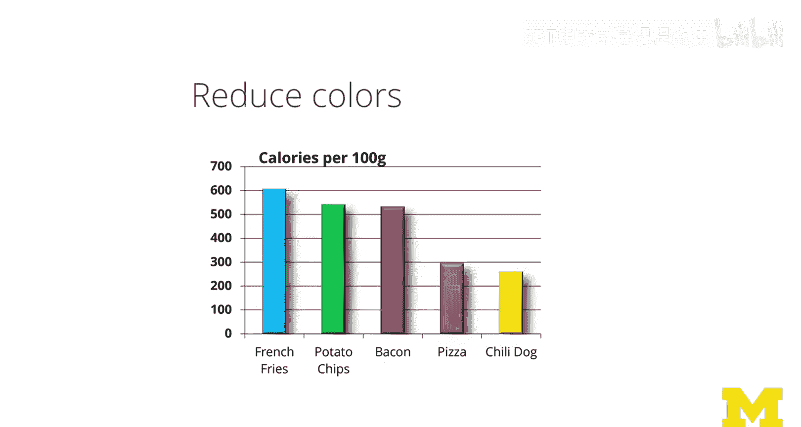
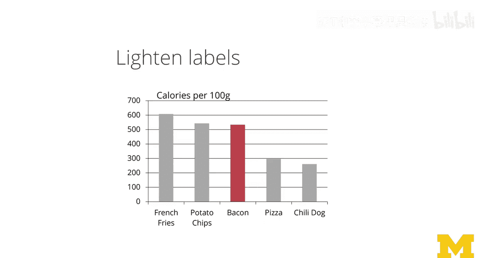
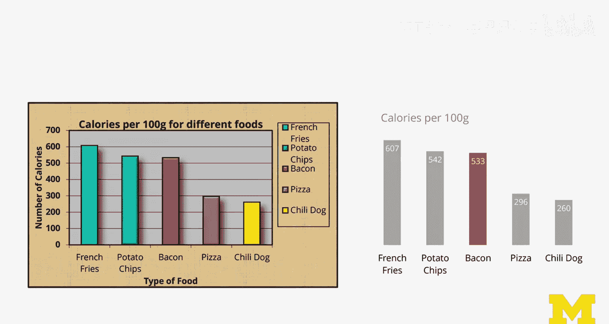

# 密歇根大学《公共部门的R数据分析（基础、数据探索、决策支持、）｜Data Analytics in the Public Sector with R》中英字幕 p70 26_图形启发式：数据墨水比（Edward Tufte理论）.zh_en -BV1YZ421J7Fx_p70-

Edward Tufty is a seminal figure on how to design visual displays of quantitative information。

 In fact， this is the title of my favorite book of his。

 and I highly encourage you to check out his work。

In this book， he introduces two interesting graphical heuristics， the data in ratio and chart junk。

First， what's a heuristic， A Heuristic is a process or rule that is meant to guide you in decision making is。

 by definition， not knowing to be optimal or perfect， but to be practical in nature。

 Heuristics are meant to be followed until you have reason to deviate from them。

 Tufty's first graphical heuristic is data ink ratiot。

 Tufty defines data ink as the non erasable core of a graphic。

 The non redundant ink arranged in response to variation in the numbers represented。In other words。

 the data ink is essential to the sense making process for a given variable。

Tfty defines the data ink ratio as the amount of data ink divided by the total ink required to print the graphic。

Now， I don't think he's actually suggesting we measure the amount of ink laid down on the page。

 but instead of suggesting that we remove those elements which don't add new information to the graphic。

Perhaps one of the best known examples showing data in production was done by Dark coursese Anatics。

 an information visualization and design company in Edmonton， Alberta， Canada。

They've put together four examples of how the data ink ratio can be approved。

 and I'm going to link to those in the next reading assignment。

 but I'm going to walk through the first one of those here。

We start with a table of the data about food items and the number of calories in those items。

 The first step is to remove unwanted background imagery。

 since it provides no value to understanding the chart。

We also remove the gray background behind the bar since it provides no conceptual value。

Then we get rid of the redundancy throughout。 This includes getting rid of the legend since each bar is labeled directly along the aaxes。

The title and the Y axis labels are trimmed since there's plenty of reference throughout the image to this being about calories for food items。

This leaves us with a much smaller image。 There are some heavy lines forming borders。

 which add no value so we can remove them， too。Color is a tricky item to include in charts and graphs。

We will be going into depth on color theory in this course。

 but color is a challenge when trying to engage with persons who might be color vision deficient or color blind。

There are some tactics to work around。 for instance。

 it used to be best practice to replace coloration with patterns。

 sometimes called hatching in graphics。

This brings its own challenges， which we'll see in a bit。Instead。

 the solution is almost always to remove all color。

 except for one which you can use as emphasis and link to that color in your text。

Someone then viewing the chart out of context would still get the sense of emphasis without being overwhelmed by a rainbow of data。

So let's drop colors except for bacon with the presumption that this text is clearly referenced in the data。

3 dimensional bars and drop shadows can go as well， since these don't add extra value。

 we can also drop the bowling throughout。There's still a lot of grid work left in this image。

 and it's a bit unclear what the value of this grid work is， so we're going to drop it。Now。

 grids can be valuable， but they're often just a distraction。For the moment， though， study the image。

 what's the difference in the number of calories between bacon our data point of interest and say。

 potato chips or chili dogs。

Just removing lines doesn't make it easier to read。

But the values of the data are pretty simple here， so let's directly label each bar in the graphic。

Now， how big is the difference between bacon and potato chips or bacon and chili dogs。

Certainly you have to do a bit of math， but you can still get a quick estimate by glancing at the graphic at an exact value through comparing numbers directly。

And there you have it by increasing the data ink ratio。

 we have made the graphic not only simpler and more readable。

 but increase the amount of information the viewer sees。

I encourage you to check out the other examples from Dark coursese Anatic linked in the next reading。

 as they've done this cleanup for a variety of different visuals， including maps。

We'll continue our exploration of Tuftti's heuristics by looking at chart junk in the next lecture。

