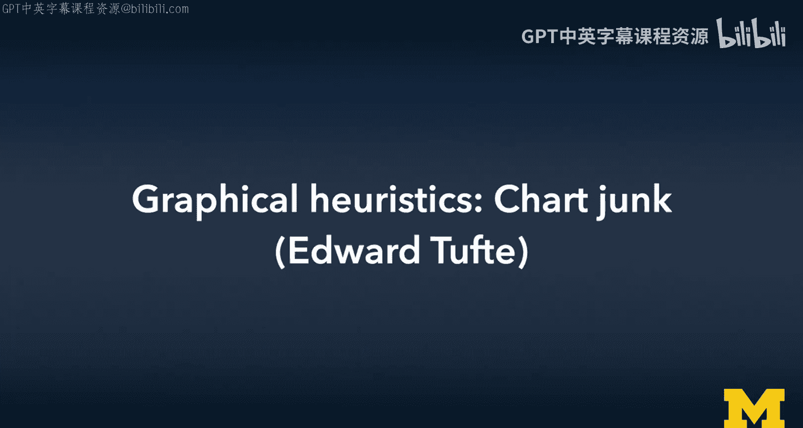
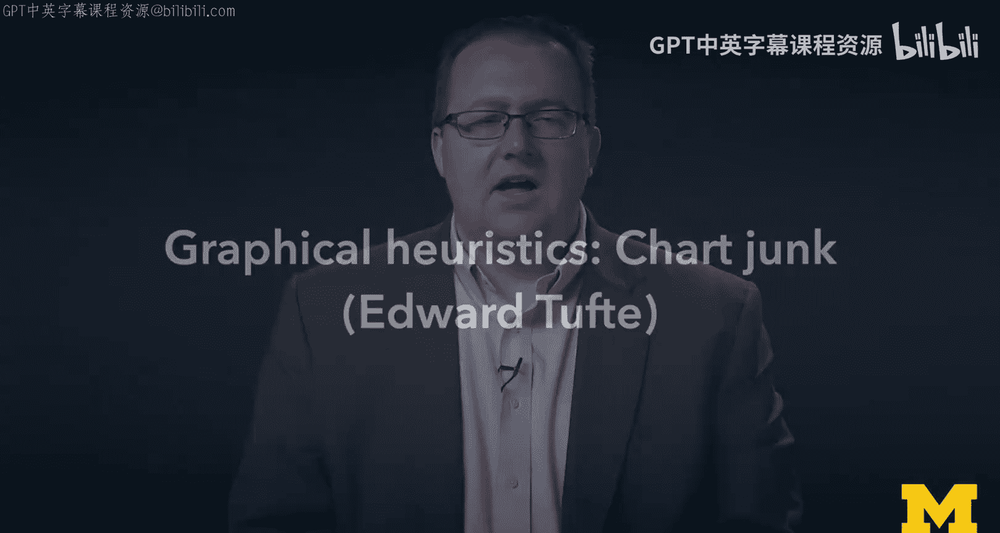
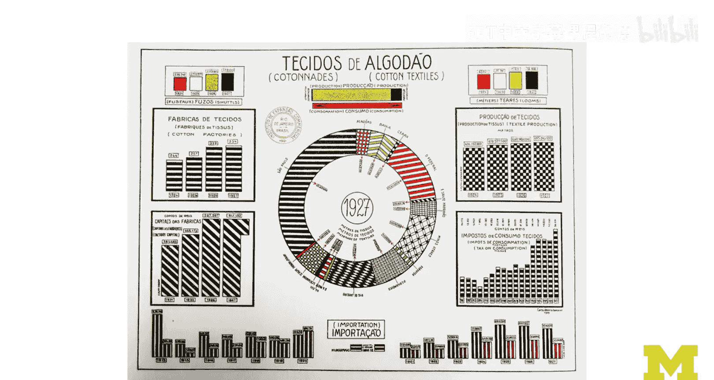
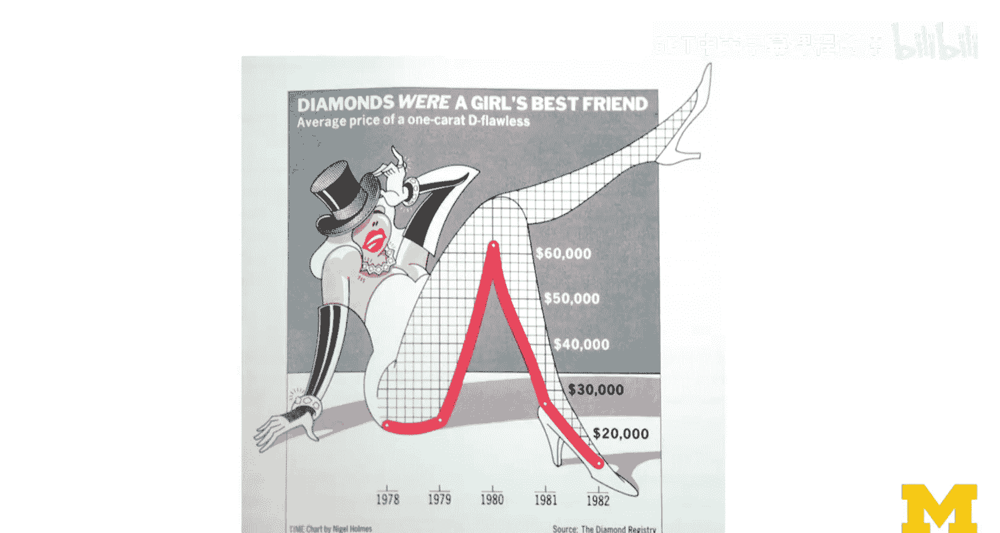

# 密歇根大学《公共部门的R数据分析（基础、数据探索、决策支持、）｜Data Analytics in the Public Sector with R》中英字幕 p71 27_图形启发式：冗余图表元素（Edward Tufte理论）.zh_en -BV1YZ421J7Fx_p71-

Another heuristic， which Edward Tufty introduces us to is called chart junk。 Now。

 Tufty is much more damning of chart junk than he is of other forms of non data ink。 Indeed。

 he suggests that artistic decorations on statistical graphs are like weeds in our data graphics。

He suggests that there's really three kinds of chart junk。 The first is unintended optical art。

 For instance， excessive shading or patterning of chart features。

 such as shown in this economics graphic， which Tuftty shares in his book。

 the visual display of quantitative information。

Here， the patterns make the human eye jump and cause visual fatigue。

 These phenomena are called moray patterns， and it the same reason you don't usually see people wearing striped shirts when filming video content like this M mooc。

 Since the low resolution of the video accentuates the mo issue。

Tftti suggests that instead of patterning this content。

 one is better off labeling the chart graphics directly。

 and we saw that being used in the data and Gra example by Dark Hurse Analytics。

The second form of chart junk is the grid。 Tufty suggests that the grid is both unnecessary as data ink。

 but also causes competition with the actual data being shared。 thininning。

 removing or desaturating grid lines makes it easier to see the data Instead of being overwhelmed by the number of lines on the page。

 Direct labeling of data is another great way to reduce this form of chart junk。

But it's the third form of chart junk that I want to focus on here。

 It's the one which typically comes to mind when talking about chart junk。 Tufty calls this the doc。

Broadly， he's referring to nond creative graphics， whether they be line art photographs and their inclusion in the chart。

Newspapers and newspaper magazines are a place where this kind of imagery is often used。

 One well known graphic artists， Nigel Holmes， has used the duck to display data in a way which is memorable。

 yet aesthetically interesting。

One of the most memorable images he's created to me is entitled Diamonds We a Girl's best friend。

 And this showed up in a Times magazine in 1982。😊，This graphic shows the trend of the price of diamonds from 1978 to 1982。

 And while the dollar amounts are easily forgotten。

 it's easy to remember that the trend had a spike because of the shape of the woman's leg。

So is the duck really a useful heuristic or is it something about ducks which are memorable。

I was part of a team led by Scott Bateman who wanted to understand this issue in more detail。

 so we set up some user testing。I've linked the full academic paper in this week's readings。

 In short， we' provided participants a variety of homesmes's image。

 including the one which you were showing， which could be could be considered chart junk。

We also included a variety of playing graphs with high data ins with no decorative embellishments。

We brought 24 subjects into the laboratory and assigned them to either view the homes or high data ink ratio conditions。

We asked the subjects to describe and summarize the charts with a series of guided questions。

This was followed with a recall test， both conducted immediately。

 as well as a second test 2 to three weeks later。 Finally。

 we used eye tracking to determine where subjects were paying attention when they looked at these charts。

Our findings were interesting while there was no recall difference when tested immediately。

 recall after2 to three weeks was significantly better for the Holmes charts。

 which showed the duck chart junk。😊，Further subjects indicated subjectively that the Holme charts were more enjoyable。

 more attractive， easier to remember and easier to remember details of。

 And they felt it was faster to describe and remember the Holmes charts。

 The non embellished designs didn't perform better than any of the Holmes designs did。😊。

Does this mean that you should use embellishments in your charts， Well。

 maybe I don't know of anyone who's replicated our findings on a larger and more diverse population。

 And there are certainly other kinds of chart junk， like the unintended optical art and the grid。

 which seem like really good heuristics。 But I think there's more to be told in this story and more nuance to be worked out。

At this point， you should have at least some thoughts from designers。

 as well as from a user study on specific kinds of charts。

 and as you go about creating your data science graphics。

 it's worth not only reflecting on the principles you use and the results you are sharing。

 but also the process by which you came up to create the graphics。

Setting up a users study is much simpler today with crowdsourcing services such as Crowdflower and Amazon Mechanical Turk。

It's now very reasonable for the average data scientist to test out whether more embellished visuals might be more effective。

 whether it's in terms of time， memorability， accuracy， than those with data ink。In the next lecture。

 we're going to go on to touch on two more items from TaFti， the life Factor and spark lines。

