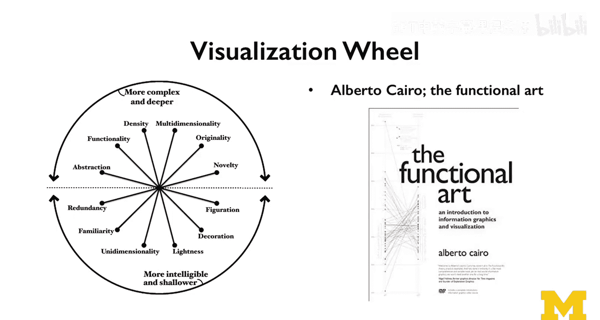
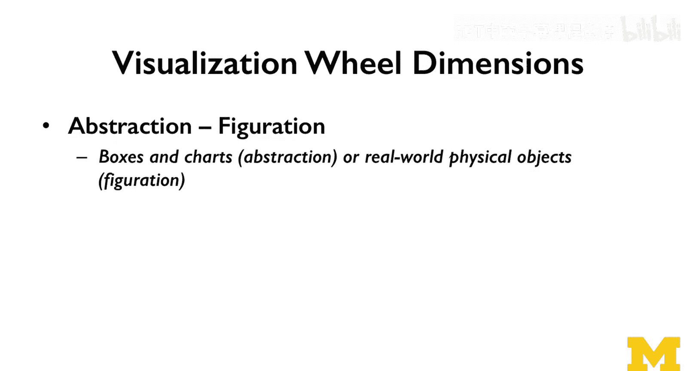
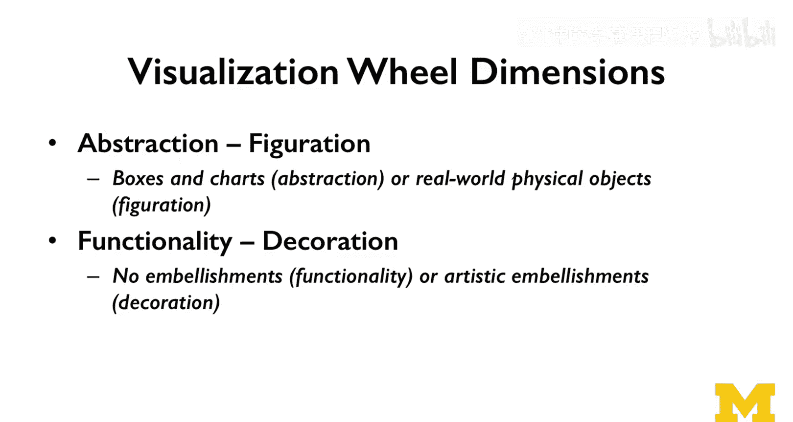
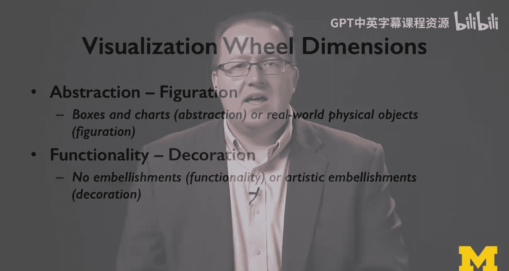
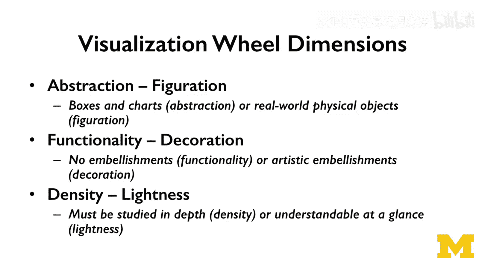
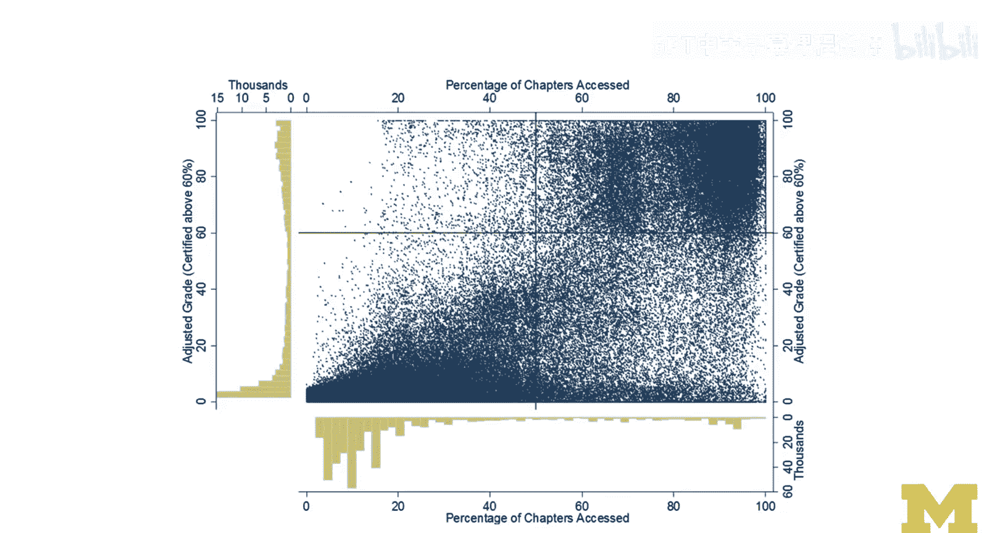
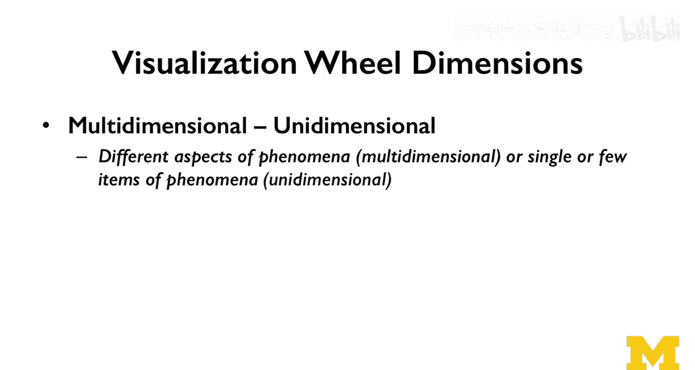
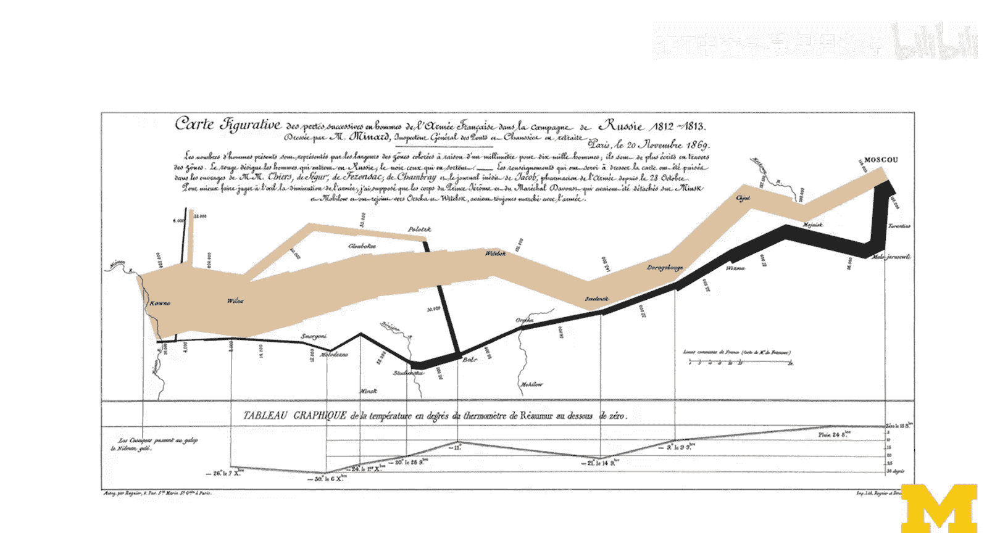
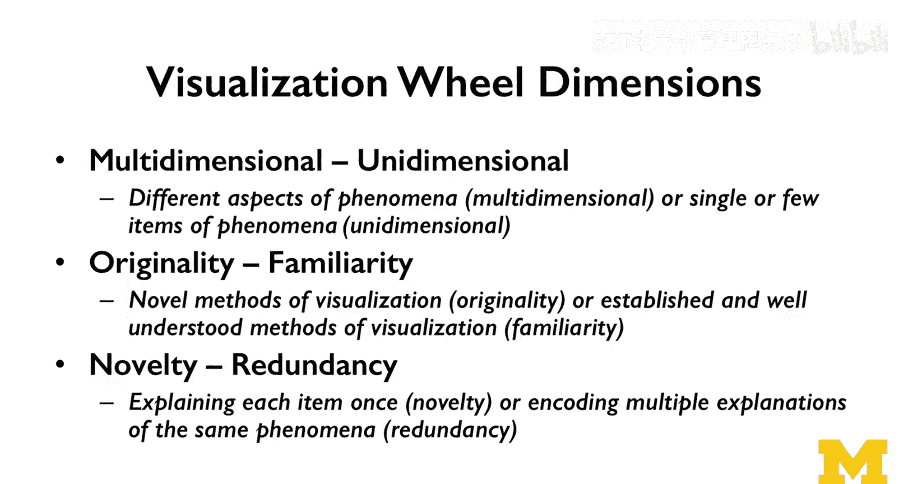

# 密歇根大学《公共部门的R数据分析（基础、数据探索、决策支持、）｜Data Analytics in the Public Sector with R》中英字幕 p74 30_设计思维工具集.zh_en -BV1YZ421J7Fx_p74-

In his book， The Funal Art， Alberto Cairo provides a tool for thinking about design trade offs when building information graphics。

 and he calls this tool the visualization wheelheel。

In this conceptualization， there are two poles of a circle。

 The top one represents highly complex data， which informs at a deep level。

 While the bottom provides easier access to data， but only informs in a shallow manner In the circle are dimensions。

 which describe trade offs between two approaches。 While Cairo provides a number of interesting dimensions。

 It's important to note that this is a tool for designers to think about their visualizations and not so much an analytics tool itself。

Your needs for any particular problem might change which of these dimensions are important or might introduce new dimensions which you should be thinking about。

Cairro actually suggests our role in an organization or a professional background might also influence the kinds of graphics we want to make。

 So I'd like to ask you as someone who is studying data science。

 who are you trying to reach through your visualizations。

Let's dig in and look at a few of the trade offs that Cairo considers。

The first is abstraction and figuration。 A highly figurative visual describes the phenomena using physical representations of the phenomena。

 such as photographs or drawings。 as the representations become less real and more conceptual。

 the emphasis shifts from figuration to abstraction。

The second dimension he discusses is functionality and decoration。

A completely functional graphic has no embellishments and is closer to a direct representation of the data。

 while a heavily decorated graphic has more artistic embellishments。

As it is with all of these dimensions， there isn't to clear better or worse。

 embellishments may increase the amount of time a viewer spends considering the visual。

 exploring its nuances and forming mental associations。

 which may increase familiarity and memorability。

The third dimension is density and lightness as they relate to the amount of information being shown。

 There are lots of great examples of this in scientific visuals。

 where some figures are intended to be studied in depth。

 while others are meant to quickly augment a narrative。

You can see this dimension at play when comparing magazine infographics where the reader is likely to be more heavily engaged in the content。

Two advertisements in the same magazine， where readers are likely to only quickly consider an ad。

Here's an example from my field of study， which was published by Harvard and MIT describing the patterns of access of users in theedX massivesive open Online course platform。

Take a moment to study this image。 What sense can you make of this image。

If we consider Cairo's third dimension， it would be tough not to say that this is a fairly dense graphic。

 The main portion of the graphic。 a scatter plot has two axes， which are labeled。

 as do each of the two subplots to the left and the bottom， which are histograms。

The ax for the histograms can be a bit confusing as they bleed into the scatter plot ax。

 but change the unit of measure and the direction of the measurement。For instance。

 in the Xaxes at the top of the scatter plot， percentage of chapters accessed is being used as the unit of measure and increases as you move towards the right hand side of the figure。

 Yet this same Xax for the histogram to the left of the graph is in thousands of persons and increases as you move to the left side of the figure。

There' are some red lines overlaid on the graphic， breaking the scatter plot roughly into quadrants。

 But with minimal labeling， it's a little unclear what the quadrants end up representing。

Regardless of whether this is a good figure or not。

 it would certainly be considered an example of a dense figure。

The fourth aspect Cairo mapps is the dimensionality of the graphic。

A multidisal graphic describes a phenomena as a whole and invites the viewer to explore many different aspects of the phenomena。

 A unidial graphic instead focuses on a single or a few items and explores them in one or more ways。

The fifth dimension is originality and familiarity。In the modern world。

 we're used to seeing a plethora of different kinds of information graphics。

 things like bar charts and linegar charts。And thinking in terms of these representations is taught at a very young age。

 For instance， my daughter， whos almost five， came home from preschool the other day with a page that showed a bar chart that she and others had made in class。

To celebrate learning about the American election， the whole class got together and had a vote on what they would have for snack。

 chocolate ice cream or mint chocolate chip ice cream。 Of course， mint chocolate chip ice cream 1。

 as one might expect。 But my point here is that these are basic ways of thinking about data in a graphical form。

 and they're now being taught very early on。 And this makes them familiar to a broad population。😊。

This wasn't always so， though。 it's safe to say that the bar chart is fairly familiar to most people。

 but a graphic with more originalities is elements that need to be explained or studied by the user。

Here's a very famous graphic by Charles Mindar。

It describes Napoleon's march into Russia in 1812。Take a moment to study the graphic。

Broadly speaking， there are five different kinds of information being visualized in this graphic。

 How many of those five pieces do you see。嗯。Here's what I see。 First。

 are elements of geography shown as the various rivers and towns along the way。

The width of the T upper bar represents the size of Napoleon's army。

 and you can see it shrinks from the beginning of the campaign from 422000 to only 100000 once the French reached Moscow。

The lower black bar shows Napoleon's retreat from Russia， and there are various points along it。

 which are mapped to dates and temperatures in Celsius。

 We see the bar thins dramatically as the army shrinks in size。

So the five kinds of data in MinA's visualization include location， direction， temperature。

 army size， and dates。The last dimension， which Cairo shares is the novelty and redundancy dimension。

 Redundancy is the tendency of a graphic to tell the same story in many different ways。 For instance。

 you might use a height of bars in a bar chartret with an axes。

 as well as color to emphasize the largest bar。

This one's a bit tricky。 You don't want to bore your readers or make your graphics overly complex。

 but you do want to encode information in a way which supports their understanding of the phenomena you have described on this dimension。

 novelty is the act of describing each phenomenon in the graphic in only one way。

There are no rights and wrongs in the visualization wheel。

 the purpose of the wheel is to help you understand and compare the visual approaches you might take。

As a reflective activity， Cairo suggests that you can plot your ordered thinking along each of these dimensions and then join those points together to create a radar plot。

Here， Cairo provides two examples of the visualization wheel in action。 On the left hand side。

 you see there is more of an emphasis towards complex visuals， those which are dense。

 multidisional and of high functionality。On the right， you see the visualization wheel。

 there are more elements of decoration， Lightness， and figuration。

Cairo suggests that the left wheel is more indicative of work being done by scientists and engineers。

 While the right wheel is more indicative of work being done by artists。

 graphic designers and journalists。This tension between how scientists and engineers might view the visualization of data and how artists and journalists might is an interesting one and willll revisit it at the end of next week。

In the next lecture， we'll go a bit deeper and consider some heuristics for Edward Tufty as to what makes a good visualization。

The visualization wheel is one tool which we have in order to better compare two different ways of visualizing information in the next lecture。

 we'll dig in a bit and see how you might use the visualization wheel to evaluate your own graphics。

