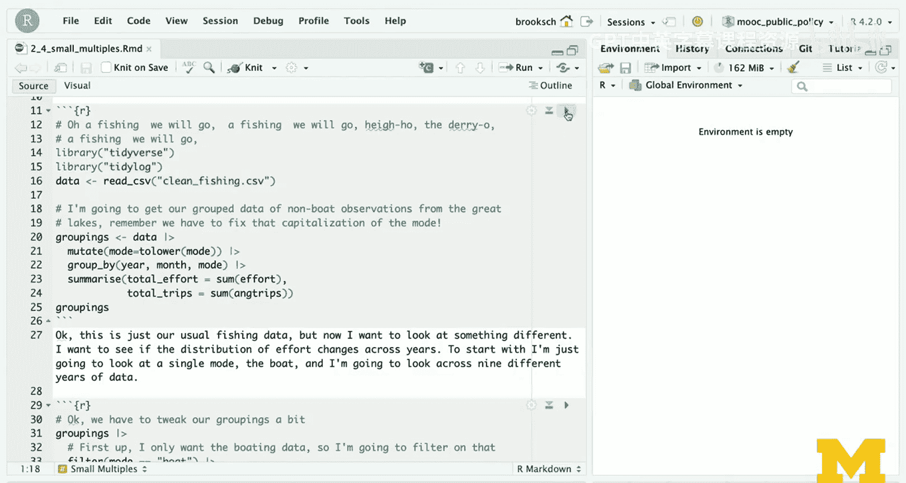
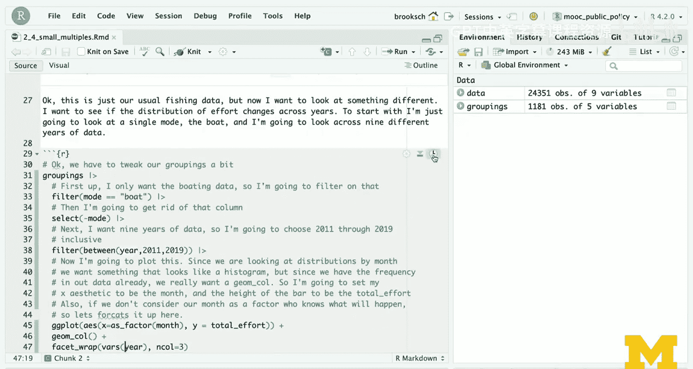
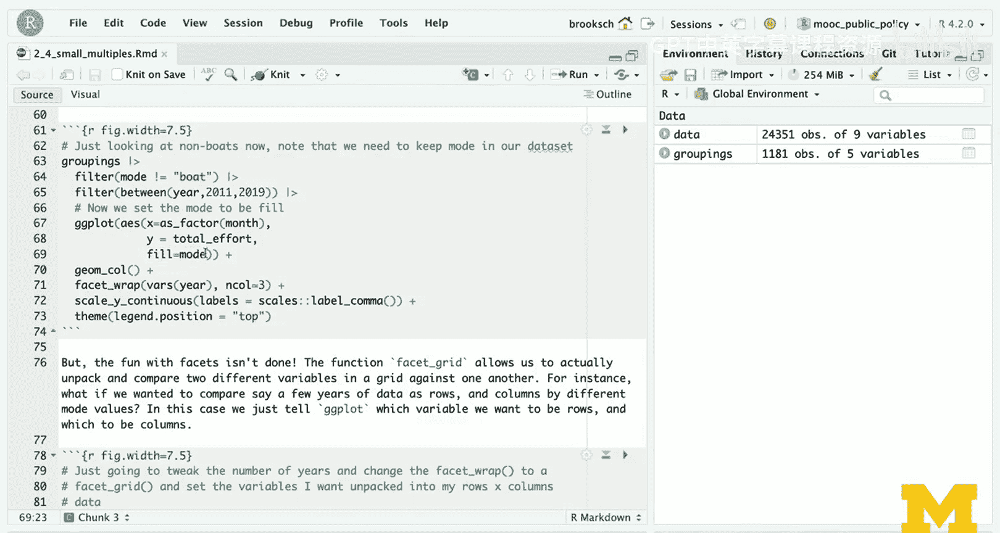
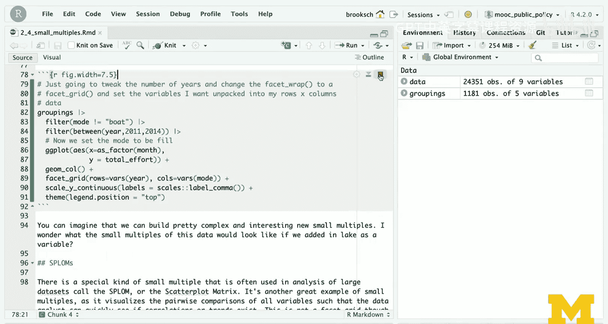

# 密歇根大学《公共部门的R数据分析（基础、数据探索、决策支持、）｜Data Analytics in the Public Sector with R》中英字幕 p75 31_小型多图展示技术.zh_en -BV1YZ421J7Fx_p75-

One of the techniques， which Edward Tufty introduces in his book。

 The visualual Display of Qua information， which is actually my personal favorite of all of his writings。

 is called small multiples。 Tufty describes them as resembling the frames of a movie。

 A series of graphics showing the same combination of variables indexed by changes in other variables。

I think there's been a little bit of liberty taken with this concept。

 but the core contribution we get with small multiples is that they allow us to see high density graphics at a glance and identify trends of interest from this。

 On top of this， G G plot has a special way of showing small multiples rooted in this layered grammar of graphics。

From our very first lecture in this course， we know that there's five core grammatical concepts which are internal to each layer in GG plot。

 our data， our aesthetic mappings， our geometries， our statistics， and position adjustments。

In addition to these core concepts， there's actually three grammatical elements which work across the layers。

 scales， coordinates， and facets。We've seen how scales can be used to change labels on axes and how coordinates can be used to flip axes。

 There's actually a lot more to coordinates， for instance。

 changing from Cartesian coordinates to polar coordinates。

 but this is relatively uncommon and I'm not going to cover it in this course， however。

 I do want to introduce you to the last of these grammatical elements facets。

A facet is a slicing of your data into subsets based on some variable or variables。

 then plotting each subset independently in a grid。

 This is precisely what Tuftti was describing for small multiples。 So let's take a look。

Okay， I'm going to bring in the fishing data and I'm going to get our group data for non boat observations。

 remember the boats were always a lot， so we're just going to look at the other ones and I'm going to fix that capitalization of the mode。

Okay this is just our usual phish data， but now I want to look at something different。

 I want to see if the distribution of effort changes across years to start with I'm just going to look at a single mode。

 the boat， and I'm going to look across nine different years of data。

Alright， we got to tweak our groupings a bit。 First up。

 I only want to check this boat data out because it's so different。

 so I'm going to filter on that and then I'm going to drop the mode。 Next， I want nine years of data。

 So there's different ways to do this I like using between。 and remember this is inclusive。

 so I'm going to take 2011 through 2019。Now I'm going to plot this Since we're looking at distributions by month。

 we want something that looks a bit like a histogram。

 but since we have frequency in our data already， it's actually a jo calllo。

 So I'm going to set my ex aestheticthetic to be the month and the height of the bar to be the total effort。

 Also， if we don't consider our month as a factor Who knows what's going to happen。

 So let's forecast cats it up here。 So I'm going to add that factor for the month here so that it's in order。

Now to create small multiples， we're going to use the facet wrap function。

 So we just add this directly into our GG plot。 the first parameters are the facets。

 which are the variables that we're actually interested in， and we wrap these in vrs。

 The vase function is a lot like the AES function that we use to wrap aesthetics。 In this case。

 I'm going to facet by year。So let's run this。

Okay， this is a great example of small multiples。 Each of the multiples shares a labels。

 but is labeled by our facet the year。 We could see how the boating distribution peaked higher in 2011 and by 2019 has fallen quite a bit。

😊，Now， it might be tempting to think about that this looks a lot like our work with a cow plot。

 but it's actually quite different With plot grid， we're plotting multiple Ggi plot objects together。

 but they do not share a base layer。 They are different plots from the perspective of the layer grammar of graphics here。

 though， everything shares the same set of layers。 The facet wrap is just choosing one more way to segment by a variable data。

 This is a single plot。😊，We can of course add in additional variables such as setting the base plot fill color。

So here I'm just going to look at nonboats data now and so I've got to keep that mode in our data set。

 but I'm going to set the fill to the mode， so I want the color of each plot to be the mode。

 the different ways that it's used and then I'll facet wrap things just like before。

But the fun with facets isn't done yet。 the function facet grid allows us to actually unpack and compare two different variables in a grid against one another。

For instance， what if we wanted to compare， say a few years data as rows and columns by different mode values。

 we could actually do this by just telling GG plot which variable we want to be rows and which one we want to be columns。

So I'm just going to tweak the number of years and change the facet rat to a facet grid。

 so I'm reducing the number of years because they're just going to be one of the directions。

 they're going to be the rows in our facet grid， and so then I've changed the facet rat to a grid。

And I've wrapped the years as variables， and then the columns I've wrapped mode。

You can imagine that we can build pretty complex and interesting new small multiples。

 I wonder what small multiples of this data would look like if we added in lake as another variable。

